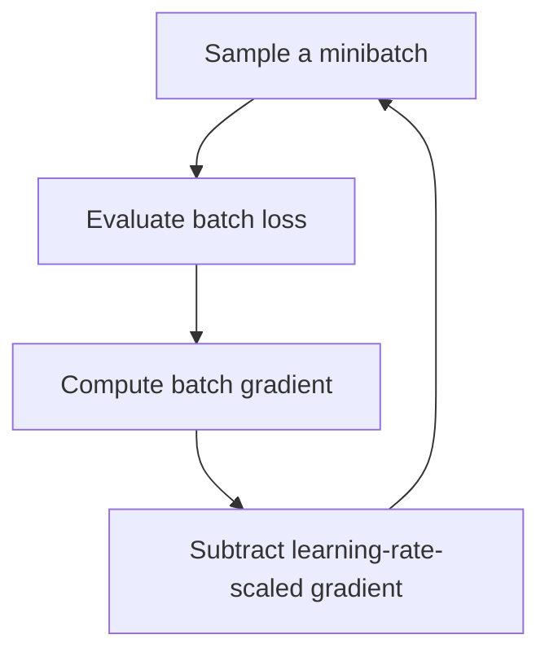

**Stochastic gradient descent (SGD)** updates model parameters using a gradient estimated from one randomly selected example or, in common practice, a small randomly sampled minibatch. It replaces a full-dataset gradient on every update with cheaper, noisier estimates from sampled batches. The sampling makes the update stochastic; the downhill movement comes from subtracting the estimated gradient.

## One update has three ingredients

For parameters $w$, learning rate $\eta$, and minibatch $B$, the basic update is $w_{t+1}=w_t-\eta\nabla_w L_B(w_t)$. Here $L_B$ is the average loss over that minibatch. The learning rate controls step size, while batch selection changes the gradient estimate from step to step.

Uniform sampling from a fixed dataset makes this minibatch gradient an unbiased estimate of its average-loss gradient at the current parameters. A noisy step can raise the full-dataset loss, and the minibatch loss can rise if the step size is too large. Random reshuffling without replacement is common too; conditional unbiasedness at every step differs from independent uniform sampling.

Plain SGD doesn't require first- and second-moment buffers. Momentum adds a running velocity, and adaptive optimizers such as Adam keep additional state. Those changes alter both update behavior and memory cost.

## Example

Assume a single model weight starts at `2.0`, the current minibatch produces a gradient of `0.6`, and the learning rate is `0.1`. One SGD step changes the weight to `2.0 - 0.1 × 0.6 = 1.94`. A different minibatch may produce a gradient of `0.2`, leading instead to `1.98` from the same starting weight.

Each minibatch result estimates the full-dataset gradient. Across representative batches, the updates approximate the broader objective while allowing training to begin before reading every example. Oversized learning rates can overshoot, and biased sampling can systematically push the model toward the wrong objective.

## Why it matters here

Training-loop, optimization, distributed-training, and privacy lessons all build on the sample-loss-gradient-update sequence. Understanding plain SGD makes optimizer state, momentum, Adam, gradient accumulation, and differentially private SGD easier to compare without confusing their distinct memory and privacy contracts.

## Related terms

- [Gradient](glossary://gradient)
- [Learning rate](glossary://learning-rate)
- [Optimizer](glossary://optimizer)
- [Adam optimizer](glossary://adam-optimizer)
- [DP-SGD](glossary://dp-sgd)
