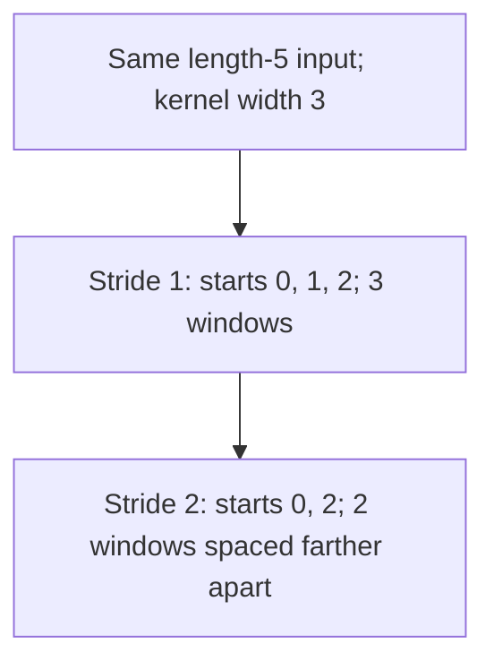

**Stride** is the step size a sliding window moves between successive applications of a [convolution kernel](glossary://convolution-kernel), pooling operator, or other local window. With stride $s=1$ the window shifts by one cell at a time and samples the input densely. With $s=2$ it jumps two cells, so neighboring output positions look at neighborhoods whose origins are two pixels (or time steps) apart. That single integer is the main knob that trades spatial (or temporal) resolution for compute and memory.

This entry covers *operator step size*. Array *memory strides* are byte offsets between neighbors in a NumPy / tensor buffer.

## Intuition

Kernel size $k$ defines the window width; stride defines its start positions. Fix $k=3$ on a long unpadded 1D sequence. Stride 1 evaluates a response at every legal start index $0,1,2,\ldots$. Stride 2 evaluates starts at $0,2,4,\ldots$. Each window still spans three cells, while stride 2 produces about half as many outputs. Here the centers are $1,3,5,\ldots$, so the even centers are skipped; padding can shift that alignment.

In 2D the same idea applies independently to height and width. Frameworks often take a single integer $s$ and use $(s,s)$, or a pair $(s_h, s_w)$. Larger stride downsamples the [feature map](glossary://feature-map): roughly divide each spatial axis by $s$ when sizes divide cleanly. That is why $2\times2$ [max pooling](glossary://max-pooling) with stride 2 is the classic "halve $H$ and $W$" layer, and why a ViT patch embedding uses `kernel_size=P, stride=P` to carve non-overlapping patches.

## Formula

**CS231n / valid-fit form** (one spatial axis; zero [padding](glossary://padding) $P$ on each side, filter size $F$, stride $S$, input length $W$):

$$
W_{\mathrm{out}} = \frac{W - F + 2P}{S} + 1
$$

When $(W - F + 2P)$ is not divisible by $S$, the quotient is fractional and windows do not tile the axis symmetrically. Teaching notes often call that setting invalid; production libraries usually still run and take a floor (see below).

**PyTorch `Conv2d` / `MaxPool2d` (floor mode)** including dilation $d$ (spacing between kernel taps; $d=1$ is dense):

$$
H_{\mathrm{out}} = \left\lfloor
\frac{H_{\mathrm{in}} + 2p - d(k_h - 1) - 1}{s}
\right\rfloor + 1
$$

and the same form for $W_{\mathrm{out}}$. For $d=1$ this matches the usual

$$
H_{\mathrm{out}} = \left\lfloor \frac{H_{\mathrm{in}} + 2p - k_h}{s} \right\rfloor + 1.
$$

**Dive into Deep Learning** writes the equivalent (with $p_{\mathrm{h}}$ = *total* padding rows on both sides):

$$
\left\lfloor \frac{n_{\mathrm{h}} - k_{\mathrm{h}} + p_{\mathrm{h}} + s_{\mathrm{h}}}{s_{\mathrm{h}}} \right\rfloor.
$$

The clean ratio $H_{\mathrm{out}} = H_{\mathrm{in}} / s$ requires compatible padding and effective kernel size. For example, it holds for divisible inputs with non-overlapping $k=s$ windows, $d=1$, and $p=0$. A divisible input can produce a different count when those conditions change: $H_{\mathrm{in}}=8$, $k=4$, $s=2$, $p=0$ gives $3$ outputs.

Cumulative downsampling after a stack of strides $s_1, s_2, \ldots, s_L$ (when each stage divides evenly) is the product

$$
S_{\mathrm{total}} = \prod_{\ell=1}^{L} s_{\ell}.
$$

A VGG-style tower with five stride-2 pools maps $224 \to 7$ because $224 / 2^5 = 7$. That total stride is also the pixel step between adjacent deep feature cells when you project back to image coordinates.

## Example

**1D hand count (CS231n-style).** Input length $W=5$, filter $F=3$, padding $P=0$:

| Stride $S$ | $W_{\mathrm{out}} = (5-3)/S + 1$ | Window start indices |
|------------|----------------------------------|----------------------|
| 1 | $3$ | $0,1,2$ |
| 2 | $2$ | $0,2$ |

With $P=1$ (one zero on each side, effective length $7$):

| Stride $S$ | $W_{\mathrm{out}}$ |
|------------|-------------------|
| 1 | $5$ (same as input) |
| 2 | $3$ |

**2D conv, no padding.** A $3\times3$ kernel on an $8\times8$ map:

- Stride $1$: $H_{\mathrm{out}} = \lfloor (8-3)/1 \rfloor + 1 = 6$
- Stride $2$: $H_{\mathrm{out}} = \lfloor (8-3)/2 \rfloor + 1 = 3$

Spatial cells drop from $36$ to $9$ (a $4\times$ reduction in area), so FLOPs and activation memory for later layers fall with the map, not with a change in parameter count of this layer (weights still have shape $(C_{\mathrm{out}}, C_{\mathrm{in}}, 3, 3)$).

**ViT patch embed.** For a $224\times224$ RGB image and patch size $P=16$:

```python
# Non-overlapping patches: kernel and stride both equal P
proj = nn.Conv2d(3, d_model, kernel_size=16, stride=16)
# Input  (B, 3, 224, 224) -> (B, d_model, 14, 14)
# then flatten spatial axes to 196 tokens
```

Because $s = k = 16$, each output location sees exactly one non-overlapping $16\times16\times3$ block and maps it to one embedding vector. That is the same linear projection as "cut into patches then matmul," implemented as one strided convolution. Overlapping patch embeddings (some hierarchical ViTs) keep $k > s$ so neighboring tokens share pixels.

**Language-model sliding window.** When scoring a long corpus under a fixed context length $k$, a *stride* $s$ is how far the window advances between forward passes. Hugging Face's usual long-document PPL setup scores only the newly covered tokens each step while conditioning on up to $k-1$ predecessors. $s=k$ means non-overlapping chunks (cheap, starved left context for early tokens in each chunk); $s < k$ means overlap (better context, more compute). Document $k$ and $s$ next to any perplexity number.

## Worked numbers

Stack three stages that each apply stride $2$ with even spatial sizes:

$$
224 \xrightarrow{s=2} 112 \xrightarrow{s=2} 56 \xrightarrow{s=2} 28
$$

Total stride $S_{\mathrm{total}} = 8$. A cell at deep map coordinate $(i,j)$ corresponds to an image region whose top-left origin is near $(8i, 8j)$ (exact mapping also depends on kernel sizes and padding). If a detection head or segmentation decoder assumes total stride $16$ while the backbone actually multiplies to $32$, boxes and masks land on the wrong scale: a classic multi-scale alignment bug.

Tiny floor case from the formula with $d=1$: $L=5$, $k=3$, $p=0$, $s=2$:

$$
L_{\mathrm{out}} = \left\lfloor \frac{5-3}{2} \right\rfloor + 1 = 2.
$$

## Diagram



Each "win@t" is one application of the same kernel starting at index $t$. Stride only changes which starts are visited, not the kernel weights.

## How it works in stacks

Common design pattern (CS231n layer-sizing notes):

1. **Stride-1 convolutions** with "same" padding keep $H,W$ fixed while mixing channels and growing the [receptive field](glossary://receptive-field) slowly.
2. **Occasional stride-2** (strided conv or $2\times2$ pool) halves resolution and roughly quarters spatial activation count.
3. Deep cells then see a larger fraction of the original input per parameter step because each stride multiplies how fast the field grows in input coordinates.

All-convolutional nets replace pooling with strided convolutions for the same downsampling job. Stem layers (AlexNet's first conv used $F=11$, $S=4$ on ImageNet-scale inputs) use large early stride when the raw grid is huge and early full-resolution maps would blow memory.

## Trade-offs

| Choice | Gain | Cost |
|--------|------|------|
| $s=1$ | Dense features, fine localization | Memory and FLOPs scale with $H \times W$ |
| $s=2$ (or more) | Cheap maps, larger effective field per cell | Lost high-frequency detail; aliasing if you never low-pass |
| $s=k$ (non-overlap) | Clean patch / pool tiles | No shared context between adjacent windows |
| $s < k$ (overlap) | Smoother coverage, less boundary artifact | More outputs and compute |

Production failures usually come from *shape contracts*:

- Encoder total stride disagrees with decoder / FPN / detection stride metadata.
- Odd input sizes after a crop or resize produce off-by-one $H_{\mathrm{out}}$ vs a sibling branch (floor vs assumed exact divide).
- Export (ONNX / TensorRT) with different padding modes changes the floor formula edge cases.
- For PPL or long-context eval, reporting a number without the window stride makes the metric non-comparable.

**Debug path.** When two tensors "should" match spatially, print at each layer: $H_{\mathrm{in}}, k, p, d, s$, then the expected $H_{\mathrm{out}}$ from the floor formula. Mismatches usually come from padding, stride, dilation, or `ceil_mode` on pooling; inspect those settings before investigating framework behavior.

## Why it matters here

Vision towers inside [vision-language models](glossary://vision-language-model), spectrogram encoders, and hierarchical tokenizers all use stride to buy speed at the price of resolution. LLM engineers hit the same integer when wiring CLIP/SigLIP-style towers, patchifying images for multimodal chat, aligning dense prediction heads, or documenting strided evaluation windows for long-document perplexity. Understanding stride turns "shape error at layer 3" into a one-line calculation instead of a day of guessing.

## Related terms

- [Convolution kernel](glossary://convolution-kernel)
- [Padding](glossary://padding)
- [Receptive field](glossary://receptive-field)
- [Max pooling](glossary://max-pooling)
- [Feature map](glossary://feature-map)
