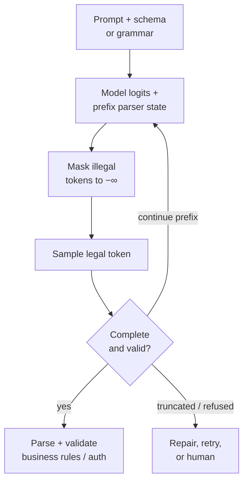

**Structured output** is model generation forced into a machine-checkable shape: a [JSON Schema](glossary://json-schema) object, a typed record, tool-call arguments, a closed enum, or any language a grammar can describe. Downstream code must be able to [parse](glossary://parsing) and validate the completion without guessing keys, types, or wrappers. The contract guarantees a **syntactic** (and often schema-level) shape; verify truth, authorization, and business correctness separately.

## Intuition

Free-form text is for humans. Software needs fields. If a release service expects `{"action": "deploy_canary", "release_id": "r17", "canary_percent": 5}`, a polite essay, a Markdown fence, a missing key, or `"five"` as a string is a production failure even when the model "understood" the request.

Structured output moves the contract left into generation (or into a hard post-parse gate):

| Layer | Question | What remains to check |
|---|---|---|
| **Surface form** | Is this valid JSON / SQL / enum? | Is the action correct? |
| **Schema** | Required keys, types, enums, nesting? | Does `release_id` exist? |
| **Policy** | Is this user allowed this action? | Model honesty |

Prompt-only "return JSON" is a request. Constrained decoding is enforcement: illegal next tokens never enter the sample.

## How it works

Generation is still autoregressive: at step $t$ the model scores the vocabulary with [logits](glossary://logits) $z \in \mathbb{R}^{|V|}$, then samples a token. Unconstrained decoding may emit any token. Structured decoding restricts the **support** of the next-token distribution to tokens that keep the partial string inside a legal language.

### Enforcement spectrum

Weakest to strongest (common product names map onto these tiers):

1. **Prompt formatting.** "Reply with JSON only." Cheap. Breaks on preambles, fences, single quotes, and schema drift.
2. **JSON mode / valid-JSON mode.** Forces a valid JSON surface (often a single object; root type is provider-specific; for example OpenAI `json_object` is object-oriented and does not support every root type). Add a schema constraint when the application requires specific fields and values.
3. **Schema / Structured Outputs APIs.** You supply a JSON Schema (often via a [Pydantic](glossary://pydantic) or Zod model). Hosted APIs may enable a strict schema path (OpenAI names this `strict: true`; other hosts use different flag names) so required fields, types, and enums match. OpenAI exposes this through Responses `text.format`, Chat Completions `response_format`, and strict [tool calling](glossary://tool-calling).
4. **Grammar-guided / constrained decoding.** Compile the schema or an EBNF grammar into a recognizer (FSM for regular constraints; CFG / pushdown for nested or recursive structure). After each token, compute the legal next-token set and mask the rest. Open-source stacks include Outlines, Guidance, XGrammar, llama.cpp grammars, and vLLM structured outputs (`json`, `regex`, `choice`, `grammar`, `structural_tag`).

JSON mode constrains syntax; structured output enforces the specified contract.

### Constrained decoding (token masks)

Let $L$ be the language of strings allowed by the schema or grammar, and let $p_{1:t-1}$ be the tokens already generated. The legal set at step $t$ is

$$
A_t = \{ i \in V \mid \exists\, s \text{ such that } \mathrm{decode}(p_{1:t-1} \circ i \circ s) \in L \}.
$$

Practically, engines compile the schema to a state machine (or CFG recognizer) over the **token** vocabulary, not characters alone. Illegal tokens are masked before softmax:

$$
\tilde{z}_i =
\begin{cases}
z_i & i \in A_t \\
-\infty & i \notin A_t
\end{cases}
\qquad
p_i = \frac{e^{\tilde{z}_i / \tau}}{\sum_{j \in A_t} e^{z_j / \tau}}
\quad (\tau > 0).
$$

Only legal tokens keep finite mass. After sampling $i$, the recognizer advances its state. That is why guarantees are step-local and dynamic: after `{"val`, a bare `{` may be illegal even though it was legal at the start of the object.

**FSM vs CFG.** Regex- and choice-style constraints map well to finite-state machines (efficient, precomputable token indexes). Deeply nested or recursive JSON (for example UI trees with `$ref` to the root) needs a context-free grammar. OpenAI documents converting JSON Schema to a CFG for Structured Outputs; pure FSM engines can struggle on recursive nesting even when they excel on flat objects and enums.

**First-schema latency.** Local engines can pay compilation costs on cold schemas. Hosted behavior depends on the model: current OpenAI documentation identifies an additional first-schema processing delay for fine-tuned models and says other models do not have that limitation. Measure the selected backend.

## Diagram



## Formula (what the mask changes)

Without a mask, temperature-$\tau$ softmax uses the full vocabulary. With a mask $m_i \in \{0,1\}$ ($1$ = legal):

$$
p_i = \frac{m_i\, e^{z_i / \tau}}{\sum_j m_j\, e^{z_j / \tau}}.
$$

Setting $m_i = 0$ is equivalent to $\tilde{z}_i = -\infty$. This is harder than [logit bias](glossary://logit-bias): bias *nudges* a fixed set of IDs; structured decoding *rebuilds* $m$ every step from the grammar and the partial string.

## Example

Action extraction for a release assistant. Define the contract once in Pydantic, export JSON Schema, and require the API (or local engine) to obey it:

```python
from enum import Enum
from pydantic import BaseModel, ConfigDict, Field

class Action(str, Enum):
    run_eval = "run_eval"
    deploy_canary = "deploy_canary"
    escalate = "escalate"

class ReleaseAction(BaseModel):
    model_config = ConfigDict(extra="forbid", strict=True)
    action: Action
    release_id: str = Field(pattern=r"^r[0-9]+$")
    canary_percent: int = Field(ge=0, le=10)
    confidence: float = Field(ge=0, le=1)

# Hosted: Responses text.format / Chat Completions response_format
# with json_schema + strict (provider- and model-specific).
# Self-hosted (vLLM-style): structured_outputs={"json": ReleaseAction.model_json_schema()}
# Always re-validate in process:
action = ReleaseAction.model_validate_json(completion_text)
```

This closed schema includes `additionalProperties: false`, which OpenAI's strict schema path requires. Its `pattern` and numeric bounds require a model supporting those keywords; fine-tuned models currently have additional restrictions. Local validation keeps these rules when a backend cannot enforce them during decoding.

Target completion (no preamble, no fences):

```json
{"action": "deploy_canary", "release_id": "r17", "canary_percent": 5, "confidence": 0.81}
```

Illegal under a strict schema (and blocked by constrained decoding when the grammar encodes these rules):

| Bad output | Why it fails the contract |
|---|---|
| `Sure! {"action": "deploy_canary", ...}` | Preamble breaks JSON parse |
| `{"action": "force_prod", "release_id": "r17", ...}` | `action` not in enum |
| `{"action": "deploy_canary", "release_id": "r17"}` | missing required fields |
| `{"action": "deploy_canary", "canary_percent": 50, ...}` | numeric bound |

Schema-valid output still needs production checks: `release_id: "r17"` may not exist, and `canary_percent: 10` may exceed policy for this principal. Parse, then authorize.

## Trade-offs

| Approach | Strength | Weakness |
|---|---|---|
| Prompt-only JSON | Zero infra | High parse failure rate |
| JSON mode | Valid JSON surface | Wrong keys/types still common |
| Strict schema API | Strong schema match; SDK parse helpers | Subset of JSON Schema; first-request compile cost; truncations and refusals |
| Local constrained decoding | Regex, choice, CFG, offline control | Engine bugs, tokenizer alignment, throughput cost on complex grammars |
| Post-hoc repair / retry | Recovers soft failures | Extra latency; repair can invent fields |

Also watch:

- **Semantic errors inside legal shapes.** Wrong math step, wrong release ID, fabricated citation: the grammar still accepts the string.
- **Truncation.** Hitting an output limit mid-object yields incomplete structure. Check Chat Completions `finish_reason`, or Responses `status` and `incomplete_details`, before parsing a complete result.
- **Refusals / safety.** Providers may return a refusal instead of schema JSON; handle an explicit refusal path.
- **Schema complexity.** Unsupported keywords, huge `oneOf` trees, or recursive types behave differently across engines (JSONSchemaBench-style evals measure empirical compliance vs declared support).
- **Distribution shift.** Masking changes the conditional distribution over *legal* strings; the model may pick a legal but low-quality filling when its preferred token was illegal.

## Debug path

When structured output "worked in the playground" and fails in the service:

1. **Log raw bytes and completion status.** Include the API's finish reason or incomplete details and refusal fields; these look like parse bugs if you only store the happy path.
2. **Re-validate in your process.** Never trust the provider alone: version skew, partial streams, and client bugs exist. Use the same Pydantic / JSON Schema as the request.
3. **Diff schema vs instance.** Missing `required`, open `additionalProperties`, and nullable enums are the usual surprises.
4. **Separate syntax metrics from task metrics.** Track parse success rate and schema-valid rate separately from extraction F1 / decision accuracy.
5. **Tighten the prompt and schema language.** Closed enums beat free strings for routing; split "reason" free text from machine fields so reasoning does not pollute keys.
6. **Check engine limits.** Regex dialect, max schema size, whitespace rules, and parallel tool calls can disable or weaken strict mode.

## Why it matters here

Production LLM systems need output contracts that downstream software can type-check. Structured output connects generation to tool arguments, extraction pipelines, agent plans, eval rows, and router decisions. Constrained decoding raises structural reliability; application validation and policy still own truth and authorization.

## Related terms

- [JSON Schema](glossary://json-schema)
- [Tool calling](glossary://tool-calling)
- [Pydantic](glossary://pydantic)
- [Parsing](glossary://parsing)
- [Logits](glossary://logits)
