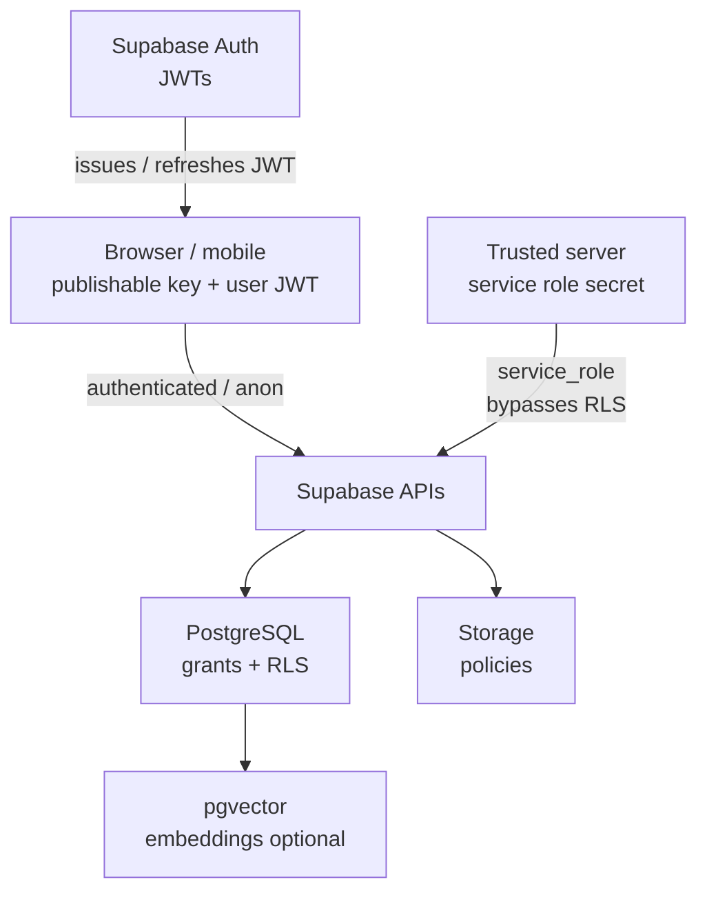

**Supabase** is an open-source backend platform centered on a full [PostgreSQL](glossary://postgresql) database per project, with Auth, an auto-generated REST Data API (PostgREST), optional GraphQL via `pg_graphql`, file Storage, Realtime subscriptions, and Edge Functions layered on top. Product data lives in Postgres and can use WAL, transactions, extensions such as [pgvector](glossary://pgvector), and [row-level security (RLS)](https://www.postgresql.org/docs/current/ddl-rowsecurity.html) as first-class controls.

For AI/ML/LLM engineers, Supabase is usually the **product and tenancy boundary** next to a probabilistic model: users, progress, document metadata, eval runs, feedback, agent session state, and (optionally) embeddings. The model proposes text and tool calls; Supabase (via Postgres grants + RLS + key roles) decides which rows and objects a principal may touch.

## Intuition

Think of Supabase as three layers that must agree:

| Layer | What it is | Who it is for |
| --- | --- | --- |
| **Postgres** | Tables, constraints, indexes, extensions, RLS | Source of truth for product state |
| **Data API (PostgREST)** | HTTP surface over exposed schemas | Browser and server clients via `@supabase/*` |
| **Auth + keys** | JWTs and API keys mapped to Postgres roles | Identity and privilege for every request |

Client apps should use a **publishable key** plus the user's session JWT. That combination runs as Postgres role `anon` or `authenticated` and is **subject to RLS**. Trusted server jobs that need unrestricted access use a **secret key**, which **bypasses RLS**. Legacy projects may still use the JWT-based `anon` and `service_role` keys; those are separate legacy key types, not alternate names for publishable and secret keys. The browser is never trusted with a key that skips policies.

## How it works

### Project building blocks

A Supabase project exposes roughly:

1. **Database:** managed Postgres (not an abstraction). Schemas, migrations, extensions (`vector`, full-text, `pg_cron`, …).
2. **Auth:** email/password, OAuth, magic links, phone, and sessions that mint **JWTs**. Access tokens carry claims such as `sub` (user id), `role` (Postgres role to assume), and `exp`.
3. **Data API:** PostgREST turns tables/views/RPCs in exposed schemas into REST. Optional GraphQL is `pg_graphql`, not PostgREST itself. Every request presents an API key and optional `Authorization: Bearer <jwt>`.
4. **Storage:** S3-compatible object service whose bucket/object metadata and RLS policies live in the Postgres `storage` schema. File bytes live in the underlying object-storage provider, not in Postgres rows.
5. **Realtime / Edge Functions:** change feeds and short-lived compute; still trust RLS and secrets the same way.

Self-hosting is supported; most teams start on the hosted product. Either way, the mental model is "Postgres + thin control plane," not a proprietary document DB.

### Roles the API actually uses

Supabase ships fixed Postgres roles that PostgREST switches into after JWT verification:

| Role | Typical caller | RLS |
| --- | --- | --- |
| `anon` | Unauthenticated Data API traffic | Enforced |
| `authenticated` | Signed-in user JWT (`role` claim) | Enforced |
| `service_role` | Trusted server with secret key | **Bypassed** |
| `authenticator` | Internal PostgREST bootstrap role | Switches to the role in the JWT |

Application authorization is **not** "create a Postgres login per user." End users are rows in `auth.users`; each request's JWT sets the session context so policies can call `auth.uid()` and `auth.jwt()`.

### Grants, then RLS

Security is two steps (official securing-API guidance):

1. **`GRANT`** decides whether role $R$ may touch object $T$ at all (`SELECT` / `INSERT` / …).
2. **RLS policies** decide which **rows** of $T$ role $R$ may see or change.

With RLS enabled and no matching policy, the default is **deny** for non-bypass roles. Policies behave like an implicit `WHERE` (and `WITH CHECK` on writes). Example shape from Supabase docs:

```sql
create policy "Individuals can view their own todos."
on todos for select
to authenticated
using ( (select auth.uid()) = user_id );
```

That is equivalent in spirit to always adding `WHERE auth.uid() = todos.user_id` for that role. Official performance guidance: wrap helpers as `(select auth.uid())` so Postgres can cache the value per statement; index policy columns; still filter in application queries so the planner has equality predicates.

Helpers:

- `auth.uid()` → current user id (JWT `sub`; null when unauthenticated)
- `auth.jwt()` → full JWT claims (do **not** put authorization secrets in user-editable `user_metadata`)

### JWT path in one request

```text
Client → apikey + optional Bearer JWT
      → gateway verifies key/JWT
      → PostgREST SET ROLE to claim role (anon | authenticated | …)
      → request.jwt.claims / auth.uid() available in SQL
      → GRANT + RLS applied on each table access
```

The JWT `role` claim selects the Postgres role; `sub` is what `auth.uid()` reads. Short-lived user JWTs are re-issued while the session stays valid. Claims such as team lists in `app_metadata` can lag until refresh: policies that read `auth.jwt()` see the **token**, not necessarily the latest row in a membership table.

## Diagram



## Example

A multi-tenant curriculum product stores learner progress and private notes. Lesson HTML can be public; progress must not leak across users.

```sql
create table public.lesson_progress (
  id uuid primary key default gen_random_uuid(),
  user_id uuid not null references auth.users (id) on delete cascade,
  lesson_slug text not null,
  completed_at timestamptz,
  notes text,
  unique (user_id, lesson_slug)
);

grant select, insert, update, delete on public.lesson_progress to authenticated;
grant select, insert, update, delete on public.lesson_progress to service_role;

alter table public.lesson_progress enable row level security;

create policy "Users read own progress"
on public.lesson_progress for select
to authenticated
using ( (select auth.uid()) is not null
        and (select auth.uid()) = user_id );

create policy "Users write own progress"
on public.lesson_progress for insert
to authenticated
with check ( (select auth.uid()) = user_id );

create policy "Users update own progress"
on public.lesson_progress for update
to authenticated
using ( (select auth.uid()) = user_id )
with check ( (select auth.uid()) = user_id );
```

The SQL grant alone does not permit deletion: no authenticated `DELETE` policy is defined here, so RLS denies that operation. Reads, inserts, and updates use the policies above.

Client (browser) uses the publishable key and the signed-in session:

```ts
const { data, error } = await supabase
  .from("lesson_progress")
  .select("lesson_slug, completed_at, notes")
  .eq("user_id", userId); // explicit filter still helps the planner
```

A nightly job that aggregates completion rates across all learners must run with the **service role on the server only** (or a narrower custom role), never with a key embedded in the SPA. LeetLLM-style apps follow the same pattern: browser client for session-scoped reads/writes; `createClient` with the secret key only in server modules that must never ship to the client.

### RAG with the same policies

Because embeddings can live in Postgres via pgvector, permissioned retrieval is ordinary SQL. Official pattern: store chunks with a `document_id`, own documents by `owner_id`, and attach RLS so similarity search cannot return another tenant's sections even if the client forgets a filter:

```sql
-- After enabling extension vector and creating documents / document_sections
create policy "Users can query their own document sections"
on document_sections for select to authenticated using (
  document_id in (
    select id from documents
    where owner_id = (select auth.uid())
  )
);

-- ANN / distance search still runs under RLS
select id, content
from document_sections
order by embedding <=> $1::vector -- bind the query embedding
limit 8;
```

That is the AI-specific value of Supabase-style backends: **retrieval and product ACLs share one transaction boundary**, instead of hoping a separate vector service reimplements tenancy correctly.

## Trade-offs

| Fit well | Fit poorly without extra design |
| --- | --- |
| Multi-tenant SaaS with clear user/tenant ownership | Extremely high-QPS pure vector serving (often needs dedicated ANN infra) |
| Auth + Postgres + storage under one project | Dumping unrestricted model logs that contain secrets into tables/buckets |
| RAG under ~millions of chunks with SQL filters | Complex multi-step agent tool authority that needs short-lived per-tool tokens beyond DB rows |
| Eval rows, feedback, feature flags next to product data | Treating RLS as a substitute for app tests, rate limits, and secret hygiene |

By default, Postgres views check underlying table access using the view owner's privileges and RLS policies. A view owned by a bypass role can expose rows the caller could not read directly. Set `security_invoker = true` (Postgres 15+) to use the caller's permissions and RLS policies. Function invocation uses `GRANT EXECUTE`; SQL inside an invoker function still encounters the caller's table RLS, while a `SECURITY DEFINER` function runs with its owner's privileges and needs careful auditing.

## Debug path

When a client gets empty data or `permission denied`:

1. Confirm the table is in an **exposed** schema and has the expected `GRANT` for `anon` / `authenticated`.
2. Confirm `ENABLE ROW LEVEL SECURITY` and at least one policy for the operation (`SELECT` is also required for many `UPDATE` flows).
3. Inspect the JWT: is `role` `authenticated`? Is `sub` the expected user? Has the session expired (`exp`)?
4. Reproduce with the SQL editor as the user role vs service role to isolate policy bugs from app bugs.
5. Check for views without `security_invoker`, missing indexes on policy columns, and policies that join slowly (rewrite to `IN (select …)` / security-definer helpers in a **non-exposed** schema).
6. A service-role check bypasses user-level RLS and confirms only that the row exists. Reproduce the request through the user's auth context, then inspect grants and policies.

Production failures that show up repeatedly: publishable and secret keys confused in env files (`NEXT_PUBLIC_*` leaking a service key), RLS left off on SQL-created tables, public storage buckets treated as private, agents or edge functions holding `service_role` for convenience, and authorization data stored only in stale JWT claims instead of tables the policy can join.

## Why it matters here

LeetLLM-class products need signed-in users, durable progress, and tenant-safe data next to content served from a [Next.js](glossary://nextjs) front end. Supabase is one concrete stack for that boundary: real Postgres, Auth JWTs, and RLS so a missing client filter is less catastrophic. For LLM features, the same stack can hold eval/feedback rows and permissioned embeddings without inventing a second identity system for the vector path. The non-negotiable rule remains: **service-role secrets stay on trusted servers; agents do not get BYPASSRLS "just to make the demo work."**

## Related terms

- [PostgreSQL](glossary://postgresql)
- [pgvector](glossary://pgvector)
- [Tenant isolation](glossary://tenant-isolation)
- [RBAC](glossary://rbac)
- [Secrets management](glossary://secrets-management)
