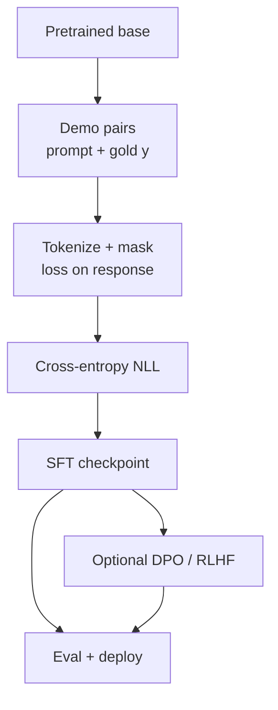

**Supervised fine-tuning (SFT)** continues training a pretrained language model on labeled prompt–response pairs so the model imitates desired answers, formats, and tool-use patterns. The objective is the same next-token [cross-entropy](glossary://cross-entropy) loss used in [pretraining](glossary://pretraining), but the data is curated demonstrations rather than raw web text. After SFT, preference methods such as [DPO](glossary://dpo) or [RLHF](glossary://rlhf) may refine ranking and style; SFT is usually the first specialization step that turns a base model into an instruction-following or product-shaped checkpoint.

In the InstructGPT pipeline (Ouyang et al., 2022), step 1 is exactly this: labelers write demonstrations for prompts, then GPT-3 is fine-tuned with supervised learning on those pairs before reward modeling and PPO. LIMA (Zhou et al., 2023) later showed that a strong base model can reach high preference quality from only about 1,000 carefully curated SFT examples without preference RL. This supports a central SFT lesson: quality and coverage of demonstrations often matter more than raw pair count once the base model already holds general knowledge.

## Intuition

Pretraining teaches the model to continue text in the distribution of the internet and books. SFT tunes that capability toward helpful answers in a product's voice. For each prompt $x$, a human (or high-quality synthetic teacher) provides a target completion $y$, and training raises $p_\theta(y\mid x)$.

Under [teacher forcing](glossary://teacher-forcing), the model learns to match the demonstration distribution one target token at a time. This objective has no explicit comparison between a chosen and a rejected answer. Selecting better demonstrations can still change what the model prefers to generate; preference training adds a direct signal about alternatives.

Algorithmically almost nothing changes from pretraining: same architecture, same causal LM loss, often the same optimizer family. What changes is the data contract (prompt + gold completion, often with chat special tokens) and which tokens enter the loss (commonly completion-only, not the user prompt).

## Formula

For a dataset of pairs $(x, y)$ with $y = (y_1,\ldots,y_T)$ and trainable parameters $\theta$, SFT minimizes average negative log-likelihood of the completion under the causal model:

$$
\mathcal{L}_{\mathrm{SFT}}(\theta)
=
-\mathbb{E}_{(x,y)\sim\mathcal{D}}
\sum_{t=1}^{T}
\log \pi_\theta(y_t \mid x, y_{<t})
$$

Equivalently, each training step is standard token-level cross-entropy between the model’s next-token distribution and the gold token $y_t$. In practice implementations shift labels by one position (predict token $t$ from positions $<t$) and set ignored positions to the framework ignore index (often `-100` in PyTorch) so padding and prompt tokens do not contribute to the mean.

**Completion-only masking.** If the full sequence is $[x; y]$, many trainers zero out the loss on $x$:

$$
\mathcal{L}
=
-\sum_{t \in \mathcal{T}_{\mathrm{resp}}}
\log \pi_\theta(y_t \mid \text{prefix}_{<t})
$$

where $\mathcal{T}_{\mathrm{resp}}$ is the set of response token positions. In TRL, completion-only loss selects the completion of a prompt–completion example; assistant-only loss selects assistant turns in a conversation and requires a chat template that exposes their generation spans. These masks can be combined. Masking removes direct prediction loss on prompt tokens, while answer gradients still depend on how the model processes that context. See the [SFTTrainer masking documentation](https://huggingface.co/docs/trl/sft_trainer#train-on-assistant-messages-only).

**Full-sequence LM loss.** Some recipes train on all non-pad tokens (prompt + response). That adds prompt-prediction terms to the objective. A low aggregate loss can then hide poor response prediction, so compare response-specific and held-out task metrics before deciding which mask suits the workload.

## How it works

1. **Start from a pretrained (or already instruction-tuned) checkpoint.** SFT is a common route from a base model to an assistant, rather than a requirement of every possible post-training pipeline. Starting from an instruct checkpoint is common for domain or product SFT; you are then specializing further, not teaching instruction following from scratch.
2. **Build demonstration data.** Each row is a prompt (optionally multi-turn chat) and a target completion. Sources: human writers, filtered production traces with gold fixes, or distilled completions from a stronger model. Apply a fixed [chat template](glossary://chat-template) so special tokens match serving.
3. **Tokenize and mask.** Encode the full conversation; set labels to ignore index on system/user turns (and padding) when using completion-only loss.
4. **Optimize $\mathcal{L}_{\mathrm{SFT}}$.** Full fine-tuning updates all weights; [LoRA](glossary://lora) / [QLoRA](glossary://qlora) update a small adapter while freezing the base. Tune learning rate for the checkpoint, update method, and data; watch validation loss and *task* metrics, not train loss alone. InstructGPT reported validation loss overfitting after about one epoch while more epochs still improved human preference and reward-model scores, so early-stop rules should be tied to product evals.
5. **Evaluate outside the training loss.** Held-out instructions, format/schema checks, safety/refusal slices, and regression suites on general capability matter more than train NLL. Then optionally continue with preference optimization.

```python
# Conceptual completion-only SFT step (shapes simplified)
import torch
import torch.nn.functional as F

def sft_loss(logits, labels, ignore_index=-100):
    # logits: [B, T, V], labels: [B, T] with ignore_index on prompt/pad
    shift_logits = logits[:, :-1, :].contiguous()
    shift_labels = labels[:, 1:].contiguous()
    return F.cross_entropy(
        shift_logits.view(-1, shift_logits.size(-1)),
        shift_labels.view(-1),
        ignore_index=ignore_index,
    )
```

## Diagram



## Example

You want a repository assistant that explains failures and emits tool-call JSON when a test run is needed.

1. Collect ~20k high-quality issue-resolution traces: question, relevant code or logs, and a gold assistant reply (plain text or `tool_call` JSON that matches your runtime schema).
2. Freeze a held-out eval set of ~1k tasks before any prompt iteration. Deduplicate near-copies so the eval is not contaminated by train paraphrases.
3. Fine-tune with completion-only loss and the same chat template used at serve time. Prefer LoRA if you must keep one shared base and ship tenant adapters.
4. Gate release on held-out metrics: correct tool name and required fields, evidence-grounded diagnosis, refusal of unauthorized production writes, and a general coding regression suite so you catch catastrophic forgetting.

If train loss falls but tool JSON validity on the held-out set does not rise, the model is fitting surface phrasing, not the operational contract.

## Worked numbers

Suppose a short gold completion is three tokens and the model assigns:

| Position $t$ | Gold token | $\pi_\theta(y_t\mid\text{prefix})$ | $-\log\pi$ (nats) |
|---:|---|---:|---:|
| 1 | `{` | $0.40$ | $\approx 0.916$ |
| 2 | `"name"` | $0.55$ | $\approx 0.598$ |
| 3 | `}` | $0.80$ | $\approx 0.223$ |

Sequence NLL for this completion:

$$
\mathcal{L} = 0.916 + 0.598 + 0.223 = 1.737
$$

Average per-token loss $\approx 0.579$. Raising the probability of the second gold token, `"name"`, from $0.55$ to $0.90$ cuts that term from $0.598$ to $0.105$ and the sequence loss to $\approx 1.244$. Token probabilities multiply into sequence probability, while token NLLs add. A low-probability required token increases the loss even if surrounding prose looks fluent; it doesn't necessarily dominate the parameter gradient, which also depends on the model and other token errors.

## Data contract

| Practice | Why it matters |
|---|---|
| Quality over bulk after format is learned | LIMA-style results: strong bases can follow formats from small curated sets; noisy mass teaches noisy habits |
| Deduplicate and decontaminate | Near-duplicates leak into “held-out” eval and fake progress |
| Freeze eval before prompt churn | Otherwise you overfit the test distribution while iterating demos |
| Provenance and license | Training on restricted tickets can leak PII or violate terms; treat demos as production data |
| Label noise becomes behavior | Wrong fixes or unsafe tool calls are cloned into weights, not filtered at inference |

## Trade-offs

| Choice | Gain | Cost / risk |
|---|---|---|
| Full fine-tuning | Maximum capacity to reshape behavior | Large train memory, full checkpoint per specialty, easier to erase base skills |
| LoRA / PEFT SFT | Cheap adapters, multi-tenant serving | Limited update rank; hard domain shifts may need more data or full FT |
| Completion-only loss | Focuses gradients on answers | Multi-turn prefix modeling may need careful template design |
| Many epochs on small data | Can improve preference scores past first-epoch val-loss min (InstructGPT) | [Overfitting](glossary://overfitting) to templates, memorization of private strings |
| Synthetic demos from a teacher | Scale and coverage | Teacher errors and style copy; still need human or hard eval gates |

## What fails in production

- **Template overfitting:** low train loss, brittle answers that only work on phrasings seen in demos.
- **Capability regression:** support tone improves while coding, math, or multilingual slices drop (alignment tax; mix general data or lower LR / fewer steps).
- **Chat-template mismatch:** train with one special-token layout, serve with another; tool calls and roles break silently.
- **Prompt leakage into loss:** no completion mask, so metrics look good while response quality stagnates.
- **Memorization:** private tickets, API keys, or customer names surface in free-form generation; scan train data and run canary membership checks.
- **Wrong success metric:** optimizing NLL alone; ship only when held-out task metrics and safety slices move.

Debug path: fix template and mask first, then data quality (wrong labels, duplicates), then LR/epochs/rank, then capacity (full FT vs LoRA). Change one axis at a time against a frozen eval suite.

## Why it matters here

Most applied LLM customization still starts with supervised demonstrations. SFT is how product behavior becomes weight-level skill rather than only a system prompt: tool schemas, domain tone, refusal style, and structured outputs. On LeetLLM it is the bridge between pretraining, PEFT adapters, and later preference methods, so you can reason about data contracts, loss masks, and release gates before you add DPO or RLHF machinery.

## Related terms

- [Pretraining](glossary://pretraining)
- [Teacher forcing](glossary://teacher-forcing)
- [Cross-entropy](glossary://cross-entropy)
- [DPO](glossary://dpo)
- [RLHF](glossary://rlhf)
