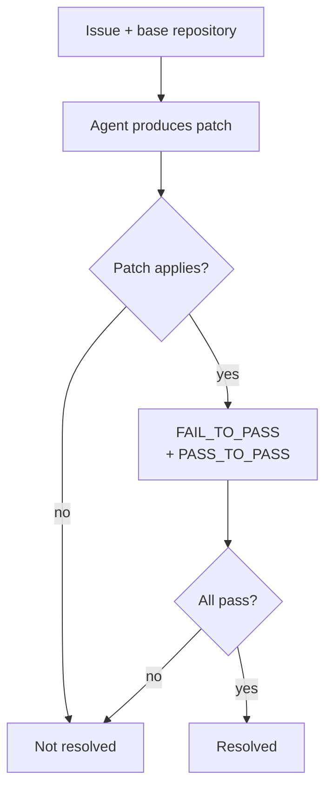

**SWE-bench** (Software Engineering Benchmark) is an execution-based eval of coding agents and language models on real GitHub issues. Given a repository snapshot and a natural-language issue, the system must produce a patch that fixes the problem. A task counts as **resolved** only when the harness applies that patch in a clean environment and the repository tests pass: every `FAIL_TO_PASS` test flips from fail to pass, and every `PASS_TO_PASS` test still passes (Jimenez et al., ICLR 2024).

Unlike HumanEval-style single-function synthesis, SWE-bench instances live in multi-file codebases (thousands of files and hundreds of thousands of lines on average in the original release). Localization, multi-file edits, dependency awareness, and tool use all matter. The original test set has **2,294** instances drawn from **12** popular Python repositories by linking merged pull requests that resolve an issue and contribute tests.

## Intuition

A human engineer is handed a bug report or feature request and a checkout of the repo at a known commit. They search, edit, run tests, and submit a diff. SWE-bench grades the same shape of work with the repo's own tests as the oracle.

The hard parts extend beyond a short pure function: find the right files in a large tree, understand cross-module behavior from issue text alone, change the right lines without breaking neighbors, and emit a valid patch. The grading test patch is withheld in the standard solve protocol; the agent sees the issue and the codebase, including tests already in that snapshot. Because the dataset and original pull requests are public, test secrecy depends on the protocol and cannot be guaranteed by withholding the patch alone.

## How it works

**Instance construction** (high level, from the paper):

1. Scrape merged PRs from popular Python packages on GitHub.
2. Keep PRs that resolve an issue **and** touch test files (so a fail-to-pass signal exists).
3. Install the repo at the PR base commit, apply the PR's test changes, then compare test outcomes before and after the PR's non-test changes.
4. Keep only instances with at least one **Fail-to-Pass** test and a working install.

**Evaluation loop** for a system under test:

1. Provide `problem_statement` (issue text) and the codebase at `base_commit`.
2. The system edits sources and emits a unified patch (or equivalent edits).
3. The [eval harness](glossary://eval-harness) applies the patch in a Dockerized environment and runs the instance's tests.
4. Grade with both test roles below.

| Suite role | Before correct fix | After correct fix | What it checks |
| --- | --- | --- | --- |
| `FAIL_TO_PASS` | fail | pass | The issue is actually fixed |
| `PASS_TO_PASS` | pass | pass | Unrelated behavior did not regress |

Both roles must pass for a full resolve. Patch apply failures, install failures, timeouts, and partial test progress count as not resolved.

## Formula

Headline metric is **% Resolved** (also called resolve rate) over a fixed split of $N$ instances:

$$
\%\ \mathrm{Resolved}
=
\frac{1}{N}
\sum_{i=1}^{N}
\mathbf{1}\!\left[
\mathrm{apply}(\mathrm{patch}_i)
\;\land\;
\bigwedge_{t \in F_i} \mathrm{pass}(t)
\;\land\;
\bigwedge_{t \in P_i} \mathrm{pass}(t)
\right]
\times 100
$$

where $F_i$ is the `FAIL_TO_PASS` set for instance $i$ and $P_i$ is the `PASS_TO_PASS` set. The indicator is $1$ only if the patch applies and every test in both sets passes.

This is closer to **pass@1** on a repository task than to multi-sample [pass@k](glossary://pass-at-k), unless the system under test is allowed multiple independent submissions and the protocol says so. Agent loops that retry inside one attempt still report a single resolved bit per instance; undisclosed best-of-$k$ or hidden retries inflate the claim.

## Diagram



## Example

Instance shape (fields simplified from the public Hugging Face schema):

```text
instance_id: sympy__sympy-19637
repo: sympy/sympy
base_commit: <hash>
problem_statement: |
  kernS: 'kern' referenced before assignment
  ...
  text = "(2*x)/(x-1)"
  expr = kernS(text)   # UnboundLocalError
FAIL_TO_PASS: ["test_kernS"]   # hidden from the agent
PASS_TO_PASS: [... many regression tests ...]
```

An agent explores `sympy`, finds the `kernS` path, and submits a small fix. The harness applies the patch and runs tests. A resolve requires `test_kernS` (and any other `FAIL_TO_PASS` entries) to pass **and** the full `PASS_TO_PASS` set to stay green.

A counterexample from the SWE-bench Verified analysis (OpenAI, 2024): some original instances demand exact deprecation messages or other PR-only details that never appear in the issue text. A reasonable fix can still fail grading. That is why **Verified** exists: human annotators filtered for well-specified issues and fair tests.

Historical scale points from primary sources; current leaderboard scores change over time:

| System / setting (historical) | Split | Approx. % Resolved |
| --- | --- | --- |
| Claude 2 + BM25 retrieval (paper) | Full | ~2% |
| Claude 2 + oracle file context (paper) | Full | ~4.8% |
| SWE-agent + GPT-4 Turbo (follow-up) | Full | ~12.5% |
| GPT-4o + strong open scaffold (OpenAI, Aug 2024) | Verified | ~33% |

Scaffold, tools, step budget, and retrieval dominate as much as the base model. Same weights, different [agent scaffold](glossary://agent-scaffold), different resolve rate.

## Variants and fair comparison

Always name **split + harness + scaffold** when you quote a score.

| Variant | Role |
| --- | --- |
| **SWE-bench (Full)** | Original 2,294 Python instances; broadest historical comparison |
| **SWE-bench Lite** | 300 tasks for cheaper iteration. Its selection excludes gold patches editing more than one file, creating/removing files, or exceeding three edit hunks, plus several issue/test filters; an agent's own patch need not be single-file. |
| **SWE-bench Verified** | 500 human-validated instances (OpenAI + authors, 2024); once the dominant public comparison set for solvability |
| **SWE-bench Pro** | Harder professional-repo suite introduced as a contamination-resistant alternative; public split integrity later disputed |
| **Multimodal / Multilingual** | Extensions beyond plain Python issue text (images/UI; other languages and repos) |

Verified removed many underspecified issues and overly narrow unit tests relative to Full, and became a widely reported comparison set. In [February 2026, OpenAI reported](https://openai.com/index/why-we-no-longer-evaluate-swe-bench-verified/) both [benchmark contamination](glossary://benchmark-contamination) evidence and flawed tests on Verified, and stopped reporting its scores. OpenAI briefly recommended Pro next; its [July 2026 audit](https://openai.com/index/separating-signal-from-noise-coding-evaluations/) estimated roughly $30\%$ of the $731$-task public Pro split was broken (overly strict tests, underspecified prompts, low coverage, or misleading instructions) and retracted that recommendation. These are OpenAI's audit findings; SWE-bench maintainers continue to publish Verified results. Lite still optimizes for cost and focus. **Choose the suite using current integrity evidence and the evaluation question**, then report Full / Lite / Verified / Pro percentages in separate rankings.

## What fails outside the leaderboard

SWE-bench stress-tests coding agents. Assess product SLA separately with service-level metrics.

- **Test-passing ≠ merge-ready.** Style, review comments, API design, and maintainer intent are not scored.
- **Scaffold confounds.** Tools, retries, test feedback mid-loop, context packing, and wall-clock budgets can move scores as much as model upgrades. Report them.
- **Environment fragility.** Install and Docker setup failures grade as failures even when the logical fix is fine; official harnesses containerize for a reason.
- **Contamination risk.** Issues and PRs are public GitHub history. Pretraining or retrieval can leak solutions; prefer post-cutoff or private slices when stakes are high ([benchmark contamination](glossary://benchmark-contamination)).
- **Narrow domain in the original suite.** Popular Python libraries, not every stack, language, or monorepo workflow; Multilingual and other extensions broaden coverage but remain finite samples.
- **False negatives from grading.** Over-specific gold tests can reject valid alternate fixes (the Verified filtering motivation).

## Why it matters here

Curriculum and production work on coding agents, tool calling, and long-horizon evals all sit under this protocol. Reading a leaderboard number without the split, harness commit, and scaffold is reading a different experiment. Use a SWE-bench suite whose current integrity status you trust (and name which one) to measure repository-level repair under hidden tests; prefer private or continuously maintained sets for frontier claims; use smaller unit-test benches for pure synthesis. Report % Resolved as a system property covering model, tools, loop, and environment.

## Related terms

- [Agent scaffold](glossary://agent-scaffold)
- [Eval harness](glossary://eval-harness)
- [Hidden tests](glossary://hidden-tests)
- [Pass@k](glossary://pass-at-k)
- [Trajectory evaluation](glossary://trajectory-evaluation)
