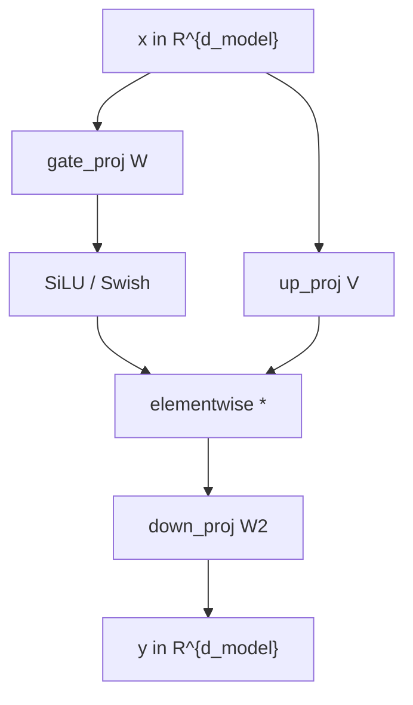

SwiGLU is a gated feed-forward block used in many modern transformers: a Swish-gated linear unit. It replaces the classic two-matrix FFN (expand, activate, project down) with three projections and an elementwise gate. Shazeer (2020) introduced the family; LLaMA, PaLM, Mistral, and Mixtral experts all ship a SwiGLU MLP.

## Intuition

A plain FFN applies one fixed nonlinearity after a single up-projection, with no separate control path. ReLU zeros negative inputs; GELU and SiLU produce smooth, signed activations whose values can represent degrees of activation.

A GLU-style layer splits the expand into two parallel linear maps of the same width:

1. **Gate path:** linear map, then a smooth nonlinearity (here Swish / SiLU).
2. **Value path:** linear map, left unactivated.

Elementwise multiply lets the gate scale each value channel per token and per feature. Values whose gate is near zero are suppressed. Unlike a sigmoid-only GLU gate, the SiLU gate can be negative or exceed one, so it can reverse a value's sign or amplify it. That multiplicative control is the whole point of SwiGLU, not a different shape of scalar activation alone.

## Formula

Shazeer defines SwiGLU (biases optional; modern LLMs usually drop them):

$$
\mathrm{SwiGLU}(x, W, V, b, c, \beta) = \mathrm{Swish}_{\beta}(x W + b) \odot (x V + c)
$$

with

$$
\mathrm{Swish}_{\beta}(z) = z \cdot \sigma(\beta z),\qquad \sigma(z)=\frac{1}{1+e^{-z}}.
$$

In the Transformer FFN, a third matrix projects the gated vector back to model width. With $\beta = 1$ and no bias (the common LLM setting), this is identical to SiLU on the gate:

$$
\mathrm{FFN}_{\mathrm{SwiGLU}}(x) = \bigl(\mathrm{SiLU}(x W) \odot (x V)\bigr) W_2
$$

where $\mathrm{SiLU}(z) = z \cdot \sigma(z)$ and $\odot$ is elementwise multiply. In Hugging Face / LLaMA code the three maps are usually named:

| Matrix in paper | Common code name | Role |
|---|---|---|
| $W$ | `gate_proj` | Gate branch (SiLU applied) |
| $V$ | `up_proj` | Value branch (no SiLU) |
| $W_2$ | `down_proj` | Project back to $d_{\mathrm{model}}$ |

So the operational form is:

$$
\begin{aligned}
\mathrm{hidden} &= \operatorname{SiLU}(\operatorname{gate\_proj}(x)) \odot \operatorname{up\_proj}(x) \\
y &= \operatorname{down\_proj}(\mathrm{hidden})
\end{aligned}
$$

## Diagram

## Example

**Shazeer's matched-budget experiment (T5 base setup).** The two-matrix ReLU FFN used $d_{\mathrm{model}} = 768$ and $d_{\mathrm{ff}} = 3072$. GLU variants have three matrices, so he set the intermediate width to $d_{\mathrm{ff}} = 2048$ ($3072 \times \tfrac{2}{3}$) to keep parameter count and FLOPs comparable. On the C4 span-filling objective, GEGLU and SwiGLU produced the best held-out log-perplexities among ReLU, GELU, Swish, GLU, Bilinear, ReGLU, GEGLU, and SwiGLU.

**LLaMA-style 7B MLP (production numbers).** Configs use $d_{\mathrm{model}} = 4096$ and intermediate size $11008$ with bias-free SwiGLU: `gate_proj` and `up_proj` map $4096 \to 11008$, `down_proj` maps $11008 \to 4096$. LLaMA adopts SwiGLU (as in PaLM) but sets intermediate width near $\tfrac{2}{3}\cdot 4d = \tfrac{8}{3}d$ instead of PaLM's $d_{\mathrm{ff}} = 4d$, then rounds for hardware (often a multiple of 256):

$$
\tfrac{8}{3}\cdot 4096 \approx 10922.67 \;\rightarrow\; 11008.
$$

Parameters in that one layer's MLP (ignoring biases, of which there are none):

$$
|\theta_{\mathrm{MLP}}| \approx 3 \times 4096 \times 11008 \approx 135\mathrm{M}.
$$

Across 32 layers that is on the order of $4\mathrm{B}$ weights in MLPs alone. Every token pays three large GEMMs; training also stores or recomputes the wide $d_{\mathrm{ff}}$ activations for the backward pass.

## Sizing

Three matrices at the same intermediate width cost about $1.5\times$ the parameters of a two-matrix FFN:

$$
|\theta_{\mathrm{two}}| \approx 2\, d_{\mathrm{model}}\, d_{\mathrm{ff}},\qquad
|\theta_{\mathrm{SwiGLU}}| \approx 3\, d_{\mathrm{model}}\, d_{\mathrm{ff}}.
$$

To compare fairly, Shazeer sets $d_{\mathrm{ff}}$ to $\tfrac{2}{3}$ of the two-matrix width. LLaMA phrases the same budget idea as "use $\tfrac{2}{3}\cdot 4d$ instead of $4d$" (PaLM keeps $4d$ with SwiGLU), which is $\tfrac{8}{3}d_{\mathrm{model}}$. When you read a config, inspect `intermediate_size` (or `ffn_dim` / `hidden_dim`) alongside whether an MLP is present. A checkpoint trained at $11008$ will not directly load into a block sized at $4\times 4096 = 16384$: the weight shapes and parameter counts differ. Merely reshaping cannot preserve this function.

## Debug path

If you reimplement a LLaMA-family checkpoint and loss or logits diverge, check these before chasing optimizers or data:

1. **Activation identity.** Gate must be SiLU/Swish$_1$, not GELU or plain ReLU. GELU-vs-SiLU is a common silent mismatch.
2. **Multiply order and placement.** Gate applies SiLU, multiplies the *up* branch, then `down_proj`. Multiplying after the down-projection is a different function.
3. **Which weight is the gate.** Swapping `gate_proj` and `up_proj` still multiplies two vectors of the same shape, so shapes look fine while the model is wrong.
4. **Bias.** Most modern SwiGLU LLMs are bias-free on all three linears. Adding bias tensors changes the loaded function even if shapes nearly match.
5. **Intermediate width.** Match `intermediate_size` exactly, including hardware rounding (e.g. $11008$ not $10923$).
6. **Fused kernels.** Serving stacks often fuse `gate`+`up` (sometimes as `gate_up_proj` with a split) or fuse SiLU-mul. Confirm the fusion matches the math above, not a GELU MLP kernel.

Small activation mismatches break weight compatibility: the load may succeed while every token is transformed by the wrong function.

## Trade-offs

| Aspect | What you get |
|---|---|
| Quality | Shazeer found GEGLU/SwiGLU best among tested FFN variants on T5-style pretrain; LLaMA/PaLM adopted SwiGLU for quality at scale |
| Parameters | Three matrices; keep $d_{\mathrm{ff}}$ near $\tfrac{2}{3}$ of a two-matrix budget if you want a fair param match (LLaMA does; PaLM uses $4d$ anyway) |
| Compute | Roughly three GEMMs per token per layer instead of two; often fused in practice |
| Memory | Wide intermediate activations dominate training HBM; same checkpointing story as any large FFN |
| Theory | Shazeer explicitly offers no deep explanation for why the gate helps ("divine benevolence"); treat it as an empirical architecture win |

## Why it matters here

SwiGLU is the concrete reason modern decoder MLPs differ from the original Transformer ReLU FFN. When you read a LLaMA-family block diagram, port a checkpoint, size tensor-parallel shards on `gate`/`up`/`down`, or reimplement Mixtral-style MoE experts, you are reading or rewriting this three-matrix gate, not a generic "activation function" swap. Getting the SiLU gate, intermediate width, and bias policy right is table stakes for correct reimplementation.

## Related terms

- [Feed-forward network](glossary://feed-forward-network)
- [Transformer](glossary://transformer)
- [RMSNorm](glossary://rmsnorm)
- [Residual stream](glossary://residual-stream)
- [Mixture of experts](glossary://mixture-of-experts)
