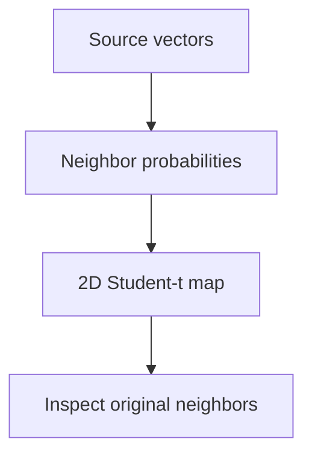

**T-distributed stochastic neighbor embedding (t-SNE)** converts high-dimensional observations into a two-dimensional or three-dimensional visualization by trying to preserve local neighborhood relationships. It supports investigation of local structure; global distances, cluster sizes, and apparent gaps can change in the original space, so validate them against the high-dimensional data.

## Why the map can be persuasive and wrong

The algorithm assigns similar source observations larger neighbor probabilities, then chooses map positions whose Student-t neighbor probabilities agree with that source distribution. Its heavy-tailed low-dimensional distribution reduces the crowding that occurs when many neighborhoods compete for limited display space.

`perplexity` controls the neighborhood scale the optimization considers. Random initialization, learning rate, sample composition, and perplexity can all change the resulting picture. Treat a dramatic cluster gap as a lead for investigation: compare original-vector neighbors and source text before making a semantic claim. Displayed cluster area poorly estimates population density.

## Example

An engineer projects 2,000 policy-document embeddings into two dimensions. Three access-control clauses appear among incident runbooks instead of near related permission policies. That placement identifies records worth investigating: check their source text, metadata, original-vector neighbors, and retrieval outcomes. Use the original embeddings for retrieval; the two-dimensional map supports visual inspection.

Compare several perplexities and measure whether each suspicious point's nearest neighbors in the map are also neighbors in the original embedding space. Stable disagreement flags data for inspection; validate findings in the original space before treating a visualization as ground truth.

## Why it matters here

Embedding and retrieval lessons use t-SNE to investigate duplicates, mislabeled documents, distribution shifts, and unusual neighborhoods. Base release decisions on judged retrieval quality, access-control correctness, latency, and memory measurements; use t-SNE to select cases for investigation.

## Related terms

- [Embedding](glossary://embedding)
- [PCA](glossary://pca)
- [Recall at K](glossary://recall-at-k)
- [Cosine similarity](glossary://cosine-similarity)
