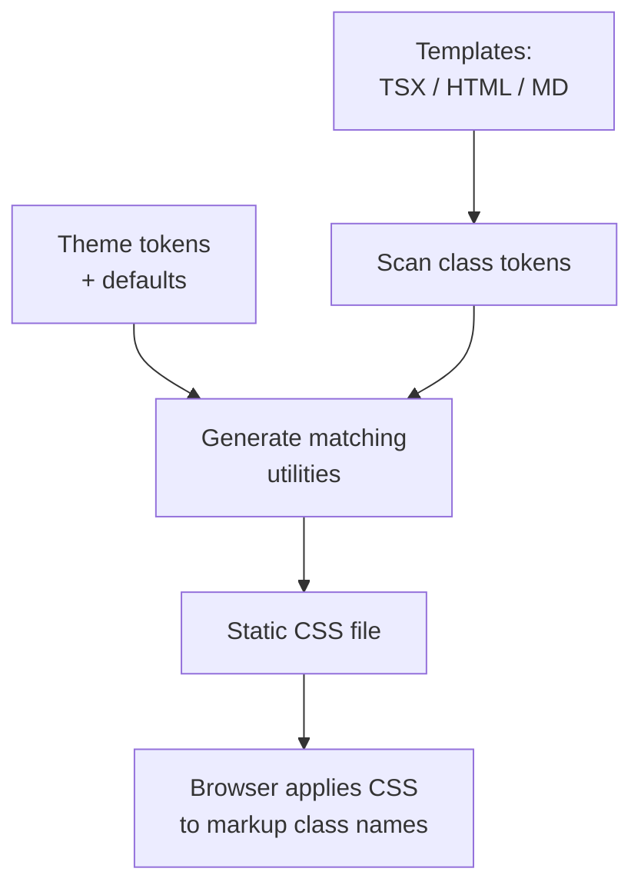

**Tailwind CSS** is a utility-first CSS framework: you style UI by composing single-purpose classes in markup (`flex`, `gap-4`, `text-sm`, `md:grid-cols-2`, `dark:bg-slate-900`) instead of inventing semantic class names and writing separate stylesheet rules for each component. At **build time** it scans templates and components for class-name tokens, generates only the CSS those tokens need, and writes a static stylesheet. Official docs describe the pipeline as scan → generate → emit CSS, with **zero runtime** in the browser: no style engine ships to the client.

Tailwind supplies a constrained vocabulary of layout, spacing, type, color, and state utilities, plus a compiler that keeps shipped CSS small. Application components or libraries such as Shadcn provide buttons, cards, and other reusable UI pieces; design tokens and patterns form the broader design system.

## Intuition

Classic CSS often means inventing names (`.card-title`, `.sidebar-nav-item`) and bouncing between HTML and a growing stylesheet. Inline styles avoid names but cannot express hover, focus, dark mode, or breakpoints cleanly, and every value becomes a magic number.

Tailwind sits between those extremes:

| Approach | Where styles live | Constraints | States / breakpoints |
|---|---|---|---|
| Custom CSS / BEM | Separate sheets, shared class names | You invent the scale | Full CSS |
| Inline `style=` | On the element | None (magic numbers) | Weak |
| Tailwind utilities | On the element as class tokens | Theme scale (`p-4`, `text-sm`) | Variants: `hover:`, `md:`, `dark:` |

You still extract components when the same class cluster repeats. The reuse unit is a React/Vue/Svelte component (or a rare `@layer components` class), not a second bespoke CSS architecture.

## How it works

### 1. Utility classes and variants

Each utility maps to one presentational job. Variants wrap the same utility in a condition:

- **Base:** `p-4` → padding from the spacing scale
- **State:** `hover:bg-sky-700` → only under `:hover`
- **Breakpoint:** `sm:grid-cols-3` → from a min-width media query upward (default `sm` is $40\,\mathrm{rem}$)
- **Theme:** `dark:bg-slate-800` → when dark mode is active
- **Stacking:** `dark:lg:data-current:hover:bg-indigo-600` → all conditions must match

Generated CSS for a variant is intentionally narrow. For example, `hover:bg-sky-700` only sets background on hover; the resting color is a separate class such as `bg-sky-500`.

### 2. Build-time class detection

Tailwind does **not** parse JSX or HTML as a language AST for styling. It treats source files as plain text, finds tokens that look like class names, and emits CSS for tokens that match known utilities (including arbitrary values like `bg-[#316ff6]` or `max-h-[calc(100dvh-2rem)]`).

Because detection is textual:

- **Complete class strings must be detectable or explicitly registered.** `text-red-600` and `text-green-600` as full literals are fine; building `text-{{ color }}-600` or `` `bg-${color}-600` `` does not itself emit those utilities. In v4, `@source inline("...")` can explicitly include a known set of classes.
- Map props to **static** class maps instead of concatenating utility stems at runtime.

In Tailwind CSS **v4**, content paths are detected automatically (skipping `.gitignore` entries, `node_modules`, binaries, CSS files, and lockfiles). Use `@source` in CSS when a dependency under `node_modules` must be scanned (shared UI packages are a common case). Configuration is **CSS-first**: `@import "tailwindcss"` plus an optional `@theme { ... }` block for design tokens (colors, fonts, breakpoints) exposed as CSS variables.

### 3. Theme scale and conflicts

Spacing utilities are often derived from a single token. With default `--spacing: 0.25rem`, a class like `mt-8` compiles roughly to:

```css
.mt-8 {
  margin-top: calc(var(--spacing) * 8); /* 2rem when --spacing is 0.25rem */
}
```

When competing utilities have the same cascade priority and specificity, **stylesheet order wins**, not HTML class attribute order. Cascade layers, `!important`, selector specificity, and active variants can also affect the result. Prefer mutually exclusive classes (e.g. `grid` *or* `flex`). In React codebases, `clsx` assembles conditional class strings; `tailwind-merge` (often combined with it as `cn(...)`) removes conflicts it recognizes when composing utilities.

### 4. What ships

The browser only receives compiled CSS and class attributes. There is no Tailwind runtime computing styles per request. That pairs well with [static generation](glossary://static-generation) and CDN-cached CSS under [Next.js](glossary://nextjs).

## Diagram



## Example

A lesson callout for a long formula needs readable type, wrapping that does not clip math, and a focusable close control. Utilities keep layout, spacing, and dark mode next to the structure:

```tsx
export function FormulaCallout({
  title,
  body,
  onClose,
}: {
  title: string;
  body: string;
  onClose: () => void;
}) {
  return (
    <aside
      className="max-w-2xl rounded-lg border border-slate-200 bg-white p-4 shadow-sm dark:border-slate-700 dark:bg-slate-900"
      role="note"
    >
      <div className="flex items-start justify-between gap-3">
        <h2 className="text-lg font-semibold tracking-tight text-slate-900 dark:text-slate-50">
          {title}
        </h2>
        <button
          type="button"
          onClick={onClose}
          className="rounded-md px-2 py-1 text-sm text-slate-600 hover:bg-slate-100 focus-visible:outline focus-visible:outline-2 focus-visible:outline-offset-2 focus-visible:outline-sky-500 dark:text-slate-300 dark:hover:bg-slate-800"
        >
          Close
        </button>
      </div>
      <p className="mt-2 break-words font-mono text-sm leading-relaxed text-slate-700 dark:text-slate-300">
        {body}
      </p>
    </aside>
  );
}

// Correct: full class names in a static map (detectable at build time)
const tone = {
  ok: "border-emerald-500/40 text-emerald-700",
  err: "border-red-500/40 text-red-700",
} as const;
```

Setup in a modern Next/PostCSS app is intentionally small (v4 style):

```css
/* globals.css */
@import "tailwindcss";

@theme {
  --font-sans: "Geist", ui-sans-serif, system-ui, sans-serif;
  --color-brand-500: oklch(0.72 0.19 270);
}
```

```js
// postcss.config (or use @tailwindcss/vite)
export default {
  plugins: {
    "@tailwindcss/postcss": {},
  },
};
```

## Production failure modes

These show up as "styles missing in prod" or "looks fine locally until CI":

1. **Dynamic class construction.** Template interpolation that never writes the full token means the utility is never generated. Fix with complete string literals or static maps.
2. **Unscanned sources.** Classes only present inside an ignored package or generated folder never enter the CSS. Register them with `@source`, or stop generating class names outside scanned trees.
3. **Conflicting utilities.** Conditional class strings that append both `hidden` and `block` (or two paddings) depend on CSS file order; use merge helpers or exclusive branches.
4. **Layout that ignores real content.** Dense AI UIs fail on long tokens, wide LaTeX, stack traces, and code fences. Prefer `min-w-0`, `break-words` / `overflow-x-auto` on code regions, and test the longest realistic strings.
5. **Accessibility left to "it looks fine".** Utility-first does not add focus rings, contrast, or keyboard paths for you. Keep `focus-visible:` styles, contrast-safe `text-*` / `bg-*` pairs, and semantic HTML (`button`, headings, `aria-*` where needed).
6. **Noisy markup without components.** Copy-pasted 20-class strings drift. Extract shared chrome (nav, cards, glossary dialogs) into components so spacing and type stay consistent.

## Trade-offs

| Gain | Cost |
|---|---|
| Fast iteration; styles next to structure | Verbose `className` strings |
| Constrained design tokens by default | Need discipline (or `@theme`) so arbitrary values do not explode |
| CSS size tracks the unique utilities used across the app | Build must see every class; wrong scan = missing styles |
| Safe local changes (one element, one class list) | Shared styles need reusable components or design tokens |
| Zero runtime styling cost | No runtime theming of unknown class strings without safelists / CSS variables |

## Why it matters here

AI/ML curriculum and product UIs are dense: equations, token dumps, tables, diagrams, dark mode, and mobile reading. Tailwind is the usual styling layer on [Next.js](glossary://nextjs) learning apps (including stacks that pair it with Shadcn-style components). It decides whether code blocks scroll, whether sidebars collapse, and whether a glossary dialog remains readable next to long definitions. The same [content pipeline](glossary://content-pipeline) that ships Markdown and [static generation](glossary://static-generation) HTML also ships the compiled CSS. When a utility is missing, check whether the build scanned the file that contains it and emitted the corresponding CSS rule. Include wrapping, contrast, and focus behavior in the [regression suite](glossary://regression-suite).

## Related terms

- [Next.js](glossary://nextjs)
- [Static generation](glossary://static-generation)
- [Content pipeline](glossary://content-pipeline)
- [Regression suite](glossary://regression-suite)
- [Mermaid diagram](glossary://mermaid-diagram)
