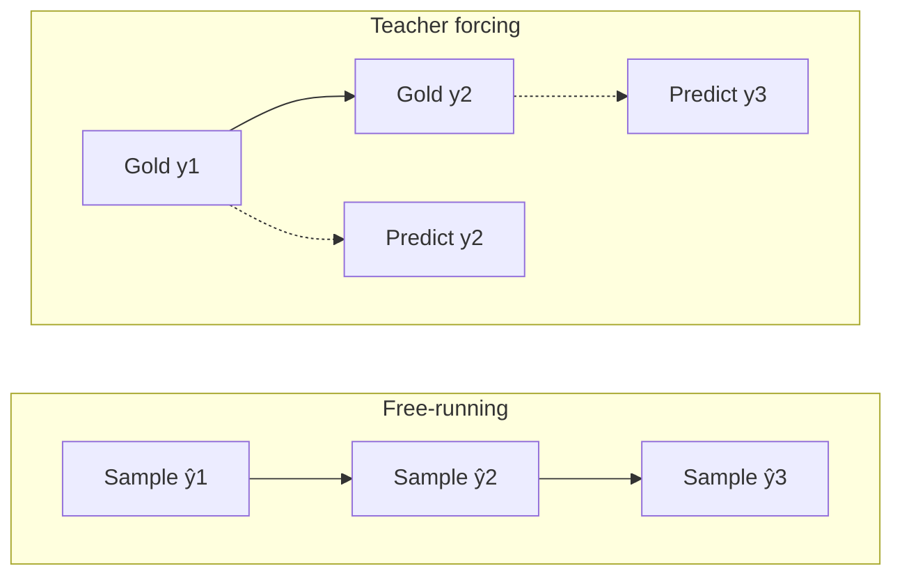

**Teacher forcing** trains an autoregressive sequence model by conditioning every next-token prediction on the *true* previous tokens from the dataset. The name comes from Williams and Zipser (1989): the ground-truth previous token acts as the teacher signal at each step, keeping later predictions on the gold trajectory.

For a target sequence $y_1,\ldots,y_T$ (and optional context $X$ such as a prompt or encoder input), maximum likelihood under teacher forcing maximizes

$$
\log P_\theta(Y \mid X) = \sum_{t=1}^{T} \log P_\theta(y_t \mid y_{<t}, X)
$$

with $y_{<t}$ taken from the data. At inference those gold prefixes are gone; the model must condition on its own samples $\hat{y}_{<t}$. That train/serve gap is often called **exposure bias**.

## Intuition

Teacher forcing scores every position against the correct prefix, so an incorrect prediction at step 1 does not alter the training input for step 2. Free-running generation conditions on sampled prefixes instead, so early errors can cascade.

In modern decoder-only LLMs the "force" is almost invisible: you pack the full sequence, shift labels by one, apply a [causal mask](glossary://causal-mask), and compute [cross-entropy](glossary://cross-entropy) at every position in one forward pass. The model still only ever *sees* gold history during that pass.

## Diagram



Both paths use the same model weights. The drawing shows the first few positions: training conditions on the gold chain, and dashed arrows are predictions scored against the next gold token. Inference conditions on its sampled chain; there is no gold token to inject after the prompt.

## How it works

**1. Factorization.** Autoregressive models write

$$
P_\theta(y_1,\ldots,y_T \mid X) = \prod_{t=1}^{T} P_\theta(y_t \mid y_{<t}, X).
$$

Teacher forcing plugs in the observed $y_{<t}$ for every factor and averages the negative log-likelihood (token-level cross-entropy) over the batch.

**2. Parallel scoring in transformers.** RNNs had to step through time even with gold inputs. Transformers feed the whole sequence once: position $t$ predicts $y_{t+1}$ (or $y_t$ after the usual shift) while the causal mask blocks attention to the future. All $T$ conditionals are scored together. That is why training tokens/sec can be high even though generation remains serial.

**3. Label shift (operational form).** For tokens `ids = [bos, a, b, c, eos]`:

```python
# Causal LM: inputs predict the next token
input_ids = ids[:-1]   # [bos, a, b, c]
labels    = ids[1:]    # [a,    b, c, eos]
# loss = mean CE(logits[i], labels[i]) with ignore_index on pads / prompt
```

SFT often masks loss on the user prompt and scores only the assistant span; teacher-forced conditioning still uses the observed prompt and earlier assistant tokens. This input/label slicing is conceptual: libraries that shift causal-LM labels internally usually expect unshifted labels, so do not shift them twice.

**4. Related training regimes.** Free-running (or closed-loop) training feeds $\hat{y}_{t-1}$ sampled from the model. Scheduled sampling (Bengio et al., 2015) mixes gold and model tokens with a decaying probability of using gold. Professor forcing (Lamb et al., 2016) matches hidden dynamics between teacher-forced and free-running rollouts. Large LLMs still mostly use pure teacher forcing for pretraining and SFT.

## Formula

Per-token loss under teacher forcing (hard label $y_t$):

$$
\mathcal{L}_t = -\log P_\theta(y_t \mid y_{<t}, X) = -z_{y_t} + \log\sum_j e^{z_j}
$$

where $z$ are the logits at position $t$. Sequence loss is usually the mean over non-masked positions:

$$
\mathcal{L} = \frac{1}{|S|}\sum_{t \in S} \mathcal{L}_t.
$$

[Perplexity](glossary://perplexity) on held-out text is $\exp(\text{mean } \mathcal{L})$ under the same teacher-forced scoring: it measures how well the model assigns probability to *gold* continuations, not how good free-running samples look.

Scheduled sampling (for contrast) at training step $i$ uses gold $y_{t-1}$ with probability $\varepsilon_i$ and a model sample $\hat{y}_{t-1}$ with probability $1-\varepsilon_i$, with $\varepsilon_i$ annealed from $1$ toward $0$ (Bengio et al., 2015). Pure teacher forcing is the $\varepsilon=1$ extreme.

## Example

Target reply after a fixed prompt: `reset the password`.

| Position | Conditioning prefix (teacher forced) | Gold next token | What free-running might see instead |
|----------|--------------------------------------|-----------------|-------------------------------------|
| 1 | prompt | `reset` | prompt |
| 2 | prompt + `reset` | `the` | prompt + `clear` (wrong sample) |
| 3 | prompt + `reset the` | `password` | prompt + `clear cache` (drift) |

Under teacher forcing, the loss for predicting `password` always uses the true prefix `reset the`. The model never practices the recovery path "I already said `clear`, now what?" Cross-entropy can fall smoothly while free-running generations still derail after one bad early token.

Concrete numbers for one position. Assume a toy vocabulary containing exactly `{the, a, your}`; gold is `the`; logits $z = [2.0, 0.5, 0.0]$:

$$
p_{\text{the}} = \frac{e^{2.0}}{e^{2.0}+e^{0.5}+e^{0}} \approx 0.736, \qquad \mathcal{L} = -\log 0.736 \approx 0.306
$$

That contribution scores the gold continuation given its observed prefix. If the model had sampled `a` earlier, the hidden state and attention context would differ. A loss computed there would still be mathematically defined, but it would score a different conditional distribution from the teacher-forced term above.

## Trade-offs

| | Teacher forcing | Free-running / mixed training |
|--|-----------------|-------------------------------|
| Stability | Stable targets; gradients stay on data support | Early training can be noisy if self-samples are garbage |
| Throughput | Full-sequence parallel pass (transformers) | Often sequential or multi-pass; harder to batch |
| Match to inference | Systematic exposure bias | Closer to serve-time conditioning |
| Metrics | Low CE / PPL can look strong while generation fails | Harder to interpret token NLL alone |

Production LLM stacks usually accept the bias: scale, data quality, instruction SFT, preference methods (DPO/RLHF), and decoding policy carry generation quality. They evaluate with free-running samples alongside teacher-forced loss.

## Why it matters here

Teacher forcing is the default training loop behind next-token pretraining, supervised fine-tuning, and intrinsic metrics like perplexity. It explains why training is parallel while [autoregressive decoding](glossary://autoregressive-decoding) is serial, why training loss can fall while open-ended generation remains poor, and why speculative decoding can *reuse* teacher-forced parallel scoring at serve time: a draft span is known, so the target model scores all draft positions in one pass the same way training scores gold tokens. When offline CE looks fine but live answers drift, inspect exposure bias, decoding, evaluation methodology, and learning rate.

## Related terms

- [Cross-entropy](glossary://cross-entropy)
- [Autoregressive decoding](glossary://autoregressive-decoding)
- [Causal mask](glossary://causal-mask)
- [Perplexity](glossary://perplexity)
- [Supervised fine-tuning](glossary://supervised-fine-tuning)
