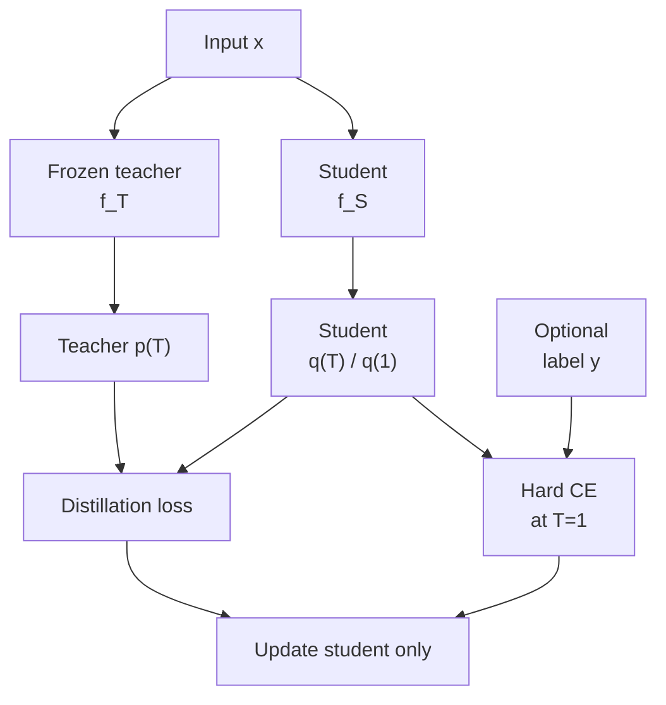

Teacher-student distillation (also called **knowledge distillation**) trains a **student** model to imitate useful signals from a **teacher** (or ensemble). The teacher is often stronger, and the student usually smaller, cheaper, or more deployable, though equal-size and self-distillation also exist. Signals can include soft class probabilities, token logits, hidden states, rationales, tool traces, preference labels, or hard teacher-generated answers. Soft distributions convey information a one-hot label omits. Classic form: Hinton, Vinyals, and Dean (2015), building on model compression by Buciluǎ, Caruana, and Niculescu-Mizil (2006).

## Diagram



## Intuition

A trained teacher encodes more than its argmax. Relative scores among *incorrect* classes are informative: a BMW might almost never be called a carrot, yet still be far more confusable with a garbage truck than with a vegetable (Hinton et al.'s classic example). They call the structure in those small probabilities **dark knowledge**. Hard labels discard it; soft targets keep it.

Temperature $T$ in the softmax softens the teacher's distribution so those ratios become usable gradients for a capacity-limited student. After training, the student runs at $T=1$ (or whatever decoding temperature the product needs). Only student weights update; the teacher is frozen (or replaced by offline cached targets).

## Formula

**Notation.** This entry uses $p$ for the teacher's soft distribution and $q$ for the student's. Some curriculum lessons reverse those labels ($q$ teacher, $p$ student) for the same $T^{2}\mathrm{KL}$ objective. The math is the same; match symbols to the local definition before comparing formulas.

**Softmax with temperature.** For teacher logits $v$ and student logits $z$:

$$
p_i = \frac{\exp(v_i / T)}{\sum_j \exp(v_j / T)}, \qquad
q_i = \frac{\exp(z_i / T)}{\sum_j \exp(z_j / T)}
$$

**Distillation objective (soft targets).** Cross-entropy of the student against the teacher's soft distribution at the same $T$:

$$
\mathcal{L}_{\mathrm{soft}} = T^{2}\, H(p, q) = -T^{2} \sum_i p_i \log q_i
$$

Equivalently (up to a $p$-only constant), minimize $T^2 D_{\mathrm{KL}}(p \Vert q)$ at temperature $T$. The unscaled logit gradient is $(q_i-p_i)/T$; for fixed logits at sufficiently high $T$, the probability difference also shrinks roughly as $1/T$. The factor $T^{2}$ therefore approximately restores gradient scale when mixing soft matching with hard CE, rather than being an exact correction at every temperature (Hinton et al., §2).

**Optional hard labels.** When ground-truth $y$ is available, add ordinary CE at $T=1$ on the same student logits:

$$
\mathcal{L} = \alpha\, \mathcal{L}_{\mathrm{soft}} + (1-\alpha)\, \mathcal{L}_{\mathrm{hard}}, \qquad
\mathcal{L}_{\mathrm{hard}} = -\log q^{(T=1)}_{y}
$$

Hinton et al. typically use a **lower weight** on the hard term than on soft matching. At high $T$, matching soft probs is approximately matching zero-meaned logits (squared error), which recovers the earlier Caruana-style logit matching as a special case.

**Token / sequence level (LLMs).** For autoregressive models, the same idea applies per next-token distribution, or at sequence level by training on full teacher generations (sequence-level KD; Kim and Rush, 2016). Forward KL $D_{\mathrm{KL}}(p_{\mathrm{teacher}} \Vert q_{\mathrm{student}})$ is **mass-covering** (student spreads mass where the teacher does). Reverse KL (as in MiniLLM-style objectives) is more **mode-seeking** and can better suit generation under tight student capacity.

## Worked numbers

Three-class logits, teacher $v=[4.0, 2.0, 0.1]$, student $z=[3.5, 2.2, 0.5]$. Softmax as above; $H(p,q)=-\sum_i p_i\log q_i$ in nats.

| $T$ | Teacher $p$ | Student $q$ | Soft CE $H(p,q)$ |
|-----|-------------|-------------|------------------|
| 1   | $[0.865, 0.117, 0.018]$ | $[0.756, 0.206, 0.038]$ | $\approx 0.48$ |
| 2   | $[0.662, 0.244, 0.094]$ | $[0.573, 0.299, 0.128]$ | $\approx 0.86$ |
| 4   | $[0.504, 0.306, 0.190]$ | $[0.456, 0.329, 0.215]$ | $\approx 1.03$ |

At $T=1$ the teacher is nearly one-hot on class 0 (class 2 is only $\approx 1.8\%$); most gradient mass is "be more sure about 0." At $T=4$ class 1 and 2 keep meaningful probability ($\approx 31\%$ and $\approx 19\%$), so the student learns *how* the teacher confuses classes through alternatives as well as the winner. Soft CE rises as distributions flatten, but each class contributes a usable signal. In code, scale the KL/CE term by $T^{2}$ when mixing with hard CE so that term does not vanish as $T$ grows.

## Example

**Classic logits KD (classification head).** Distil a BERT-size teacher into a smaller student on a support-ticket topic classifier:

```python
import torch
import torch.nn.functional as F

def kd_loss(student_logits, teacher_logits, labels, T=2.0, alpha=0.7):
    # soft: teacher and student at temperature T
    log_q = F.log_softmax(student_logits / T, dim=-1)
    p = F.softmax(teacher_logits.detach() / T, dim=-1)
    soft = F.kl_div(log_q, p, reduction="batchmean") * (T * T)
    # hard: standard CE at T=1
    hard = F.cross_entropy(student_logits, labels)
    return alpha * soft + (1.0 - alpha) * hard
```

Teacher stays in `eval()` with frozen weights (or precompute and cache logits offline). Student trains with this loss.

**Deployed NLP compression.** DistilBERT (Sanh et al., 2019) distills BERT-base during pretraining with a triple loss: soft CE on teacher MLM distributions, the student's own masked LM loss, and a cosine loss aligning hidden states. Result reported in the paper: about **40% fewer parameters**, **60% faster** inference, retaining about **97%** of BERT's GLUE macro score under their setup. A second distillation step at fine-tuning (task teacher → student) can recover more task score.

**LLM product path.** A large teacher generates answers, chain-of-thought traces, tool-call transcripts, or preference pairs; a smaller student is SFT'd (and sometimes further aligned) on those artifacts. That is still teacher-student transfer, even when the "soft" object is a full sequence rather than a full vocabulary distribution at every step. Offline synthetic data is common when online teacher logits over a large vocab are too expensive to store or stream.

## What gets distilled

| Signal | What the student learns | Typical use |
|--------|-------------------------|-------------|
| Softened token / class probs | Probability shape, confusions | Hinton KD, DistilBERT CE term |
| Hidden states / attention maps | Intermediate geometry | TinyBERT, MiniLM-style layers |
| Hard teacher outputs (SeqKD) | Surface behavior, format | Cheap SFT from teacher rollouts |
| Rationales / CoT traces | Intermediate reasoning style | Small reasoners from large teachers |
| Tool traces / action logs | Policy over tools | Agent distillation |
| Preference / rank labels | Ranking behavior | Distilled reward or preference models |

The signal you choose is the contract for what can survive capacity cut. Logit matching preserves ranking among alternatives; hard answer SFT does not teach near-miss confusions unless the dataset covers them explicitly.

## How it works in practice

1. **Pick teacher and student capacity.** Choose a student with enough capacity for the target behaviors; compression can remove behaviors the student cannot represent.
2. **Choose transfer set.** Original labeled data, unlabeled production traffic, or teacher-generated synthetic data. Soft targets often let you train with less data than hard labels alone (Hinton et al., speech experiment with 3% of data).
3. **Cache or stream teacher signals.** Offline logits or generations cut GPU cost; on-policy student rollouts (student samples, teacher scores) need different losses and more care.
4. **Train student only.** Freeze teacher; mix soft and hard losses; tune $T$ and $\alpha$. Very small students often prefer moderate $T$ (Hinton et al. saw intermediate $T$ beat very high $T$ when capacity was tiny).
5. **Evaluate slices that matter.** Average accuracy can look fine while calibration, rare domains, refusals, or long-form quality collapse.

## Trade-offs

| Benefit | Cost / risk |
|---------|-------------|
| Lower latency, memory, \$/query | Student capacity ceiling; cannot copy all teacher skill |
| Soft targets regularize; dense gradients | Teacher bias and errors transfer |
| Offline synthetic data scales SFT | Stale teacher; distribution shift vs live traffic |
| One deployable model instead of ensemble | Training pipeline more complex than plain SFT |
| Orthogonal to quantization / pruning | Stacked compression can compound quality loss |

**How distillation differs from teacher forcing.** [Teacher forcing](glossary://teacher-forcing) feeds gold previous tokens during sequence training. Distillation transfers *another model's* targets or behavior. Speculative decoding pairs a small draft model with a large verifier at *inference*, leaving student weights unchanged.

## Production failure modes

- **Surface match, weak robustness.** Student copies format and common cases; fails on long tail, adversarial prompts, or multi-step tools.
- **Safety and refusal drift.** Teacher refusals and hedges are soft; hard-label SFT on "helpful" answers can wash them out unless safety slices are in the transfer set and eval suite.
- **Calibration loss.** High-$T$ soft matching still needs calibration evaluation on the student's deployed decoding path. Re-check ECE / slice reliability if scores drive routing or abstention.
- **Tokenizer / architecture mismatch.** Shared vocab and comparable head geometry make logit KD easy. Cross-architecture transfer often falls back to sequence-level or feature-projection losses.
- **Stale teacher.** Distilled student freezes teacher behavior at distillation time. Product or policy changes need refresh runs and regression gates.
- **Average-only evaluation.** Hold out domains where the teacher was hired (math, code, policy language), and report those slices alongside overall accuracy.

## Why it matters here

Distillation is how expensive model behavior becomes a smaller checkpoint you can serve: edge encoders, cheaper chat models, distilled judges, and compressed rerankers. It sits next to [supervised fine-tuning](glossary://supervised-fine-tuning) (often the hard-label or sequence-KD path), [quantization](glossary://quantization) (weight precision, not behavior transfer), and preference training. For LLM engineers, the design questions are concrete: which teacher signal, which loss geometry (forward vs reverse KL), how much capacity the student has, and which production slices prove the transfer worked.

## Related terms

- [Supervised fine-tuning](glossary://supervised-fine-tuning)
- [KL divergence](glossary://kl-divergence)
- [Temperature](glossary://temperature)
- [Cross-entropy](glossary://cross-entropy)
- [Logits](glossary://logits)
