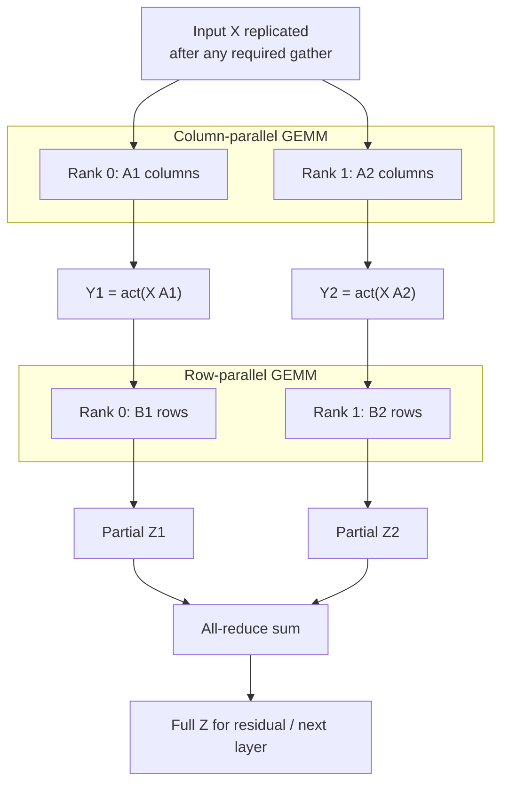

Tensor parallelism (TP) is **intra-layer model parallelism**: it splits the weight matrices and activations of a *single* layer across devices so that one GEMM, attention block, or MLP runs as cooperating shards. Each GPU holds only a slice of the parameters for that layer, computes a partial result, then joins a collective ([NCCL](glossary://nccl) all-reduce, all-gather, or reduce-scatter) so the mathematical output matches a single-device layer.

[Data parallelism](glossary://data-parallelism) replicates the model and splits the *batch*. [Pipeline parallelism](glossary://pipeline-parallelism) cuts the *depth* of the stack. Tensor parallelism cuts the *width* of a layer. Megatron-style LLM stacks often combine all three (3D parallelism): keep TP on fast intra-node links, PP across nodes, and DP (or FSDP/ZeRO) across replicas.

## Intuition

A linear layer $Y = X A$ with $A \in \mathbb{R}^{h_{\mathrm{in}} \times h_{\mathrm{out}}}$ stores every entry of $A$ on one GPU in the naive case. When $h_{\mathrm{out}}$ (or the intermediate FFN width) is huge, that matrix alone, plus activations and the rest of the block, exceeds device memory or under-uses FLOPs if you refuse to use more GPUs on that layer.

TP answers: **partition $A$** so each rank owns $1/t$ of the columns or rows, runs a smaller local matmul, and pays a collective to reassemble the correct full tensor where the next op needs it. The Megatron design pairs a **column-parallel** linear with a **row-parallel** linear so nonlinearities (GeLU/SwiGLU) stay local, with roughly one all-reduce per sub-block in the forward pass.

## How it works

### Column-parallel linear

For $Y = X A$, split $A$ along columns (output features):

$$
A = [A_1 \mid A_2 \mid \cdots \mid A_t],
\quad
Y_i = X A_i
$$

Rank $i$ holds $A_i$ and produces $Y_i$. Concatenating the $Y_i$ (all-gather) recovers $Y$. Elementwise ops that act independently on output channels (GeLU on each half of an MLP expansion) can run **before** any gather because each rank has the values for its local output channels. That is why Megatron column-parallelizes the first MLP GEMM and the Q/K/V projections.

### Row-parallel linear

Split $A$ along rows (input features):

$$
A = \begin{bmatrix} A_1 \\ A_2 \\ \vdots \\ A_t \end{bmatrix},
\quad
Y = \sum_{i=1}^{t} X_i A_i
$$

Each rank holds $A_i$ and multiplies the input-feature slice $X_i$ that matches $A_i$'s rows (or takes the matching columns of a replicated full $X$). A sequence shard alone does not supply this feature partition: sequence-parallel implementations arrange the required gather/scatter transitions. The partial products sum to $Y$ via **all-reduce** in the classic pattern. Row-parallel is the natural partner after a column-parallel expansion: the sharded intermediate is already the right layout for a row-split second matrix.

### Megatron transformer block pattern

For one transformer layer (Shoeybi et al., Megatron-LM; also used by Megatron Core and by vLLM's TP path):

1. **Self-attention.** Column-parallel Q, K, V (heads split across ranks). Local attention per head shard. Row-parallel output projection. Forward: all-reduce after the output projection (`g` in Megatron's notation).
2. **MLP.** Column-parallel first linear (+ local activation). Row-parallel second linear. Forward: all-reduce after the second linear.

Megatron defines conjugate ops $f$ and $g$:

- $f$: identity in forward, all-reduce in backward
- $g$: all-reduce in forward, identity in backward

Per transformer layer that yields **two all-reduces in the forward pass** and **two in the backward pass** (one pair for attention, one for MLP). Sequence parallelism (when enabled with TP) further shards LayerNorm/Dropout activations along the sequence axis to cut activation memory; frameworks often recommend it whenever TP $> 1$.

### Serving versus training

| Setting | What TP must support | Typical knob |
| --- | --- | --- |
| Training | Forward, backward, optimizer (often with distributed optimizer), checkpoints that match shard layout | Megatron Core `tensor_model_parallel_size` |
| Inference | Forward only; weights and often KV shards live on TP ranks | vLLM `tensor_parallel_size` |

In decode, each new token triggers the same per-layer collectives on **tiny** activations. Bandwidth still matters, but **latency** of frequent small all-reduces often dominates. Prefill with large batches/sequences can hide more communication behind compute.

## Formula

**World size (classic 3D, no CP/EP).** With tensor degree $t$, pipeline degree $p$, and data-parallel degree $d$:

$$
N_{\mathrm{GPU}} = t \times p \times d
$$

With context parallelism, Megatron Core uses $N = t \times p \times c \times d$ for the dense layout. Expert parallelism repartitions ranks within the available parallel groups. Calculate dense and expert layouts from the framework's group definitions; MoE may use a different expert tensor-parallel degree, so multiplying every configured degree as an independent factor would miscount ranks.

**Memory for sharded dense weights.** For a parameter count $\Psi$ stored at $w$ bytes per element (for example $w=2$ in BF16), a pure TP group of size $t$ stores about

$$
M_{\mathrm{weights, rank}} \approx \frac{w\,\Psi}{t}
$$

per rank for those sharded tensors (embeddings and unsharded norms may differ). Activations and KV cache also shrink for head/FFN-sharded dims, but residual streams and all-reduced full hidden states still cost $O(w \cdot B \cdot S \cdot h)$ where $B$ is batch, $S$ sequence, $h$ hidden size.

**Communication volume (order of magnitude, ring-style all-reduce).** Narayanan et al. (SC'21 Megatron scaling paper) bound per-layer TP traffic for classic Megatron **without sequence parallel**: for microbatch size $b$, sequence $s$, hidden $h$, and TP degree $t$, full hidden tensors of size $bsh$ (in elements) are all-reduced twice in forward and twice in backward per layer. Per device, ring all-reduce moves about $2\frac{t-1}{t}$ element-volumes per collective, so four collectives give

$$
V_{\mathrm{layer, device}} \approx 8\,bsh\,\frac{t-1}{t}
$$

elements (multiply by $w$ for bytes). Sequence parallel replaces some of those full-$bsh$ all-reduces with all-gather / reduce-scatter on sequence shards, so the collective shape changes even when the order of magnitude stays similar. With $\ell_{\mathrm{stage}}$ layers on a pipeline stage, multiply by $\ell_{\mathrm{stage}}$. That is why **$t$ larger than GPUs on one node** often fails: NVLink can absorb frequent all-reduces; cross-node Ethernet or weak IB often can't.

**Head divisibility.** Attention TP usually requires query heads to divide evenly over $t$. KV heads under GQA can be partitioned when divisible, or replicated across ranks when there are fewer KV heads than ranks and the implementation supports it. Other incompatible layouts are rejected; do not assume uneven packing is available.

## Diagram



## Worked numbers

**Weight shard.** A dense 70B model in BF16 is roughly $70 \times 10^9 \times 2 \approx 140$ GB of weights alone. With $t = 8$, each TP rank holds about $140/8 \approx 17.5$ GB of those weights (plus KV, activations, and framework overhead). That is often what makes "70B on 8×80 GB" possible once KV budget is controlled.

**Communication vs node size.** On an 8-GPU HGX node, $t = 8$ can keep TP collectives inside its NVLink domain. Raising to $t = 16$ across two nodes introduces inter-node traffic; calculate its fraction from rank order and NCCL's selected topology and algorithm. For decode with $b=1$, $s=1$, $h=8192$ in BF16, one all-reduce activation payload is $16384$ bytes ($16$ KiB), so collective latency can dominate tokens/sec. Prefill with $b=8$, $s=4096$, $h=8192$ in BF16 produces $536870912$ bytes ($512$ MiB) per payload and can instead be bandwidth-bound.

**Head constraint.** A model with 64 query heads supports $t \in \{1,2,4,8,16,32,64\}$ in the usual even split. With 32 heads, $t=8$ works; $t=12$ does not without special packing.

## Example

**Training topology.** You pretrain a ~70B decoder-only model on 64 GPUs with Megatron-style 3D parallel:

- $t = 8$ (one node of 8 GPUs for TP)
- $p = 4$ (four pipeline stages)
- $d = 2$ (two data-parallel replicas)

$$
N = 8 \times 4 \times 2 = 64
$$

Each transformer MLP is column-then-row sharded eight ways; each attention block splits heads across the eight ranks. Collectives stay inside the node. Pipeline stages exchange activations across nodes with cheaper point-to-point traffic. DP ranks synchronize (or shard via distributed optimizer / FSDP) after the pipeline flush.

**Inference with vLLM.** A single replica of a model that does not fit on one GPU:

```python
from vllm import LLM

# One replica sharded across 4 GPUs (Megatron-style TP inside vLLM)
llm = LLM("meta-llama/Llama-3.1-70B-Instruct", tensor_parallel_size=4)
outs = llm.generate("San Francisco is a")
```

Or serving:

```bash
vllm serve meta-llama/Llama-3.1-70B-Instruct --tensor-parallel-size 4
```

vLLM's guidance: prefer TP for single-node multi-GPU fit; for a multi-node replica, set `tensor_parallel_size` to GPUs per node and add pipeline parallel for the node count so TP collectives stay on the fast local links. If GPUs lack NVLink (for example some L40S nodes), prefer pipeline parallel for multi-GPU even on one node when TP collectives dominate.

## Sizing

| Goal | Prefer |
| --- | --- |
| Fit a wide layer / large hidden size | Raise $t$ while heads divide evenly |
| Stay on fast interconnect | Cap $t$ at GPUs per NVLink domain (often 8) |
| Scale depth multi-node | Raise pipeline $p$ across nodes; keep $t$ within the local fast-link domain |
| Scale throughput with model already fit | Raise data-parallel $d$ (or more replicas in serving) |
| Long sequence activation pressure | Sequence parallel with TP; or context parallel in Megatron Core |
| MoE expert layers | Expert parallel (often with TP for non-expert mats) |

Rule of thumb from large-scale Megatron training: use TP up to the node width, then pipeline across nodes, then DP for remaining GPUs. Serving mirrors that: TP for width/fit on a node, PP for multi-node depth, separate replicas for QPS.

## Debug path

- **OOM only when $t=1$:** model width or KV does not fit; raise $t$ or quantize / shorten context before blaming the framework.
- **OOM after raising $t$:** unexpected full replicas of embeddings, logits, or optimizer state; or activation memory not dropping (sequence parallel off). Check which tensors are actually sharded.
- **Tokens/sec falls when $t$ rises:** profile NCCL time vs matmul time. If collectives dominate, shrink $t$, keep the group on NVLink, or switch multi-node growth to PP.
- **Hang or NCCL timeout:** mismatched TP group sizes, wrong process-group ranks, or one rank taking a different control-flow path (uneven batch, different `max_model_len`).
- **Wrong numerics vs single GPU:** all-reduce missing after a row-parallel layer, incorrect residual path, or dropout/RNG not synchronized under model parallel.
- **Config rejected:** `num_attention_heads % t != 0` (or KV-head divisibility under GQA). Pick a divisor of both when the stack requires it.
- **Checkpoint / serve mismatch:** training saved TP-sharded weights; serving expects a different `tensor_parallel_size` or merged HF layout. Convert with the stack's reshard tools; do not assume rank files load into an arbitrary $t$.

## Trade-offs

| Raise $t$ | You gain | You pay |
| --- | --- | --- |
| Memory per rank for wide mats | Lower | More ranks must participate in every layer |
| Parallel GEMM width | Higher FLOPs on the layer | Smaller local GEMMs can underfill tensor cores if $t$ is too large |
| Fit 70B+ on multi-GPU | Often required | Decode latency sensitivity to interconnect |
| Vs more DP | Better when a *single* replica does not fit | Vs more DP when the model already fits and you need QPS |
| Vs more PP | Lower pipeline bubble; same-layer sync | Heavier collectives than PP's P2P |

For a 7B model that already fits on one GPU, scale request rate with more replicas (data-parallel serving) instead of setting $t=8$ on one request path.

## Why it matters here

Tensor parallelism is how large transformer layers span GPUs in both pretraining and production serving. Curriculum topics on Megatron, DeepSpeed, FSDP, vLLM, NCCL, and 3D parallelism assume you can reason about column/row splits, per-layer all-reduces, head divisibility, and why TP groups must stay on fast links. When TTFT or tokens/sec collapse after you "just set TP=8," inspect communication shape alongside the FLOP estimate; collective overhead is often the limiting factor.

## Related terms

- [Pipeline parallelism](glossary://pipeline-parallelism)
- [Data parallelism](glossary://data-parallelism)
- [NCCL](glossary://nccl)
- [NVIDIA Megatron](glossary://nvidia-megatron)
- [vLLM](glossary://vllm)
