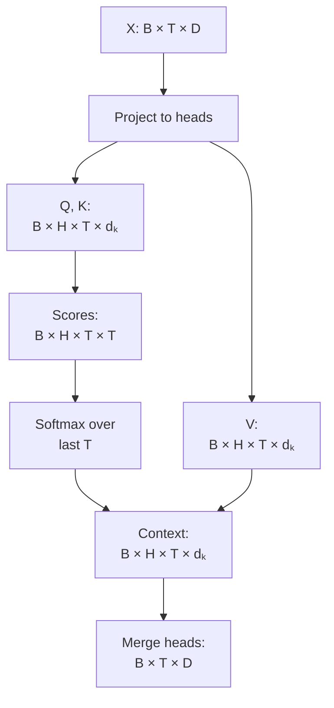

**Tensor shape** is the ordered tuple of axis lengths on a [tensor](glossary://tensor): how many elements sit along each dimension, from the outermost axis to the innermost. A tensor with shape $(d_0, d_1, \ldots, d_{r-1})$ has **rank** (number of dimensions) $r$. The values live on a rectangular grid; the shape is The schema every matmul, broadcast, attention score, and loss reduction must honor.

In frameworks, shape is first-class metadata. PyTorch exposes it as `tensor.shape` / `tensor.size()` (a `torch.Size` tuple). NumPy uses `ndarray.shape`. The product of the sizes is the element count:

$$
\mathrm{numel} = \prod_{i=0}^{r-1} d_i
$$

(with the empty product equal to $1$ for a rank-0 scalar). Memory in bytes is roughly $\mathrm{numel} \times b$ for element size $b$, before padding, views, or non-contiguous layouts.

## Intuition

Shape answers two questions at once:

1. **Geometry:** which axis is batch, which is time, which is feature width?
2. **Compatibility:** can this tensor multiply, concatenate, or reduce with that one?

Raw integers alone are easy to misread. The same layout `(2, 8, 128, 64)` might mean `[batch, heads, seq, head_dim]` or a botched `[batch, seq, heads, head_dim]` after a wrong `permute`. Name axes when you debug; treat anonymous tuples as a smell at module interfaces.

Common ML axis names:

| Letter | Meaning |
| --- | --- |
| $B$ | batch (examples, requests, or packed sequences) |
| $T$ / $L$ / $S$ | sequence length (tokens or time) |
| $H$ / $n_{\mathrm{h}}$ | attention heads (or image height; context decides) |
| $D$ / $d_{\mathrm{model}}$ | hidden / residual width |
| $d_k$ | per-head key/query dimension |
| $C, H, W$ | channels, height, width (vision) |
| $V$ | vocabulary size (logits over tokens) |

Layout conventions matter as much as the sizes. Vision often uses NCHW `(N, C, H, W)` in PyTorch and NHWC elsewhere. Language models almost always put batch first and sequence next: `(B, T, D)`. Mixing conventions is a frequent silent-or-loud shape bug.

## Formula

**Rank and size.** Shape $(d_0,\ldots,d_{r-1})$ has rank $r$; index $i$ runs over $0 \le i < d_i$ on that axis.

**Broadcasting** (NumPy and PyTorch; align from the **trailing** axis leftward). Two dimensions are compatible if they are equal, or one of them is $1$. Missing leading dimensions act like size $1$. The result takes the non-singleton size (or the common size); for positive dimensions this is the maximum, but broadcasting sizes $0$ and $1$ yields $0$, not $1$. If any pair fails both rules, the op raises (NumPy `ValueError`, PyTorch `RuntimeError`).

Examples from the NumPy rule book:

$$
\begin{align*}
(256, 256, 3) &\times (3) &&\to (256, 256, 3) \\
(8, 1, 6, 1) &\times (7, 1, 5) &&\to (8, 7, 6, 5) \\
(4, 3) &\times (4) &&\text{fails (trailing } 3 \neq 4\text{)}
\end{align*}
$$

**Matmul / batched GEMM.** For 2D, $(m, k) \times (k, n) \to (m, n)$. Higher rank treats leading dimensions as a batch that must broadcast: attention often multiplies

$$
Q \in \mathbb{R}^{B \times H \times T_q \times d_k}
\quad\text{by}\quad
K^\top \in \mathbb{R}^{B \times H \times d_k \times T_k}
\quad\to\quad
S \in \mathbb{R}^{B \times H \times T_q \times T_k}.
$$

**Reshape constraint.** `view` / `reshape` to a new shape $(d'_0,\ldots,d'_{r'-1})$ requires the same `numel`. A single $-1$ can infer a size when the other sizes determine it unambiguously; it does not relax the element-count requirement. Reshape does **not** reorder semantic axes; `permute` / `transpose` does. A no-copy `view` also requires compatible strides.

## Diagram



Each arrow is a shape schema. Swapping $H$ and $T$ in $Q$ still yields a legal matmul against a similarly broken $K$, but the scores no longer mean "query position vs key position."

## Example

**Vision batch.** Thirty-two RGB images at $224 \times 224$ in channel-first layout:

```text
images.shape = (32, 3, 224, 224)   # B, C, H, W
numel        = 32 * 3 * 224 * 224  # 4_816_128 elements
```

**LLM attention (concrete numbers).** Batch $B=2$, sequence $T=128$, model width $D=512$, $H=8$ heads so $d_k = D / H = 64$:

```text
hidden   : (2, 128, 512)        # B, T, D
q_proj   : (2, 128, 512)        # still B, T, D before split
q_heads  : (2, 8, 128, 64)      # B, H, T, d_k  after reshape+permute
k_heads  : (2, 8, 128, 64)
scores   : (2, 8, 128, 128)     # B, H, T_q, T_k
attn_out : (2, 128, 512)        # merged back to residual stream
logits   : (2, 128, 32000)      # B, T, V  (example vocab)
```

If someone permutes to `(2, 128, 8, 64)` and multiplies as if the layout were still `(B, H, T, d_k)`, the last two axes of the score tensor become nonsense. The op may still run. Assert named dims at partitions:

```python
assert q.shape == (B, H, T, d_k), q.shape
assert scores.shape == (B, H, T, T), scores.shape
```

**Broadcast trap in loss.** Logits `(B, C)` and targets accidentally shaped `(B, 1)` can broadcast in elementwise ops and produce a wrong reduced loss without an immediate rank error. Prefer explicit `squeeze` / class-index shapes and unit tests with unequal $B$ and $C$.

## Worked numbers

Start with $x$ of shape $(2, 3)$:

$$
x = \begin{bmatrix} 1 & 2 & 3 \\ 4 & 5 & 6 \end{bmatrix}
$$

- `numel` $= 6$. Rank $= 2$.
- `x.unsqueeze(0)` → shape $(1, 2, 3)$ (new batch axis of length 1).
- `x.reshape(3, 2)` → shape $(3, 2)$: same six values in storage order, **not** a transpose of rows/columns as linear algebra means it.
- True axis swap: `x.T` or `x.permute(1, 0)` → shape $(3, 2)$ with $x_{01}=2$ moved to position $(1,0)$.

Broadcast add with $v = (10, 20, 30)$ of shape $(3,)$:

$$
x + v \;\to\; \begin{bmatrix} 11 & 22 & 33 \\ 14 & 25 & 36 \end{bmatrix}
\quad\text{shape }(2, 3).
$$

$v$ of shape $(2,)$ does **not** broadcast against $(2, 3)$ under trailing-axis rules; `v[:, None]` gives shape $(2, 1)$, and `x + v[:, None]` then produces shape $(2, 3)$ by adding one value to each row.

## How it works in practice

| Operation | Shape effect | Typical use |
| --- | --- | --- |
| `unsqueeze` / `squeeze` | insert or remove size-1 axes | add batch dim; drop singleton after pool |
| `view` / `reshape` | re-partition `numel` | merge heads: `(B,T,H,d)` → `(B,T,D)` |
| `permute` / `transpose` | reorder axes | `(B,T,H,d)` → `(B,H,T,d)` for attention |
| `expand` / broadcast | virtual stretch of size-1 axes | masks, positional biases |
| `cat` along dim $i$ | sum sizes on axis $i$ | stack sequences or expert outputs |
| `stack` | new axis | pack a list of same-shaped tensors |
| matmul / `einsum` | schema shared dims | attention scores, FFN, vocab projection |

**Contiguity.** After `permute`, memory may be non-contiguous. Some kernels require `.contiguous()` before `view`. `reshape` is allowed to copy; `view` is not. Shape equality does not imply the same strides.

**Dynamic axes.** Serving and export (ONNX, TensorRT) often freeze all dims except batch and sometimes sequence length. A shape that "worked in the notebook" with fixed $T=128$ can break when $T$ varies per request unless padding, masks, and kernels agree.

## Debug path

When shapes disagree or results look subtly wrong:

1. Print `tensor.shape` (and dtype/device) at every module interface, including the crash site.
2. Say axes out loud: "batch, heads, query len, key len" before the matmul.
3. Check **trailing** broadcast alignment; size-1 axes are the usual silent stretch.
4. Separate **permute** bugs (wrong meaning, often still runs) from **reshape** bugs (wrong packing of `numel`).
5. For sequence models, confirm mask shape matches the score tensor: e.g. `(B, 1, 1, T)` or `(B, 1, T, T)` broadcasting onto `(B, H, T, T)`.
6. Reproduce with tiny distinct sizes ($B \neq T \neq H \neq d_k$) so an axis swap cannot hide by coincidence.

## Why it matters here

Many LLM and vision bugs start as a shape schema failure: head merge off by a factor of $H$, causal mask broadcast onto the wrong axes, logits `(B, T, V)` reduced as if they were `(B, V)`, image channels last when the backbone expects first, or a [KV cache](glossary://kv-cache) written as `(B, T, H, d)` while the kernel reads `(B, H, T, d)`. Frameworks will raise on hard mismatches; they will **not** raise when broadcasting or a legal matmul implements the wrong story. Naming axes, asserting shapes, and testing with non-square sizes turns shape from folklore into a reliable interface.

Curriculum work on attention, padding, batching, and export all assumes you can read and write these specifications fluently. Shape literacy is the cheapest production debug skill in deep learning.

## Related terms

- [Tensor](glossary://tensor)
- [Matrix](glossary://matrix)
- [NumPy array](glossary://numpy-array)
- [Padding](glossary://padding)
- [Attention head](glossary://attention-head)
