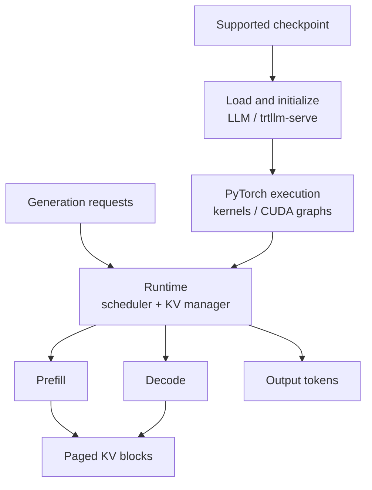

**TensorRT-LLM** (often abbreviated TRT-LLM) is NVIDIA's open-source library for high-performance **LLM and related generative inference** on NVIDIA GPUs. It runs supported trained checkpoints, optionally quantized, through its model definitions, kernels, and runtime for GPU-efficient execution and LLM-specific scheduling.

Current upstream documentation describes a PyTorch-native runtime: its [migration guide](https://nvidia.github.io/TensorRT-LLM/latest/legacy/tensorrt-backend-removal.html) says the TensorRT engine backend and `trtllm-build` have been removed. Supported Hugging Face checkpoints load directly through `LLM` or `trtllm-serve`; AutoDeploy builds on the PyTorch backend. Older pinned releases may still have the compiled-engine workflow, so read the documentation for your exact release. In production TensorRT-LLM integrates with [Triton Inference Server](glossary://triton-inference-server) and NVIDIA Dynamo. Compared with general [TensorRT](glossary://tensorrt), it specializes in [KV cache](glossary://kv-cache) layout, [continuous batching](glossary://continuous-batching), paged attention, chunked prefill, sampling, multi-GPU parallelism, and LLM quant formats.

## Intuition

Training frameworks (for example [PyTorch](glossary://pytorch) + Transformers) optimize for flexible training graphs. LLM serving optimizes for a narrow loop:

1. **Prefill** the prompt (compute-heavy, many tokens at once).
2. **Decode** one (or a few) new tokens per step while reading a growing KV cache (memory-bandwidth heavy).

Naive fixed-batch serving wastes GPU time: short requests wait for long ones, and contiguous max-length KV reservations leave memory empty. TensorRT-LLM attacks both problems with:

- **Model and kernel optimization**: fused kernels, supported precision paths (FP16/BF16/FP8/FP4/INT), optimized attention, CUDA graphs, and capacity limits (`max_batch_size`, `max_num_tokens`, `max_seq_len`).
- **Runtime scheduling**: in-flight batching mixes context-phase and generation-phase sequences every iteration; a paged KV manager allocates fixed-size blocks instead of one huge contiguous buffer per request.
- **Hardware-aware numerics**: FP8 on Hopper (H100 and later), FP4 on Blackwell (for example B200), tensor/pipeline/expert parallelism across GPUs.

The cost is a **runtime contract**: model support, GPU architecture, precision, captured graph shapes, and memory limits constrain which optimizations work together. Change those assumptions and reinitialize or recapture where needed, then revalidate. Current upstream uses the checkpoint initialization path shown below for supported models; legacy releases may require a separate serialized TensorRT engine.

## Diagram



## How it works

At a high level the modern stack looks like this (names follow NVIDIA's architecture docs):

| Piece | Role |
|-------|------|
| **Model definition** | TensorRT-LLM implementations of Llama, Qwen, DeepSeek, multimodal, and others; maps checkpoint weights into expected tensors |
| **Quantization** | Model Optimizer / native paths for FP8, AWQ-style W4, SmoothQuant, INT8 KV, FP4 on supported GPUs |
| **Initialization** | Loads supported weights and prepares model execution, memory pools, and configured CUDA graph captures |
| **LLM API / serve** | High-level `LLM(...)` or `trtllm-serve` for offline batch and OpenAI-style online serving |
| **PyExecutor** | Loop: fetch requests → schedule → allocate KV → forward → sample → return finished sequences |
| **Scheduler** | Respects `max_batch_size` and `max_num_tokens`; prefers generation-phase work; admits new prefills when budget remains |
| **KVCacheManager** | Paged pools and block reuse; the current `KvCacheConfig` reference defaults `tokens_per_block` to 32, with kernel/model-specific restrictions |
| **ModelEngine + Sampler** | GPU forward pass; temperature / top-k / top-p / beam and guided decoding on logits |

**In-flight batching (IFB)** is continuous / iteration-level batching: after each iteration, finished sequences leave, waiting work can enter, and context-phase sequences can share a step with generation-phase sequences. Inputs are **packed** (padding removed) so generation tokens are not padded out to the longest prompt.

**Chunked prefill** splits a long context into chunks (aligned to KV block size except the last chunk) so long prompts do not monopolize `max_num_tokens`, which stabilizes TTFT under load.

**Memory at runtime** is roughly:

$$
M_{\text{GPU}} \approx M_{\text{weights}} + M_{\text{activations}} + M_{\text{KV}} + M_{\text{runtime buffers}}
$$

- Weights scale with parameter count, dtype, and how tensor/pipeline parallel shards them.
- Activation workspace, captured graphs, and pools depend on configured maximum shapes and backend behavior. A smaller request batch does not necessarily release their reservations. Legacy TensorRT engines have build-time workspace constraints.
- KV cache is usually a large runtime pool. Current `KvCacheConfig.free_gpu_memory_fraction` defaults to **0.9**; `max_tokens` and other limits can reduce the allocation. Check the release's memory accounting rather than interpreting this as 90% of total GPU capacity.

Lower precision cuts weight payload and often bandwidth: one FP8 value uses half the bytes of an FP16 value, before scales and other metadata. Benchmark the full workload because end-to-end speedup depends on kernels, batch composition, and request shapes.

## Example

A product team serves **Llama-3.1-8B-Instruct** on a single H100 for chat:

1. Start from a Hugging Face checkpoint (or an NVIDIA FP8-optimized checkpoint such as a Model Optimizer export on the Hub).
2. Load through the current LLM API with `max_batch_size` high enough for concurrency and `max_num_tokens` tuned for the prefill/decode mix. Configure KV capacity and chunked prefill using the supported model/release options.
3. Expose `trtllm-serve` (or Triton TensorRT-LLM backend) and send OpenAI-style `v1/chat/completions`.

Offline smoke test with the high-level API (shape of the official quick start):

```python
from tensorrt_llm import LLM, SamplingParams

llm = LLM(model="meta-llama/Llama-3.1-8B-Instruct")  # or local / FP8 path
params = SamplingParams(temperature=0.0, max_tokens=64)
for out in llm.generate(["The capital of France is"], params):
    print(out.outputs[0].text)
```

They then A/B the **same checkpoint and tokenizer** against [vLLM](glossary://vllm) on identical traffic: same max context, same output-length distribution, same quantization story if both support it. Metrics are not a single "tokens/s" number.

## Worked numbers: capacity knobs

Suppose the configured limits are:

- `max_batch_size` $B = 64$
- `max_num_tokens` $T = 8192$
- tokens per KV block $b = 32$ (chosen for this worked example and matching the current `KvCacheConfig` reference default)

On one iteration the scheduler cannot admit more than $B$ live sequences, and the packed token budget cannot exceed $T$. A single prefill of length 6000 already uses most of $T$, so few other prefills fit unless **chunked prefill** splits that context. Generation-phase requests often cost only $\approx 1$ token each per step (beam width 1), so after prefills finish, many decode-only sequences can share the same $T$ budget.

KV blocks for one sequence of length $L$ (per layer, K and V accounted in pool design) scale like:

$$
n_{\text{blocks}} \approx \left\lceil \frac{L}{b} \right\rceil
$$

If free memory after weights and activations holds $N$ comparable blocks total, that pool is shared across live sequences and retained reusable prefixes. Raising `max_num_tokens` can increase workspace reservations and **reduce** KV capacity even when average traffic never hits the max. Measure the effect for your backend and model; blocks across different layer pools are not interchangeable.

## Trade-offs

| Strength | Cost / constraint |
|----------|-------------------|
| NVIDIA GPU optimizations (fused kernels, FP8/FP4, CUDA graphs) | NVIDIA-only; supported features depend on GPU architecture and release |
| IFB + paged KV + chunked prefill for real multi-tenant mix | Steeper operational path than "load HF weights and go" for some advanced configs |
| Multi-GPU TP/PP/EP and Triton/Dynamo integration | Quantization, runtime configuration, and version pinning are part of deployment |
| Speculative decoding, LoRA multi-adapter, disaggregated prefill/decode | Feature matrix is model- and version-dependent; always check support matrix |

**TensorRT-LLM vs vLLM / SGLang (engineering view):** all three now provide flexible model execution with specialized kernels and scheduling. TensorRT-LLM emphasizes NVIDIA-focused integration and optimizations; whether to build an engine depends on the deployment and feature set. Compare them with a **fixed benchmark contract**, model support, and operational requirements to identify the best fit for the workload.

## Debug path

When production misbehaves, separate layers:

1. **Correctness**: greedy decode parity vs Hugging Face / reference on fixed prompts; chat template and tokenizer must match. Quantization can shift logits enough to change tool-call JSON or long chain-of-thought.
2. **Capacity contract**: successful initialization validates the configured engine. Check that target workloads fit by inspecting workspace, CUDA graph, and KV reservations; tune `max_num_tokens`, batch limits, and KV capacity, then reinitialize where required. Rebuilding an engine applies to older engine-based releases.
3. **Scheduler / SLO**: track [TTFT](glossary://ttft), inter-token latency / [TPOT](glossary://tpot), tokens per second, KV block utilization, preemption or queue time, and batch composition (prefill vs decode). Long prompts without chunked prefill starve the token budget.
4. **Environment**: examples and engines from a mismatched TensorRT-LLM release are a frequent failure mode; pin library, CUDA, and TensorRT versions together.
5. **GPU memory after destroy**: `nvidia-smi` may still show pool-held memory; compare TensorRT-LLM's memory-pool stats with `nvidia-smi` before diagnosing a leak.

## Why it matters here

LeetLLM's serving and systems material treats inference runtimes as first-class design choices. TensorRT-LLM shows how **hardware-specific kernels + runtime continuous batching** work together on NVIDIA hardware: performance depends on precision, KV layout, scheduler knobs, and model size. Understanding the runtime contract (shapes, quantization, memory limits, parity checks) is how you ship throughput wins while maintaining quality.

## Related terms

- [TensorRT](glossary://tensorrt)
- [vLLM](glossary://vllm)
- [KV cache](glossary://kv-cache)
- [Continuous batching](glossary://continuous-batching)
- [Quantization](glossary://quantization)
