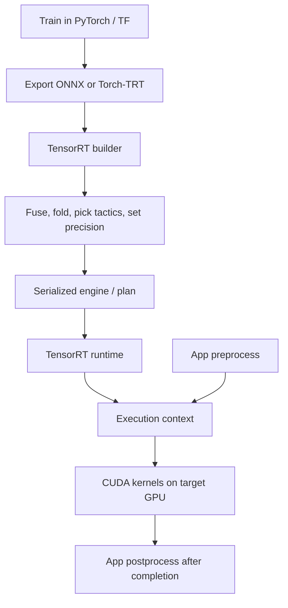

**TensorRT** is NVIDIA's SDK for **optimizing and running neural-network inference on NVIDIA GPUs**. It takes a trained model (most often as [ONNX](glossary://onnx)), compiles it into a hardware-specific binary called an **engine** (also a **plan** when serialized), and executes that engine through a low-overhead runtime. Training still happens in frameworks such as [PyTorch](glossary://pytorch). TensorRT owns the **inference** path: fusion, kernel choice, precision, memory layout, and execution.

NVIDIA's docs split the product into two phases:

1. **Builder (offline):** parse a network definition, apply graph and device-specific optimizations, time candidate **tactics** (kernel implementations), and emit a serialized engine.
2. **Runtime (online):** deserialize the engine, create one or more **execution contexts**, bind input/output buffers, and enqueue inference on a [CUDA](glossary://cuda) stream.

TensorRT compiles deep-learning models for NVIDIA inference. [TensorRT-LLM](glossary://tensorrt-llm) extends related optimization ideas (attention kernels, KV cache, continuous batching, and more) into an LLM-specialized stack. Both focus on inference, with TensorRT-LLM targeting language-model serving.

## Intuition

A training framework prioritizes differentiability, dynamic Python graphs, and research flexibility. Serving prioritizes **latency**, **throughput**, and **GPU utilization** on a fixed function. TensorRT freezes the trained math into a plan tuned for one GPU generation and one TensorRT version, then runs that plan with as little host overhead as possible.

The builder is allowed to change *how* the graph runs, not *what* it computes (within floating-point reassociation and explicit precision choices). Typical wins come from:

| Technique | What it does |
|-----------|----------------|
| **Layer / pointwise fusion** | Merge sequences such as Conv + Bias + Activation into one kernel so intermediate tensors never hit HBM |
| **Tactic selection** | Benchmark alternate CUDA kernels / tile sizes per layer and keep the fastest for the target GPU and shapes |
| **Precision selection** | Prefer FP16, BF16, TF32, FP8, INT8, or INT4 where the hardware is strong and accuracy still holds |
| **Format transforms** | Internally lay tensors out for Tensor Cores (for example NHWC-friendly layouts) even if the network was defined in NCHW |
| **Constant folding / dead-code elimination** | Drop work that cannot affect named outputs |
| **Workspace and scheduling** | Trade temporary GPU memory for faster algorithms |

You pay for those wins at **build time** (often minutes for large models) and in **operational contract**: engines are usually specific to TensorRT version and GPU. Define optimization profiles that cover the dynamic batch and sequence lengths you serve. Validate lower-precision engines with a parity suite across representative inputs and outputs.

## Diagram



## How it works

### Network definition and entry paths

The builder consumes a **network definition**: named input/output tensors plus a graph of layers. Common ways to populate it:

| Path | When it fits |
|------|----------------|
| **ONNX parser** | Default production path: framework-neutral graph from PyTorch/TensorFlow/JAX export |
| **Torch-TensorRT** | Stay inside PyTorch; partial compile with framework fallback for unsupported ops |
| **Network API** (`addConvolution`, …) | Full manual control; load weights into a hand-built graph |
| **Plugins** | Custom ops TensorRT does not implement natively |

Inputs and outputs must be **named**. Tensors not marked as outputs are transient; the builder may optimize them away. Weights referenced during build must stay alive until the engine is built (the ONNX parser typically owns them for that window).

### Build configuration

`BuilderConfig` controls workspace size, optimization profiles for dynamic shapes, timing cache, and tactic constraints. On TensorRT 10.x it also holds weak-typing precision flags (`FP16`, `INT8`, and so on). TensorRT 11.x encodes precision in the strongly typed network instead of those flags. The builder:

1. Eliminates dead computations and folds constants.
2. Reorders and fuses layers.
3. Enumerates legal kernels and data formats per layer.
4. **Times** tactics on the real GPU (running other GPU work during timing can perturb results and yield a worse plan).
5. Emits a serialized plan.

A **timing cache** stores measured tactic costs so rebuilds of similar graphs skip repeated timing. Builder optimization level trades build time for more aggressive search.

### Runtime model

Typical serving loop:

1. Create a `Runtime`, deserialize the plan into a `CudaEngine`.
2. Create one or more `ExecutionContext` instances from that engine (each holds invocation state; multiple contexts can share one engine for concurrent streams).
3. Set input shapes if dynamic, bind device (or host) buffers for each I/O tensor.
4. Call `enqueueV3` on a CUDA stream; synchronize the stream when you need results on the host.

Engines answer queries for tensor names, ranks, dtypes, and formats so the application can allocate correctly. Control returns when work is enqueued; completion is stream-synchronous, not automatic host-side.

### Dynamic shapes and optimization profiles

By default the builder freezes shapes seen at definition time. For variable batch, image size, or sequence length, you add one or more **optimization profiles**. Each profile gives, per dynamic input dimension:

$$
d_{\min} \le d_{\mathrm{opt}} \le d_{\max}
$$

TensorRT selects kernels compatible with the profile range and tunes at $d_{\mathrm{opt}}$. Shapes outside the profile fail at runtime; shapes inside each dimension's range must also satisfy the network's cross-input and operator constraints. Some tactics are available only when min, opt, and max match. Multiple profiles let you specialize (for example batch 1 interactive vs batch 32 batch jobs) and select a profile for a context.

### Precision and quantization

Supported compute/storage types include FP32, FP16, BF16, FP8, FP4, INT8, INT4, and others depending on GPU generation and TensorRT version. Through TensorRT 10.x, **weak typing** let the builder pick mixed-precision tactics when you set flags such as FP16 or INT8. **Strong typing** and explicit Q/DQ graphs pin conversions in the network definition. TensorRT 11.x requires strongly typed networks and removes weak-typing precision flags plus implicit INT8 calibrators.

TensorRT uses **symmetric** quantization for low-precision integer and FP8/FP4 paths: dequantization is a multiply by a positive scale. For INT8, NVIDIA documents:

$$
x_q = \mathrm{round}_{\mathrm{ties\ to\ even}}\Bigl(\mathrm{clip}\bigl(\tfrac{x}{s},\,-128,\,127\bigr)\Bigr),
\qquad
x = x_q \cdot s
$$

Under the older **implicit** INT8 path (removed in TensorRT 11.x), TensorRT computed per-channel weight scales as:

$$
s_{\mathrm{ch}} = \frac{\max\bigl(\lvert x_{\min}^{\mathrm{ch}}\rvert,\ \lvert x_{\max}^{\mathrm{ch}}\rvert\bigr)}{127}
$$

Prefer **explicit quantization**: Q/DQ nodes in the graph (from [Model Optimizer](https://github.com/NVIDIA/TensorRT-Model-Optimizer) PTQ/QAT or framework export). Either way, **calibration or QAT data must match production traffic**. A classifier calibrated on ImageNet-style crops can look fine on average metrics and still flip decisions on your product distribution.

### Engine portability

By default a plan is tied to:

- The **TensorRT major/minor** that built it
- The **GPU architecture** (and often the exact device class) used for tactic timing
- The **platform** (OS + CPU arch)

Optional version-compatibility and hardware-compatibility modes exist, with performance or feature trade-offs. Operational rule: rebuild or carefully revalidate when TensorRT, CUDA, GPU SKU, or max shape profile changes. Do not ship an A100-built engine to an L4 fleet and expect load success without a compatibility story.

### Ecosystem placement

| Piece | Role relative to TensorRT |
|-------|---------------------------|
| [ONNX](glossary://onnx) | Portable graph + weights handoff into the builder |
| [ONNX Runtime](glossary://onnx-runtime) TensorRT EP | Optional path: ORT partitions subgraphs into TensorRT engines |
| [Triton Inference Server](glossary://triton-inference-server) | Serving shell: HTTP/gRPC, batching, model repo; TensorRT as a backend |
| [TensorRT-LLM](glossary://tensorrt-llm) | Separate LLM-specialized runtime; current upstream is PyTorch-native, while older releases also used TensorRT engines |
| `trtexec` | CLI to build, serialize, and benchmark engines |
| Polygraphy | Cross-backend parity, subgraph isolation, debug tooling |

## Example

**Hypothetical latency-sensitive image classifier.** A team trains a ResNet-style image classifier in PyTorch. Serving needs sub-10 ms p95 on a single L4 for batch size 1-8 and $224\times 224$ RGB. Suppose its measured FP32 PyTorch baseline misses the budget; TensorRT is a candidate optimization to benchmark.

**1. Export ONNX** with a dynamic batch axis (see the [ONNX](glossary://onnx) entry for a full export pattern). Fix input name `input`, output name `logits`, opset pinned to what TensorRT supports in your container.

**2. Build an engine with a shape profile** using `trtexec` (shapes are illustrative; match your graph). On TensorRT **10.x**, allow FP16 tactics with `--fp16`:

```bash
trtexec \
  --onnx=classifier.onnx \
  --saveEngine=classifier_fp16.plan \
  --fp16 \
  --minShapes=input:1x3x224x224 \
  --optShapes=input:4x3x224x224 \
  --maxShapes=input:8x3x224x224 \
  --memPoolSize=workspace:4096
```

On TensorRT **11.x**, `--fp16` and other precision flags are removed because networks are strongly typed. Produce mixed precision offline first (for example ModelOpt AutoCast, or export with the Casts you want), then build the same min/opt/max shapes without precision flags:

```bash
# after offline cast/quantize, e.g. modelopt.onnx.autocast
trtexec \
  --onnx=classifier_autocast.onnx \
  --saveEngine=classifier_fp16.plan \
  --minShapes=input:1x3x224x224 \
  --optShapes=input:4x3x224x224 \
  --maxShapes=input:8x3x224x224 \
  --memPoolSize=workspace:4096
```

The builder times tactics for the L4, fuses eligible layers, and writes `classifier_fp16.plan`. Build once per GPU class in CI; load the plan at service start.

**3. Parity gate before shipping.** Compare PyTorch (or ONNX Runtime CPU) vs TensorRT on a fixed fixture that includes batch 1, batch 8, near-duplicate images, and hard negatives:

```python
import numpy as np

# ref: (N, C) float32 logits from the training-framework path
# trt: (N, C) float32 logits from the TensorRT engine on the same pixels
abs_err = np.max(np.abs(ref - trt))
rel_err = np.max(np.abs(ref - trt) / (np.abs(ref) + 1e-5))
pred_match = np.mean(ref.argmax(-1) == trt.argmax(-1))

assert abs_err < 1e-2  # tighten or loosen from product risk
assert pred_match >= 0.999  # label flips are the real incident
```

If INT8 is next, insert Q/DQ (or an approved PTQ pipeline), rebuild, and re-run the same suite **plus** decision-threshold checks. Softmax scores can move a few thousandths and still change `argmax` near class boundaries.

**4. Serve.** Load the plan once, keep a pool of execution contexts, preprocess images exactly as in training (mean/std, color order, resize), run `enqueueV3`, apply the same temperature/threshold code outside the engine. Triton can host the plan if you need multi-model HTTP serving; TensorRT still owns the compiled graph.

## Trade-offs

**Strengths.** Large inference speedups on NVIDIA GPUs for CNNs, recommendation towers, speech graphs, vision encoders, and many transformer components; fine control over precision and shapes; mature tooling (`trtexec`, Polygraphy, Nsight); natural backend for Triton.

**Limits.** NVIDIA-only; build cost and GPU-specific plans complicate mixed-SKU fleets; unsupported ops need plugins or graph surgery; dynamic control flow and highly data-dependent shapes are harder than static CNN graphs; aggressive FP16/INT8 without eval gates causes silent quality regressions; generative LLM serving often needs TensorRT-LLM or another LLM engine rather than a naive ONNX→TensorRT of the full generate loop.

**What fails in production**

| Symptom | Usual cause |
|---------|-------------|
| Engine fails to load | Built for different GPU SKU / TensorRT version / platform |
| Runtime shape error | Input outside optimization profile |
| Latency regression after "upgrade" | New TensorRT picked different tactics; no benchmark gate |
| Accuracy drop only in prod | INT8/FP16 path; calibration set ≠ live traffic; preprocess drift |
| Build OOM or multi-hour builds | Workspace too small/large; huge dynamic ranges; no timing cache |
| Throughput cliff under concurrency | One execution context shared unsafely; missing multi-context or stream plan |

## Debug path

1. **Reproduce offline.** Same ONNX, same TensorRT container, same GPU SKU as prod.
2. **Parity before optimization.** Framework vs ONNX vs TensorRT FP32 on a golden batch. If FP32 already diverges, fix export or plugins first.
3. **Add precision one step at a time.** FP16, then BF16/FP8/INT8. Re-run label and score checks after each step.
4. **Inspect profiles.** Log actual runtime shapes vs `min/opt/max`. Spikes outside the profile are hard failures; living forever at `max` may mean the opt point was wrong.
5. **Profile kernels.** `trtexec` layer times, Nsight Systems: host sync, copy bandwidth, or one unfused layer often explains the gap vs the blog-post speedup.
6. **Confirm the outer contract.** Tokenizer, image decode, normalization constants, label order, and thresholds live outside the engine; [training-serving skew](glossary://training-serving-skew) is still your problem.

## Why it matters here

LeetLLM's systems and deployment material treats inference optimization as an **engineering contract**: freeze a trained network, compile it for real hardware, and prove that latency wins did not break product decisions. TensorRT is the reference example of that contract on NVIDIA GPUs. Understanding builder vs runtime, optimization profiles, precision, and parity gates is what separates "we exported ONNX" from "we can serve this model under a latency budget without silent quality loss."

## Related terms

- [TensorRT-LLM](glossary://tensorrt-llm)
- [ONNX](glossary://onnx)
- [Triton Inference Server](glossary://triton-inference-server)
- [Mixed precision](glossary://mixed-precision)
- [Quantization](glossary://quantization)
