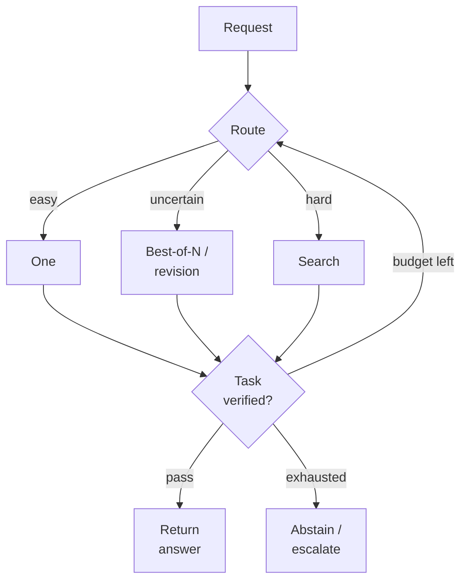

**Test-time compute** is computation spent after a request arrives to improve that request's answer. It is also called **inference-time compute** or **test-time scaling**. Instead of changing model weights, the system may generate more tokens, sample several candidates, search a reasoning tree, call tools, critique an attempt, or run a verifier before choosing an output.

The boundary is timing and purpose. Pretraining, fine-tuning, and distillation spend **train-time compute** to improve future behavior across requests. Test-time compute spends latency, tokens, memory, and tool calls on the current input. Ordinary serving overhead is not automatically useful test-time scaling: recomputing the same answer because a cache failed costs compute without creating another decision path or check.

## Scaling strategies

| Strategy | Extra compute | Selection signal |
| --- | --- | --- |
| Longer single trajectory | More sequential decode tokens | Model decides when to stop or budget ends |
| Best-of-$N$ | $N$ parallel samples | Reward model, tests, judge, or exact verifier |
| Self-consistency | Several reasoning paths | Majority/weighted agreement on final answer |
| Search | Expand and prune partial trajectories | Process or outcome value estimate |
| Revision | Draft, critique, improve | Critic feedback plus final verifier |
| Tool use | Retrieval, code execution, environment queries | External observations |

Parallel samples reduce wall time when hardware can batch them, but consume aggregate tokens and KV cache. Sequential revision can condition on earlier evidence, but directly increases user latency. Search quality depends on both proposal diversity and verifier quality.

## Budget as a decision

Let strategy $s$ receive budget $b$ measured in tokens, model calls, verifier calls, or FLOPs. A product-facing objective is expected quality minus cost and latency penalties:

$$
s^*(x), b^*(x)
= \arg\max_{s,b}
\left[
\mathbb{E}[Q \mid x,s,b]
- \lambda_C C(s,b)
- \lambda_L L(s,b)
\right]
$$

The best allocation depends on input $x$. [Snell et al.](https://openreview.net/forum?id=4FWAwZtd2n) showed in controlled math experiments that compute-optimal strategy varied with problem difficulty and model; one fixed best-of-$N$ budget was inefficient. Use that result to motivate adaptive routing, then validate a difficulty estimator and measure whether extra compute improves each target slice.

## Diagram



## Example

### Adaptive candidate budget

```python
def solve(request, risk, difficulty):
    if risk == "high":
        n = 4
        require_external_verifier = True
    elif difficulty > 0.8:
        n = 8
        require_external_verifier = True
    elif difficulty > 0.4:
        n = 3
        require_external_verifier = False
    else:
        n = 1
        require_external_verifier = False

    candidates = model.generate(request, n=n, max_tokens=1_200)
    scored = [(verify(request, c, external=require_external_verifier), c)
              for c in candidates]
    score, answer = max(scored, key=lambda row: row[0].score)

    if require_external_verifier and not score.passed:
        return abstain("verification_failed")
    return answer
```

This pseudocode assumes `model`, `verify`, and `abstain` are application interfaces, that `verify(..., external=True)` actually uses the required independent checks, and that generation returns at least one candidate. It is useful only if `difficulty` predicts where extra attempts help and `verify` ranks candidates better than chance. Evaluate the router against fixed budgets at the same total cost. Otherwise adaptive logic can spend more on hopeless tasks and less on deceptively hard ones.

## Evaluate correctness alongside compute

More attempts improve the chance of sampling a correct candidate only when the proposal distribution assigns it nonzero probability and the selector can recognize it. For independent candidates with per-sample success probability $p$, oracle success after $N$ attempts is:

$$
P(\text{at least one success}) = 1 - (1-p)^N
$$

Real samples are dependent; repeated failure modes can make gains smaller than this independent-sampling estimate. Dependence alone does not always reduce success probability. A weak verifier can select polished wrong answers more confidently as $N$ grows, a form of verifier overoptimization. Longer reasoning can also wander away from an initially correct answer.

## Evaluation contract

Report quality against **total inference budget**, not candidate count alone:

- input and output tokens across all candidates;
- model and verifier calls;
- wall-clock TTFT and end-to-end latency;
- peak KV/cache memory and batch interference;
- pass rate, calibration, and abstention;
- quality by difficulty and risk slice;
- selector oracle gap: best candidate present versus candidate selected.

Compare same-budget baselines: one larger model call, $N$ smaller-model calls, longer sequential reasoning, and tool-assisted verification. Count failed and discarded candidates in cost.

## When to stop

Use extra compute when tasks are valuable, hard, and independently verifiable. Cap it when evidence stops changing, candidates converge, the verifier is unreliable, latency SLO is near, or side effects require human approval. Product systems need a finite [token budget](glossary://token-budget), deadline, maximum attempts, and a defined abstain/escalate outcome.

## Why it matters here

Reasoning models and agents turn inference into a resource-allocation problem. Test-time compute connects decoding, search, verifiers, tools, latency, and cost. Measure where another unit of compute produces enough quality to justify its user and infrastructure cost.

## Related terms

- [Token budget](glossary://token-budget)
- [Latency budget](glossary://latency-budget)
- [Pass@k](glossary://pass-at-k)
- [Beam search](glossary://beam-search)
- [Reward model](glossary://reward-model)
- [Model judge](glossary://model-judge)
- [Trajectory evaluation](glossary://trajectory-evaluation)
