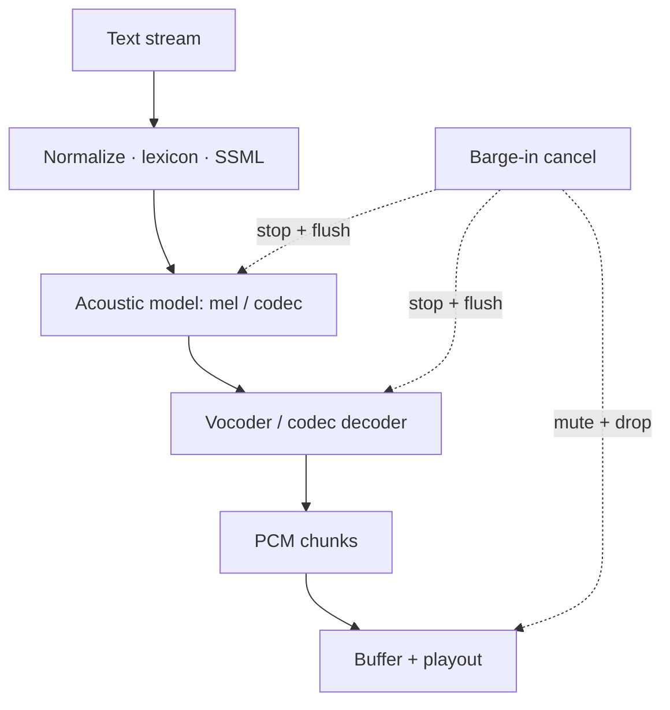

Text-to-speech (TTS) converts written text into a spoken waveform the user can hear. In a voice agent it is the **output** half of the real-time loop: [speech-to-text](glossary://speech-to-text) turns mic audio into text, the model plans a reply, and TTS turns that reply into audio. A system can reason correctly and still feel broken if speech starts late, mangles product names, stutters from buffer underruns, or keeps talking after the user interrupts.

TTS quality is therefore multi-dimensional. Naturalness (how human it sounds) is only one axis. Production stacks also care about first-audio latency, stream smoothness under load, pronunciation control for domain terms, stable loudness, and clean stop behavior under [barge-in](glossary://barge-in).

## Intuition

Use TTS as a streaming render pipeline with a hard [latency budget](glossary://latency-budget). The user has already waited through endpointing, STT finalization, and model [TTFT](glossary://ttft). Every extra hundred milliseconds before the first audible sample is dead air. Once audio is playing, the synthesizer must stay ahead of the playback cursor. Average real-time factor below one provides headroom, but per-chunk delays can still cause glitches. When the user interrupts, cancel in-flight synthesis and flush client buffers; separately track the played portion when recording what the user actually heard.

## How it works

Modern neural TTS maps text to a waveform through a small number of stages. Implementations collapse or replace some of them, but the responsibilities remain:

1. **Text normalization and markup.** Expand numbers, dates, currencies, and abbreviations into spoken form (`16` → "sixteen"). Optional SSML (or vendor markup) controls breaks, rate, pitch, `say-as` interpretations, and explicit phoneme overrides for hard words.
2. **Linguistic / phonetic front end.** Map graphemes to phonemes (G2P), apply a pronunciation lexicon for project names and model IDs, and choose stress and phrase boundaries. Classical systems exposed rich linguistic features here; many neural models learn most of this from data and keep only a thin lexicon layer for domain vocabulary.
3. **Acoustic model.** Predict a time-aligned acoustic representation: historically an 80-bin log mel spectrogram, more recently discrete neural-codec tokens (semantic + acoustic codebooks). Autoregressive models emit frames or tokens left to right; non-autoregressive models expand phonemes by predicted duration and generate frames in parallel.
4. **Vocoder or codec decoder.** Invert the intermediate representation into time-domain samples (for example PCM at $16$-$24\,\mathrm{kHz}$). Neural vocoders (WaveNet-style, flow, GAN, or codec decoders) replaced Griffin-Lim phase reconstruction used in early Tacotron-style systems.
5. **Stream packaging.** Chop samples into playback chunks (often tens of milliseconds), send over WebSocket/WebRTC/telephony, and keep a client jitter buffer full enough to hide network and inference jitter without adding large delay.

### Classic two-stage stack (Tacotron 2 style)

Google's Tacotron 2 (2018) is the canonical teaching architecture for "text → mel → waveform":

- A sequence-to-sequence network with attention maps character (or phoneme) embeddings to **mel-scale spectrogram** frames.
- A modified WaveNet vocoder generates waveform samples conditioned on those mel frames.

Mel features are computed from the STFT magnitude with an 80-channel mel filterbank. In the Tacotron 2 paper the analysis settings are a $50\,\mathrm{ms}$ window, $12.5\,\mathrm{ms}$ hop, and log dynamic-range compression. Frames are spaced $12.5\,\mathrm{ms}$ apart and their analysis windows overlap, so one second of speech is about $80$ frames. The paper reports a mean opinion score (MOS) of $4.53$ for the full system versus $4.58$ for professionally recorded speech on their test set (5-point naturalness scale, many raters per sample).

### Parallel, single-stage, and streaming variants

- **Non-autoregressive acoustic models** (FastSpeech / FastSpeech 2 family) predict phoneme durations, expand embeddings with a length regulator, and emit mel frames in parallel. That removes left-to-right mel decoding latency at the cost of needing good duration prediction and (often) external alignment during training.
- **Single-stage end-to-end models** such as VITS (conditional VAE + normalizing flows + adversarial training) map text to waveform without a separately trained mel→wave stage, reducing train/serve mismatch between acoustic model and vocoder.
- **Neural codec language models** treat speech as discrete tokens and generate them with transformer decoders (zero-shot voice cloning, style control). Some systems still need the full sentence before speaking; **full-stream** designs accept text word-by-word as an LLM emits it and begin audio after the first word. Public streaming systems report first-packet latency on the order of $\sim 100\,\mathrm{ms}$ on modern GPUs when optimized (for example VoXtream reports $102\,\mathrm{ms}$ first-packet latency with `torch.compile` on A100-class hardware). Treat those numbers as hardware- and load-specific benchmarks, not portable constants.

## Formula

**Real-time factor (RTF)** measures whether synthesis stays ahead of playback. With wall-clock synthesis time $T_{\mathrm{wall}}$ for an utterance of audio duration $T_{\mathrm{audio}}$:

$$
\mathrm{RTF} = \frac{T_{\mathrm{wall}}}{T_{\mathrm{audio}}}.
$$

$\mathrm{RTF} < 1$ means the pipeline produces audio faster than it plays (headroom for batching, load, and network). $\mathrm{RTF} \ge 1$ risks underruns unless you pre-buffer aggressively (which hurts first audio). Some vendor docs invert this ratio and call "$2\times$ real-time" a speedup; always check which convention a dashboard uses.

**First-packet latency (FPL)** / time-to-first-audio for the TTS hop alone:

$$
\mathrm{FPL} = t_{\mathrm{first\ playable\ sample}} - t_{\mathrm{TTS\ start}}.
$$

For a full voice turn the user-visible silence is larger:

$$
t_{\mathrm{dead\ air}} \approx t_{\mathrm{endpoint}} + t_{\mathrm{STT\ final}} + \mathrm{TTFT}_{\mathrm{LLM}} + \mathrm{FPL}_{\mathrm{TTS}} + t_{\mathrm{network\ +\ buffer}}.
$$

That is why sentence- or phrase-level streaming from the LLM into TTS matters: waiting for a full multi-paragraph answer before starting synthesis wastes the entire generation budget as silence.

**Mel frame count** (Tacotron-style hop $h = 12.5\,\mathrm{ms} = 0.0125\,\mathrm{s}$):

$$
N_{\mathrm{frames}} \approx \left\lceil \frac{T_{\mathrm{audio}}}{h} \right\rceil.
$$

**Mean opinion score (MOS)** for naturalness is the average of human ratings $r_i \in \{1, 1.5, \ldots, 5\}$ (or similar):

$$
\mathrm{MOS} = \frac{1}{n}\sum_{i=1}^{n} r_i.
$$

Use MOS (or MUSHRA-style tests) for quality releases; use ASR word/character error on resynthesized audio, pronunciation checklists, and latency percentiles for day-to-day regressions.

## Diagram



## Example

A hypothetical tutoring agent answers "Why is attention $O(n^2)$?" The LLM streams tokens. The voice layer does **not** wait for the full answer; the illustrative timeline assumes overlapping preparation:

| Time | Event |
|---:|---|
| $t=0$ | User endpoint commits; STT final text arrives |
| $t=180\,\mathrm{ms}$ | First LLM tokens of sentence 1 complete |
| $t=280\,\mathrm{ms}$ | TTS emits first PCM chunk (FPL $\approx 100\,\mathrm{ms}$ on this hop) |
| $t=280$-$900\,\mathrm{ms}$ | Sentence 1 plays while LLM + TTS prepare sentence 2 |
| $t=1.4\,\mathrm{s}$ | Learner barges in: "wait, what is $n$?" |
| $t=1.5\,\mathrm{s}$ | Client mutes speakers; server cancels remaining TTS and unheard text |

If the product waits for all text for a 40-second spoken answer before synthesis, LLM generation adds dead air even when $\mathrm{FPL}_{\mathrm{TTS}}$ is excellent. Track spoken duration separately from text-generation time. If synthesis slows to RTF $1.3$ long enough to exhaust the playback buffer, speech underruns despite high offline MOS.

Concrete operational sketch for a streaming vendor API (shape varies by provider):

```python
# Pseudocode: stream LLM sentences into TTS; cancel on barge-in
async for sentence in llm_sentence_stream(reply_tokens):
    if barge_in.is_set():
        await tts.cancel()
        player.flush()
        break
    async for pcm_chunk in tts.stream(sentence, voice="tutor_en"):
        if barge_in.is_set():
            await tts.cancel()
            player.flush()
            break
        await player.write(pcm_chunk)
```

## Production pressure

What fails when TTS meets real agents:

| Failure | What you observe | Usual cause |
|---|---|---|
| Slow start | Multi-second silence after the user stops talking | Full-reply batching; cold model; large look-ahead; queueing |
| Underrun / robot glitch | Audio hitch mid-utterance | $\mathrm{RTF}\ge 1$ under load; tiny client buffer; GC pauses |
| Wrong names / identifiers | "LeetLLM" misread; model IDs or tensor shapes spoken ambiguously | Missing lexicon / SSML phonemes; weak text normalization |
| Ghost speech after interrupt | User hears a half-second of cancelled tail | Server cancel without client flush; jitter buffer not dropped |
| Self-hearing loop | Agent "listens" to its own last sentence | Missing or weak [echo cancellation](glossary://echo-cancellation), not TTS quality |
| Prosody weirdness | Wrong emphasis, monotone lists, math read poorly | Long LLM lines without punctuation; no `say-as` / break hints |

**What to measure in production:** p50/p95 FPL (or time-to-first-audio end-to-end), RTF under target concurrency, underrun rate, barge-in mute latency, pronunciation error rate on a fixed domain list (names, model IDs, URLs, code tokens), synthesis error/timeout rate, and a small human or ASR-intelligibility eval on golden prompts. Offline MOS alone does not catch latency or cancel bugs.

**Controls that help:** stream by sentence or clause from the LLM; keep a pronunciation lexicon for product vocabulary; prefer SSML `phoneme` / `sub` / `say-as` for critical tokens; size playback buffers for RTF variance without inflating FPL; wire barge-in to cancel TTS **and** flush client buffers; treat the TTS far-end signal as the AEC reference so VAD does not fire on your own voice.

## Why it matters here

On LeetLLM, voice agents are duplex systems: STT, planning, tools, and TTS share one [latency budget](glossary://latency-budget). Text-to-speech is where the model's tokens become sound. Understanding mel/codec intermediates, RTF, first-packet latency, streaming handoff from the LLM, pronunciation control, and cancel-on-barge-in is what separates a demo that "sounds nice in a quiet room" from a product that stays responsive under load and interruption.

## Related terms

- [Speech-to-text](glossary://speech-to-text)
- [Barge-in](glossary://barge-in)
- [Echo cancellation](glossary://echo-cancellation)
- [Latency budget](glossary://latency-budget)
- [p95 latency](glossary://p95-latency)
