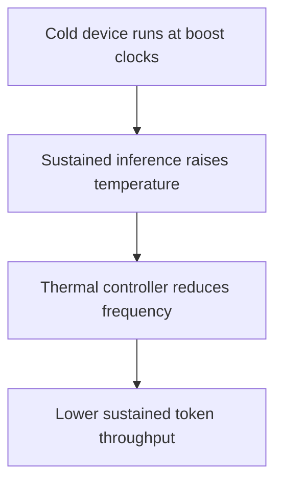

**Thermal throttling** reduces a processor's operating frequency or available power when device temperature approaches a safety limit. The first seconds of an inference benchmark can therefore look much faster than sustained performance after a phone, laptop, or embedded accelerator heats up. A cooler, airflow, ambient temperature, battery state, and concurrent workloads all influence when throttling begins.

## Peak throughput and sustained throughput diverge

An accelerator may initially run at a high boost frequency, generate heat faster than its enclosure can dissipate it, and then lower clocks to remain within its thermal budget. Token generation slows even though the model, prompt, quantization, and software haven't changed. A benchmark that reports only the first request hides this transition.

Track device temperature, clock frequency, power draw, time to first token, and output tokens per second over a realistic continuous workload. Compare warm steady-state behavior alongside the cold-start peak.

## Example

An on-device assistant initially generates 24 tokens per second during a short demonstration. After ten minutes of repeated requests, its case warms up, the accelerator lowers its operating frequency, and throughput settles near 13 tokens per second. These hypothetical measurements illustrate one device and workload; actual throughput depends on the hardware and operating conditions. The deployment can respond by shortening outputs, choosing a smaller model, batching less aggressively, inserting idle intervals, or moving selected requests to a remote fallback. The right response depends on privacy requirements and acceptable latency.

## Why it matters here

Small-language-model and edge-deployment lessons compare nominal accelerator capacity with the sustained performance available in a real device enclosure. Thermal behavior can invalidate a deployment that passes a one-minute benchmark but fails under ordinary repeated user traffic.

## Related terms

- [GPU](glossary://gpu)
- [Tokens per second](glossary://tokens-per-second)
- [Latency budget](glossary://latency-budget)
- [Quantization](glossary://quantization)
