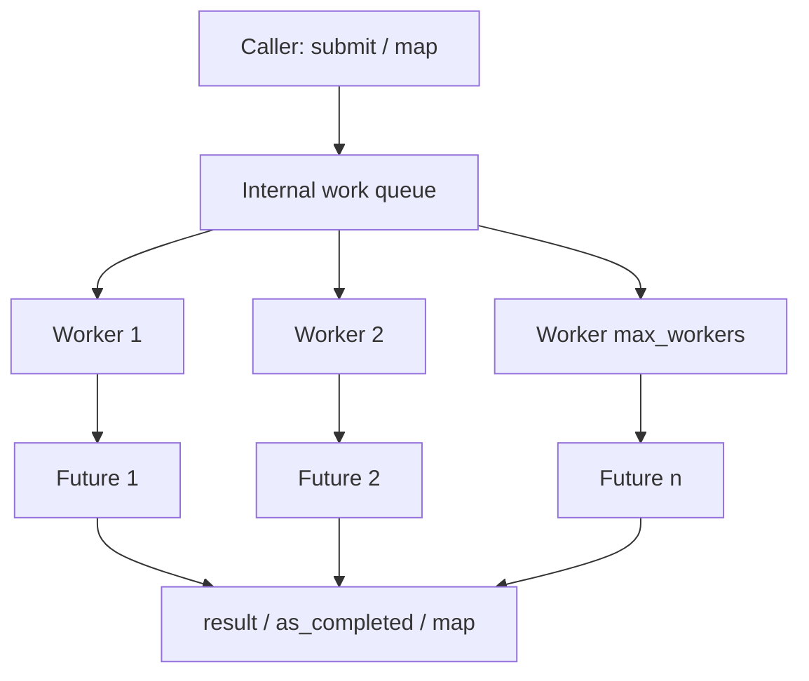

`ThreadPoolExecutor` is Python's standard-library pool (`concurrent.futures`) for running callables on a **bounded** set of worker threads and collecting results through `Future` objects. You submit work with `submit` or `map`; workers pull from an internal queue; at most `max_workers` threads run at once. It is the usual tool for overlapping **I/O-bound** work (HTTP, sockets, files, DB drivers, subprocess waits) without hand-managing `threading.Thread` lifecycles.

On conventional GIL-enabled CPython, it does not give multi-core speed for pure Python CPU work: only one thread runs Python bytecode at a time. Threads still help when workers block in I/O or run native code that releases the GIL. For CPU-heavy Python, consider `ProcessPoolExecutor` or a suitable native extension. Optional free-threaded CPython builds can run Python threads in parallel when the GIL remains disabled, so that limitation depends on the interpreter and imported extensions.

## Intuition

A fixed worker set pulls tasks from one queue. When one worker waits on a network reply, another can run. The worker bound limits simultaneous execution, but `submit` does not impose a bounded pending queue or a requests-per-second limit. Add admission control and a [rate limiter](glossary://rate-limit) where those contracts matter.

`ThreadPoolExecutor` is the concrete stdlib implementation of bounded [worker fanout](glossary://worker-fanout) for blocking callables. Prefer it when:

- The callables are **synchronous** (requests, `urllib`, many SDKs, `time.sleep`-style waits).
- Concurrency is tens to low hundreds of in-flight I/O ops, not tens of thousands of idle waiters (that shape often fits `asyncio` better).
- You want `Future`s, timeouts on wait, and `as_completed` without writing your own thread pool.

## How it works

1. **Create** a pool with `max_workers` (and optional `thread_name_prefix`, `initializer`, `initargs`).
2. **Submit** work: `submit(fn, *args)` returns a `Future` immediately; `map(fn, iterable)` submits many calls and yields results in **input order**.
3. **Workers** (up to `max_workers`) dequeue tasks and run `fn`. Idle workers are reused before new threads start (since 3.8).
4. **Join results** with `future.result(timeout=...)`, `as_completed`, or `wait`. Exceptions from `fn` re-raise when you call `result()`.
5. **Shutdown** with the context manager (`with ThreadPoolExecutor(...) as pool:`) or `shutdown(wait=True, cancel_futures=False)`. After shutdown, new `submit`/`map` raises `RuntimeError`.

Default `max_workers` when you pass `None` (Python 3.13+):

$$
\max\_workers = \min\bigl(32,\ (os.process\_cpu\_count() \lor 1) + 4\bigr)
$$

Earlier 3.8-3.12 used `os.cpu_count()` instead of `os.process_cpu_count()`. The `+ 4` and cap at 32 come from the stdlib design note: keep enough workers for I/O overlap, but avoid huge implicit pools on many-core machines. Treat the default as a starting point for generic scripts, not as a production concurrency budget for LLM APIs.

### API surface you actually use

| Method | Role |
| --- | --- |
| `submit(fn, *args, **kwargs)` | Schedule one call; get a `Future` |
| `map(fn, *iterables, timeout=None, buffersize=None)` | Many calls; input-order results; `buffersize` requires Python 3.14+ |
| `Future.result(timeout=None)` | Block for value or re-raise the worker exception |
| `Future.cancel()` | Cancel only if the task is still **pending** (not already running) |
| `shutdown(wait=True, cancel_futures=False)` | Stop accepting work; optionally cancel pending |

`map` collects the full iterables up front by default. Python 3.14+ adds optional `buffersize` so only that many unfinished tasks sit submitted ahead of the consumer; when the buffer is full, iteration over the inputs pauses. A raised exception surfaces when that item is pulled from the result iterator, not at submit time.

## Diagram



## Example

Fan out embedding HTTP calls for a batch of RAG chunks. Cap concurrency below the provider's concurrent-request limit, record per-chunk errors, and keep identity for retries:

```python title="thread-pool-embeddings.py"
from concurrent.futures import ThreadPoolExecutor, as_completed
import time

# Fake provider: ~200ms RTT, fails on empty text
def embed(chunk_id: str, text: str) -> tuple[str, list[float]]:
    if not text.strip():
        raise ValueError(f"empty chunk {chunk_id}")
    time.sleep(0.2)
    return chunk_id, [float(len(text)), float(text.count(" "))]

chunks = [
    ("c1", "why does KV cache grow with sequence length?"),
    ("c2", "compare top-k and top-p sampling"),
    ("c3", ""),  # will fail
]

# Provider allows ~8 concurrent embeds; stay under that
MAX_WORKERS = 4

with ThreadPoolExecutor(
    max_workers=MAX_WORKERS,
    thread_name_prefix="embed",
) as pool:
    futures = {
        pool.submit(embed, cid, text): cid
        for cid, text in chunks
    }
    vectors: dict[str, list[float]] = {}
    errors: dict[str, str] = {}
    for future in as_completed(futures):
        cid = futures[future]
        try:
            key, vec = future.result(timeout=5.0)
            vectors[key] = vec
        except Exception as exc:
            errors[cid] = repr(exc)

print(sorted(vectors), errors)
# ['c1', 'c2']  {'c3': "ValueError('empty chunk c3')"}
```

Sequential wall time would be about $2 \times 0.2\,\mathrm{s} = 0.4\,\mathrm{s}$: the empty chunk fails before sleeping. With $4$ workers, wall time is closer to one simulated RTT (~$0.2\,\mathrm{s}$) plus overhead, because waits overlap. The failed chunk is isolated: one bad row does not kill the pool. Since `as_completed` yields finished futures, `result(timeout=5.0)` here does not impose a five-second execution deadline on the calls.

Ordered results when the consumer needs index alignment:

```python
with ThreadPoolExecutor(max_workers=4) as pool:
    # map yields in input order; exception surfaces at that position
    for cid, vec in pool.map(lambda c: embed(*c), chunks):
        ...
```

## Sizing

Pick `max_workers` from the **bottleneck**, not from core count alone.

| Bottleneck | How to size |
| --- | --- |
| Provider RPM/TPM or concurrent streams | Cap at a fraction of the limit; leave headroom for retries |
| DB / HTTP connection pool | `max_workers` $\le$ pool size (or each worker waits and stalls) |
| File descriptors / sockets | Keep well under `ulimit -n` and OS connection tables |
| Local disk or single-host crawl target | Small $N$ (often 4-16) to avoid thundering herd |
| True CPU work in pure Python | Prefer processes; threads will serialize on the GIL |

Rough capacity view for I/O-bound workers with mean service time $S$ seconds and $W$ workers (Little's law style in-flight bound):

$$
\lambda_{\max} \approx \frac{W}{S}
$$

Example: mean embed RTT $S = 0.25\,\mathrm{s}$, $W = 8$ workers $\Rightarrow$ about $32$ embeds/s if the provider allows it. A $20$ req/s target suggests about $20 \times 0.25 = 5$ busy workers under this simplified model, plus an actual rate limiter: faster calls and bursts can exceed the quota even with five workers.

Also budget **memory and sockets**: each in-flight call holds a connection, buffers, and any SDK state. $W$ times peak per-call footprint is the real floor for RAM.

## Trade-offs

| Choice | Prefer when | Cost |
| --- | --- | --- |
| `ThreadPoolExecutor` | Blocking I/O libraries, simple fanout, eval harnesses | GIL limits pure-Python CPU; shared memory needs locks |
| `ProcessPoolExecutor` | CPU-bound pure Python, isolation from crashes | Pickle overhead; higher memory; not for tiny I/O calls |
| `asyncio` + async clients | High concurrency of pure network waits | Requires async stack end-to-end |
| `asyncio.to_thread` / loop default executor | Small blocking pockets inside async code | Still a thread pool under the hood; size carefully |

Deadlocks are a real footgun documented in the stdlib: workers waiting on futures that require the same exhausted pool can hang forever, as can cyclic dependencies regardless of pool size. Avoid synchronous wait-on-peer patterns inside pool work and validate the dependency graph; a larger pool cannot resolve cyclic dependencies.

Cancellation is weak for threads: `Future.cancel()` only stops **pending** work. A running HTTP call usually finishes even after you stop waiting. Pair pools with per-call timeouts on the I/O itself and with [deadlines / TTL](glossary://ttl-deadline) at the request boundary.

Shared mutable state (caches, counters, open files) needs [thread safety](glossary://thread-safety) (`Lock`, atomic structures, or no sharing). The pool does not protect your objects.

## Debug path

When a pool "stalls" or thrashing appears under load:

1. **Confirm bound vs open sockets:** is `max_workers` higher than connection pool size or provider concurrency?
2. **Check hang vs slowness:** `future.result(timeout=...)` raises `TimeoutError` on the waiter; the worker may still be blocked in I/O without a socket timeout.
3. **Look for deadlock:** worker waiting on another future in the same small pool (stdlib deadlock examples).
4. **Inspect exceptions:** call `result()` / handle `as_completed` with `try/except` so one failure does not look like a silent drop.
5. **Name threads:** `thread_name_prefix="embed"` makes stacks and `threading.enumerate()` readable in dumps.
6. **Shutdown behavior:** process exit joins pool threads; long-running tasks can delay exit. Prefer bounded work and explicit timeouts for production jobs.
7. **Broken pool:** a failing `initializer` marks the pool broken (`BrokenThreadPool`); new submits fail until you replace the executor.

## Why it matters here

LLM systems constantly fan out independent blocking I/O: multi-source retrieval, batch embeddings, document crawls, eval rows, tool probes, and provider health checks. `ThreadPoolExecutor` is the default stdlib answer for "run these sync callables with a hard concurrency cap." Production quality is less about whether you used threads and more about whether `max_workers` matches rate limits and pools, whether every submitted item produces one result or one recorded error, and whether timeouts and [backpressure](glossary://backpressure) prevent unbounded queues of futures.

## Related terms

- [as_completed](glossary://as-completed)
- [Worker fanout](glossary://worker-fanout)
- [Thread safety](glossary://thread-safety)
- [Rate limit](glossary://rate-limit)
- [Backpressure](glossary://backpressure)
