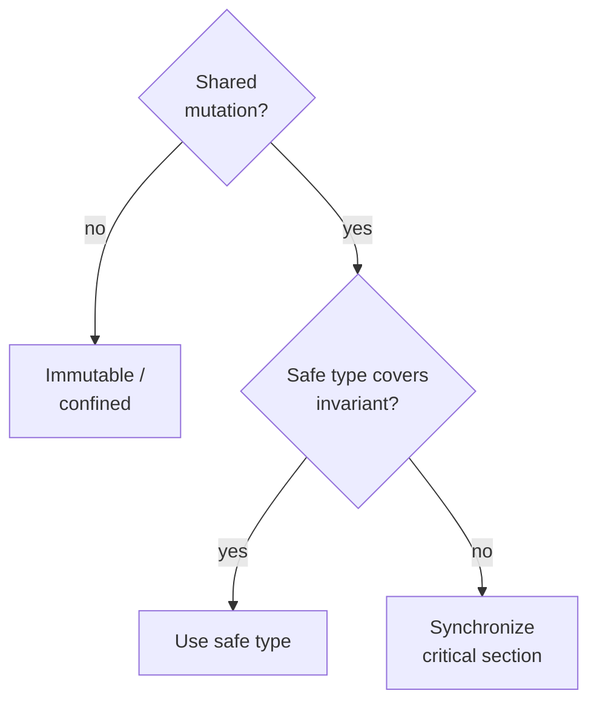

**Thread safety** is a correctness property: a function, type, or module is thread-safe when concurrent callers get the behavior promised by its specification, and its representation invariants hold, no matter how the runtime interleaves those callers. The caller must not need extra timing rules such as "do not call `get` while `set` is running."

The classic formulation (Goetz et al., *Java Concurrency in Practice*; MIT 6.005) stresses three pieces: correct under concurrent use, independent of scheduling, and without dumping coordination onto every client. A race condition is the failure mode when shared mutable state is read and written without a rule that makes those accesses safe.

## Intuition

Thread safety is about *interleavings*. Two workers can both read the same value, both compute a new value, and both write back a result that is wrong for the pair of operations. The program may pass every single-threaded test and still break only under load.

The root cause is almost always **shared mutable state**. Fix the root in one of four ways:

| Strategy | Idea | When it fits |
|----------|------|--------------|
| **Confinement** | Do not share the mutable object; each thread has its own | Per-request buffers, thread-local caches, worker-private batch state |
| **Immutability** | Share freely because nothing mutates after publish | Config snapshots, frozen model IDs, prompt templates, published weight handles |
| **Thread-safe type** | Put shared mutation inside a type that already serializes or coordinates | Prefer `queue.Queue` for cross-thread handoff; concurrent maps with a documented API. Python documents thread-safe `deque` appends and pops, but compound sequences such as checking nonempty then popping still need coordination |
| **Synchronization** | Take a lock (or equivalent) around the critical section yourself | Multi-field invariants: "size and map stay consistent," "balance never goes negative" |

A lock protects an invariant when every access path follows the same synchronization rule. For an invariant spanning multiple operations (check-then-act: `if key not in cache: cache[key] = compute()`), hold one lock around the whole sequence or use a single atomic compound API.

## How it works

### Read-modify-write and lost updates

A common race is a non-atomic update. Abstractly, both threads execute:

$$
v \leftarrow \mathrm{read}(x),\quad v' \leftarrow f(v),\quad \mathrm{write}(x, v')
$$

If the two reads see the same $x$, one write is lost. For a counter, $f(v)=v+1$, so $n$ concurrent increments can produce a final value strictly less than $n$. Mutual exclusion collapses the critical section so the whole triple appears atomic to other threads.

### Check-then-act

Even when each map operation is atomic, a compound sequence can race:

```text
if key not in cache:          # check
    cache[key] = expensive()  # act
```

Two threads can both miss, both run `expensive()`, and both store. That may only waste work (memoization), or it may violate "exactly one side effect" (billing, job claim, connection open). Lock the sequence, or use a documented atomic compound API or single-flight mechanism that covers the required work. `cache.setdefault(key, expensive())` evaluates `expensive()` before insertion, so it does not prevent duplicate computation or side effects; an atomic insertion alone is insufficient for that guarantee.

### Serializability of outcomes

Each concurrent API defines its consistency contract. APIs that promise atomic operations should produce a result consistent with *some* permitted sequential order, while a concurrent collection may promise only weakly consistent iteration. Read the operation's specification. Clients can rely on the promised invariants and must handle every result the contract permits.

### Python notes for AI services

In default CPython, the global interpreter lock (GIL) means only one thread runs Python bytecode at a time. That does **not** make application-level thread safety free:

- Bytecode can switch between threads between bytecodes; multi-step Python updates still race.
- Extension code (NumPy, many tokenizers, some I/O) can release the GIL, so true parallel mutation of shared buffers is possible.
- Free-threaded CPython builds (PEP 703, optional from 3.13+) remove the GIL; code that "worked" by accident under the GIL needs real synchronization for shared mutation.

Prefer confinement and immutability first. Use `threading.Lock` / `RLock` for small critical sections. Use `queue.Queue` or `ThreadPoolExecutor` patterns for fanout instead of hand-rolled shared lists. Keep model inference, network calls, and long GPU waits *outside* locks so workers do not serialize on I/O.

## Diagram



## Example

A process-local embedding cache used by many FastAPI worker threads. Without a lock, capacity and map can diverge under concurrent `get`/`put`.

```python title="thread-safe-embedding-cache.py"
from threading import Lock
from collections import OrderedDict

class EmbeddingCache:
    """LRU-ish cache with a single lock protecting size + map together."""

    def __init__(self, capacity: int) -> None:
        self._capacity = max(0, capacity)
        self._data: OrderedDict[str, list[float]] = OrderedDict()
        self._lock = Lock()

    def get(self, key: str) -> list[float] | None:
        with self._lock:
            value = self._data.get(key)
            if value is not None:
                self._data.move_to_end(key)
            return list(value) if value is not None else None

    def put(self, key: str, value: list[float]) -> None:
        with self._lock:
            if key in self._data:
                self._data.move_to_end(key)
            self._data[key] = list(value)
            while len(self._data) > self._capacity:
                self._data.popitem(last=False)
```

Without the lock, lookup, recency updates, and eviction can interleave: one thread can find a key just before another evicts it, making `move_to_end` fail. The lock makes each cache operation coherent, while a caller's separate `get` → embed → `put` sequence remains a separate transaction; two callers can compute the same missing embedding. Use single-flight coordination when avoiding that duplicate cost is part of the contract.

The example copies input and output vectors to prevent **rep exposure**, where a caller mutates the stored list outside the lock. This shallow copy is sufficient for the shown `list[float]`; nested mutable elements would need a stronger ownership policy. Keep capacity fixed after construction, and do not mutate an input vector concurrently while passing it to `put`.

A minimal load test: start $N$ threads, each doing $K$ increments or puts under the real API, join, then assert the invariant (`value == N*K`, or cache size within capacity). Passing this stress test can expose regressions but cannot prove safety for every schedule.

### Production failure shapes

| Symptom under load | Typical cause |
|--------------------|---------------|
| Lost increments, wrong job counts | Non-atomic counter or set update |
| Cache larger than max size | Size and map updated without one lock |
| Duplicate job claim / repeated tool write | Check-then-act without exclusive claim |
| Rare `KeyError` / torn structure | Unsynchronized dict/list mutation |
| Throughput cliff when load rises | Lock held across model call or network I/O |
| "Flaky only in prod" | Race needs specific interleaving; hard to reproduce offline |

## Why it matters here

LLM product code spends most of its time on prompts and models, then ships shared in-process state: response and embedding caches, [token buckets](glossary://token-bucket) and [rate limits](glossary://rate-limit), connection pools, streaming buffers, metrics, adapter slots, and in-memory work queues. Many "model serving" incidents are ordinary concurrency bugs wrapped around model calls. Thread-safety work names the invariant, chooses confinement / immutability / a safe type / a lock, and proves the invariant with real fanout and concurrent execution tests.

## Related terms

- [threading.Lock](glossary://threading-lock)
- [threading.RLock](glossary://threading-rlock)
- [ThreadPoolExecutor](glossary://thread-pool-executor)
- [LRU cache](glossary://lru-cache)
- [Worker fanout](glossary://worker-fanout)
