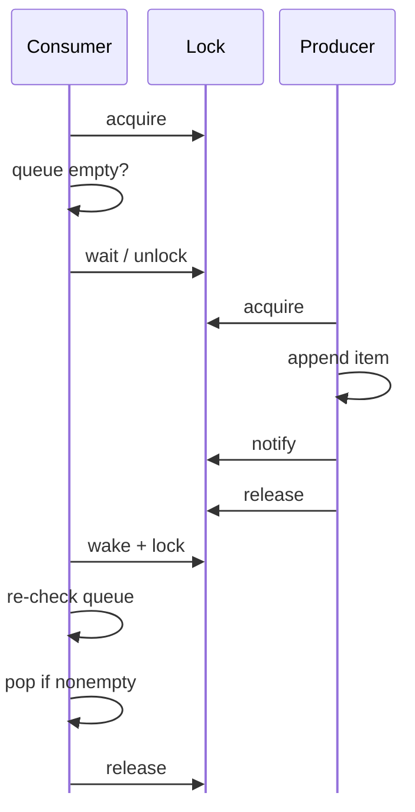

A `threading.Condition` is a lock plus a wait queue: threads release the lock and sleep until another thread calls `notify()` / `notify_all()`, then re-acquire the lock and re-check a **predicate** over shared state.

The predicate and lock determine correctness. Notification prompts waiting threads to recheck shared state, which may now satisfy the predicate.

## Intuition

A plain [Lock](glossary://threading-lock) answers "who may mutate this now?" A condition variable answers "who should sleep until this *state* is right?" It avoids spin-polling and lets producers wake waiters after updating a queue, barrier, or batch buffer.

Python's condition variables follow **Mesa semantics** (the model used by nearly all modern runtimes, including POSIX `pthread_cond_*`): after `notify()`, the waiter resumes only when it re-acquires the lock. Between wake and re-acquire, another thread can change the shared state again. Spurious wakeups (returning from `wait()` without a matching notify) are also allowed. That is why the standard pattern is a loop:

```python
with condition:
    while not predicate():
        condition.wait()
    # act under the lock
```

`if not predicate(): condition.wait()` is wrong: one wakeup can leave the predicate still false.

## How it works

`threading.Condition(lock=None)` owns an underlying lock. If you pass none, it creates an [RLock](glossary://threading-rlock). You can share one lock across several conditions when multiple wait reasons protect the same structure (this is how `queue.Queue` works: one `mutex`, then `not_empty` / `not_full` conditions for put/get, plus `all_tasks_done` for `join()`).

| Method | Requires lock held | What it does |
|--------|--------------------|--------------|
| `with condition:` / `acquire()` / `release()` | n/a | Enter/leave the critical section |
| `wait(timeout=None)` | yes | Atomically release lock, sleep, re-acquire on wake; returns `False` on timeout |
| `wait_for(predicate, timeout=None)` | yes | Loop: check predicate under lock, else `wait`; returns last predicate value |
| `notify(n=1)` | yes | Wake up to $n$ waiters (implementation may wake more; do not rely on exact count) |
| `notify_all()` | yes | Wake every waiter |

Critical protocol details from the stdlib:

1. **Update state under the lock**, then notify, then release (or exit the `with` block).
2. **`notify` does not release the lock.** Waiters only leave `wait()` after they re-acquire. Keep critical sections short so woken threads are not stuck behind a long hold.
3. **Choose `notify` vs `notify_all` by who can make progress.** One item into an unbounded queue usually needs one consumer (`notify`). A state change that unblocks every waiter (shutdown, barrier release, "flush all") needs `notify_all`.
4. **`wait_for(predicate)`** is the documented shorthand for the `while not predicate: wait()` loop, and evaluates the predicate with the lock held.
5. With an underlying `RLock`, `wait()` fully releases it even when recursively acquired, then restores the recursion depth when it re-acquires. Calling `release()` just once would not provide that behavior.

## Diagram



## Example

A threaded eval runner batches completed rows until a flush size is hit, then one worker drains the batch. Producers score items; a flusher waits until enough rows are ready (or timeout / shutdown).

```python title="condition-batch-flush.py"
from collections import deque
from threading import Condition, Thread
from time import monotonic

batch: deque[str] = deque()
ready = Condition()
FLUSH_AT = 32
shutdown = False

def submit(row_id: str) -> None:
    with ready:
        batch.append(row_id)
        if len(batch) >= FLUSH_AT or shutdown:
            ready.notify()

def flusher() -> None:
    global shutdown
    while True:
        with ready:
            # Mesa + timeout: re-check after every wake
            deadline = monotonic() + 2.0
            while len(batch) < FLUSH_AT and not shutdown:
                remaining = deadline - monotonic()
                if remaining <= 0:
                    break
                ready.wait(timeout=remaining)
            if not batch:
                if shutdown:
                    return
                continue  # timed out with nothing ready; wait again
            to_flush = list(batch)
            batch.clear()
        # I/O outside the lock
        write_eval_shard(to_flush)

def write_eval_shard(rows: list[str]) -> None:
    print("flush", len(rows), "rows")

worker = Thread(target=flusher)
worker.start()
for i in range(100):
    submit(f"row-{i}")
with ready:
    shutdown = True
    ready.notify_all()
worker.join()  # wait until the final batch is written before process exit
```

Workers sleep instead of spinning. The predicate (`len(batch) >= FLUSH_AT or timeout or shutdown`) owns correctness; `notify` only means "look again."

`queue.Queue` is the same idea packaged for you: one mutex, `not_empty.wait()` until an item exists, `not_full.wait()` when `maxsize` is hit, and matching `notify` on the other side. Prefer `queue.Queue` for plain handoff; use a raw `Condition` when the wait rule is richer (batch size, multi-predicate barriers, custom flush policies).

## Why it matters here

Threaded AI tooling spends most of its life waiting: HTTP to providers, disk for datasets, GPU workers finishing a shard. Condition variables turn "poll until ready" into blocking waits without burning a core, and they are the mechanism under blocking queues in eval runners, crawlers, and in-process work pipelines.

Production failure modes usually come from protocol bugs:

- **Lost wakeup:** updating shared state outside the condition's lock can let a waiter see a false predicate, miss the update, then sleep forever. Python rejects `notify()` without the lock with `RuntimeError`. With the correct protocol (lock → update → notify → unlock; waiters re-check in a loop), a `notify` that finds no waiters is fine: the next waiter sees the new state *before* calling `wait()`.
- **`if` instead of `while`:** another consumer steals the only item between notify and re-acquire (classic producer/consumer under Mesa semantics), or a spurious wakeup returns with the queue still empty. Crash or corrupt drain follows.
- **Wrong notify fanout:** `notify()` when several waiters need different predicates (e.g. "has room" vs "has item") can wake a thread that cannot proceed, leaving the eligible waiter asleep indefinitely without another notification. Re-check loops preserve safety but do not guarantee progress. Prefer separate conditions per wait reason or an appropriate `notify_all()` policy.
- **Long critical sections:** heavy model calls or network I/O *inside* `with condition:` block every other waiter and producer after notify, turning a concurrent pipeline into a single-thread queue of lock holders.
- **Shutdown races:** without a `shutdown` flag in the predicate and `notify_all()`, workers sit forever in `wait()` after the last item. Pair stop flags with `notify_all()` and re-check on every wake.

For async code on one event loop, prefer [asyncio.Queue](glossary://asyncio-queue) and coroutine waits instead of OS-thread conditions. For multi-thread I/O fanout with a fixed worker count, [ThreadPoolExecutor](glossary://thread-pool-executor) plus `queue.Queue` is usually enough; reach for `Condition` when you own the shared structure and the wait rule.

## Related terms

- [threading.Lock](glossary://threading-lock)
- [threading.RLock](glossary://threading-rlock)
- [threading.Event](glossary://threading-event)
- [ThreadPoolExecutor](glossary://thread-pool-executor)
- [asyncio.Queue](glossary://asyncio-queue)
