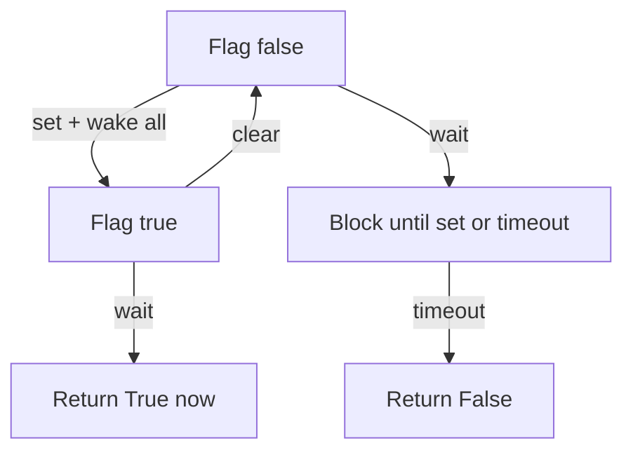

A `threading.Event` is a **one-bit, thread-safe flag** that one thread can turn on (`set`) and other threads can poll (`is_set`) or block on (`wait`) until it is on. The standard library describes it as the simplest inter-thread signal: an internal boolean that starts false, becomes true with `set()`, returns to false with `clear()`, and unblocks every waiter when it goes true.

It carries **no payload**, no count, and no mutual exclusion. Use it for readiness, cooperative cancellation, and process-local shutdown, not for protecting shared data or for edge-triggered "consume this pulse once" messaging.

## Intuition

The flag is level-triggered and visible to every worker in the process.

- Off (`clear` / initial state): work continues, or waiters block.
- On (`set`): every thread already waiting wakes; every future `wait()` returns immediately without blocking.

That **level-triggered** (sticky) behavior is the whole product. Once the light is on, it stays on until someone turns it off. Perfect for "shutdown requested" or "model weights are loaded." Wrong for "fire one tick per completed batch," where each pulse must be consumed and then forgotten.

Under the hood in CPython, `Event` is a thin wrapper: a private `bool` plus a `Condition` on a `Lock`. `set()` assigns the flag and `notify_all()`; `wait()` returns immediately if the flag is already true, otherwise it sleeps on the condition until a timeout or a `set()`.

## How it works

| Method | Effect |
| --- | --- |
| `Event()` | Create with internal flag **false** |
| `is_set()` | Non-blocking: `True` iff the flag is true |
| `set()` | Flag → true; **all** current waiters wake; later `wait()` calls do not block |
| `clear()` | Flag → false; later `wait()` calls block again until the next `set()` |
| `wait(timeout=None)` | Block while flag is false; return `True` if the flag is (or became) true, `False` if `timeout` expired first |

Since Python 3.1, `wait()` reports whether it observed the set state or was signaled before timing out. A call that finds the flag already set returns immediately with `True`. Do not treat that return as an atomic read of the flag at your next line: another thread can call `clear()` before the waiter resumes, and CPython can still return `True` for that notification.

There is no atomic "wait then auto-clear." If you need one-shot handoff of a value or a pulse, use a [queue](glossary://queue-queue), a [condition](glossary://threading-condition) over shared state, or a dedicated handshake, not a bare `Event`.

## Example

Cooperative cancel for a threaded offline eval: workers keep scoring until the caller sets the event (deadline, Ctrl-C handler, or "enough samples").

```python title="event-cancel-eval.py"
from concurrent.futures import ThreadPoolExecutor, as_completed
from threading import Event, Timer
import time

def score_one(example_id: int, stop: Event) -> tuple[int, float]:
    # Multi-step unit of work: poll between work steps.
    for _ in range(5):
        if stop.is_set():
            return example_id, float("nan")
        time.sleep(0.01)  # stand-in for a chunk of model.generate / judge work
    return example_id, 1.0 if example_id % 2 == 0 else 0.0

def run_eval(n: int, max_workers: int = 4, wall_s: float = 0.2) -> list[float]:
    scores: list[float] = []
    stop = Event()  # fresh cancellation state for each run
    timer = Timer(wall_s, stop.set)
    timer.start()  # request cancellation even if no future completes
    try:
        with ThreadPoolExecutor(max_workers=max_workers) as pool:
            futures = {pool.submit(score_one, i, stop): i for i in range(n)}
            for fut in as_completed(futures):
                _, s = fut.result()
                if s == s:  # not NaN
                    scores.append(s)
    finally:
        stop.set()
        timer.cancel()
        timer.join()
    return scores

print(len(run_eval(200)))  # partial run; not all 200 necessarily scored
```

Workers that only check `stop` once at entry will ignore a late cancel. Poll `is_set()` between units of work (or use short `wait` timeouts in idle loops). `set()` does **not** interrupt a thread stuck inside a single long blocking call (socket read, GPU kernel wait); you still need timeouts on those calls.

The timer requests cancellation after the budget. Scheduling delay, the current work step, queued-future handling, and executor shutdown can extend return time beyond `wall_s`. Treat `wall_s` as a cooperative cancellation budget, and bound blocking calls and executor shutdown separately.

## Diagram



## Event vs nearby primitives

| Need | Prefer |
| --- | --- |
| Sticky "stop / ready" bit visible to many threads | `threading.Event` |
| Protect a counter, cache, or claim invariant | [threading.Lock](glossary://threading-lock) / [RLock](glossary://threading-rlock) |
| Sleep until a **predicate** over shared state may hold | [threading.Condition](glossary://threading-condition) |
| Pass work items or results between threads | [queue.Queue](glossary://queue-queue) |
| Bounded pool of blocking callables | [ThreadPoolExecutor](glossary://thread-pool-executor) |
| Same idea inside one asyncio loop (not OS threads) | `asyncio.Event` (not thread-safe; do not mix with worker threads as a cross-thread flag) |

`asyncio` docs warn that asyncio sync primitives are **not** thread-safe. Cross-thread signals belong to `threading`, not `asyncio.Event`.

## What fails in production

1. **Treating it as edge-triggered.** A second `set()` while the flag is already true is a no-op for waiters who already left. If each signal must be consumed once, an Event loses pulses; use a queue or counter under a condition.
2. **Cancel without poll points.** Calling `stop.set()` while workers are inside multi-second provider calls only stops them *after* those calls return. Pair the Event with per-request timeouts and checks between steps of a multi-step agent/eval loop.
3. **Hanging `wait()` on shutdown.** Prefer `wait(timeout=...)` in idle loops so a missed `set()` or a stuck peer cannot leave the process un-killable forever. Combine with a wall-clock or [monotonic](glossary://time-monotonic) deadline for the whole job.
4. **`clear()` races.** Clearing while some workers still treat "set" as "shutdown" can restart work you meant to stop. For one-shot shutdown, set once and never clear. For reusable barriers, document who owns `clear()` and when.
5. **Process boundary.** A `threading.Event` is in-process only. Separate processes need `multiprocessing.Event` or an external signal (Redis flag, job-control API).
6. **Mistaking it for a lock.** Two threads can both pass `if not stop.is_set(): ...` and both mutate shared state. Signaling and mutual exclusion solve different problems; use a lock for the invariant.

## Why it matters here

Threaded crawlers, retrieval fan-out, offline eval runners, and tool-call probes all need a cheap way to say "stop accepting new work" or "weights are ready" without inventing shared-memory protocols. `threading.Event` is the standard-library answer for that sticky bit: level-triggered, waitable, and trivial to test (already set before start; set while waiters sleep; timeout returns `False`). Interview systems questions often probe exactly that distinction: Event for a flag, Condition for a predicate, Queue for data, Lock for invariants.

## Related terms

- [threading.Lock](glossary://threading-lock)
- [threading.Condition](glossary://threading-condition)
- [threading.RLock](glossary://threading-rlock)
- [ThreadPoolExecutor](glossary://thread-pool-executor)
- [queue.Queue](glossary://queue-queue)
