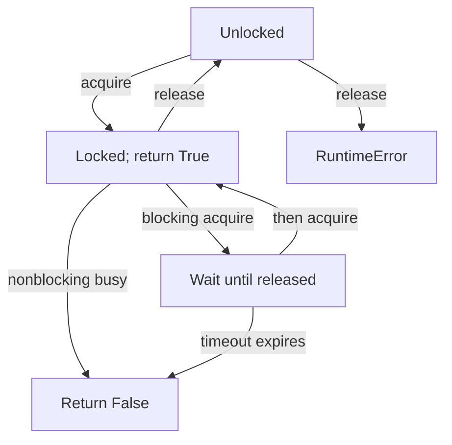
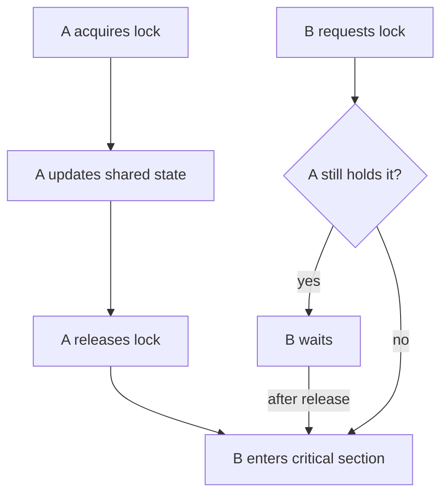

A `threading.Lock` is Python's primitive mutual-exclusion lock: at most one thread holds it, and other threads that call `acquire()` block (or fail) until the holder calls `release()`. It guards a **critical section**: the shortest stretch of code that must not interleave with concurrent access to the same shared state.

In the standard library this is the lowest-level lock type (built on `_thread`). It has two states, locked and unlocked, starts unlocked, and does **not** record which thread owns it. Any thread may call `release()`; calling `release()` on an unlocked lock raises `RuntimeError`. Prefer the context manager form so release always runs, including on exceptions:

```python
with lock:
    # critical section
    ...
```

That is equivalent to `acquire()` / `try` / `finally: release()` as documented in the [threading module](https://docs.python.org/3/library/threading.html).

## Intuition

A lock protects an **invariant** over shared memory: "the balance never goes negative," "the cache size never exceeds $N$," "a job id is claimed by at most one worker," "token-bucket tokens never go below zero without a deny." You wrap only the read-modify-write region that must stay consistent. Network calls, model inference, disk I/O, and remote provider RPCs almost never belong inside that region.

The lock does not invent correctness. If two code paths touch the same state and only one takes the lock, the race still exists. CPython's global interpreter lock (GIL) also does not make multi-step updates atomic: two threads can still interleave bytecode for `x += 1` or check-then-act on a dict. With free-threaded builds (PEP 703), true parallel bytecode makes unprotected shared mutation even more likely to fail under load.

## How it works

Primitive lock lifecycle:

1. **Create** unlocked: `lock = threading.Lock()`.
2. **Acquire** (enter the critical section):
   - `acquire()` or `acquire(blocking=True)`: wait until unlocked, then lock and return `True`.
   - `acquire(blocking=False)`: return `False` immediately if already locked; otherwise lock and return `True`.
   - `acquire(timeout=t)` with $t > 0$: wait up to $t$ seconds; return `True` if acquired, `False` if the wait expired.
3. **Use** the shared state while holding the lock.
4. **Release**: set unlocked; if waiters exist, **exactly one** proceeds. Which waiter wins is **not defined** and may vary by platform.
5. **`locked()`**: returns whether the lock is currently held (for diagnostics, not as a substitute for acquire).

Important differences from [threading.RLock](glossary://threading-rlock):

| | `Lock` | `RLock` |
|---|---|---|
| Same thread re-acquires | Blocks forever (self-deadlock) | Allowed; recursion count increments |
| Who may `release` | Any thread | Owning thread only |
| Nested helpers sharing one lock | Use carefully or switch to `RLock` | Natural fit |

When more than one thread is blocked in `acquire()`, the documentation states only that one proceeds after `release()`; do not assume fairness or FIFO waiter order.

## Diagram



Typical critical-section pattern for mutable shared state:



## Example

Two worker threads claim jobs from an in-memory set used by a batch eval runner or tool-call fanout. In a separate membership-check/remove implementation, both could observe a job before either removes it. In the `if pending: pending.pop()` pattern below, a competing worker can drain the set between the check and pop, causing an unexpected `KeyError`. The lock makes the whole empty-check/claim operation coherent.

```python title="lock-job-claim.py"
from threading import Lock
from typing import Optional

pending: set[str] = {"j1", "j2", "j3"}
lock = Lock()


def claim_one() -> Optional[str]:
    with lock:
        if not pending:
            return None
        job_id = pending.pop()  # protect the empty-check + pop sequence together
        return job_id


def finish(job_id: str, results: dict[str, str], value: str) -> None:
    # Heavy work (inference, HTTP) happens *outside* the lock.
    # Only the shared map write is protected.
    with lock:
        results[job_id] = value
```

Lost-update shape on a plain counter (metrics, rate-limit tokens, in-process quota):

```python title="lock-counter.py"
from threading import Lock, Thread

class Counter:
    def __init__(self) -> None:
        self.value = 0
        self._lock = Lock()

    def add(self, n: int = 1) -> int:
        with self._lock:
            self.value += n
            return self.value


c = Counter()
threads = [Thread(target=c.add, args=(1,)) for _ in range(1000)]
for t in threads:
    t.start()
for t in threads:
    t.join()
assert c.value == 1000  # an unlocked version may lose updates on some schedules
```

Without synchronization, a read-modify-write can let both threads read the same `value` and write `value + 1`, losing an increment. Python build and scheduling affect how easily a stress test reproduces that interleaving; protect the invariant with a lock instead of relying on test timing.

## Critical-section size

Hold the lock only while the invariant is at risk:

1. Compute expensive work **outside** (embedding, HTTP, tokenizer, GPU).
2. Take the lock to **read decision state**.
3. Optionally release, do slow work, re-acquire to **commit**, and validate the decision state or version again before relying on it.
4. For large mutations, "copy under lock, mutate outside, swap under lock" needs a version check/retry or another policy for concurrent changes; otherwise the swap can overwrite newer updates.

Long holds serialize threads and destroy throughput. Under a [ThreadPoolExecutor](glossary://thread-pool-executor), a lock held across a 2 s model call turns $W$ workers into effective concurrency $1$ for that path.

## Trade-offs

| Choice | Gain | Cost |
|---|---|---|
| Fine-grained lock (per key / per shard) | Higher concurrency | Harder invariants; risk of lock-order deadlock if you ever take two |
| One global lock | Simple correctness | Throughput ceiling under contention |
| Non-blocking `acquire(False)` | Fast path without waiting | Caller must handle `False` (retry, drop, queue) |
| `timeout` on acquire | Avoids unbounded hang | Need a policy when the wait fails |
| Plain `Lock` | Cheapest primitive; clear "not re-entrant" | Nested same-thread acquire deadlocks |
| [RLock](glossary://threading-rlock) | Nested methods safe | Hides re-entrancy; can mask over-coupled design |

For waiting until a **predicate** on shared state is true (queue non-empty, batch full), use [threading.Condition](glossary://threading-condition) (a lock plus wait/notify), not busy spin with a bare `Lock`.

## Debug path

When production shows "only under load" wrong counts, double-processed jobs, or cache overflow:

1. **Name the invariant** in one sentence before touching code.
2. List every site that **reads or writes** that state; confirm each takes the same lock object (not a different `Lock()` created per call).
3. Search for work inside `with lock:` that does I/O or inference; move it out.
4. Check for nested `with self._lock` on a plain `Lock` (self-deadlock); switch to `RLock` only if nested public methods truly share one section.
5. Reproduce with many threads and an assertion after `join` (lost increments, duplicate claims, size $> N$). A single-threaded unit test cannot prove the lock is necessary or sufficient.
6. If hang dumps show all threads blocked on the same lock, measure hold time (who acquired last) rather than adding more workers.

## Why it matters here

Concurrent AI systems share counters, [LRU](glossary://lru-cache) and semantic caches, connection pools, in-memory work queues, rate-limit state, and metrics scrapers. Race bugs surface as flaky evals, double-billed tool calls, overflowed process memory, or "impossible" negative quotas. `threading.Lock` makes shared mutation safe inside one process. Use a process-shared or distributed coordination primitive across process boundaries, persist state separately across restarts, and use [idempotency](glossary://idempotency) for side effects that leave the process.

## Related terms

- [threading.RLock](glossary://threading-rlock)
- [threading.Condition](glossary://threading-condition)
- [Thread safety](glossary://thread-safety)
- [ThreadPoolExecutor](glossary://thread-pool-executor)
- [Worker fanout](glossary://worker-fanout)
