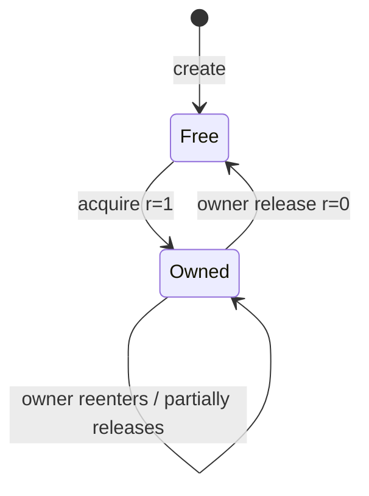

A `threading.RLock` is a **reentrant lock**: mutual exclusion with an **owning thread** and a **recursion level**. The same thread may call `acquire()` again without blocking, and must call `release()` once per successful acquire. Other threads still block until the owner fully unlocks (recursion level returns to zero).

`RLock` is a factory that returns the platform's most efficient concrete reentrant lock. Prefer the `with` form so each acquire is paired with a release, including on exceptions.

## Intuition

A plain [`threading.Lock`](glossary://threading-lock) tracks only locked or unlocked state. If the holder tries to acquire it again, it waits for itself forever (self-deadlock). That shows up in nested helpers that both guard the same state:

```text
replace()  --acquire-->  set()  --acquire again-->  DEADLOCK with Lock
```

`RLock` adds two pieces of state on top of locked/unlocked:

| State | Meaning |
|-------|---------|
| **Owning thread** | Which thread currently holds the lock (`None` when free) |
| **Recursion level** $r$ | How many unmatched `acquire()` calls that owner has made |

Rules, matching the [Python standard library docs](https://docs.python.org/3/library/threading.html#rlock-objects):

1. Free lock ($r = 0$): any thread may acquire; it becomes owner with $r = 1$.
2. Same owner acquires again: $r \leftarrow r + 1$, return immediately (no block).
3. Other thread acquires: block until the lock is free (or timeout / non-blocking fails).
4. Owner releases: $r \leftarrow r - 1$. Only when $r$ hits $0$ does the lock become free and one waiter proceed.
5. Non-owner release, or release when free: raises `RuntimeError`.

Only the **outermost** release hands the lock to another thread. Nested same-thread acquires stay private to that thread.

Use re-entrancy to support layered APIs. If every method needs an `RLock`, simplify shared-state ownership or separate public and private critical sections.

## How it works

### Acquire / release

```python
# Conceptual; not the real CPython implementation
def acquire(self, blocking=True, timeout=-1) -> bool:
    me = current_thread()
    if self.owner is me:
        self.level += 1
        return True
    # else: wait for free lock (or fail if non-blocking / timeout)
    # then: self.owner, self.level = me, 1

def release(self) -> None:
    if self.owner is not current_thread():
        raise RuntimeError("release unlocked lock / wrong owner")
    self.level -= 1
    if self.level == 0:
        self.owner = None
        # wake exactly one waiter, if any
```

`acquire(blocking=False)` returns immediately with `False` if another thread owns the lock, but still re-enters if *this* thread owns it. `timeout` (seconds, Python 3.2+) bounds how long a non-owner waits.

### Context manager

`with lock:` is equivalent to `acquire()` in `__enter__` and `release()` in a `finally` on `__exit__`. Nested `with` blocks on the same `RLock` raise the recursion level and drop it cleanly, even if an exception aborts the inner block.

### Interaction with Condition

[`threading.Condition`](glossary://threading-condition) defaults to an internal `RLock` when you do not pass a lock. `Condition.wait()` must fully release that lock so other threads can enter; with a recursively held `RLock`, a single `release()` decrements one level. The stdlib uses an internal path that unlocks completely, then restores the recursion level when re-acquiring after the wait. Defaulting to `RLock` supports this condition-variable behavior.

## Diagram



Other threads trying `acquire` while the lock is **Owned** block until the owner fully unlocks (transition to **Free**). Cross-thread view:

```text
Thread A:  acquire -> r=1 -> acquire -> r=2 -> release -> r=1 -> release -> r=0
Thread B:  .............. blocked waiting ............................ acquire (ok)
```

## Example

A small in-process prompt-cache used by several [ThreadPoolExecutor](glossary://thread-pool-executor) workers. Public methods each take the lock; a higher-level method calls a lower-level one without unlocking first.

```python title="rlock-prompt-cache.py"
from threading import RLock

class PromptCache:
    def __init__(self, capacity: int) -> None:
        self._lock = RLock()
        self._capacity = max(0, capacity)
        self._items: dict[str, str] = {}
        self._hits = 0
        self._misses = 0

    def get(self, key: str) -> str | None:
        with self._lock:
            value = self._items.get(key)
            if value is None:
                self._misses += 1
                return None
            self._hits += 1
            return value

    def put(self, key: str, value: str) -> None:
        with self._lock:
            if self._capacity == 0:
                return  # non-positive capacity stores no entries
            if key not in self._items and len(self._items) >= self._capacity:
                # Drop an arbitrary key; real code would use LRU order
                self._items.pop(next(iter(self._items)))
            self._items[key] = value

    def get_or_set(self, key: str, factory) -> str:
        with self._lock:
            # Nested acquire: same thread, recursion level 1 -> 2 -> 1
            hit = self.get(key)
            if hit is not None:
                return hit
            value = factory()
            self.put(key, value)
            return value

    def stats(self) -> tuple[int, int]:
        with self._lock:
            return self._hits, self._misses
```

With a plain `Lock`, `get_or_set` would deadlock on the inner `get` / `put`. With `RLock`, the owning worker re-enters safely; concurrent workers still serialize on the same critical section.

This deliberately simple example calls `factory()` under the lock to avoid duplicate computation. Keep that factory short and free of blocking I/O or arbitrary reentrant callbacks; a slow model/provider call serializes every cache user. Production caches often use per-key single-flight coordination instead. `RLock` permits same-thread reentry but does not repair an invariant exposed to a callback halfway through an update.

Minimal check of the recursion invariant:

```python title="rlock-count-check.py"
from threading import RLock, Thread

lock = RLock()
order: list[str] = []

def nested() -> None:
    with lock:
        order.append("outer")
        with lock:
            order.append("inner")

t = Thread(target=nested)
t.start()
t.join()
assert order == ["outer", "inner"]
```

## Trade-offs

| Prefer | When |
|--------|------|
| **`Lock`** | Single non-nested critical section; simplest ownership story |
| **`RLock`** | Public methods share one lock and legitimately call each other while holding it |
| **Split locks / no lock** | Independently protected state, immutable values, or confinement; process boundaries require a separate coordination policy for any shared external state |

Costs of re-entrancy:

- Slightly more bookkeeping than a primitive lock (owner id + level).
- Nested call graphs can hide "I thought I held the lock once" mistakes if you mix manual `acquire`/`release` without `with`.
- A mismatched release count ($r$ never returns to 0) leaves the lock permanently held for other threads: hang under load, not a clean exception.
- Re-entrancy preserves mutual exclusion on locked paths; paths that skip the lock can still race, and long critical sections remain expensive. Hold the lock only while the invariant is at risk; keep model calls, network I/O, and disk out of the nested section when you can.

## Why it matters here

AI services share in-process state across worker threads: response and embedding caches, rate-limit counters, connection pools, batch accumulators, and metrics. Those layers often nest (`get_or_set` → `get`/`put`, `claim_job` → `update_status`). `RLock` prevents self-deadlock in that pattern while still serializing other threads. Production hangs that only appear under nested helpers are often "used `Lock` where call graphs re-enter" or "released fewer times than acquired." Pair `RLock` with [thread-safety](glossary://thread-safety) invariants you can test under real concurrency.

## Related terms

- [threading.Lock](glossary://threading-lock)
- [threading.Condition](glossary://threading-condition)
- [Thread safety](glossary://thread-safety)
- [ThreadPoolExecutor](glossary://thread-pool-executor)
- [threading.Event](glossary://threading-event)
