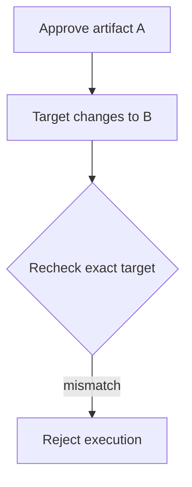

A **time-of-check-to-time-of-use (TOCTOU)** failure occurs when a security or correctness condition changes after a system checks it but before the system uses the result. [MITRE CWE-367](https://cwe.mitre.org/data/definitions/367.html) classifies this as a race between resource validation and resource use. The original check can be completely correct and still authorize the wrong action because its assumptions are no longer true at execution time.

Agent workflows enlarge this gap. A human may approve a deployment, a worker may queue the job, and the model may later rewrite the target arguments or resume from an old checkpoint. Between approval and execution, permissions can be revoked, a document can be deleted, a pull request can change, or a production artifact can acquire a different digest.

## Watch state change between check and use

## Example

A reviewer approves `deploy(checkpoint="abc123", environment="staging")`. The queued action later becomes `deploy(checkpoint="def456", environment="production")`. Checking only that some approval exists converts the first decision into source of truth for a different operation. Bind approval to the authenticated actor, exact arguments, artifact digest, target environment, issuance time, and expiration. Revalidate immediately before executing the side effect.

A last-second recheck leaves a race when the target can change before the side effect. Execute the exact immutable digest or use a conditional operation that validates the expected version atomically with the change. A database transaction protects the resource when it provides the required locking and isolation; an external deployment API needs its own conditional operation. One-use approval tokens prevent replay only when redemption is atomic and bound to the approved operation. Cached authorization decisions need explicit freshness limits and revocation behavior.

## Why it matters here

Human-in-the-loop agents, durable workflow checkpoints, enterprise RAG revocation, and coding-agent pull requests all depend on state that can change while work is waiting. Execution can act under an approval only after proving that the approved state is still current.

## Related terms

- [Human in the loop](glossary://human-in-the-loop)
- [Workflow checkpoint](glossary://workflow-checkpoint)
- [permission scope](glossary://permission-boundary)
- [Idempotency](glossary://idempotency)
