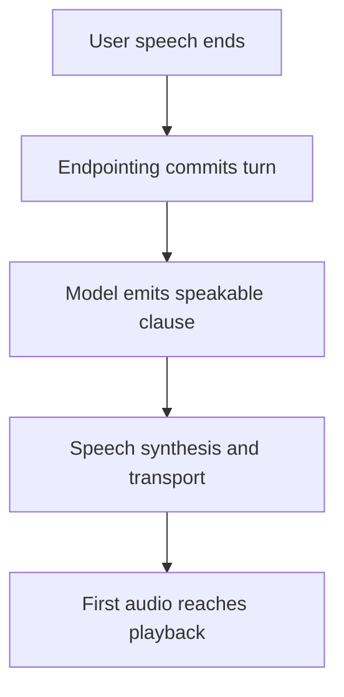

Time to first audio (TTFA) measures how long a user waits before an assistant's first audible response reaches playback. The metric must name both its starting event and its stopping event. A speech-end-to-playback clock includes turn detection, final speech recognition, model response, speech synthesis, network delivery, and the playout buffer. A commit-to-audio clock starts later and measures only the internal response path after the system accepts the turn.

## Two clocks and one user-visible endpoint

The user's microphone can already be streaming to recognition while they speak, so counting an entire recognition request after speech end can overstate the critical path. Conversely, stopping a timer when synthesized bytes leave the server understates the delay the user hears. Choose and report an explicit endpoint: first playable audio is ready for playout, while first played audio has actually begun playback. Those events can differ by buffering and scheduling delay. Keep endpointing delay separate from post-commit inference work.

When both clocks stop at the same playback event, their difference identifies turn-commit delay. Track user interruptions, unsupported-answer announcements, responsiveness to a new interruption, incorrect commits, barge-in muting, and quality as separate measures.

## Example

User speech ends at `0 ms`. Endpointing commits the turn at `60 ms`, the model produces a stable clause at `185 ms`, speech synthesis emits the first chunk at `300 ms`, and buffered playback begins at `380 ms`. Speech-end TTFA is therefore `380 ms`, while commit-to-audio is `380 - 60 = 320 ms`. Calling either number model time would hide the speech, transport, and playback components.

## Why it matters here

The voice-agent capstone defines response budgets that remain meaningful across browsers, devices, and network conditions. TTFA prevents a fast language-model first-token measurement from being mistaken for a responsive spoken interaction. Keeping both clocks, their percentile distributions, and the associated network slice visible makes endpointing, synthesis, and playout regressions independently diagnosable.

## Related terms

- [Time to first token](glossary://ttft)
- [Endpointing](glossary://endpointing)
- [Text-to-speech](glossary://text-to-speech)
- [WebRTC](glossary://webrtc)
- [Barge-in](glossary://barge-in)
