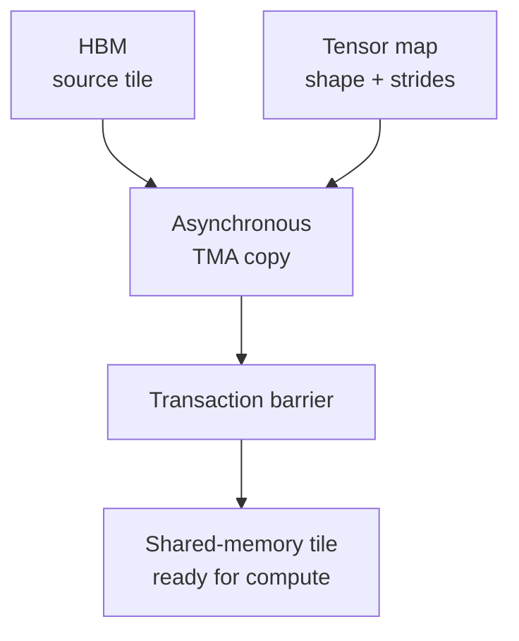

The Tensor Memory Accelerator (TMA) is NVIDIA GPU hardware, introduced with Hopper, for asynchronous bulk transfers between global and shared memory, including multidimensional tensor tiles. Tensor-map descriptors describe shape, stride, element type, and layout so tiled transfers avoid assigning every participating thread its own scalar address calculation. Contiguous one-dimensional bulk copies can instead use a pointer and size without a tensor map. TMA improves the staging path around matrix multiplication and attention; it does not perform the matrix multiply itself.

## Descriptors, tiles, and barriers

A producer prepares a descriptor for a source tensor and requests a tile transfer. The accelerator fetches the selected region while other GPU work can proceed. For a global-to-shared load, a transaction barrier tells consumer threads when the shared-memory tile is ready. A shared-to-global store instead uses a bulk async-group completion mechanism; waiting until it has read shared memory allows buffer reuse, while waiting for completed global writes serves a different purpose. For asynchronous operations crossing CUDA's generic and asynchronous memory proxies, the required fences and barriers are part of correctness rather than optional tuning.

Alignment, supported dimensions, shared-memory capacity, and device architecture determine whether a particular kernel can use this path. A valid-looking tensor with the wrong stride can fetch a different region from the one the expert or attention kernel expects. Hardware capability should therefore be checked separately from ordinary CUDA availability.

## Example

A Hopper-class attention kernel stages a `128 x 64` BF16 key tile. The payload occupies `128 * 64 * 2 = 16,384` bytes before any padding. While the accelerator transfers that tile into shared memory, another warp group can process a previously completed tile. The next consumer waits on the tile's barrier before reading it. Reporting only matrix FLOPs hides the benefit when reduced global-memory stalls, rather than arithmetic throughput, explain the observed improvement.

## Why it matters here

FlashAttention-3, DeepGEMM, and expert-parallel communication use different combinations of tiled movement, tensor-core computation, and asynchronous synchronization. Knowing what TMA owns separates data staging from multiplication and exposes layout-dependent FP8 scale-factor bugs. Validate each optimized kernel on its target GPU architecture because architecture-specific layouts and instructions can change behavior.

## Related terms

- [HBM](glossary://hbm)
- [Tensor Core](glossary://tensor-core)
- [FlashAttention](glossary://flashattention)
- [CUDA](glossary://cuda)
