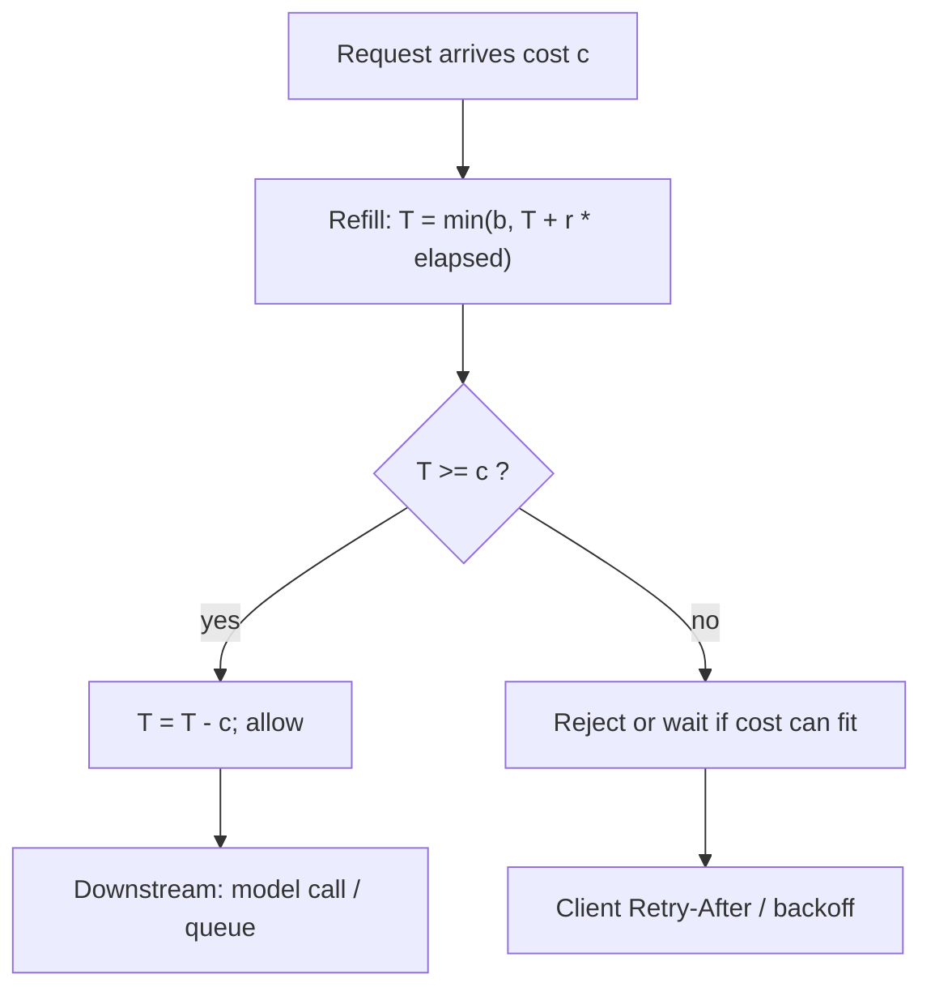

A **token bucket** is a rate-limit algorithm that stores a finite balance of *credits* (tokens), refills them at a steady rate up to a capacity ceiling, and spends one or more credits per allowed unit of work. Over a long window the allowed average is bounded by the refill rate; over a short window a full bucket can absorb a controlled burst up to the capacity.

Here "token" means rate-limit credit. In model contexts, "token" means a tokenizer unit; label counters as `rl_tokens` or `credits` when both meanings appear in one service.

Classic networking literature (and the common Wikipedia formulation) describes a bucket of depth $b$ refilled at rate $r$ tokens per second. A request or packet of cost $n$ is *conformant* only if at least $n$ tokens are present; those tokens are then removed. Excess refill above capacity is discarded. Non-conformant work is dropped, delayed until enough tokens accumulate (shaping), or marked for later drop under congestion (policing).

Cloud APIs use the same two knobs under product names: AWS API Gateway's *throttling rate* is refill $r$ and *throttling burst* is capacity $b$. These are best-effort targets, so excess traffic may receive HTTP `429`. Google Cloud Tasks instead delays queued dispatches as credit runs out; the API calculates `max_burst_size` from `max_dispatches_per_second`, while `queue.yaml` allows an explicit `bucket_size`. A downstream worker can still return `429` if dispatch bursts exceed its own capacity.

## Intuition

A token bucket tracks continuously refilling credit rather than resetting usage at rigid calendar periods.

| Knob | Meaning | If too small | If too large |
|---|---|---|---|
| **Capacity $b$** | Max burst you allow when idle | Legitimate spikes fail; UX feels brittle | One client empties the bucket and still hammers the GPU |
| **Refill $r$** | Long-run average you can sustain | Steady traffic starves; queues build | Average load exceeds safe fleet capacity |

A full bucket represents earned idle credit. After a burst drains it, request gating returns to about $r$ units per second until the balance rebuilds. That shape fits AI APIs: a cheap classification and a long-context generation have different costs, so spend should track *work size* alongside request count.

Token bucket is the dual of the leaky-bucket *meter*: fluid added on send vs tokens removed on send. The queue form of leaky bucket smooths output to a near-constant drip (little burst out). Token bucket explicitly *allows* burstiness up to $b$, which is usually what API product limits want.

## Formula

Let $b$ be capacity, $r$ the refill rate (tokens per second), $T(t)$ the balance at time $t$, and $c$ the cost of the next request. Lazy refill (update only on each decision) is the production form:

$$
T(t) = \min\bigl(b,\ T(t_{\mathrm{last}}) + r\cdot(t - t_{\mathrm{last}})\bigr).
$$

allow if $T(t) \ge c$, then set $T \leftarrow T - c$. Else reject, or wait $\frac{c - T(t)}{r}$ seconds for shaping when $r > 0$ and $c \le b$. A cost above capacity can never fit; a depleted zero-refill bucket cannot recover. This retry estimate assumes no competing spend. Use an atomic reservation when request gating must be guaranteed.

Continuous refill earns fractional credit at rate $r$. For $r > 0$, an integer-token implementation can add one token every $1/r$ seconds. A discrete update every $S$ milliseconds adds $(r \cdot S)/1000$ tokens each tick. These approaches can preserve the long-run refill rate, but tick timing and rounding change short-window request gating; retain fractional credit and bound the tick interval when those differences matter.

**Maximum burst duration** at line rate $M$ (when $r < M$) is about $T_{\max} = b / (M - r)$, so the peak burst size is $B_{\max} = T_{\max} \cdot M$. For API work priced in request units with $M$ effectively "as fast as the client can send," treat $b$ itself as the hard instantaneous spike you must survive on the hot path.

## Diagram



## Example

Per-tenant gateway: capacity $b = 60$ request-credits, refill $r = 10$ credits/s (about 600 RPM steady). Cost is weighted: chat turn $c = 1$, bulk embedding batch $c = 5$, premium long-context $c = 10$.

Timeline with an injected clock (`now` advances in tests without sleep):

| $t$ (s) | Event | Before refill | After refill | Decision | After spend |
|---|---|---|---|---|---|
| 0.0 | Bucket starts full | n/a | $60$ | n/a | $60$ |
| 0.0 | 12 chat turns ($c=1$ each) | $60$ | $60$ | all allow | $48$ |
| 0.0 | 2 premium calls ($c=10$) | $48$ | $48$ | both allow | $28$ |
| 0.0 | 6 embedding batches ($c=5$) | $28$ | $28$ | 5 allow, 1 reject | $3$ after fifth; sixth denied |
| 0.5 | 1 chat ($c=1$) | $3$ | $\min(60, 3 + 10\cdot 0.5) = 8$ | allow | $7$ |
| 2.0 | idle then 1 premium ($c=10$) | $7$ | $\min(60, 7 + 10\cdot 1.5) = 22$ | allow | $12$ |

After the opening burst, the tenant is near empty. Further work is paced by refill. A fixed 60-per-minute window would still allow another full 60 at the next minute perimeter even if the last second already fired 60; the bucket does not reset on a calendar edge, so double-spend at window edges does not appear.

```python title="token-bucket-core.py"
from __future__ import annotations

import math
import time
from dataclasses import dataclass
from typing import Callable


@dataclass
class TokenBucket:
    capacity: float
    refill_per_second: float
    tokens: float | None = None
    last_t: float | None = None
    now: Callable[[], float] = time.monotonic

    def __post_init__(self) -> None:
        if not all(math.isfinite(x) and x >= 0 for x in
                   (self.capacity, self.refill_per_second)):
            raise ValueError("capacity and refill must be finite and nonnegative")
        if self.tokens is None:
            self.tokens = float(self.capacity)
        if not math.isfinite(self.tokens) or not 0 <= self.tokens <= self.capacity:
            raise ValueError("initial balance must lie within capacity")
        if self.last_t is None:
            self.last_t = self.now()

    def _refill(self) -> None:
        t = self.now()
        assert self.last_t is not None
        elapsed = max(0.0, t - self.last_t)
        self.tokens = min(
            self.capacity,
            (self.tokens or 0.0) + elapsed * self.refill_per_second,
        )
        self.last_t = t

    def allow(self, cost: float = 1.0) -> bool:
        if not math.isfinite(cost):
            raise ValueError("cost must be finite")
        if cost <= 0:
            return True
        if cost > self.capacity:
            return False  # never allows; mis-sized cost or capacity
        self._refill()
        assert self.tokens is not None
        if self.tokens >= cost:
            self.tokens -= cost
            return True
        return False

    def retry_after_s(self, cost: float = 1.0) -> float:
        if not math.isfinite(cost):
            raise ValueError("cost must be finite")
        self._refill()
        assert self.tokens is not None
        if self.tokens >= cost:
            return 0.0
        if cost > self.capacity or self.refill_per_second == 0:
            return math.inf
        return (cost - self.tokens) / self.refill_per_second
```

Invariants to pin in tests: $0 \le T \le b$ always; spend never goes negative; refill uses elapsed monotonic time only; exact equality $T = c$ allows; `cost > capacity` never passes; concurrent callers need a lock or an atomic store (see below).

## Worked numbers (LLM TPM)

Provider limits can include both RPM (requests) and TPM (tokenizer tokens). Use separate request gating constraints for each. Provider accounting windows and token estimates vary, so treat the local bucket as a chosen policy for the target provider.

For a hypothetical local TPM policy, suppose capacity $b = 80{,}000$ and refill $r = 80{,}000 / 60 \approx 1333$ tokenizer-tokens per second. Reserving a $4{,}000$-token prompt plus a $2{,}000$-token output allowance costs $c = 6{,}000$. A full bucket allows $\lfloor 80{,}000 / 6{,}000 \rfloor = 13$ such calls in a burst, then paces near $1333 / 6000 \approx 0.22$ calls/s. Even a 60-RPM cap can allow thirteen concurrent 100k-token prompts against an 80k-TPM allowance. A rejected request may stop before the provider performs or bills prefill work.

Reserve estimated cost before the call. For a local usage budget, reconcile with actual usage after the stream ends; for a provider request gating limit, refund unused credit only if that provider's accounting permits it. Without reservation, concurrent inflight requests overspend the same balance. The Python example assumes a finite, nondecreasing injected clock and serial calls; its nonpositive costs are treated as free work.

## How it works in production

1. **Key** the bucket by identity: API key, tenant, user, IP, model route, or a tuple (tenant, model). Wrong key = shared fate or missed abuse.
2. **Update lazily** on each decision (formula above). Prefer `time.monotonic` / injected `now` so NTP steps do not invent or erase credit.
3. **Cost** should match the scarce unit: `1` for RPM, estimated tokenizer tokens for TPM, dollars for spend, GPU-seconds for internal fairness.
4. **On deny**, return which limit fired and remaining balance if safe to expose. For a recoverable shortage with positive refill, estimate `Retry-After` ≈ $(c - T)/r$; do not turn an impossible cost or infinite wait into a finite retry header. Pair with [retry backoff](glossary://retry-backoff) and jitter so rejected clients do not synchronize into a thundering herd.
5. **Distributed state** needs an atomic check-and-decrement (Redis Lua / `WATCH`, single-writer, or centralized limiter). Read-modify-write races allow $N$ times the burst across $N$ replicas.
6. **Multi-dimensional** limits: evaluate RPM bucket *and* TPM bucket *and* concurrency; allow only if all pass, spend all on success (or reserve then commit).

Shaping (sleep until tokens exist) suits internal workers and Cloud Tasks-style queues. Policing (`429` immediately) suits public HTTP APIs where holding connections burns capacity.

## Sizing

- Set $r$ from sustainable capacity: fleet goodput, provider schema, or cost budget, not from peak marketing traffic.
- Set $b$ from the largest *legitimate* spike you will absorb: cold-start retries, UI double-submit windows, batch job release. Test $b = r\cdot(1\text{–}2\,\mathrm{s})$ as an initial refill-credit hypothesis, then tune it using p95 queue age and provider `429` rate.
- Cap $b$ below what a single tenant can use to exhaust shared GPU headroom in one RTT.
- For cost-weighted spends, verify `max_cost <= b` or large jobs can never start even on a full bucket.

## Debug path

Unexpected `429` or silent over-allocation: log identity key, route, $b$, $r$, $T$ before/after, cost, elapsed since last update, clock source, and whether the decision was local or from a shared store. Typical faults:

- Wall clock jump (use [time.monotonic](glossary://time-monotonic) / [injected now](glossary://injected-now))
- Per-replica buckets that each allow a full burst
- Cost always `1` while TPM is the real constraint
- Burst $b$ large enough that continuous batching and KV cache still melt under "allowed" traffic
- Clients retry without `Retry-After`, converting a correct limit into a retry storm

Pair token-bucket request gating with [backpressure](glossary://backpressure) for full local queues or GPU slots and [load shedding](glossary://load-shedding) when the fleet is past its SLO.

## Trade-offs

| Approach | Burst behavior | Clock / state | Fit |
|---|---|---|---|
| **Token bucket** | Explicit capacity $b$ | Lazy refill; needs store for multi-host | Default for API rate + weighted cost |
| **Fixed window** | Double-spend at edges | Simple counters | Easy dashboards; weak fairness |
| **Sliding window / log** | Smooth near edges | Heavier memory or approx counters | Strict request counts |
| **Leaky bucket (queue)** | Smooths *output* | Queue delay | Shaping egress, less bursty send |

Token bucket wins when product language is "average X with burst Y" (AWS rate/burst, Cloud Tasks dispatch rate / burst size). It loses simplicity if you only need a daily quota: a [rolling quota](glossary://rolling-quota) or fixed allowance may be clearer for billing periods.

## Why it matters here

Provider RPM/TPM caps, internal tenant fairness, spend caps, and crawl or tool-call gates need rate limiting policies; a token bucket is one useful implementation, alongside sliding windows and other quota schemes. LLM traffic is bursty and cost-skewed: a full bucket of unit-cost requests is a different risk than a full bucket of long-context generations. Engineers who only think in fixed windows either under-protect the fleet at partitions or over-block honest spikes. Getting $b$, $r$, cost weights, and distributed atomicity right is how product promises stay within finite serving capacity without teaching clients to stampede.

## Related terms

- [Rate limit](glossary://rate-limit)
- [Backpressure](glossary://backpressure)
- [time.monotonic](glossary://time-monotonic)
- [Retry backoff](glossary://retry-backoff)
- [Quota](glossary://quota)
