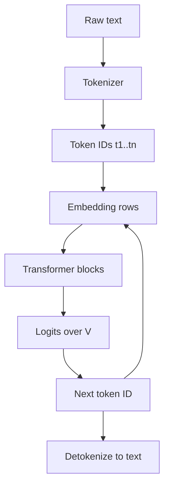

A **token** is one discrete unit in the sequence a language model reads or writes. Internally it is almost always an **integer ID** in a fixed vocabulary $\mathcal{V}$. The model never operates on characters or words as first-class types: text is encoded into a list of IDs, each ID indexes an embedding row, attention runs over positions in that list, and generation emits one next ID at a time until a stop condition.

Tokens are the product of a [tokenizer artifact](glossary://tokenizer-artifact) (vocabulary, merge or score rules, normalization, special tokens). The same string can become different ID sequences under different artifacts. OpenAI documents the unit as sequences of characters the model processes (often a whole common word, a fragment, or a single character), with English rules of thumb such as about $4$ characters or about $3/4$ of a word per token. Those ratios are planning aids only. Text context positions use actual encoded sequences, including template tokens; provider billing and rate limits have their own accounting rules and can include hidden reasoning or multimodal units. KV-cache occupancy also depends on which positions each layer retains.

## Intuition

Users type strings. The model sees a stream of symbols from a finite alphabet of size $|\mathcal{V}|$. A common English word may be one token. A model ID, UUID, emoji, or non-English span may expand into many tokens. Leading spaces and capitalization often produce *different* IDs for what a human calls "the same word" (for example ` red` vs `Red`).

The generation loop is next-token prediction: given $t_1,\ldots,t_{n-1}$, score every vocabulary entry and pick $t_n$. Quality, latency, memory, and cost all settle in token units, not word counts.

## Diagram



## How it works

1. **Encode.** Normalize text, pre-tokenize (spaces, punctuation, regex), segment into pieces with BPE / WordPiece / Unigram rules, map pieces to integer IDs. Special tokens (BOS, EOS, pad, role markers, tool delimiters) may be inserted by the chat template, not by the user string alone.
2. **Embed.** Lookup $E \in \mathbb{R}^{|\mathcal{V}| \times d}$ so each ID becomes a $d$-dimensional vector. The model incorporates positional information: absolute encodings may be added to embeddings, while RoPE rotates attention queries and keys and ALiBi biases attention scores.
3. **Transform.** Attention and MLPs mix positions. Sequence length in tokens is the length that drives attention cost and KV-cache size.
4. **Score and pick.** The LM head maps the final hidden state to logits $z \in \mathbb{R}^{|\mathcal{V}|}$. Sampling applies temperature and any top-$k$, top-$p$, or other constraints to obtain a next-ID distribution. Greedy decoding can choose an argmax without computing softmax.
5. **Decode.** Append the chosen ID, embed it, update the [KV cache](glossary://kv-cache), and repeat. Detokenize IDs back to text for the client. Individual byte-level tokens can contain incomplete UTF-8 sequences, so a streaming decoder must retain partial bytes until a valid character is available. Chunks need not end at word or token boundaries.

Classic references: Vaswani et al. (2017) treat input/output as token sequences with learned embeddings and next-token softmax; Sennrich et al. (2016) popularized subword units via BPE for open vocabulary; GPT-2 (Radford et al., 2019) used byte-level BPE with $|\mathcal{V}|=50{,}257$ ($256$ bytes + $50{,}000$ merges + end-of-text).

## Formula

Let $\mathcal{V}$ be the vocabulary and $E \in \mathbb{R}^{|\mathcal{V}| \times d}$ the token embedding table. A tokenized prompt is a sequence of IDs

$$
t_{1:n} = (t_1,\ldots,t_n),\qquad t_i \in \{0,\ldots,|\mathcal{V}|-1\}.
$$

Each position embeds as $x_i = E_{t_i}$ (plus position encoding). Autoregressive models define

$$
p(t_{1:n}) = \prod_{i=1}^{n} p(t_i \mid t_{<i}),
$$

and at each step the head produces logits $z^{(i)} \in \mathbb{R}^{|\mathcal{V}|}$ with

$$
p(t_i = v \mid t_{<i}) = \mathrm{softmax}(z^{(i)})_v.
$$

Context capacity is counted in the same units. For a window of size $W$:

$$
n_{\mathrm{in}} + n_{\mathrm{out}} \le W
$$

(with provider-specific caps on $n_{\mathrm{out}}$ alone). Memory for the KV cache grows linearly with the number of surviving token positions, not with word count.

## Example

Under OpenAI's `cl100k_base` encoding (GPT-4-class family; measured with `tiktoken`):

| String | Tokens | Pieces (approx.) |
|---|---:|---|
| `Hello world` | $2$ | `Hello`, ` world` |
| `CUDA-9XZ-ALPHA` | $8$ | `CUDA` `-` `9` `X` `Z` `-` `AL` `PHA` |
| `HTTPRequestParser` | $2$ | `HTTPRequest` `Parser` |
| `你好世界` | $5$ | mixed CJK + byte pieces |
| `🚀` | $3$ | UTF-8 byte fragments |
| UUID `550e8400-e29b-41d4-a716-446655440000` | $18$ | many short alphanumerics |

The human-readable job label `CUDA-9XZ-ALPHA` is one identifier but **eight** model positions. Drop a few such IDs into every RAG chunk and you burn context and money far faster than word count suggests. Switch to GPT-2 BPE and the same label becomes **ten** tokens; `o200k_base` (GPT-4o family) makes it **seven**. Token count depends on both the string and the tokenizer artifact.

```python
# Operational check: count with the serving tokenizer, not word split.
import tiktoken

enc = tiktoken.get_encoding("cl100k_base")  # GPT-4 family; gpt-4o uses o200k_base
text = "CUDA-9XZ-ALPHA"
ids = enc.encode(text)
print(len(ids), ids)  # 8 text positions, before chat wrappers or other API accounting
```

## Worked numbers

English planning ratios from OpenAI's tokenizer docs (approximate):

- $1$ token $\approx 4$ characters of common English
- $100$ tokens $\approx 75$ words
- $\sim 1{,}500$ words $\approx 2{,}048$ tokens

Use them only for back-of-envelope capacity. For a $32{,}000$-token window, a naive "$24{,}000$ words of English" estimate is already wrong if half the prompt is code, logs, or CJK.

Cost scales with both sides of the API:

$$
\mathrm{cost} \approx c_{\mathrm{in}} \cdot n_{\mathrm{in}} + c_{\mathrm{out}} \cdot n_{\mathrm{out}}
$$

Output tokens are often priced higher than input. Reasoning models may also bill internal "thinking" tokens that never appear as user-visible text. Prefix/prompt caching can discount repeated input token spans; the unit is still the token ID sequence.

## What tokens control

| System concern | Role of the token |
|---|---|
| Context window | Hard capacity in token positions |
| Token budget / packing | How system, history, evidence, tools, and answer share $W$ |
| Prefill / TTFT | Prompt token count affects prefill; queuing and other work also affect TTFT |
| Decode / TPOT | Ordinary autoregressive decoding advances one token per step; speculative verification can accept several |
| KV cache | Dense attention retains $K$/$V$ entries per layer and position; sliding windows or eviction limit retention |
| Billing and quotas | Metered in input / output / cached tokens |
| Streaming UX | Clients receive detokenized fragments; multi-byte pieces lag |
| Loss and eval | Cross-entropy and perplexity are next-token scores over $\mathcal{V}$ |

## Production failure modes

- **Wrong unit.** Product code budgets by words or characters; the model truncates mid-instruction because $n_{\mathrm{in}}$ hit $W$.
- **Wrong artifact.** Eval or offline packing uses tokenizer A; production serves tokenizer B. Counts, tool delimiters, and embeddings disagree.
- **Domain bloat.** Logs, base64, UUIDs, and minified JSON explode token density. RAG "top-5 chunks" silently exceed the evidence budget.
- **Special-token leakage.** Chat templates, tool schemas, and safety markers count toward $n_{\mathrm{in}}$ even when the user never typed them.
- **Detokenize glitches.** Streaming merges partial UTF-8; naive string append can corrupt CJK or emoji until a later token completes the codepoint.
- **Silent clip.** Packers drop the tail of evidence or the head of system rules without logging token counts per section.

Debug by printing IDs and lengths for fixed strings under the **exact** serving encoding, then compare section budgets in the packer logs.

## Why it matters here

Tokens are the shared currency of LLM systems. Context windows, prompt packing, KV-cache sizing, continuous batching, API pricing, throughput (tokens/s), and next-token training loss all speak this unit. Curriculum topics on [tokenization](glossary://tokenization), long context, RAG packing, and inference metrics assume you can separate "what the user typed" from "how many model steps and embedding rows that becomes." Many bugs labeled model quality start as token-count or tokenizer-artifact surprises.

## Related terms

- [Tokenization](glossary://tokenization)
- [Tokenizer artifact](glossary://tokenizer-artifact)
- [Context window](glossary://context-window)
- [Token budget](glossary://token-budget)
- [KV cache](glossary://kv-cache)
