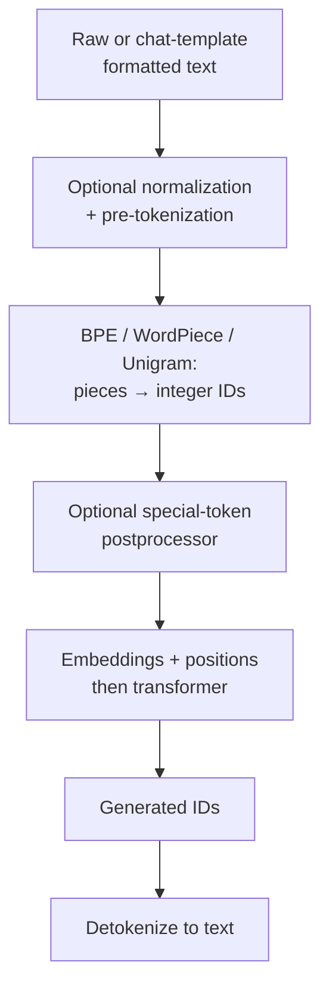

Tokenization converts raw text into a sequence of token IDs: the integer symbols a language model embeds, attends over, scores, and generates. The reverse path (detokenization) maps IDs back to UTF-8 text for humans and tools.

Formally, a tokenizer is a pair of maps between strings and ID sequences. For input text $s$ and vocabulary $\mathcal{V}$:

$$
\mathrm{Tok}(s) = (x_1,\ldots,x_n),\qquad x_i \in \{0,\ldots,|\mathcal{V}|-1\}
$$

$$
\mathrm{Detok}(x_1,\ldots,x_n) \approx s
$$

with $n = |\mathrm{Tok}(s)|$ the **token count** that drives text context budget, prefill work, and (for many APIs) billing. Retained KV-cache length also depends on the attention and eviction policy. Byte-level encodings such as `tiktoken` can round-trip the original text losslessly. Byte coverage alone does not undo normalization: lowercasing, NFKC conversion, or whitespace cleanup can discard distinctions even when those rules are fixed. Word-level systems and some subword tokenizers can also emit `[UNK]` when coverage or fallback is insufficient.

## Intuition

The model never sees "words" as a first-class unit. It sees IDs chosen by a fixed [tokenizer artifact](glossary://tokenizer-artifact). Those IDs decide how much context a prompt consumes, how code identifiers fracture, how multilingual text survives, and which pieces decoding can emit.

Changing the tokenizer changes the sequence the same weights operate on, even when the characters look identical. Treat tokenization as part of the model contract and version it with the weights.

## How it works

Production encode paths can combine the following stages, with some omitted or acting as the identity. Training and serving must use the same configured path, including the vocabulary, chat template, and tokenizer postprocessor. A chat template normally renders messages into formatted text before that text is encoded; a tokenizer postprocessor may separately add special-token IDs afterward.

1. **Normalize.** Unicode form (often NFC or NFKC), optional lowercasing, control-character policy. See [Unicode normalization](glossary://unicode-normalization).
2. **Pre-tokenize.** Split on whitespace, punctuation, or a regex (GPT-family encodings use a regex that keeps leading spaces with words and splits digits/punctuation in family-specific ways). SentencePiece can skip language-specific pretokenization by treating space as a normal character (often marked `▁`).
3. **Segment.** Apply the learned algorithm over base units:
   - **[BPE](glossary://bpe):** start from characters or UTF-8 bytes; apply merge ranks in training order (Sennrich, Haddow, and Birch, ACL 2016; compression roots in Gage, 1994). GPT-2 popularized **byte-level** BPE: base alphabet is all $256$ byte values so any UTF-8 string is representable without `[UNK]` (Radford et al., 2019).
   - **[WordPiece](glossary://wordpiece):** vocabulary of reusable pieces; BERT-style encode often uses greedy longest-match (Schuster and Nakajima, 2012 for the WordPiece model; later BERT tooling).
   - **Unigram LM:** start large, prune by likelihood; encode with best path (or sample paths for subword regularization) (Kudo, ACL 2018). Often packaged via [SentencePiece](glossary://sentencepiece) (Kudo and Richardson, 2018).
4. **Map to IDs.** Lookup each piece in the vocab; inject special tokens (BOS, EOS, pad, chat markers, tool markers) when the call path requires them.
5. **Model and decode.** Embeddings look up rows $E[x_i]$; generation samples new IDs; detokenize streams text back.

Serving must use the **same artifact** the model was trained with: vocab, merges or piece scores, pre-tokenizer, special-token IDs, and chat template if any.

## Diagram



## Algorithm families

| Family | Build idea | Encode idea | Open-vocab style |
|---|---|---|---|
| BPE | Grow merges by pair frequency | Replay merge ranks | Byte-level BPE: full coverage by construction |
| WordPiece | Build pieces (often likelihood-driven) | Often greedy longest match | May use `[UNK]` unless fallback exists |
| Unigram LM | Start large, prune by likelihood | Best path or sample | Natural multi-segmentation |

[Subword tokenization](glossary://subword-tokenization) is the shared design point: units smaller than words, larger than raw bytes, so rare strings compose from reusable pieces. Frameworks (Hugging Face `tokenizers`, SentencePiece, OpenAI `tiktoken`) implement these families plus the packaging details that make train/serve match.

## Example

Measure with the real encoder. Counts below were rechecked with `tiktoken 0.14.0` under the named encodings (re-run the snippet if you upgrade `tiktoken` or the model mapping). The measured **count and decode round-trip** define the contract; the listed piece strings illustrate these segmentations.

Under OpenAI's `cl100k_base` (GPT-3.5 / GPT-4 family, ~$100$k vocabulary via `tiktoken`):

| String | Token count | Pieces (illustrative) |
|---|---:|---|
| `hello world` | $2$ | `hello`, ` world` (leading space on second piece) |
| `HTTPRequestParser` | $2$ | `HTTPRequest`, `Parser` |
| `CUDA-9XZ-ALPHA` | $8$ | `CUDA`, `-`, `9`, `X`, `Z`, `-`, `AL`, `PHA` |
| `unhappiness` | $3$ | `un`, `h`, `appiness` |
| `✨` (U+2728) | $2$ | two UTF-8 byte fragments |

Same strings under `o200k_base` (GPT-4o family, ~$200$k vocabulary) often compress further: `CUDA-9XZ-ALPHA` drops to $7$ pieces (`XZ` merges), and `✨` becomes a single token. The ID-to-piece mappings differ between encodings; some numeric IDs can coincide, but that does not make them interchangeable. Never copy an ID from one family into another without an explicitly verified mapping.

```python
# OpenAI-style count (must match the model you call)
# Fixture: o200k_base encodes "CUDA-9XZ-ALPHA" as 7 IDs (measured under tiktoken).
import tiktoken

enc = tiktoken.encoding_for_model("gpt-4o")  # o200k_base
ids = enc.encode("CUDA-9XZ-ALPHA")
assert len(ids) == 7  # pinned fixture; re-measure if encoding map changes
assert enc.decode(ids) == "CUDA-9XZ-ALPHA"
```

What looks like one "word" to a human can be one cheap token or a long fragment chain. That single difference changes prompt packing, truncation, and billed usage.

## Worked numbers

For a request with prompt token count $n_{\mathrm{in}}$ and planned generation budget $n_{\mathrm{out}}$, most systems enforce something like:

$$
n_{\mathrm{in}} + n_{\mathrm{out}} \le W
$$

where $W$ is the [context window](glossary://context-window) in tokens. Attention and KV-cache costs grow with token count $n$; character length offers a rough proxy. A rough engineering heuristic from OpenAI's `tiktoken` docs is that **English prose averages about $4$ characters (or ~$4$ bytes) per token**; code, CJK, emoji, UUIDs, and minified JSON often need far more tokens per visible character.

Example budget:

| Field | Characters | Approx. tokens (`cl100k_base`) |
|---|---:|---:|
| System policy | $1{,}200$ | ~$300$ |
| User message (English) | $800$ | ~$200$ |
| Retrieved log lines / model IDs | $800$ | ~$400$+ (fragmentation) |
| Reserved output | n/a | $512$ |

These are hypothetical planning estimates, not measured encodings of specified strings. The "short" log payload can dominate $n_{\mathrm{in}}$. Estimating with `len(text)//4` can undercount fragmented text and admit a prompt that exceeds the real limit; overcounting highly compressible text can reject a prompt that actually fits.

## Debug path

When quality, cost, or length look wrong, print pieces and IDs for the **exact** production string (including leading spaces and chat markup):

1. Confirm the [tokenizer artifact](glossary://tokenizer-artifact) hash matches the checkpoint (vocab, merges, specials, template).
2. Encode with the same path serving uses (`apply_chat_template` when the model is chat-tuned; do not double-insert BOS/EOS).
3. Inspect fragmentation on model IDs, URLs, stack traces, CJK, emoji, and tool JSON.
4. Compare train vs serve: NFC vs NFKC, `byte_fallback`, pad/EOS IDs, and stop sequences.
5. For provider APIs, reconcile local estimates with billed usage; local `tiktoken` must use the encoding for **that** model.

Symptoms of tokenizer mismatch: sudden token-count cliffs after a "harmless" upgrade, broken tool-call markup, multilingual garble after detokenize, or eval gaps when notebooks use a different Hub revision than production.

## Trade-offs

| Choice | Benefit | Cost |
|---|---|---|
| Larger vocabulary | Shorter sequences on in-domain text | Bigger embedding table; rare merges |
| Smaller vocabulary | Smaller embeddings | Longer sequences, more attention/KV |
| Byte-level / byte fallback | No `[UNK]` on Unicode | Rare scripts can become many tokens |
| Domain-trained merges | Compact jargon and code | May hurt general English or other domains |
| Aggressive pre-tokenizer splits | Stable boundaries for digits/punct | Higher counts on IDs and paths |

There is no universal "best" tokenizer. The correct artifact is the one frozen with the weights.

## Why it matters here

Tokenization sits upstream of embeddings, context windows, next-token loss, streaming output, prompt packing, continuous batching, and every token-priced API call. Prefill latency, KV-cache memory, and tokens-per-second all settle in units of $n = |\mathrm{Tok}(s)|$. Many bugs labeled "model quality" start as tokenizer mismatches, chat-template drift, or silent ID remapping after a serving change.

In the curriculum, treat tokenization as the boundary between human text and model tensors: learn the pipeline, measure with the real artifact, and pin that artifact with the checkpoint.

## Related terms

- [Token](glossary://token)
- [Tokenizer artifact](glossary://tokenizer-artifact)
- [BPE](glossary://bpe)
- [Subword tokenization](glossary://subword-tokenization)
- [Context window](glossary://context-window)
