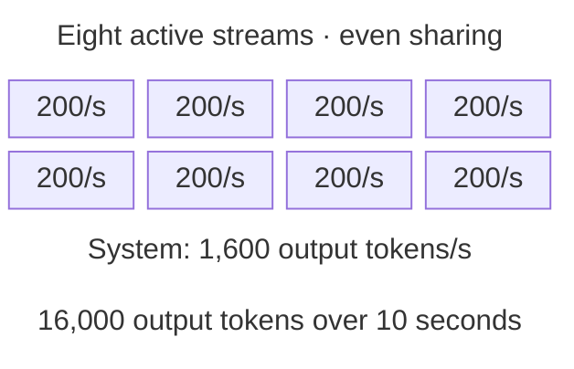

**Tokens per second (TPS)**, also called **token throughput**, measures how many tokens an LLM inference system processes or generates per unit time under a defined workload. In serving practice the headline number is almost always **output** (generation) tokens: how many new tokens the fleet produces across concurrent requests in one second of wall clock.

TPS is a **capacity** metric. It answers "how much generation work can this deployment finish?" Measure [TTFT](glossary://ttft), [TPOT](glossary://tpot), and [ITL](glossary://itl) to describe one user's wait and token cadence.

Curriculum labs often introduce TPS first as **per-request decode rate** after the first token ($\approx 1/\mathrm{TPOT}$). Serving dashboards more often mean **system aggregate** output TPS. Label which quantity a number measures when moving between a fundamentals lesson and a fleet gauge.

## Formula

For a benchmark window, **system (aggregate) output TPS** is

$$
\mathrm{TPS}_{\mathrm{system}}
= \frac{N_{\mathrm{out}}}{T_{\mathrm{window}}}
$$

where $N_{\mathrm{out}}$ is the total number of generated tokens across all completed (or measured) requests, and $T_{\mathrm{window}}$ is the chosen wall-clock denominator in seconds.

Two common denominators appear in industry tools (NVIDIA NIM / GenAI-Perf documentation):

| Tool convention | Denominator | Includes client overhead? |
|-----------------|-------------|---------------------------|
| GenAI-Perf style | $T_y - T_x$ (first request send $\to$ last response of last request) | Usually no |
| LLMPerf style | $T_{\mathrm{end}} - T_{\mathrm{start}}$ (full benchmark harness) | Yes (prompt build, client prep, response storage) |

Those choices can differ by tens of percent on short single-concurrency runs. Always name which window you used.

**Per-user decode rate** (what one stream feels like after the first token) is the reciprocal of mean inter-token time:

$$
\mathrm{TPS}_{\mathrm{user}}
\approx \frac{1}{\overline{\mathrm{ITL}}}
\approx \frac{1}{\mathrm{TPOT}}
\quad \text{(for long outputs)}
$$

So a mean [TPOT](glossary://tpot) of $40\,\mathrm{ms}$ is about $25$ tokens/s for that user. Per-user TPS and system TPS measure different scopes: many concurrent users can push system TPS into the thousands while each user sees $10$–$30$ tokens/s.

A rough identity that ties the two views together under steady concurrent load is

$$
\mathrm{TPS}_{\mathrm{system}}
\approx C_{\mathrm{active}} \times \mathrm{TPS}_{\mathrm{user}}
$$

where $C_{\mathrm{active}}$ is the average number of sequences actively decoding. Raising concurrency usually **raises** system TPS and **lowers** per-user TPS until the GPU saturates.

## Example

Eight chat requests run concurrently for $10\,\mathrm{s}$ of steady generation. Together they emit $16{,}000$ output tokens:

$$
\mathrm{TPS}_{\mathrm{system}} = \frac{16{,}000}{10} = 1{,}600\ \text{tokens/s}
$$

If the work is shared evenly, each stream is about

$$
\mathrm{TPS}_{\mathrm{user}} \approx \frac{1{,}600}{8} = 200\ \text{tokens/s}
$$

which corresponds to about $5\,\mathrm{ms}$ mean ITL. Whether that cadence is necessary depends on the product SLO; report the measured distribution under the target concurrency instead of treating one public benchmark threshold as universal.

**Worked offline case.** A batch job runs one 70B model replica and finishes $120$ summarization requests in $60\,\mathrm{s}$. Mean output length is $400$ tokens:

$$
N_{\mathrm{out}} = 120 \times 400 = 48{,}000
\quad\Rightarrow\quad
\mathrm{TPS}_{\mathrm{system}} = \frac{48{,}000}{60} = 800\ \text{tokens/s}
$$

Here high system TPS is the goal. Per-user cadence barely matters because nobody is reading a stream.

## Which TPS?

"Tokens per second" can describe several metrics. Label the axis before comparing two numbers.

| Label | Counts | Question it answers |
|-------|--------|---------------------|
| **System output TPS** | Generated tokens / wall time, all users | Fleet generation capacity |
| **User output TPS** | $\approx 1/\mathrm{TPOT}$ for one stream | Streaming feel after first token |
| **Prefill / prompt TPS** | Prompt tokens processed / prefill time | How fast the server digests inputs |
| **Decode TPS** | Generated tokens during [decode](glossary://decode-phase) only | Generation loop efficiency |
| **TPS per GPU** | System TPS / GPU count | Hardware packing efficiency |
| **Blended TPS** | (prompt + output) / wall time | Mixed bookkeeping; easy to misuse |

Prefill and decode have different hardware shapes. Prefill over a long prompt is often compute-bound (large matrix-matrix work). Decode at small batch is often memory-bandwidth bound (reload weights and growing [KV cache](glossary://kv-cache) each step). A blended number can hide which phase is failing.

vLLM-style engines expose both views operationally: prompt tokens processed per second and generation tokens per second over a short rolling window (for example the last few seconds of engine metrics). Use those gauges for live capacity; use TTFT/TPOT histograms for user experience.

## Diagram

One model step can emit one new token per live sequence. System TPS sums those emissions. User TPS is the cadence of a single sequence's stream.

## How it works in serving

1. **Prefill** builds the KV cache for the prompt and produces the first token ([TTFT](glossary://ttft) includes queue + prefill + that first token).
2. **Decode** runs one forward step per new token per sequence. [Continuous batching](glossary://continuous-batching) rebuilds the live set each iteration so finished sequences free slots and new ones enter.
3. **Aggregate TPS** rises as more sequences share each step: the same weight load serves more tokens, so GPU arithmetic intensity improves until compute, memory, or KV capacity caps the batch.
4. **Per-user TPS** falls as the step grows slower or a sequence waits between scheduled steps (other prefills, large batches, preemption).

That is the classic throughput-latency trade-off Databricks and other serving guides document: batch more work to raise system tokens/s, accept higher TPOT per user, or the reverse.

**Tokenizer caveat.** Tokens are model-specific. The same paragraph can produce different token counts under different tokenizer artifacts. Cross-model user-facing comparisons need a tokenizer-independent unit such as characters or words; tokens/s remains valid for capacity comparisons of a fixed model and tokenizer.

## Sizing and capacity

Useful back-of-envelope estimates once you have a measured system TPS at a target quality and latency envelope:

$$
\text{GPUs needed}
\approx
\frac{\text{required system tokens/s}}{\text{measured tokens/s per GPU}}
\times \frac{1}{\text{headroom}}
$$

Set the headroom factor from load tests at the required p95 TTFT and TPOT; peak throughput alone does not account for workload latency targets.

Relate request rate to tokens when outputs dominate:

$$
\text{required system TPS}
\approx
\mathrm{QPS}_{\mathrm{target}} \times \overline{N}_{\mathrm{out}}
$$

A chatbot at $5$ completed requests/s with mean $300$ output tokens needs about $1{,}500$ tokens/s of generation capacity, before retries, tool loops, and uneven traffic. [QPS](glossary://qps) alone understates that load if output lengths grow.

For interactive chat, also check **goodput**: requests completed per second while meeting TTFT and TPOT SLOs. The fraction meeting those SLOs is the attainment rate; multiplying it by completed requests/s gives request goodput under the same window. Usable capacity counts requests that meet latency targets, so report goodput alongside peak TPS.

## What fails in production

| Failure mode | What you see | What to check |
|--------------|--------------|---------------|
| High system TPS, angry users | Fleet gauges look great; chat feels slow | Per-user TPOT/ITL, batch size, queue time |
| Low system TPS, idle GPU | Utilization low, long gaps between steps | Continuous batching off, tiny concurrency, CPU-bound tokenizer/API path |
| Prefill starvation of decode | Smooth until long prompts arrive; streams hitch | Chunked prefill, `max_num_batched_tokens`, prefill/decode isolation |
| KV thrash | TPS collapses near memory limit | Cache hit rate, max concurrent seqs, context length, preemption |
| Bad benchmark compare | Vendor A "beats" B by 2× | Window definition, input/output lengths, precision, engine, cache hits, concurrency, tokenizer |
| Tokenizer mismatch | "Same text, different tokens/s" | Report characters or words when comparing products |
| Counting prompt as output | Inflated "generation" TPS | Separate prompt TPS from generation TPS |

Always report: model and revision, hardware, precision/quantization, engine (vLLM, TensorRT-LLM, TGI, SGLang, …), prompt length, output length, concurrency or arrival process, prefix-cache hit rate, and whether the count is output-only. Without those labels, TPS comparisons are noise.

[NVIDIA's GenAI-Perf documentation](https://docs.nvidia.com/deeplearning/triton-inference-server/user-guide/docs/perf_analyzer/genai-perf/README.html#metrics) defines aggregate and per-user token throughput separately. As of September 2026, NVIDIA is phasing out GenAI-Perf and directs new benchmarking work to AIPerf; historical GenAI-Perf results remain interpretable under their recorded definitions.

## Trade-offs

| Push for | Often helps | Often hurts |
|----------|-------------|-------------|
| Higher system TPS | Continuous batching, higher concurrency, quantization, speculative decoding (when accept rate is high) | Per-user TPOT, TTFT under load, quality if quantization is aggressive |
| Higher user TPS | Smaller decode batch, decode-friendly scheduling, faster kernels / bandwidth, shorter contexts | Fleet capacity, cost per token at low utilization |
| Offline max TPS | Large static batches, no latency SLO | Interactive goodput |

There is no single "good" TPS. Offline PDF extraction wants max system tokens/s. Pair programming wants stable per-user cadence above a reading-speed floor. Size to the product, not to a leaderboard screenshot.

## Why it matters here

LeetLLM treats TPS as the **capacity lens** next to TTFT (silence before the first token) and TPOT/ITL (streaming rhythm). Serving design, continuous batching, KV-cache limits, and GPU packing all show up first as movements in these numbers. Learners who keep system throughput and per-user cadence separate can debug the right layer: more GPUs when capacity is short, scheduler or batch policy when users feel slow while the fleet is "busy," and prefill vs decode when only one phase moves.

## Related terms

- [TPOT](glossary://tpot)
- [TTFT](glossary://ttft)
- [ITL](glossary://itl)
- [Decode phase](glossary://decode-phase)
- [Continuous batching](glossary://continuous-batching)
