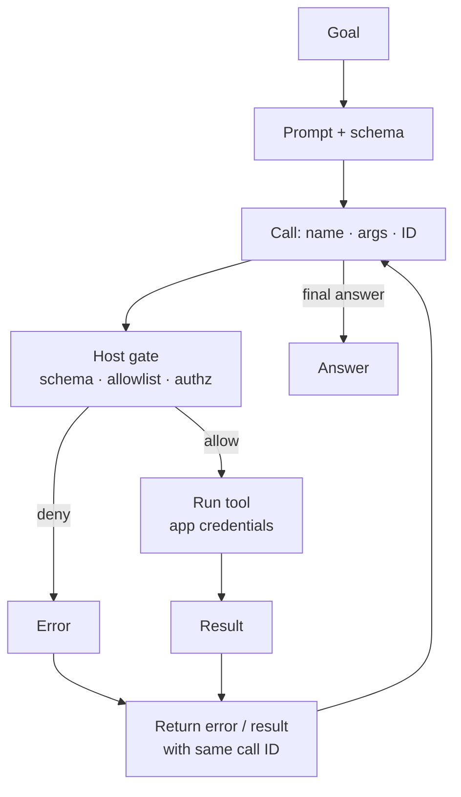

**Tool calling** (also called **function calling**) is the protocol by which a language model proposes a named external operation with structured arguments, and an execution host validates, authorizes, executes, and returns an observation. The model emits a machine-readable request; side effects belong to application handlers or provider-hosted tool runtimes, depending on the tool.

Providers surface this as structured special tokens or message parts (OpenAI `tool_calls` / Responses `function_call`, Anthropic `tool_use` blocks). Research systems such as Toolformer insert API call text into the generation stream. In production, define tools as typed APIs with structured arguments that the host can validate and authorize before dispatch.

## Intuition

A chat model alone has a fixed training cutoff, no private data, and no actuators. Tools fix that split:

| Layer | Owns | Must not own |
| --- | --- | --- |
| **Model** | Whether to call, which tool, which arguments | Credentials, policy, network IO |
| **Application** | Schema checks, authn/authz, rate limits, idempotency, audit, retries | Guessing intent from unvalidated text |
| **Tool / backend** | Domain truth (private datasets, search index, shell sandbox) | Deciding the user is "allowed" because the model asked |

"The model asked for it" is never authorization. Fluent JSON is still untrusted input.

## How it works

### Runtime loop

OpenAI's function-calling guide describes a multi-step conversation between your app and the model. The same shape appears in Anthropic client tools and in agent scaffolds:

1. Send the user message plus a **tool catalog** (names, descriptions, [JSON Schema](glossary://json-schema) for arguments).
2. The model either answers in text or returns one or more **tool calls** (name + arguments + call id).
3. Your code **validates and executes** each call (or denies it).
4. You append **tool results** (or structured errors) bound to those call ids.
5. The model continues: final answer, or more tool calls.

That loop is the agent. The [agent scaffold](glossary://agent-scaffold) owns budgets, retries, context packing, and stop conditions around it.



### Schemas and choice controls

A typical function tool definition carries:

- **`name`**: stable identifier the runtime routes on
- **`description`**: when to use the tool (this is model-facing documentation)
- **`parameters`**: JSON Schema for arguments
- **`strict`** (when supported): constrained decoding so arguments match the schema instead of "best effort" JSON

Common policy knobs on the request:

| Control | Effect |
| --- | --- |
| `tool_choice: auto` | Model may call zero or more tools |
| `tool_choice: required` / `any` | Force at least one tool call |
| Forced named tool | Call exactly one specified function |
| `tool_choice: none` | Forbid tools this turn |
| `parallel_tool_calls` | Allow or ban multiple calls in one turn |

Parallel calls are useful for independent retrieval queries and dangerous for concurrent deploy, delete, or permission writes. Prefer parallel for independent reads; serialize writes with explicit [idempotency](glossary://idempotency) keys.

Anthropic distinguishes **client tools** (your app runs the handler and returns `tool_result`) from **server tools** (provider runs search, code execution, and so on). In both cases the model still *requests* the tool; only the execution host differs. [MCP](glossary://mcp) standardizes how hosts discover and invoke tool servers; it does not replace the authorization layer in your scaffold.

### What the model actually generates

Under the hood, tool definitions are injected into the prompt in a format the model was trained or post-trained on. Calls count as output tokens; schemas and results count as input tokens on later turns. Keep the **initially exposed** catalog small enough that tools are distinguishable on your eval set, and use clear names, enums, and required fields so invalid states are hard to emit. Route to specialized tool subsets instead of assuming one catalog-size threshold transfers across models.

## Formula

Early self-supervised tool training (Toolformer, Schick et al., 2023) keeps a candidate API call only when inserting the call **and** its result lowers next-token loss enough versus baselines without a useful result. For position $i$, call $c_i$, and result $r_i$:

$$
L_i(\mathbf{z}) = -\sum_{j=i}^{n} w_{j-i}\,\log p_M(x_j \mid \mathbf{z}, x_{1:j-1})
$$

$$
L_i^{+} = L_i\!\big(e(c_i, r_i)\big),\qquad
L_i^{-} = \min\!\big(L_i(\varepsilon),\, L_i(e(c_i, \varepsilon))\big)
$$

Keep the call when $L_i^{-} - L_i^{+} \ge \tau_f$. Production chat APIs usually apply this filter for you. Its principle still matters: a tool is valuable when its observation **changes what the model should say next**.

## Example

Learning assistant, authenticated learner `user_42`, lesson `kv-cache`. Tool schema (abbreviated):

```json
{
  "type": "function",
  "name": "lookup_lesson_progress",
  "description": "Return progress and next exercise for one lesson the learner may read.",
  "strict": true,
  "parameters": {
    "type": "object",
    "properties": {
      "lesson_slug": { "type": "string", "minLength": 1, "maxLength": 96 }
    },
    "required": ["lesson_slug"],
    "additionalProperties": false
  }
}
```

Model proposes:

The following is a parsed application representation. In [OpenAI function-call responses](https://developers.openai.com/api/docs/guides/function-calling), `arguments` arrives as a JSON-encoded string; parse it before passing a dictionary to a handler. Provider response fields differ.

```json
{
  "id": "call_7f3a",
  "name": "lookup_lesson_progress",
  "arguments": { "lesson_slug": "kv-cache" }
}
```

Trusted handler (not the model):

```python
def handle_tool_call(user, name: str, args: dict, call_id: str) -> dict:
    if name not in ALLOWED_TOOLS[user.role]:
        return error_result(call_id, "denied", "tool not allowlisted")

    validated = TOOL_SCHEMAS[name].parse(args)  # JSON Schema / Pydantic

    if name == "lookup_lesson_progress":
        if not user.can_read_lesson(validated.lesson_slug):
            return error_result(call_id, "denied", "lesson not visible")
        row = db.fetch_lesson_progress(user.id, validated.lesson_slug)
        return ok_result(call_id, {
            "lesson_slug": row.lesson_slug,
            "completed": row.completed,
            "next_exercise": row.next_exercise,
        })

    if name == "run_code_submission":
        # Stronger gates: sandbox limits, confirmation, timeout, audit
        ...
```

A second turn with the observation lets the model answer: "You completed the KV-cache reading; the next exercise is block-allocation sizing." An execution tool such as `run_code_submission` needs the same loop plus sandbox limits, [human-in-the-loop](glossary://human-in-the-loop) confirmation where required, and an audit row. Schema validity alone never proves the requested code is safe to run.

## Debug path

When tool calling misbehaves in production, classify the failure before swapping models:

| Symptom | Likely layer | What to check |
| --- | --- | --- |
| Model never calls a tool | Catalog / prompt / `tool_choice` | Descriptions, "use tools for live data" policy, forced choice for critical paths |
| Invalid JSON / missing fields | Schema / strict mode | `required`, `additionalProperties: false`, enums; enable strict structured outputs |
| Right tool, wrong tenant data | Authz after parse | Resource-level ACL on arguments and tenant scope |
| Duplicate charges or emails | Retries / parallelism | Idempotency keys, disable parallel writes, dedupe by `call_id` |
| Model invents success after a failure | Error shape | Return structured errors the model can recover from; never silent empty success |
| Unexpected tool after retrieval | [Prompt injection](glossary://prompt-injection) | Untrusted tool results and web text; [action allowlist](glossary://action-allowlist); argument policy |

Log `call_id`, tool name, principal, sanitized args, allow/deny reason, latency, and backend status. Trajectory logs are how you tell "model chose poorly" from "runtime executed without a check."

## Trade-offs

- **More tools** expand capability and dilute routing accuracy; defer rare tools or load them on demand rather than dumping a giant catalog every turn.
- **Strict schemas** raise parse reliability and reject bad shapes early. Enforce eligibility, fraud, and tenancy with separate business-policy checks.
- **Parallel tool calls** cut latency for independent reads and amplify blast radius for writes.
- **Server-executed tools** reduce your handler code and move trust to the provider boundary; client tools keep data and credentials in your VPC but you own every failure mode.
- **Returning raw backend dumps** bloates context and can leak fields the model should never see; return minimal, purpose-built observations.

## Why it matters here

Tool calling is the hinge between language models and software systems. Agents, RAG-with-actions, coding assistants, and ops bots are tool loops plus policy. Interview and production work both probe the same split: how schemas are defined, how the plan-act-observe cycle runs, and where authorization sits when the model is wrong or adversarially steered. If you only remember one rule: **the model proposes; the application disposes.**

## Related terms

- [Agent scaffold](glossary://agent-scaffold)
- [Structured output](glossary://structured-output)
- [Action allowlist](glossary://action-allowlist)
- [JSON Schema](glossary://json-schema)
- [MCP](glossary://mcp)
