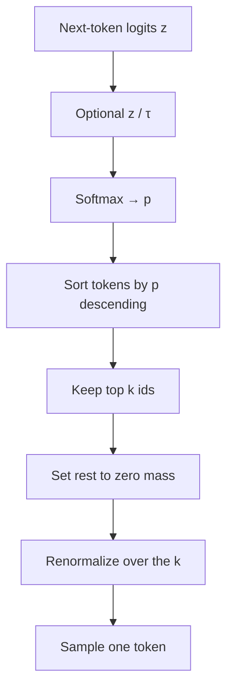

Top-k means keeping only the $k$ highest-scoring items from a larger candidate set, then using only that shortlist. In LLM decoding, those items are vocabulary tokens: the next token is sampled from the $k$ most probable tokens after renormalization (Fan et al., 2018; Holtzman et al., 2019). In retrieval and ranking, the items are documents, chunks, labels, or actions: stages after the cutoff never see rank $k{+}1$.

The same name therefore covers two production knobs that both answer "how many of the best candidates may the next stage use?" One reshapes a token distribution; the other sets a hard recall ceiling for evidence.

## Intuition

Without truncation, an autoregressive model can sample from the full vocabulary. The long tail holds many low-probability tokens that, in aggregate, are over-represented relative to fluent human text. Pure sampling often drifts into incoherence; maximization (greedy or beam search) often locks into bland or repetitive loops. Top-k cuts the tail by count: only the $k$ largest next-token probabilities stay in play.

The fixed count is both the strength and the limit. On a peaked step (one or two tokens hold almost all mass), a large $k$ still reweights junk into the sample pool. On a flat step (many plausible continuations), a small $k$ throws away valid options and forces bland choices. [Top-p](glossary://top-p) (nucleus) sampling was designed for that adaptivity problem: it keeps a variable number of tokens whose cumulative probability reaches $p$, instead of always exactly $k$ (Holtzman et al., 2019).

In retrieval, top-k forms a hard gate on the candidate pool for reranking or prompt packing. Raising retrieval $k$ usually raises [recall@k](glossary://recall-at-k) and cost; lowering it removes chunks ranked just outside the cutoff from later stages.

## Diagram

Typical engine order is temperature on logits, then top-k filter, then optional top-p on the remaining mass, then sample. Confirm the order in your runtime: Hugging Face Transformers applies top-k before top-p in the shared filter path.

## Formula

**Decoding.** Let $P(x \mid x_{1:i-1})$ be the model's next-token distribution over vocabulary $V$. Define the top-k vocabulary $V^{(k)} \subset V$ as a size-$k$ set that maximizes total probability mass:

$$
V^{(k)} = \operatorname*{arg\,max}_{S \subset V,\, |S|=k} \sum_{x \in S} P(x \mid x_{1:i-1}).
$$

In the size-$k$ mathematical definition these are the $k$ tokens with largest $P$, with an explicit tie rule. Some implementations instead keep every token at or above the kth score, so ties can leave more than $k$ candidates ([Transformers implementation](https://github.com/huggingface/transformers/blob/main/src/transformers/generation/logits_process.py)). Let $p' = \sum_{x \in V^{(k)}} P(x \mid x_{1:i-1})$. Renormalize and sample:

$$
P'(x \mid x_{1:i-1}) =
\begin{cases}
P(x \mid x_{1:i-1}) / p' & \text{if } x \in V^{(k)} \\
0 & \text{otherwise.}
\end{cases}
$$

Special cases: $k = 1$ is greedy (after any temperature still only the max remains). $k = |V|$ (or an engine's "disabled" value such as `top_k=0` in some APIs) is unrestricted sampling. The scaling factor $p'$ changes every step: large when the head holds most mass, small when the top $k$ still leave a heavy tail outside.

Temperature $\tau$ usually acts on logits before softmax:

$$
p_i(\tau) = \frac{\exp(z_i / \tau)}{\sum_j \exp(z_j / \tau)},
$$

For finite $\tau > 0$, dividing by temperature and applying softmax preserve logit order: the top-k IDs stay the same, while their sampling probabilities change. Temperature can change top-p membership because that cutoff depends on mass. Greedy/zero-temperature paths are implemented separately.

**Retrieval.** Given scores $s_1, \ldots, s_N$ for corpus items, the top-k set is

$$
S_k = \{ i : \operatorname{rank}(s_i) \le k \},
$$

where rank $1$ is the highest score. No renormalization is required; later stages only score or pack items in $S_k$.

## Worked numbers

Suppose after softmax the head of the next-token distribution is:

| Token | $p$ |
|-------|-----|
| `mat` | 0.40 |
| `table` | 0.25 |
| `bed` | 0.15 |
| `desk` | 0.08 |
| `chair` | 0.05 |
| *rest of $V$* | 0.07 total |

With $k = 3$, $V^{(k)} = \{\texttt{mat}, \texttt{table}, \texttt{bed}\}$, $p' = 0.80$, and the sampling distribution becomes

$$
P'(\texttt{mat}) = 0.50,\quad
P'(\texttt{table}) = 0.3125,\quad
P'(\texttt{bed}) = 0.1875.
$$

Everything else has probability $0$ at this step, including tokens that would have been reasonable under a flatter context. With $k = 1$, only `mat` can be chosen. With $k = 50$ on a peaked step, many near-zero tokens stay in the candidate set; after renormalization they still have small mass but can occasionally be drawn.

## Example

**Decoding.** A story model continues "The cat sat on the". Fan et al. (2018) used top-k with $k = 10$ for hierarchical story generation: sample only among the ten most likely next pieces, which cut gibberish from full-vocabulary sampling while avoiding the generic loops of beam search. Modern runtimes expose `top_k` directly, but defaults can differ by model config and engine. Set it explicitly when outputs must be reproducible across stacks.

**Retrieval.** A RAG retriever returns the top $20$ chunks by dense score. A cross-encoder reranks those $20$ and packs five into the prompt. If the needed policy paragraph was rank $27$, it never entered the candidate set; increase retrieval depth or improve first-stage recall before changing reranking or generation temperature.

## How it works in engines

1. Produce next-token logits for the current prefix (decode step).
2. Apply masks and biases (pad, banned tokens, logit bias).
3. Optionally divide by temperature $\tau$.
4. Softmax (or work in log space with equivalent truncation).
5. Select the $k$ largest probabilities; set others to $-\infty$ / zero.
6. Optionally apply top-p (or min-p, typical-p, …) on what remains.
7. Renormalize and draw one token; append and repeat.

Provider APIs differ, including by model. Anthropic's API has historically exposed `top_k`, but its [current reference](https://platform.claude.com/docs/en/api/completions/create) says models released after Claude Opus 4.6 reject it. Google's GenerationConfig exposes `topK` where supported by the chosen model. OpenAI Chat Completions has no top-k parameter; temperature and `top_p` support also depends on the model. Self-hosted stacks (vLLM, Transformers, llama.cpp, TGI) commonly expose top-k and may combine it with top-p.

## Trade-offs

| Setting | Effect | Risk |
|---------|--------|------|
| Small decode $k$ (e.g. 5–20) | Safer, more conservative text | Flat contexts lose valid options; bland style |
| Large decode $k$ (e.g. 100+) | More diversity when mass is spread | Peaked steps reintroduce tail noise after renorm |
| Retrieval $k$ too low | Cheap rerank and short context | Irrecoverable miss of gold evidence |
| Retrieval $k$ too high | Higher recall | Latency, cost, noise for the reranker or prompt |

Top-k constrains which continuations or candidates remain *eligible* for sampling. Hallucinations, missing tools, and wrong context require separate product checks. Tune with temperature and top-p held fixed, using the actual product metric (factual acceptance, style preference, pass@n) alongside qualitative review.

## Why it matters here

Every LLM product either samples under a truncated distribution or retrieves under a finite candidate budget. Top-k is the simplest fixed-size truncation: easy to reason about, easy to mis-set, and easy to confuse with nucleus sampling. In this curriculum it links decoding policy ([temperature](glossary://temperature), [top-p](glossary://top-p), [logits](glossary://logits)) to retrieval gates ([candidate generation](glossary://candidate-generation), [recall@k](glossary://recall-at-k), [reranker](glossary://reranker)). Tune $k$ against recall, noise, cost, and quality targets for the product.

## Related terms

- [Top-p sampling](glossary://top-p)
- [Temperature](glossary://temperature)
- [Logits](glossary://logits)
- [Recall@k](glossary://recall-at-k)
- [Reranker](glossary://reranker)
