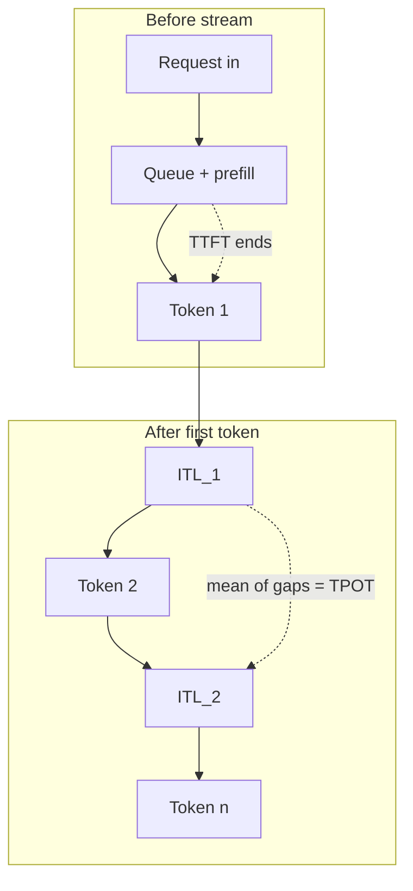

**Time per output token (TPOT)** is the average wall-clock time a serving system takes to emit each generated token **after** the first token has already appeared. It is a **decode-cadence** summary for one request (or a benchmark of many requests), not a whole-response timer and not a fleet throughput number.

If a request streams tokens at arrival times $t_1, t_2, \ldots, t_n$ (same clock everywhere, empty chunks and terminal `[DONE]` frames dropped), the usual industry definition used by GenAI-Perf, Ray Serve LLM, and vLLM-style serving benchmarks is

$$
\mathrm{TPOT}
= \frac{\mathrm{E2E} - \mathrm{TTFT}}{n - 1}
= \frac{t_n - t_1}{n - 1}
= \frac{1}{n-1}\sum_{i=1}^{n-1} \mathrm{ITL}_i
$$

where $\mathrm{ITL}_i = t_{i+1} - t_i$ and $\mathrm{TTFT}$ ends at $t_1$. The $-1$ in the denominator is intentional: the first token belongs to [TTFT](glossary://ttft) / [prefill](glossary://prefill), not to the post-stream average.

Here E2E ends at the last output token. A response-completion timer that includes trailing usage frames or connection teardown adds overhead and is not exactly $t_n-t_{\mathrm{request}}$. Real streams may deliver several tokens per chunk: chunk arrival times alone do not provide one measured timestamp per token. State whether the tool divides chunk gaps by token counts or estimates token cadence ([GenAI-Perf metrics](https://docs.nvidia.com/deeplearning/triton-inference-server/user-guide/docs/perf_analyzer/genai-perf/README.html#metrics)).

Some stacks (and some NVIDIA docs) treat TPOT and [ITL](glossary://itl) as the same phrase. In practice they agree **per request** (TPOT is the mean of that request's ITLs) and can diverge **across a fleet**: average TPOT is often request-weighted, while average ITL is often token-weighted. Always read the dashboard legend before you page on a regression. Completions with fewer than two output tokens have no decode gap, so TPOT is undefined; production aggregates usually **drop** $n=1$ requests rather than treating them as errors.

## Intuition

TTFT answers "when does anything show up?" TPOT answers "how fast does the rest of the answer move once streaming has started?"

Typical reading is only a few to ~10 tokens/s (roughly $100\text{-}250\,\mathrm{ms}$ per token, depending on the words-per-token heuristic). Serving targets are usually tighter so the stream stays ahead of the reader: a TPOT near $30\text{-}50\,\mathrm{ms}$ (~20-33 tokens/s of **per-user** cadence) usually feels fluid in chat. A TPOT of $100\,\mathrm{ms}$ is about 10 tokens/s per user (~450 words per minute in the rough English heuristic used in MosaicML / Databricks serving notes), still faster than many people read but already sluggish for interactive coding UIs. Multi-hundred-ms TPOT (or a smooth mean hiding multi-hundred-ms p95 ITL stalls) feels like freezes.

TPOT is **not** system-wide [tokens per second](glossary://tokens-per-second). High fleet TPS with fat continuous batches can raise every user's TPOT. Low per-user TPOT with one quiet GPU can coexist with terrible capacity.

## Formula

**Single request** with $n \ge 2$ output tokens:

$$
\mathrm{TPOT} = \frac{t_n - t_1}{n - 1}
$$

**Approximate end-to-end latency** (serving engineering form used widely after Databricks / MosaicML practice notes):

$$
\mathrm{E2E} \approx \mathrm{TTFT} + \mathrm{TPOT} \cdot (n - 1)
$$

Some write $\mathrm{TTFT} + \mathrm{TPOT}\cdot n$ as a quick planning heuristic when $n$ is large; the exact $(n-1)$ form matches the exclude-first-token definition above.

**Per-user streaming rate** for long outputs:

$$
\text{user tokens/s} \approx \frac{1}{\mathrm{TPOT}}
$$

**Fleet aggregation trap** (vLLM / Ray Serve LLM convention):

$$
\overline{\mathrm{TPOT}} = \frac{1}{N}\sum_{r=1}^{N} \mathrm{TPOT}_r
\quad\text{(each request once)}
$$

$$
\overline{\mathrm{ITL}} = \frac{\sum \text{all gaps}}{\sum_r (n_r - 1)}
\quad\text{(each token gap once)}
$$

Request A: 100 tokens at $10\,\mathrm{ms}$ TPOT ($99$ gaps). Request B: 2 tokens at $50\,\mathrm{ms}$ TPOT ($1$ gap).

- Avg TPOT $= (10+50)/2 = 30\,\mathrm{ms}$
- Token-weighted avg ITL $= (99\cdot 10 + 1\cdot 50)/100 = 10.4\,\mathrm{ms}$

Same traffic, different "average." (Some docs weight by $n$ instead of $n-1$ when ITL is treated as constant per request; the qualitative trap is identical.)

## Worked numbers

A chat completion streams four tokens. Client receive times after request send: $320$, $354$, $395$, $432\,\mathrm{ms}$.

| Quantity | Value |
|----------|--------|
| TTFT | $320\,\mathrm{ms}$ |
| Gaps (ITLs) | $34$, $41$, $37\,\mathrm{ms}$ |
| TPOT | $(34+41+37)/3 = 37.3\,\mathrm{ms}$ |
| User tokens/s | $1/0.0373 \approx 26.8$ |

TTFT stays out of the average. The user already saw the stream start; TPOT only describes the rhythm after that.

For a 400-token answer with the same TPOT:

$$
T_{\mathrm{decode}} \approx 399 \times 37.3\,\mathrm{ms} \approx 14.9\,\mathrm{s}
$$

First-token latency is almost invisible next to that. Raising `max_tokens` multiplies the decode budget; shortening the prompt mainly helps TTFT unless shorter context also shrinks per-step attention cost.

## Example

```python
# Request-level TPOT from stream timestamps (seconds)
# t_tokens[0] is first token arrival; t_request is send time
def tpot_ms(t_request: float, t_tokens: list[float]) -> float:
    if len(t_tokens) < 2:
        # Math needs n >= 2 output tokens. Production dashboards usually
        # drop single-token completions from TPOT aggregates rather than error.
        raise ValueError("need at least 2 output tokens")
    # exclude first token; match GenAI-Perf / vLLM-style TPOT
    return 1000.0 * (t_tokens[-1] - t_tokens[0]) / (len(t_tokens) - 1)

ttft_ms = 1000.0 * (t_tokens[0] - t_request)
# e2e_ms ≈ ttft_ms + tpot_ms(...) * (len(t_tokens) - 1)
```

Under load, the same request shape might show TPOT $37\,\mathrm{ms}$ at concurrency 1 and $80\,\mathrm{ms}$ at concurrency 32 because the [decode phase](glossary://decode-phase) shares the GPU with more sequences and occasional prefills. The metric still measures **per-user** pace, not aggregate capacity.

## Diagram



TTFT ends when token 1 is delivered. Every later gap is an ITL sample. TPOT is the mean of those gaps for the request (or the mean of per-request means in a benchmark table labeled "Mean TPOT").

## How it works

After prefill fills the [KV cache](glossary://kv-cache) for the prompt, decode emits one new token per step per sequence (before speculative tricks). Each step loads weights, reads growing K/V, runs a forward pass for the live batch, samples, streams, and appends new cache entries.

At small batch, that step is often **memory-bandwidth bound**: arithmetic intensity is low because large weight matrices produce thin activations. MosaicML / Databricks serving notes capture this with Model Bandwidth Utilization (MBU): achieved bandwidth is roughly (model weight bytes + active KV bytes) divided by the time per decode step, which is what TPOT tracks for a quiet request.

Under production load, TPOT also includes **time the sequence waited between scheduled steps**:

| Driver | Effect on TPOT |
|--------|----------------|
| Decode batch / concurrent sequences | Larger batches raise per-step latency; higher aggregate TPS, worse per-user TPOT |
| Prefill mixed into the same iteration | Long new prompts steal a step; streams pause |
| KV pressure / preemption | Sequences swap out; p95/p99 TPOT spikes |
| Context length so far | Attention and KV traffic grow with prefix; mild drift on long answers |
| Speculative decoding | High accept rates cut effective TPOT; low accept rates add wasted draft work |
| Quantization / kernels / tensor parallel | Faster step floor for everyone, or lower MBU if shards get too thin |
| Stream path buffering | Engine step time flat while clients still see high TPOT |

A TPOT regression can originate in scheduling, cache, concurrency, the path between GPU and browser, or model execution.

## Debug path

When **TPOT regresses while TTFT is stable**, the first-token path is fine and decode or streaming is not:

1. Plot **p50 and p95/p99** of per-request TPOT (and of raw ITL if you have it). Mean-only charts hide stalls that users feel.
2. Check concurrent decode depth, `max_num_seqs` / batch token caps, and whether chunked or priority prefill is starving decode.
3. Inspect KV usage, preemption counts, and prefix-cache thrash. Evictions open multi-step holes that inflate averages and tails.
4. For speculative decoding, track acceptance rate next to TPOT; acceptance drops often show up as TPOT first.
5. Compare engine-side step metrics to client-side gap histograms. If only the client is bad, chase reverse proxies, SSE buffering, and detokenization chunking.
6. Slice by model, route, quantization, output length, and batch shape. Averages across mixed workloads hide the case users complain about.
7. Confirm you are not counting empty stream frames or averaging TTFT into "per-token" latency (some older tools did; GenAI-Perf and modern vLLM-style reports exclude the first token).

If **TTFT and TPOT** both degrade, inspect overload sources such as queueing, GPU saturation, autoscaling lag, and deploy changes alongside the decode kernel.

## Trade-offs

Serving always trades fleet capacity against per-user TPOT. Continuous batching raises aggregate [tokens per second](glossary://tokens-per-second) by packing more sequences into each step; each sequence's TPOT usually rises. Offline summarization can tolerate high TPOT. Interactive chat and code completion usually cannot.

Prefill-decode colocation couples the two metrics: a heavy prefill on the same GPU stretches every concurrent decode gap. Disaggregated prefill/decode pools (DistServe-style) protect TPOT at the cost of KV transfer and two weight copies.

## Why it matters here

LeetLLM separates TTFT from streaming speed because they point at different systems. Bad TTFT often means queueing or prefill. Bad TPOT often means decode, batching, KV-cache pressure, memory bandwidth, or stream plumbing. Learners who keep those axes separate fix the right layer instead of randomly shrinking the model or raising GPU count.

Curriculum material on inference mechanics, continuous batching, and model parallelism treats TPOT as the **per-user decode SLO** and TPS as the **capacity** lens. You need both views to size fleets and to debug "the model feels slow."

## Related terms

- [TTFT](glossary://ttft)
- [ITL](glossary://itl)
- [Tokens per second](glossary://tokens-per-second)
- [Decode phase](glossary://decode-phase)
- [Continuous batching](glossary://continuous-batching)
