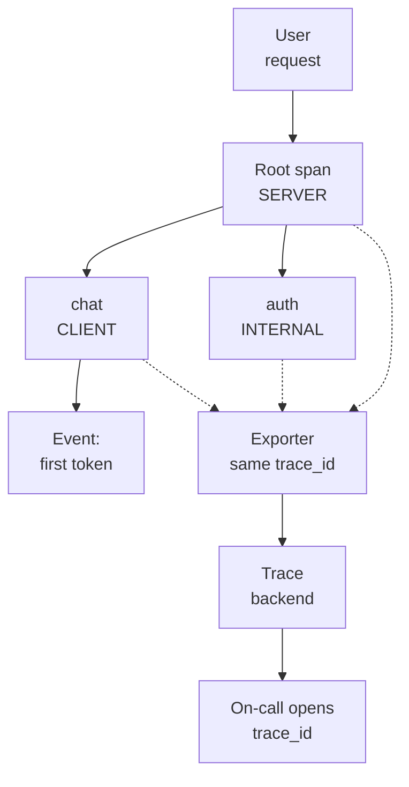

**Tracing** records the path of a single logical request as a tree (or DAG) of timed **spans**, so you can see which steps ran, in what order, how long each took, and what attributes and errors they carried. Google's Dapper paper modeled production traces this way: nodes are units of work (spans), edges are parent/child causality, and each span holds start/end timestamps plus optional annotations. OpenTelemetry defines a **trace** implicitly as the set of spans that share one `trace_id`, with edges given by parent span IDs.

In AI/ML systems that path routinely crosses gateway auth, routing, retrieval, prompt pack, model providers, tool loops, validators, and stream delivery. Metrics say the fleet is slow; logs show isolated events; a trace answers *where this request spent time and which hop changed the outcome*.

## Intuition

A span is one named operation with a clock interval. Nesting spans turns a request into a timeline you can walk:

```text
[ POST /v1/chat  ········································· ]  root
  [ retrieve.hybrid ······ ]
  [ chat gpt-4o-mini ····························· ]
      · first-token event
  [ tool.web_search ··· ]
  [ policy.serve_gate ]
```

Without that tree, teams debug from symptoms ("p95 is 2 s", "wrong policy cited") and guess the owner. With it, they open one `trace_id`, sort spans by time, and stop at the first hop that is slow, empty, errored, or policy-wrong.

Tracing is **not**:

| Nearby idea | Difference |
|---|---|
| Metrics | Aggregates over many requests; no single-request story |
| Logs | Point-in-time messages; need shared IDs to reconstruct a path |
| [Audit trail](glossary://audit-trail) | Long-retention accountability (who/what/policy); traces are short-lived operational detail |
| [Trajectory evaluation](glossary://trajectory-evaluation) | Grades agent step quality offline; traces are runtime telemetry for one live request |

Share `request_id` / `trace_id` across those systems so they join. Do not treat a chatty debug log as a trace.

## How it works

### 1. Trace, span, context

OpenTelemetry's model (aligned with Dapper and W3C Trace Context):

| Piece | Role |
|---|---|
| **Trace** | One logical operation end-to-end; all spans share a 16-byte `trace_id` |
| **Span** | One unit of work: name, start/end, parent id, attributes, events, status, kind |
| **Root span** | Span with no parent; usually the inbound request |
| **SpanContext** | What propagates: `trace_id`, `span_id`, flags, optional `tracestate` |

A span's duration is wall time of that operation:

$$
\Delta t = t_{\mathrm{end}} - t_{\mathrm{start}}.
$$

When child spans overlap, parent duration differs from their sum. Sequential children take roughly the sum of their durations; parallel fan-out is closer to $\max_i \Delta t_i$ plus parent overhead. Read Gantt charts alongside summary numbers.

### 2. Context propagation

Distributed tracing only works if context crosses process, thread, queue, and callback boundaries. W3C **Trace Context** standardizes the HTTP carrier:

```text
traceparent: 00-<trace-id 32 hex>-<parent-id 16 hex>-<flags 2 hex>
```

Example:

```text
traceparent: 00-4bf92f3577b34da6a3ce929d0e0e4736-00f067aa0ba902b7-01
```

Receivers extract that header, create a child span with the same `trace_id` and parent equal to the caller's `span_id`, then inject a new `traceparent` when calling the next service. Instrumented HTTP clients often do this automatically. Queues, thread pools, streaming callbacks, and tool loops need supported instrumentation or explicit context propagation; automatic coverage varies by library. Drop the carrier once and the delayed tool call becomes an orphan root; your "one request" timeline shatters into unlinked trees.

### 3. Span kinds and product structure

OpenTelemetry span kinds hint how backends assemble the graph:

| Kind | Use in AI paths |
|---|---|
| `SERVER` | Inbound HTTP / RPC (gateway handler) |
| `CLIENT` | Outbound model provider, vector DB, tool HTTP |
| `INTERNAL` | In-process stages: rewrite, pack, rerank, gate |
| `PRODUCER` / `CONSUMER` | Async jobs (index rebuild, offline eval, deferred tool) |

Name spans by **operation**. Use a stable path that matches ownership and [latency budget](glossary://latency-budget) rows:

```text
http.server              (SERVER)
├── auth.internal
├── retrieve.hybrid      (INTERNAL or CLIENT to vector DB)
├── rerank
├── chat {model}         (CLIENT, gen_ai.operation.name=chat)
├── tool.{name}          (CLIENT)
└── policy.serve_gate
```

### 4. Attributes worth recording

Prefer **bounded identifiers and shapes** over raw private content:

- **Identity / route:** `request_id`, tenant, route name, deploy version
- **Model:** provider, model id, prompt template id (OpenTelemetry GenAI: `gen_ai.provider.name`, `gen_ai.request.model`, `gen_ai.usage.input_tokens`, `gen_ai.usage.output_tokens`)
- **Retrieval:** retriever name, doc/chunk IDs, hit count, cache hit/miss, index version
- **Tools:** tool name, result status, retry count (hash or redact args)
- **Outcomes:** span status, error class, gate decision, final product status
- **Timing markers:** `gen_ai.response.time_to_first_chunk` (seconds from request to first stream chunk), and/or a **span event** on the chat span for the first-token instant (a point in time, not a nested duration)

Treat full prompts, retrieved passages, and tool bodies as sensitive. Sample them, redact them, or put them behind short retention. High-cardinality labels on *metrics* (user id, full prompt hash) explode cost; put detail on sampled spans, not on every time series.

The [current GenAI span conventions](https://github.com/open-telemetry/semantic-conventions-genai/blob/main/docs/gen-ai/gen-ai-spans.md) are in Development, so pin the convention version with instrumentation. `gen_ai.response.time_to_first_chunk` measures the first received chunk, which can differ from the first nonempty text token. Parent IDs form a tree within a trace; span links can represent additional causal relationships, including work across traces.

### 5. Sampling

At production volume you rarely export 100% of traces. Common policies:

| Policy | Keeps | Risk if mis-set |
|---|---|---|
| Head sampling | Decision at root (fixed rate) | Rare failures under-sampled |
| Tail sampling | Decision after the trace (errors, slow, interesting attrs) | Needs a collector buffer |
| Always-on for errors | Error status or SLO miss | Still need enough healthy baselines |

Sampling is a cost/coverage trade. A trace system that only ever stores happy paths cannot debug production.

## Diagram

The drawing isolates two representative child spans under one root and one trace ID. Retrieval, tool, and policy spans follow the same parent relationship. The first-token marker is an event on the chat span; it does not open another span.



## Example

Support chat `req_8841` for tenant `acme` returns a confident deployment answer that ops says is wrong. Fleet metrics look fine (error rate low, p95 end-to-end about $1.1\,\mathrm{s}$). The trace for `trace_id=5b8aa5a2…` tells a different story:

| Span | Kind | $\Delta t$ | Attributes (subset) |
|---|---|---:|---|
| `POST /v1/chat` | SERVER | $1.64\,\mathrm{s}$ | `http.route=/v1/chat`, `tenant=acme` |
| `retrieve.hybrid` | INTERNAL | $210\,\mathrm{ms}$ | `docs=8`, includes `deploy_guide_v2` |
| `rerank` | INTERNAL | $95\,\mathrm{ms}$ | drops `deploy_guide_v3` (current procedure) |
| `chat support-large` | CLIENT | $780\,\mathrm{ms}$ | input $1{,}240$ / output $180$ tokens; first-chunk event at $+420\,\mathrm{ms}$ |
| `policy.serve_gate` | INTERNAL | $8\,\mathrm{ms}$ | `decision=serve` |

Latency diagnosis: provider wait owns most of the wall clock; retrieval is within a typical [latency budget](glossary://latency-budget) line. Quality diagnosis: the wrong evidence survived ranking, so the model "correctly" grounded on a stale chunk. Without document IDs on the retrieve/rerank spans, the team would have retuned the model. With them, the fix is ranking features or index freshness.

Minimal instrumentation sketch (SDK setup omitted):

```python
from opentelemetry import trace

tracer = trace.get_tracer("llm.gateway")

def handle_chat(req):
    with tracer.start_as_current_span("POST /v1/chat") as root:
        root.set_attribute("http.route", "/v1/chat")
        root.set_attribute("request.id", req.id)
        with tracer.start_as_current_span("retrieve.hybrid") as span:
            docs = retrieve(req)
            span.set_attribute("retrieval.doc_count", len(docs))
            span.set_attribute("retrieval.doc_ids", [d.id for d in docs[:32]])
        with tracer.start_as_current_span(
            f"chat {req.model}",
            kind=trace.SpanKind.CLIENT,
        ) as span:
            span.set_attribute("gen_ai.operation.name", "chat")
            span.set_attribute("gen_ai.request.model", req.model)
            # On first stream chunk: span.add_event("first_token")
            # and set gen_ai.response.time_to_first_chunk (seconds).
            result = call_provider(req, docs)
            span.set_attribute("gen_ai.response.time_to_first_chunk", result.ttft_s)
            span.set_attribute("gen_ai.usage.input_tokens", result.input_tokens)
            span.set_attribute("gen_ai.usage.output_tokens", result.output_tokens)
            return result
```

If `call_provider` streams in another thread without attaching context, the chat span ends empty and first-token timing never lands under the right parent.

## Debug path

When production is slow, expensive, or wrong:

1. **Start from an exemplar** `trace_id` / `request_id` (log line, client header, metric exemplar), not from a lone average.
2. **Walk spans in [request path](glossary://request-path) order.** Stop at the first hop that is slow, empty, errored, or policy-wrong.
3. **Split latency from quality.** Slow prefill is a different owner than dropped evidence or a skipped gate.
4. **Check broken context.** Multiple root spans for one user action usually mean missing propagation across a queue or callback.
5. **Confirm versions on the bad hop** (prompt template, index build, model id, policy version). Many "model regressions" are template or corpus deploys.
6. **Mark product failures on the span.** HTTP 200 with empty retrieval or `decision=block` is still a failure mode; set status and outcome attributes accordingly.

What fails often in production:

- Context lost across async workers and streaming handlers
- Spans only on HTTP, nothing on retrieval / tools / agent steps
- 100% export under load with no sampling policy, or sampling that drops all errors
- Full prompts stored indefinitely without privacy review
- Orphan custom attribute names (`model_name` vs `gen_ai.request.model`) so teams cannot join fleets

## Trade-offs

| Choice | Gain | Cost |
|---|---|---|
| Auto-instrument HTTP/DB only | Fast coverage of transport | Misses retrieval, tools, agent loops |
| Manual product spans | Timeline matches the real [request path](glossary://request-path) | Code ownership and naming discipline |
| 100% sampling | Complete exemplars | Storage and export cost |
| Aggressive head sampling | Lower cost | Harder rare-bug reconstruction |
| Full content on spans | Fast content debugging | Privacy, retention, legal risk |
| Traces only, no metrics | Rich single-request detail | No cheap fleet SLOs without exemplars |

Bias toward **complete context across async edges**, **spans that match product hops**, **standard GenAI attribute names**, and **sampled bulk content**.

## Why it matters here

LeetLLM systems are multi-hop by design: routing, retrieval, providers, tools, and safety gates. Tracing is how you make one request reconstructible after launch, attribute [p95 latency](glossary://p95-latency) to a real stage, and stop arguing from symptoms. Without traces, [observability](glossary://observability) collapses to dashboards that cannot open an exemplar path. With them, you connect product incidents to owners, budgets, and versions.

## Related terms

- [OpenTelemetry](glossary://opentelemetry)
- [Observability](glossary://observability)
- [Request path](glossary://request-path)
- [Audit trail](glossary://audit-trail)
- [Latency budget](glossary://latency-budget)
