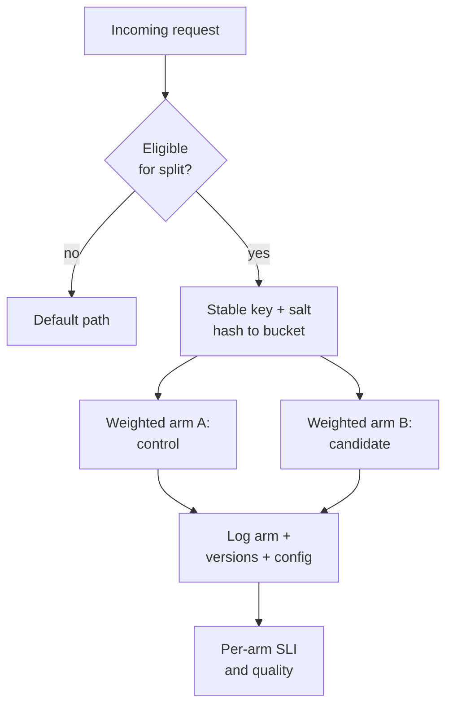

A **traffic split** is a routing rule that sends a configured **share** of eligible requests to each of several live destinations: service revisions, model versions, providers, prompt/policy packs, or full product arms. The split is usually expressed as **weights** or **percentages** that sum (or normalize) to the whole eligible stream. Every destination is a real production path for the share it receives: users see answers, tools may write, and billing meters run.

Traffic splits implement several rollout and experiment processes:

| Concept | Role of the split |
|---|---|
| [Canary rollout](glossary://canary-rollout) | Small, staged weights with hold windows and stop rules |
| [A/B testing](glossary://ab-testing) | Fixed arms under sticky assignment for a causal metric |
| [Shadow traffic](glossary://shadow-traffic) | Candidate receives a measurement copy while the primary serves user-visible output |
| Blue/green cutover | Often transitions from $0/100$ to $100/0$ after validation |
| [Feature flag](glossary://feature-flag) | App-level evaluation that implements the same percentage idea |

Service meshes (Istio weight-based routes, Envoy `weighted_clusters`), platforms (Cloud Run revision percentages), API gateways, and in-process flag routers all implement the same idea: **given an eligible request, pick one live destination according to weights and stickiness.**

## Intuition

Ordinary load balancing spreads work across healthy capacity. A traffic split intentionally routes unequal shares by version or experiment so you can limit blast radius, compare arms, or migrate gradually.

Envoy's docs separate two related operations:

1. **Traffic shifting:** move the stream from cluster A toward cluster B over time (runtime fraction or changing weights).
2. **Traffic splitting:** keep several clusters live at once with fixed relative weights (for A/B or multi-version exposure).

In AI products the destinations are often not "pod image v1 vs v2" alone. They are **model route + prompt template + retriever index + safety pack**, any of which can change independently. The split only helps if logs can attribute which combination served each request.

## How it works

1. **Define destinations.** Each arm must be deployable without taking all traffic: a Cloud Run revision, a Kubernetes subset, a model alias, a flag-selected code path.
2. **Define eligibility.** Not every request enters the split. Exclude bots, incomplete sessions, tenants that opted out, surfaces that cannot support the candidate (no tool schema yet), or traffic already in a conflicting experiment.
3. **Assign a unit.** Hash a [stable assignment](glossary://stable-assignment) key (user, tenant, conversation, document family) into a bucket, or sample independently per request when continuity does not matter (pure latency probes).
4. **Apply weights.** Map the bucket (or a uniform random draw) onto weighted arms. Record the chosen arm, weight config version, eligibility reason, and destination ids on the request.
5. **Operate the dial.** Raise or lower weights for canaries and migrations; freeze weights for A/B power plans; set treatment to $0$ for [rollback](glossary://rollback) or a [kill switch](glossary://kill-switch).

Gateway-level splits (mesh, Cloud Run) and application-level splits (flags, routing policy) can stack. Prefer **one authoritative assigner** for a given decision so two layers do not re-randomize the same request.

## Formula

With arms $1,\ldots,k$ and non-negative weights $w_i$ with a positive total (not necessarily summing to $100$), the intended share for arm $i$ is

$$
p_i = \frac{w_i}{\sum_{j=1}^{k} w_j}, \qquad \sum_{i=1}^{k} p_i = 1.
$$

Envoy's `weighted_clusters` and Istio VirtualService weights use this relative-weight model: what matters is each weight over the sum, not that the numbers literally add to $100$ (though $100$-point configs are common for readability).

For a sticky percentage canary with treatment share $p$ ($0 \le p \le 1$), a standard deterministic rule is

$$
b = H(\textit{assignmentKey} \parallel \textit{splitSalt}) \bmod M, \qquad
\text{treatment} \iff b < p \cdot M
$$

where $H$ is a stable hash, $M$ is the modulus (often $10{,}000$ for $0.01\%$ granularity, or $100$ for whole percents), and the salt is fixed for this split so changing an unrelated experiment does not reshuffle the population. Raising $p$ from $0.05$ to $0.25$ keeps previously treated keys treated when the hash and salt stay fixed.

Check observed shares at the randomized unit: sticky conversation assignment targets conversation shares, while request shares can differ if arms change conversation length. Large, statistically significant gaps at the assignment-unit level suggest [sample ratio mismatch](glossary://sample-ratio-mismatch) (SRM). Investigate assignment, eligibility, logging, overrides, and retries before interpreting effects; exclude force-on/off units from a nominal randomized split test.

## Diagram



## Example

You run a support assistant. Control uses model route `gpt-baseline` with bi-encoder retrieval. Candidate uses `gpt-stronger` plus a cross-encoder reranker. Both are live behind one gateway.

**Split config (eligible production chats only):**

| Arm | Destination | Weight | Share $p_i$ |
|---|---|---|---|
| Control | `gpt-baseline` + bi-encoder | $95$ | $0.95$ |
| Candidate | `gpt-stronger` + cross-encoder | $5$ | $0.05$ |

Assignment key: `conversation_id` (sticky multi-turn). Salt: `support_rerank_2026q2`. Internal dogfood is force-on for candidate; enterprise tenants that ban third-party rerankers are force-off.

After one peak hour you see $n = 20{,}000$ eligible chats:

- Expected candidate count: $0.05 \times 20{,}000 = 1{,}000$
- Observed candidate count: $1{,}012$ (about $5.06\%$)

That is close enough for ordinary noise. Before reading quality, also check SRM per locale and tenant tier.

**What you watch per arm (not fleet-averaged):**

- p95 end-to-end latency and [TTFT](glossary://ttft)
- Error and timeout rate
- Tokens and \$ per answered chat
- Citation-present rate and human acceptance
- Safety failures (PII leakage, unauthorized tool calls)
- Fallback rate from candidate back to baseline

If candidate p95 jumps from $1.8\,\mathrm{s}$ to $3.2\,\mathrm{s}$ while acceptance is only slightly better, set candidate weight to $0$ in one config change. That is the operational value of a split: [rollback](glossary://rollback) is reweighting, not rebuilding images or re-indexing.

If metrics stay inside predeclared bounds, step weights (for example $5 \to 25 \to 50 \to 100$) under a [canary rollout](glossary://canary-rollout) plan, or hold a fixed $10\%$ treatment for a powered [A/B test](glossary://ab-testing).

```python
from hashlib import sha256

def pick_arm(conversation_id: str, weights: dict[str, int], salt: str) -> str:
    """Sticky weighted pick. weights values are relative (need not sum to 100)."""
    if not weights or any(w < 0 for w in weights.values()):
        raise ValueError("weights must be nonempty and nonnegative")
    total = sum(weights.values())
    if total <= 0:
        raise ValueError("total weight must be positive")
    # Fixed hash range: changing the sum of weights does not rehash keys.
    key = repr((conversation_id, salt)).encode("utf-8")
    bucket = int.from_bytes(sha256(key).digest(), "big")
    modulus = 1 << 256
    cumulative = 0
    for arm, w in weights.items():
        cumulative += w
        if bucket * total < cumulative * modulus:
            return arm
    raise AssertionError("positive total should assign every bucket")
```

## Assignment details that matter in production

Splitting is more than a percentage string in a YAML file.

- **Stickiness.** Random per-request assignment mixes prompts, memories, model personality, and safety behavior inside one workflow. Prefer conversation, user, or tenant keys for chat agents.
- **Streaming and long jobs.** Once a stream or multi-step tool plan starts on an arm, keep that request on the same destination until completion even if weights change mid-flight.
- **Shared backends.** Arms often share vector stores, GPU pools, and caches. A heavy candidate can hurt control latency or look better because of a warm shared cache. Absolute fleet SLOs still apply.
- **Experiment conflict.** Multiple splits (model + retriever + UI) contaminate each other if assignment is uncoordinated. Record every active experiment id on the request so analysis can filter interactions.
- **Emergency zero.** Operators need a one-step path to $p_{\mathrm{candidate}} = 0$ without a full deploy. Practice that flip.

## Trade-offs

| Choice | Gain | Cost / risk |
|---|---|---|
| Smaller candidate share | Lower blast radius | Longer waits for rare failures; weaker early metrics |
| Sticky conversation keys | Interpretable multi-turn behavior | Uneven short-term counts if conversations differ in length |
| Gateway-only split | Language-agnostic, central ops | Harder to encode product eligibility; less context |
| App-level flag split | Rich context, multivariate arms | Must log and default safely when the flag service fails |
| Many concurrent splits | Parallel learning | Contamination, combinatorial support load |

## Why it matters here

Model, prompt, retrieval, and serving changes fail in production-only ways: long-tail prompts, provider latency spikes, tool side effects, tenant policy edges. A traffic split is how you move those changes from offline evals and [shadow traffic](glossary://shadow-traffic) onto **real users** without an all-or-nothing cutover. When a canary share $f$ carries a per-request failure rate $e$, that arm's contribution to fleet error is about $f \cdot e$, so blast radius scales with the dial. The same dial powers [canary rollouts](glossary://canary-rollout), [A/B tests](glossary://ab-testing), and fast [rollback](glossary://rollback): weights, stickiness, eligibility, and per-arm logs.

## Related terms

- [Canary rollout](glossary://canary-rollout)
- [Shadow traffic](glossary://shadow-traffic)
- [Stable assignment](glossary://stable-assignment)
- [Sample ratio mismatch](glossary://sample-ratio-mismatch)
- [Feature flag](glossary://feature-flag)
