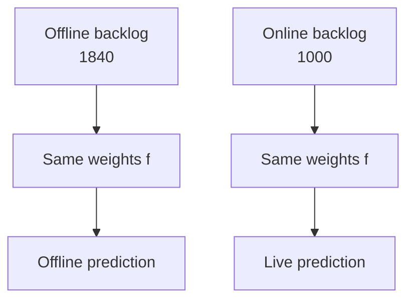

**Training-serving skew** is a difference between what the model sees (and therefore how it performs) when you train and evaluate offline versus when you score live traffic. Google's [Rules of Machine Learning](https://developers.google.com/machine-learning/guides/rules-of-ml) define it as a gap between training-time and serving-time performance, and name three classic causes: different data handling in the two pipelines, a change in the world (or tables) between train and serve, and feedback loops where the model reshapes the traffic it later trains on.

In engineering practice the phrase usually means **path mismatch**: the same feature name, prompt field, or preprocessing step is *implemented* differently offline and online (windows, nulls, caps, joins, tokenizers, chat templates, retrieval indexes). That is distinct from [data drift](glossary://data-drift), where the *environment* moves while both paths stay consistent, and from [feature leakage](glossary://feature-leakage), where training rows contain information that would never be available at prediction time. Drift, leakage, and skew can co-occur; skew is the one you fix with shared code, specifications, and parity tests rather than "more data" alone.

## Intuition

Training code often has batch tables, backfilled labels, complete joins, and offline preprocessing. Serving code has live caches, partial data, timeouts, schema migrations, and online feature stores. Skew is the gap between those paths. Shared column names can still hide different windows, defaults, time zones, units, and null policies.

If offline code records a feature in millimeters while serving computes the same named feature in inches, the schema can match while the values do not. Offline metrics then describe a model input distribution that never exists in production.

## How it works

Zinkevich's Rules of ML (and Google's production ML crash course) group skew into a few operational families:

| Family | What diverges | Typical surface |
| --- | --- | --- |
| Pipeline / code skew | Different transforms, joins, encoders, defaults | Notebook SQL vs service code; two languages; hand-ported logic |
| Schema skew | Types, required fields, enum sets, null rates | Warehouse export vs online JSON; silent column renames |
| Feature / value skew | Same schema, different distributions or semantics | Stale online store, different window, different impute |
| Table-join skew | Offline snapshot vs live lookup of a changing table | Doc stats, user aggregates joined by id without logging serve values |
| Model-export skew | Train-time score ≠ loaded serving artifact score | Quantization, graph rewrite, different runtime |
| Feedback-loop skew | Model actions change future labels and features | Ranking that only logs impressions of what it already showed |

A useful diagnostic split from Google's monitoring guidance:

- **Schema skew:** training and serving inputs do not obey the same schema (types, required fields, allowed values).
- **Feature skew:** engineered values differ even when the raw schema looks aligned (different feature code or materialization).

The golden rule is simple: **train and production should mimic each other as closely as possible.** The closer the training task matches the prediction task, the less "the model broke" is actually a data-path bug.

## Diagram



## Example

A ticket SLA model predicts $P(\text{miss SLA})$ from `queue_backlog` and related features.

**Training path (notebook).** `queue_backlog` is computed from a completed daily warehouse table. Nulls become $0$. Values are not capped. Joins use the full day's corrected rows (including late corrections written after the decision time).

**Serving path (API).** The live service reads an hourly Redis cache of open-ticket counts. Nulls are *dropped* (request falls back to a default vector). Values are hard-capped at $1000$. Cache lag is often 45-90 minutes behind event time.

| Property | Offline | Online |
| --- | --- | --- |
| Window | calendar day rollup | rolling ~1h counter (when fresh) |
| Null policy | fill $0$ | drop / different default |
| Cap | none | $\min(v, 1000)$ |
| Freshness | full-day corrected table | stale cache |
| Time correctness | often "latest known now" | approximate live state |

Offline validation AUC is $0.91$. After deploy, with **no weight change**, live precision on the high-risk threshold collapses. Side-by-side logging of one ticket at a fixed [prediction timestamp](glossary://prediction-timestamp) shows:

```text
ticket=T-4412  prediction_ts=2026-04-10T12:00:00Z
feature          offline_as_of_ts     online_as_of_ts
queue_backlog    1840 (daily, filled)  1000 (capped, stale)
null_filled      false                false
```

The model never saw "capped + stale + different null policy" during training. Retraining on the same broken offline definition will not fix production; aligning the paths will.

**LLM-system versions.** The same failure mode appears when retrieval indexes, document parsers, chunk delimiters, prompt templates, tool schemas, safety policies, tokenizer versions, [chat templates](glossary://chat-template), or eval test cases no longer match production traffic. Offline RAG eval on an older corpus or a different chunker can look excellent while the live gateway uses another embedding model, another top-$k$, or a chat template that strips system instructions.

## Formula

For a fixed entity key $k$ and prediction time $t_p$, define the offline feature map $x_{\mathrm{off}}(k, t_p)$ and the online map $x_{\mathrm{on}}(k, t_p)$. **Path parity** at that point is

$$
x_{\mathrm{off}}(k, t_p) = x_{\mathrm{on}}(k, t_p)
$$

field by field (including missingness and defaults). For continuous monitoring of *distributions* (not single rows), compare a training baseline mass $e_i$ to a serving window mass $a_i$ using a configured divergence. For example, Vertex AI Model Monitoring v1 documents Jensen-Shannon for numeric histograms and $L_\infty$ distance for categorical mass; other products and versions can use different metrics:

$$
\begin{align*}
D_{\mathrm{JS}}(a \Vert e)
&= \tfrac{1}{2} D_{\mathrm{KL}}\!\left(a \Big\Vert \tfrac{a+e}{2}\right)
 + \tfrac{1}{2} D_{\mathrm{KL}}\!\left(e \Big\Vert \tfrac{a+e}{2}\right), \\
L_\infty(a, e)
&= \max_i \lvert a_i - e_i \rvert.
\end{align*}
$$

Distribution alerts catch population shift and many pipeline bugs, but they do **not** prove semantic parity. Two paths can share similar histograms while disagreeing on the row that matters for a single prediction. Always keep row-level parity tests for critical features.

## Worked numbers

Suppose training fills missing `queue_backlog` with $0$, while serving substitutes the training-set median $m = 120$ when the online key is missing. On a day when 15% of live requests miss the key:

| path | missing rate | imputed value | mean on missing slice |
| --- | ---: | ---: | ---: |
| train definition | 15% | $0$ | $0$ |
| serve definition | 15% | $120$ | $120$ |

If the model learned that low backlog predicts "will meet SLA," online missing keys are scored as *moderate* backlog instead of *empty*. Scores systematically shift on the missing slice even though the weight file is unchanged. A distribution monitor may also fire (mass piles up at $120$ online and at $0$ offline), but the root cause is the null policy, not "the users changed."

## Debug path

1. **Freeze one prediction.** Pick a live request (or a logged shadow copy) with entity keys and $t_p$. Do not average; compare one row first.
2. **Recompute $x_{\mathrm{off}}$ and $x_{\mathrm{on}}$ at the same as-of time.** Diff windows, filters, encoders, defaults, time zones, units, caps, and freshness field by field before blaming the model.
3. **Check model-export identity.** Score the *same* feature vector with the training graph and the serving artifact. If scores differ, the bug is export/runtime, not features.
4. **Log features at serve time.** The strongest fix in Rules of ML (Rule #29) is to save the feature vector used at serving and pipe a sample into training and parity checks. YouTube and other Google systems reported large quality gains and less code after switching to serve-time feature logs.
5. **Share code and specifications.** Reuse the same transform library (or generate both paths from one [feature schemas](glossary://feature-contract)). Prefer one language for critical feature logic when possible. Pin tokenizer, prompt template, chunker, and embedding model versions for LLM apps.
6. **Shadow and monitor.** Run [shadow traffic](glossary://shadow-traffic) or dual compute: production inputs through the training path, alert on field-level diffs and distribution gaps alongside model scores. Schema validation on raw inputs is necessary; unit tests on *engineered* features catch the rest.

```python
# Conceptual parity check at a fixed as-of time
assert offline_features(entity, ts) == online_features(entity, as_of=ts)

# Serve-time log is the ground truth for "what the model actually saw"
train_on(logged_serving_features)  # sample; versioned schema required
```

Prevention patterns that hold in both classical ML and LLM systems:

- Shared feature / prompt / retrieval code across train, eval, and serve
- Versioned [feature schemas](glossary://feature-contract) and context-assembly specifications
- [Point-in-time joins](glossary://point-in-time-join) offline so training cannot use future or late data the online path never had
- Explicit [feature freshness](glossary://feature-freshness) SLOs so "typed and non-null" is not mistaken for "current"
- Continuous comparison of training baselines to live inputs (schema + engineered stats)

## Why it matters here

Training-serving skew is one of the most common reasons "the model broke" when the real bug is the data path. Strong offline results can collapse in production with **zero weight changes**: different null policies, stale online features, divergent chat templates, or a mismatch between the evaluation and serving retrieval indexes. Google Play improved app-install rate on the main landing page by 2% after finding features always present in training data but missing from serving logs (TFX case study, also cited in Google's model-monitoring material). For AI/ML and LLM engineers, skew is the bridge between notebook metrics and production reliability: measure path parity, log what you serve, and treat feature/prompt specifications with the same seriousness as model checkpoints.

## Related terms

- [feature schemas](glossary://feature-contract)
- [Feature store](glossary://feature-store)
- [Feature freshness](glossary://feature-freshness)
- [Point-in-time join](glossary://point-in-time-join)
- [Data drift](glossary://data-drift)
