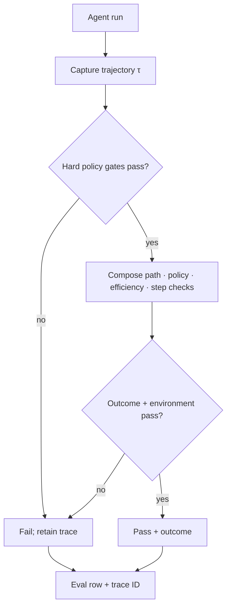

**Trajectory evaluation** grades the ordered path of an agent run (model turns, tool calls and arguments, observations, intermediate messages, stop reason, and side effects) alongside the final user-facing text. Final-answer accuracy asks whether the result succeeded; trajectory evaluation checks the steps and whether the path was allowed.

In interactive agent settings the trajectory is the execution log of a multi-step loop. Research benchmarks such as AgentBench cast LLM agents as actors in interactive environments (states, actions, observations in a multi-turn POMDP-style loop); production systems log the same structure as a message and tool-call trace. Google's Agent Development Kit (ADK) scores both pieces separately: `tool_trajectory_avg_score` for tool-use path match, and response metrics (for example `response_match_score`) for the final text. LangChain's AgentEvals package operationalizes the same idea with deterministic trajectory match modes and optional [LLM-as-a-judge](glossary://llm-as-judge) rubrics over the full path.

## Intuition

A polished final answer can hide a bad process. The agent may have called a forbidden write tool, skipped a required identity check, looped five redundant searches, stopped without completing a side effect, or "succeeded" by luck after hallucinating a tool result that never ran.

Final-only eval is like grading a surgery by whether the patient left the hospital, without checking sterile technique, wrong-site cuts, or unauthorized drugs. Process failures are often the ones that become production incidents: money moved without approval, PII left the tenant boundary, or cost exploded while the reply still looked helpful.

## How it works

A trajectory is an ordered sequence of steps produced by the agent runtime. A practical form for tool-using agents is:

$$
\tau = \bigl(u,\ (a_1,o_1),\ (a_2,o_2),\ \ldots,\ (a_T,o_T),\ y\bigr)
$$

where $u$ is the user goal (and session context), $a_t$ is the action at step $t$ (usually a tool name plus arguments, or a model message), $o_t$ is the observation returned by the tool or environment, $T$ is the number of action steps, and $y$ is the final answer or terminal state. Traces should also record stop reason, policy decisions, and whether side effects actually committed.

Scoring falls into a few families that you usually **compose**, not pick once:

| Family | What it checks | When it is right |
| --- | --- | --- |
| **Reference match** | Compare $\tau$ to an expected path $\tau^{*}$ | Known workflows (policy before write, required tools) |
| **Constraint / policy** | Forbidden tools absent; args in allowlisted ranges; required gates fired | Safety, money, PII, multi-tenant systems |
| **Efficiency / progress** | Step count, retries, loops, partial subgoal progress | Cost, latency, flaky tools |
| **Step / process quality** | Each $a_t$ is useful, grounded, and ordered sanely | Open-ended agents with many valid paths |
| **Outcome** | Final $y$ and environment state correct | Always pair with process checks for agents |

**Deterministic trajectory match** needs a reference path. Pick a library and learn *its* modes; names do not transfer 1:1.

**AgentEvals** (`create_trajectory_match_evaluator`):

1. **strict.** Same tools **in the same order**, with matching message structure; free-text wording of assistant messages may differ. Use when order is policy: for example, `run_tests` and `request_approval` before `apply_patch`.
2. **unordered.** Same multiset of tool calls; order free. Use when independent reads can commute and extras are *not* allowed.
3. **subset.** Actual tools are only from the reference (actual ⊆ reference; no extras). Use to catch scope creep and wasteful extras.
4. **superset.** Actual tools include at least the reference set (actual ⊇ reference; extras allowed). Use for "must do these minimum steps."

**ADK** (`tool_trajectory_avg_score`; configure threshold $1.0$ to require every invocation to match):

1. **EXACT** (default). Perfect match of expected tool calls; no missing, no extras.
2. **IN_ORDER.** All expected tools appear in that order; other calls may sit between them.
3. **ANY_ORDER.** All expected tools appear somewhere; order free; extras allowed between them.

Note the trap: AgentEvals **unordered** is a same-multiset check (no extras). ADK **ANY_ORDER** allows extras. Choose explicitly.

You can match tool names only, or names plus selected argument fields (repository path must match; timestamps may be ignored).

**LLM / rubric judges** score paths when many valid trajectories exist. They work best after hard gates: allowlists, schema, citation id checks, and safety classifiers decide eligibility; the judge scores reasonableness, efficiency, or protocol adherence on remaining cases. Calibrate judges on a human-labeled [golden dataset](glossary://golden-dataset) the same way you would for open-ended answer quality.

**Process rewards** generalize the idea for training and search. Outcome reward models score only $y$; process reward models (PRMs; Lightman et al., Math-Shepherd, and later agent PRMs) score intermediate steps so a bad plan is penalized even if the final answer is lucky. In product eval you rarely train a PRM first; you start with match + constraints + a small judge rubric.

## Formula

**Binary path pass** under a reference and a match predicate $M$:

$$
\mathrm{traj\_pass}(\tau,\tau^{*}) = \mathbf{1}\bigl\{M(\tau,\tau^{*})\bigr\}
$$

For a suite of $N$ cases with references $\tau^{*}_i$:

$$
\mathrm{traj\_accuracy} = \frac{1}{N}\sum_{i=1}^{N}\mathrm{traj\_pass}(\tau_i,\tau^{*}_i)
$$

ADK's configured `tool_trajectory_avg_score` threshold of $1.0$ under EXACT match is this idea at full strictness: every invocation's tool-use sequence must match for the case to pass. Its [criteria documentation](https://adk.dev/evaluate/criteria/) defines the score as an average of binary invocation matches.

**Constraint score** without a single golden path (common in production):

$$
\mathrm{constraint}(\tau) = \mathbf{1}\{\text{no forbidden tools}\}
\cdot \mathbf{1}\{\text{required tools present}\}
\cdot \mathbf{1}\{\text{args in policy}\}
\cdot \mathbf{1}\{\text{terminal state ok}\}
$$

A case can have $\mathrm{outcome}=1$ and $\mathrm{constraint}=0$ (passing tests after an unapproved repository write). Release gates should fail that case.

**Efficiency.** With positive step budget $B$ and actual steps $T$:

$$
\mathrm{step\_ratio} = \frac{T}{B},\qquad
\mathrm{redundant} = \#\{\text{duplicate or no-op tool calls}\}
$$

High $T$ with a correct $y$ is still a regression when latency and spend matter.

**Optional process average** when each step has a quality label $r_t \in \{0,1\}$ or $[0,1]$:

$$
R_{\mathrm{process}}(\tau) = \frac{1}{T}\sum_{t=1}^{T} r_t
$$

For $T>0$, that is the evaluation analogue of a PRM score: dense feedback on the path, not a single end reward. Define a separate convention for runs with no action steps.

## Diagram



## Example

Task: fix a failing retrieval-eval runner under a policy that requires a baseline test and human approval before repository files change.

**Reference path (strict for writes):**

1. `read_issue(issue_id="EVAL-4412")`
2. `inspect_file(path="eval/retrieval.py")`
3. `run_tests(target="tests/test_retrieval.py")`
4. `propose_patch(path="eval/retrieval.py")`
5. `request_approval(action="apply_patch", path="eval/retrieval.py")` (must be approved)
6. `apply_patch(...)` only after approval
7. `run_tests(target="tests/test_retrieval.py")`

**Run A (final text looks great):**

| Step | Action | Note |
| --- | --- | --- |
| 1 | `read_issue` | ok |
| 2 | `inspect_file` | ok |
| 3 | `apply_patch(path="eval/retrieval.py")` | **not allowlisted without approval** |
| 4 | `run_tests` | tests pass after an unauthorized write |

Final-answer eval may pass. Trajectory eval fails: repository state changed without the required gate. [Action allowlist](glossary://action-allowlist) and [policy gate](glossary://policy-gate) should have blocked step 3 at runtime; trajectory eval catches the regression if those gates were bypassed or misconfigured.

**Run B:** correct tools in order, but `inspect_file` runs five times on the same unchanged path. Outcome and safety pass; efficiency fails (`step_ratio` and `redundant` high).

**Run C:** never calls `apply_patch`, then reports "the fix is committed." Outcome fails on environment state (no file changed); trajectory also fails for a missing terminal side effect.

Log per step at least: index, tool name, args hash (or redacted args), result status, policy decision, latency, and parent [trace](glossary://tracing) id so failures are replayable in the [eval harness](glossary://eval-harness).

```python
# Illustrative shape of a deterministic path check (not a library API).
REQUIRED = ["read_issue", "inspect_file", "run_tests", "request_approval"]
FORBIDDEN_WITHOUT_APPROVAL = {"apply_patch", "git_commit"}

def grade_trajectory(steps: list[dict]) -> dict:
    names = [s["tool"] for s in steps]
    missing = [t for t in REQUIRED if t not in names]
    approved = False
    illegal = []
    for step in steps:
        # Approval is a trusted runtime result, never model-written text.
        if step["tool"] in FORBIDDEN_WITHOUT_APPROVAL and not approved:
            illegal.append(step)
        if step["tool"] == "request_approval":
            approved = step.get("approved") is True
    return {
        "policy_pass": not missing and not illegal,
        "missing_required": missing,
        "illegal_writes": illegal,
        "n_steps": len(steps),
    }
```

This small checker enforces presence and chronological approval for one fixed write scope. Later approval cannot legalize an earlier write. A real policy must bind approval to the exact action and target, check baseline-test ordering, and separately verify the requested change and final tests. Use that evidence to establish task success; `policy_pass` records only the checks in this sketch.

## Trade-offs

| Choice | Upside | Cost |
| --- | --- | --- |
| Strict match | Cheap, stable CI signal | Brittle when multiple valid orders exist |
| Unordered / subset / superset | More realistic multi-path tasks | Weaker order guarantees |
| Constraints only (no golden path) | Scales when many paths are valid | Must encode policy carefully |
| LLM judge on path | Handles open-ended agents | Variance, cost, needs calibration |
| Outcome-only | Easy to implement | Misses unsafe or wasteful success |

Prefer hard, deterministic process checks for money, auth, and PII. Use judges for soft qualities (plan coherence, helpful tool choice) after hard gates pass. Prefer shadow or sandboxed runs when scoring trajectories that would otherwise execute real writes.

## Debug path

When trajectory metrics move:

1. **Diff the first failing step** against the previous green run (tool name, args, policy decision).
2. **Separate harness drift from model drift:** tool schema, allowlist, timeout, and retry policy are part of the score (same lesson as [eval harness](glossary://eval-harness) and AgentBench-style environment sensitivity).
3. **Check for lucky outcomes:** block release when the outcome passes but the process fails.
4. **Watch loops:** rising $T$ with flat success rate is a cost and reliability regression.
5. **Replay with frozen tools** so tool nondeterminism does not masquerade as agent improvement.

## Why it matters here

Agent systems fail in the middle of the run. Trajectory evaluation treats tool sequences, policy gates, and stop states as first-class graded artifacts. Offline suites, [shadow evaluation](glossary://shadow-evaluation), and production sampling all get sharper when the full path, including the final message, is the unit of measure.

## Related terms

- [Tool calling](glossary://tool-calling)
- [Tracing](glossary://tracing)
- [LLM-as-a-judge](glossary://llm-as-judge)
- [Policy gate](glossary://policy-gate)
- [Action allowlist](glossary://action-allowlist)
