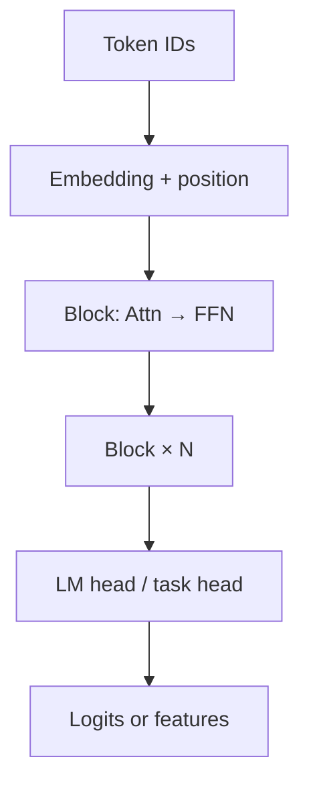
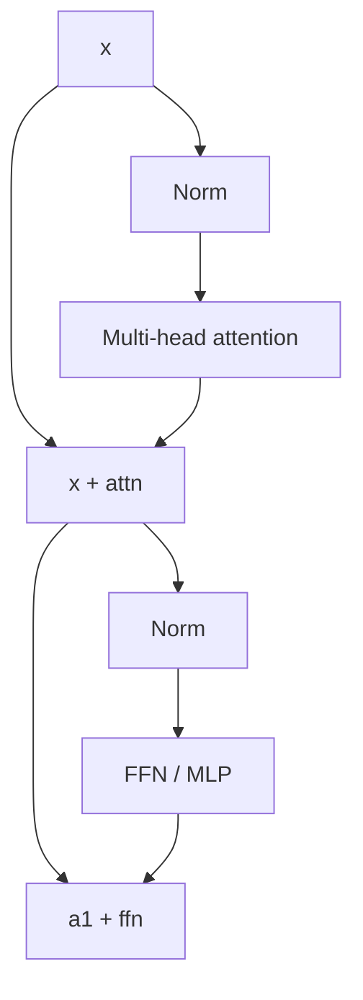

A **transformer** is a neural network that represents a sequence as vectors and repeatedly updates each position with two operations: [self-attention](glossary://self-attention) (mix information across positions) and a [feed-forward network](glossary://feed-forward-network) (transform each position alone). Residual connections and normalization make deep stacks trainable. Vaswani et al. (2017, *Attention Is All You Need*) introduced the design for sequence transduction without recurrence or convolution; modern LLMs are mostly **decoder-only** stacks of the same block family under a [causal mask](glossary://causal-mask).

## Intuition

Each layer performs one update over the whole sequence. Every token already holds a vector in the residual stream. Attention lets each token read from other tokens with learned weights. The feed-forward block then transforms that token's features without looking at neighbors. After many layers, the vector at the last position is rich enough to score the next token or to classify or embed the full sequence.

The architectural bet is that global pairwise mixing plus position-wise nonlinear capacity, trained end-to-end, beats sequential RNNs on both quality and wall-clock training: attention parallelizes across positions, so one training example does not need $O(n)$ sequential steps through time.

## Diagram

One decoder block (pre-norm style, common in LLMs). Residual adds use the pre-sublayer stream, not the original input twice:

## How it works

### Original encoder-decoder (Vaswani et al., 2017)

The paper's Transformer is a **seq2seq** model:

| Stack | Depth (base) | Per layer |
| --- | --- | --- |
| Encoder | $N=6$ | multi-head self-attention + position-wise FFN |
| Decoder | $N=6$ | masked self-attention + encoder-decoder [cross-attention](glossary://cross-attention) + FFN |

Encoder self-attention is bidirectional over the source. Decoder self-attention is causal so position $i$ cannot attend to future target tokens. Cross-attention uses decoder queries against encoder keys/values so each target position can read the full source.

Base hyperparameters from the paper: $d_{\mathrm{model}}=512$, $h=8$ heads, $d_k=d_v=64$, $d_{\mathrm{ff}}=2048$, sinusoidal [positional encodings](glossary://positional-encoding), post-norm residual blocks of the form $\mathrm{LayerNorm}(x + \mathrm{Sublayer}(x))$.

### Decoder-only LLMs (GPT-style)

Most chat and completion models drop the encoder. The stack is $N$ decoder blocks of the same basic architecture, usually with distinct weights, with **only** causal self-attention and an FFN. Training is next-token prediction over a packed sequence; inference is autoregressive: predict token $t$, append it, repeat. Serving splits that into [prefill](glossary://prefill) (process the full prompt, fill the [KV cache](glossary://kv-cache)) and [decode](glossary://decode-phase) (one new token at a time, reuse cached $K,V$).

Other common families still reuse the same block grammar:

- **Encoder-only** (BERT-style): bidirectional self-attention for classification and embeddings.
- **Encoder-decoder** (T5-style): still useful for translation and span-to-span tasks.

Modern stacks often swap details while keeping the skeleton: [RMSNorm](glossary://rmsnorm) instead of LayerNorm, pre-norm instead of post-norm, [RoPE](glossary://rope) instead of absolute sinusoids, [SwiGLU](glossary://swiglu) MLPs, [grouped-query attention](glossary://grouped-query-attention), and fused kernels such as [FlashAttention](glossary://flashattention).

### One layer, in order

For a token sequence $X \in \mathbb{R}^{n \times d_{\mathrm{model}}}$ entering a block:

1. **Normalize first in pre-norm blocks**, then project to queries, keys, values (per [attention head](glossary://attention-head)). Post-norm blocks project the incoming stream directly.
2. **Score** pairs with scaled dot products; apply mask (causal and/or padding).
3. **Softmax** over keys; form a weighted sum of values; concatenate heads; output-project.
4. **Residual add** into the residual stream; apply normalization here for post-norm attention.
5. **FFN** expands, applies a nonlinearity (or gate), projects back; residual add again. Pre-norm applies its second normalization before the FFN; post-norm applies it after this add.

The [residual stream](glossary://residual-stream) is the running $n \times d_{\mathrm{model}}$ tensor that every sublayer reads and writes. Depth is how many such editing passes you stack.

## Formula

**Scaled dot-product attention** (Vaswani et al., Eq. 1):

$$
\mathrm{Attention}(Q,K,V)=\mathrm{softmax}\!\left(\frac{QK^{\top}}{\sqrt{d_k}}\right)V
$$

$Q,K \in \mathbb{R}^{n \times d_k}$, $V \in \mathbb{R}^{n \times d_v}$. Division by $\sqrt{d_k}$ keeps dot products from growing with head width so softmax stays in a useful gradient regime.

**Multi-head attention** (paper §3.2.2):

$$
\mathrm{MultiHead}(Q,K,V)=\mathrm{Concat}(\mathrm{head}_1,\ldots,\mathrm{head}_h)\,W^O
$$

$$
\mathrm{head}_i=\mathrm{Attention}(QW_i^Q,\,KW_i^K,\,VW_i^V)
$$

**Position-wise FFN** (paper Eq. 2), applied independently at each position:

$$
\mathrm{FFN}(x)=\max(0,\,xW_1+b_1)\,W_2+b_2
$$

with inner width $d_{\mathrm{ff}}$ (base: $2048$ for $d_{\mathrm{model}}=512$).

**Post-norm residual block** (original paper):

$$
x' = \mathrm{LayerNorm}\!\big(x + \mathrm{MultiHead}(x)\big),\qquad
y = \mathrm{LayerNorm}\!\big(x' + \mathrm{FFN}(x')\big)
$$

Many LLMs use **pre-norm** instead: normalize before the sublayer, residual add after. Same two residual writes; different gradient and training dynamics.

**Causal mask** for language modeling (illegal future scores set to $-\infty$ before softmax):

$$
M_{ij}=\begin{cases}0 & j\le i\\ -\infty & j>i\end{cases},\qquad
\mathrm{Attention}=\mathrm{softmax}\!\left(\frac{QK^{\top}}{\sqrt{d_k}}+M\right)V
$$

**Complexity (full attention, one layer):** pairwise attention is $O(n^2 d)$ time and naively stores $O(hn^2)$ attention scores for sequence length $n$, width $d$, and $h$ heads. Fused kernels can avoid materializing that matrix. A full block also pays **$O(n d^2)$** for QKV/output and FFN projections when FFN width is proportional to $d$, which often dominate at short $n$. Masks can be implicit in a kernel or represented with $-\infty$ (as in [PyTorch's SDPA definition](https://docs.pytorch.org/docs/stable/generated/torch.nn.functional.scaled_dot_product_attention.html)); finite negative sentinels require care about precision and masked rows. The quadratic attention work is why long context, [FlashAttention](glossary://flashattention), sparse patterns, and [KV cache](glossary://kv-cache) engineering dominate production design. With a cache, decode step $t$ still scores against $t$ past keys ($O(t\,d)$ attention work per step) but avoids recomputing past $K,V$ through the whole stack.

## Example

**Winograd-style pronoun binding.** Prompt fragment:

> the trophy would not fit in the suitcase because it was too **\_\_\_**

Both *big* (trophy too big) and *small* (suitcase too small) are valid completions, so the fragment leaves the referent ambiguous. Once either completion is supplied, a coreference task should bind "it" to the trophy for *big* and to the suitcase for *small*. A transformer embeds each subword, adds position information, and runs its blocks. Attention can mix information from both candidate nouns; learned attention and FFN weights can help resolve the completed sentence. This example illustrates information flow; probing is needed to attribute coreference to particular layers or heads.

**Shape walk-through (base paper numbers).** Sequence length $n=4$, $d_{\mathrm{model}}=512$, $h=8$, $d_k=64$:

| Tensor | Shape |
| --- | --- |
| Token embeddings $X$ | $4 \times 512$ |
| One head $Q,K,V$ | $4 \times 64$ each |
| Attention scores $QK^{\top}$ | $4 \times 4$ |
| Head output | $4 \times 64$ |
| Concat of 8 heads | $4 \times 512$ |
| FFN hidden | $4 \times 2048$ |
| Block output | $4 \times 512$ |

Training computes this for all positions in parallel under the mask. At generation time, only the newest position's query is new; past $K,V$ come from the cache.

## Sizing (what fails in production)

Transformers fail in systems more often as **resource and contract** problems than as "wrong architecture":

| Failure | What breaks |
| --- | --- |
| Context too long | Attention and KV memory scale with $n$ (and $n^2$ for naive score materialization); requests OOM or hit max length |
| No / wrong KV cache | Decode redoes full-prefix work; latency explodes with generation length |
| Wrong mask | Bidirectional train + causal serve (or padding bugs) leaks future tokens or attends pad ids |
| Position mismatch | Serving RoPE/ALiBi/scale different from training silently ruins long-context quality |
| Prefill vs decode ignored | Capacity planning treats "tokens/s" as one number; TTFT and inter-token latency diverge |
| Tokenization / chat template | "Model is dumb" is often bad segmentation or missing special tokens before the first transformer layer |

Rough KV memory for multi-head attention (keys **and** values, all layers), one sequence:

$$
\mathrm{KV\ bytes} \approx 2 \cdot L \cdot n_{\mathrm{kv}} \cdot d_k \cdot T \cdot b
$$

where $L$ is layers, $n_{\mathrm{kv}}$ KV heads, $T$ cached tokens, $b$ bytes per element (2 for FP16/BF16). GQA/MQA shrink $n_{\mathrm{kv}}$; quantization shrinks $b$. Weights are a separate, mostly fixed cost; the cache grows with concurrent context.

## Why it matters here

Almost every LLM lesson on this site sits on a transformer stack: [tokenization](glossary://tokenization) produces ids, attention and positions define the [context window](glossary://context-window), pretraining and fine-tuning change weights, and serving optimizes prefill, decode, and the KV cache. Reading attention papers, kernel blogs, or eval failures is easier once "transformer" means a concrete residual stack of attention + FFN, not a brand name for "the AI model."

## Related terms

- [Self-attention](glossary://self-attention)
- [Attention head](glossary://attention-head)
- [Feed-forward network](glossary://feed-forward-network)
- [Residual stream](glossary://residual-stream)
- [KV cache](glossary://kv-cache)
