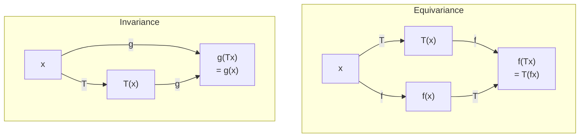

**Translation equivariance** means a spatial shift of the input produces the *same* shift of the output. If you move an edge two pixels right, a translation-equivariant layer's response also moves two pixels right; the pattern of activations is preserved, only its location changes. The dual idea is **translation invariance**: the output stays fixed under a shift (a class score still says "cat" after the cat moves). Convolution with shared weights is the classic equivariant operator on grids; pooling and global heads push toward invariance.

Translation equivariance is a structural property of a map $f$. Data augmentation can improve robustness to shifts; weight-shared convolution encodes $f(T(x)) = T(f(x))$ up to edge effects.

## Formula

Let $T_t$ shift a signal by offset $t$ (on a 1-D grid, $(T_t x)_i = x_{i-t}$; on 2-D images the same idea applies per axis). A layer $f$ is **translation equivariant** if

$$
f(T_t(x)) = T_t\bigl(f(x)\bigr)
$$

for every admissible $t$. **Translation invariance** is the special case where the output transform is the identity:

$$
f(T_t(x)) = f(x).
$$

Goodfellow, Bengio, and Courville (*Deep Learning*, Ch. 9) state the same idea for convolution: if $g$ is any translation of the input, convolution satisfies $f(g(x)) = g(f(x))$. Cohen and Welling (ICML 2016) write the group form used throughout equivariant deep learning:

$$
\Phi(T_g\, x) = T'_g\, \Phi(x),
$$

where $T_g$ and $T'_g$ are the actions of group element $g$ on input and representation spaces. Pure translations are the group $\mathbb{Z}^2$ (or $\mathbb{Z}$ in 1-D). Invariance is equivariance with $T'_g = \mathrm{Id}$ for all $g$.

**Why convolution equivariates.** With shared weights, the response at position $i$ is the same local filter applied to the neighborhood of $i$. Shifting the input by $t$ moves every neighborhood by $t$, so every response moves by $t$. Formally, for discrete cross-correlation (what frameworks call "convolution") with kernel $K$,

$$
(x \star K)_i = \sum_u x_{i+u}\, K_u.
$$

Then $(T_t x \star K)_i = (x \star K)_{i-t} = T_t(x \star K)_i$ on infinite grids (or away from boundaries). Pointwise nonlinearities (ReLU, GELU) commute with shifts, so they preserve equivariance. Stacking equivariant layers yields an equivariant stack: each layer can reuse the same spatial inductive bias at greater depth (Cohen & Welling).

## Intuition

Equivariance **preserves location**: the feature knows *where* the pattern is. Invariance **discards location**: the feature only knows *that* the pattern is present.

A useful mental model for a CNN classifier:

1. Early [convolution kernels](glossary://convolution-kernel) build [feature maps](glossary://feature-map) that track edges, textures, and parts as they move (equivariant).
2. [Max pooling](glossary://max-pooling) and strided layers coarsen the grid, giving *local* shift robustness inside each window (approximate local invariance, not full equivariance of the map).
3. Global average pooling removes spatial location: if a shift merely permutes an equivariant feature map's positions, its average stays unchanged. Flattening followed by an arbitrary dense head can assign different weights to different locations, so the output may change under a shift.

You need equivariance when position still matters (detection boxes, dense segmentation, OCR character placement, spectrogram event timing). You need invariance when only identity matters (ImageNet-style labels). Forcing invariance too early throws away geometry that later layers need; Cohen and Welling keep equivariance through depth so intermediate features transform predictably instead of discarding location too soon.

## Example

**1-D edge detector.** Input $x = [0, 0, 1, 1, 0, 0]$ and kernel $K = [1, -1]$ (stride 1, valid convolution, no padding):

$$
\begin{aligned}
y_0 &= 0\cdot 1 + 0\cdot(-1) = 0, \\
y_1 &= 0\cdot 1 + 1\cdot(-1) = -1, \\
y_2 &= 1\cdot 1 + 1\cdot(-1) = 0, \\
y_3 &= 1\cdot 1 + 0\cdot(-1) = 1, \\
y_4 &= 0\cdot 1 + 0\cdot(-1) = 0.
\end{aligned}
$$

So $y = [0, -1, 0, 1, 0]$. The rising edge ($0\to 1$) produces $-1$; the falling edge ($1\to 0$) produces $+1$.

Shift the input one step right: $x' = T_1(x) = [0, 0, 0, 1, 1, 0]$. Repeating the same filter yields $y' = [0, 0, -1, 0, 1]$, which equals the zero-filled shift $T_1(y)=[0, 0, -1, 0, 1]$. That is translation equivariance for this operator and shift.

**Then local invariance via pooling.** Non-overlapping max pool with window 2 on $y$ keeps the largest signed activation in each bin, not the largest absolute magnitude. A one-pixel slide of a positive peak that stays inside the same window can leave the pooled value unchanged: local invariance, not equivariance of the pooled map (the pool output may not shift when the input does).

```python
import torch
import torch.nn.functional as F

x = torch.tensor([[[0., 0., 1., 1., 0., 0.]]])  # N=1, C=1, L=6
k = torch.tensor([[[1., -1.]]])                 # out=1, in=1, k=2

y = F.conv1d(x, k)               # [1, 1, 5]
x_shift = torch.roll(x, shifts=1, dims=-1)
y_shift = F.conv1d(x_shift, k)

# Interior agreement: shift-then-conv vs conv-then-shift
# (torch.roll wraps; true equivariance needs care at boundaries)
assert torch.allclose(y_shift[..., 1:], y[..., :-1])
```

## Diagram



Shift-then-map equals map-then-shift for equivariance. For invariance, both paths give the same unshifted output.

## Worked numbers: boundary break

Exact equivariance assumes an infinite grid or circular padding. With zero padding and "same" size, border cells see artificial zeros, so absolute position leaks into the computation.

Kayhan and van Gemert (CVPR 2020) show that standard same-convolution with zero padding lets a network classify *where* an identical patch sits (top-left vs bottom-right) using only boundary effects: near the border the filter never sees a full support of real pixels, so locations are not treated equally. Circular padding equalizes location usage but can wrap semantics from the opposite side.

Tiny 1-D "same" case with $K=[1,1,1]$, pad $1$ zero on each side, stride 1:

| input $x$ | padded | $y=\mathrm{conv}(x)$ |
|-----------|--------|----------------------|
| $[1,2,3]$ | $[0,1,2,3,0]$ | $[0{+}1{+}2,\,1{+}2{+}3,\,2{+}3{+}0]=[3,6,5]$ |
| $T_1(x)=[0,1,2]$ | $[0,0,1,2,0]$ | $[0{+}0{+}1,\,0{+}1{+}2,\,1{+}2{+}0]=[1,3,3]$ |

Zero-fill $T_1(y)=[0,3,6]$, which is **not** $[1,3,3]$. The center still moves coherently; the borders absorb the padding asymmetry. That mismatch compounds in deep stacks of padded layers (a large effective [receptive field](glossary://receptive-field) reaches the boundary from far inside the image).

## How it works in stacks

| Ingredient | Equivariance effect |
|------------|---------------------|
| Shared-weight conv, stride 1, infinite grid / circular pad | Exact translation equivariance / exact circular-shift equivariance; finite valid convolution agrees only where the compared receptive fields remain in bounds |
| Pointwise nonlinearity, batch-norm per channel | Preserves equivariance if affine params are not position-dependent |
| Zero / reflect padding, valid shrink | Breaks or weakens equivariance at boundaries |
| Stride $s>1$ or strided pool | Subsamples; equivariance only under shifts that are multiples of $s$ (aliasing) |
| Global average pool | Invariant if the preceding feature map shifts by a permutation of its positions; boundary loss and aliasing can break that premise |
| Flatten + arbitrary dense | Location-specific weights; no architectural invariance guarantee |
| Absolute positional encodings, coordinate channels | Explicitly *break* translation equivariance by design |

Azulay and Weiss (JMLR 2019) show modern CNNs often change top-1 predictions under single-pixel shifts: strided downsampling ignores the sampling theorem (aliasing), and fully connected heads use position-specific weights. Zhang (ICML 2019, "Making Convolutional Networks Shift-Invariant Again") recovers much practical shift stability with anti-aliased downsampling (blur before stride). Data augmentation can improve robustness on images near the training distribution; test the architecture on shifted inputs because augmentation alone adds no structural constraint.

**LLM-adjacent note.** Vision towers inside VLMs, OCR, document layout, and spectrogram encoders still rest on these geometry facts. Absolute position encodings in ViTs trade translation equivariance for order awareness; convolutional stems keep local equivariance until patchify or pool.

## Trade-offs

| Goal | Prefer | Cost |
|------|--------|------|
| Dense spatial tasks (detect, segment, align) | Keep high-res equivariant maps longer | Memory and compute |
| Pure classification | Early downsample + global pool | Lose fine localization; small shifts can still flip logits if aliased |
| Strict shift stability | Anti-aliased strides, circular pad where safe, fewer absolute position cues | Extra blur cost; circular pad may be wrong for natural images |
| Sample efficiency on grids | Weight sharing (built-in equivariance) | Inductive bias wrong if labels *depend* on absolute location |

**What fails in production.** (1) Eval crops or letterbox padding differ from train: models learn border absolute location and score differently when the object moves relative to the frame. (2) Export changes padding mode or `ceil_mode` on pools: shapes and border behavior diverge. (3) Dense prediction heads assume feature map indices align with input pixels after a fixed stride stack; an off-by-one pad breaks the alignment even if class accuracy looks fine. (4) "CNNs are shift-invariant" is a myth at the logit level for typical ResNets; measure shift consistency on your own crops if the product needs it.

## Why it matters here

Translation equivariance is the reason convolutional feature maps track structure as it moves, and why pooling and heads must be designed deliberately when you want either location-sensitive outputs or location-agnostic scores. It connects [convolution kernels](glossary://convolution-kernel), [padding](glossary://padding), [stride](glossary://stride), and [max pooling](glossary://max-pooling) into one geometric story, and it is the special case of group equivariance that every AI engineer meets first.

## Related terms

- [Convolution kernel](glossary://convolution-kernel)
- [Max pooling](glossary://max-pooling)
- [Feature map](glossary://feature-map)
- [Padding](glossary://padding)
- [Stride](glossary://stride)
