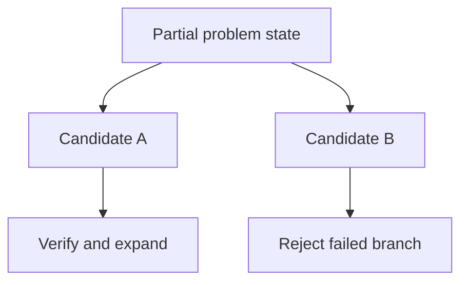

**Tree of thought (ToT)** organizes problem solving as a search over multiple intermediate reasoning states. A controller proposes alternative paths, evaluates partial progress, expands promising states, and can abandon or revisit unsuccessful branches.

## The search controller owns the budget

Each node represents a candidate partial solution, such as a proposed evidence set, calculation, or repair plan. Edges represent possible next steps. An evaluation stage scores states; it can use the same LLM, another model, or an external verifier. The application controls branching factor, maximum depth, allowed tools, deadlines, and termination. The original [Tree of Thoughts paper](https://arxiv.org/abs/2305.10601) combines LLM thought generation and state evaluation with breadth-first or depth-first search.

Breadth-first search compares alternatives at the same depth. Beam search keeps only the highest-scoring candidates. Depth-first search can backtrack when a candidate fails. None of these strategies makes an unreliable evaluator trustworthy: a biased score can repeatedly expand plausible but invalid branches.

## Example

A coding agent considers two fixes for a failing authentication test. Branch A removes the permission check and makes the visible test pass. Branch B preserves authorization and repairs the incorrect fixture. A verifier runs security and regression tests, rejects Branch A, and expands Branch B.

Independent checks can reject a persuasive branch that introduces privilege escalation. Set a node or token budget so recursive exploration stays within the original request's cost envelope.

## Why it matters here

Advanced prompting and agent lessons use bounded reasoning trees to separate candidate generation from evaluation, tool execution, and approval. The technique is useful when several paths deserve comparison, but its value depends on measurable success, verifier quality, latency, and controlled spending.

## Related terms

- [Chain of thought](glossary://chain-of-thought)
- [Test-time compute](glossary://test-time-compute)
- [Candidate generation](glossary://candidate-generation)
- [Evaluation gate](glossary://eval-gate)
