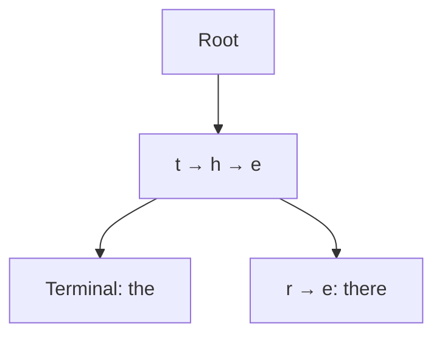

A trie, or prefix tree, stores strings by sharing their common prefixes. Each edge represents a character or other symbol, and a terminal marker records when the path to a node forms a complete stored key. A node can be terminal while still having children.

## Terminal nodes make longest matching possible

Insert `the` and `there`, and both keys share the path `t -> h -> e`. The node after `the` is terminal, and matching can continue through `r -> e` to discover the longer terminal key `there`. A longest-prefix tokenizer remembers the deepest terminal node while exploring, then emits it when the scan stops. This handles both shorter and longer stored keys.

Building the trie costs time and space proportional to the total number of stored characters, assuming constant-time child lookup. Looking up a key or prefix of length $q$ takes $O(q)$ time, stopping early on a missing edge. A tokenizer's longest-match scan follows at most $m$ stored edges, where $m$ is the maximum token length, before stopping or finding a mismatch. Tokenizing an entire string can revisit characters after each greedy decision, so worst-case time is $O(nm)$ for input length $n$.

## Diagram

## Example

With vocabulary `{"the", "there", "for", "fore"}`, scanning `therefore` first remembers terminal `the`, continues to longer terminal `there`, and emits `there`. Restarting from the root on `fore` chooses `fore` over `for`, producing `["there", "fore"]`.

## Why it matters here

The tokenizer practice problem uses a trie to make greedy longest-match semantics explicit. Related structures also appear in filesystem trees, prefix routing, and compressed radix trees used by model-serving caches.

## Related terms

- [Radix tree](glossary://radix-tree)
- [Tokenization](glossary://tokenization)
- [Prefix cache](glossary://prefix-cache)
- [Token](glossary://token)
