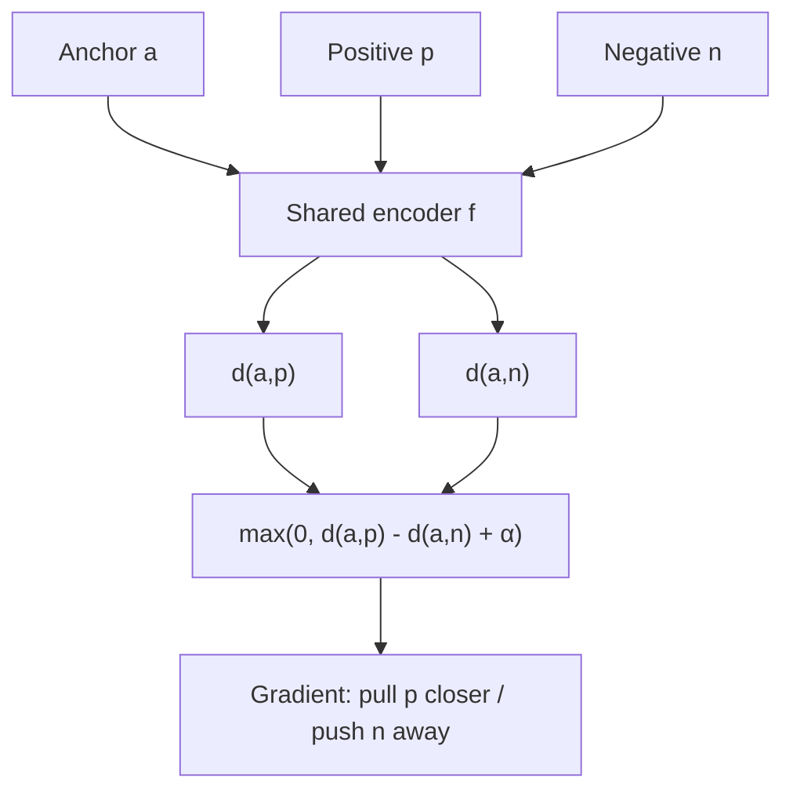

**Triplet loss** is a metric-learning objective over three examples: an **anchor** $a$, a **positive** $p$ (same class or true match), and a **negative** $n$ (different class or non-match). The encoder $f$ maps each input to an embedding so that $a$ is closer to $p$ than to $n$ by at least a fixed margin $\alpha$. FaceNet (Schroff, Kalenichenko, and Philbin, 2015) popularized the form used in production face verification and embedding training; the same hinge appears in sentence embeddings, image retrieval, re-identification, and duplicate detection to shape neighborhoods through explicit relative distances.

Classification names a fixed set of classes; triplet loss orders positives and chosen negatives around each anchor with a margin. That is the geometry later nearest-neighbor search depends on.

## Intuition

One training step rearranges three points in embedding space. The positive should move toward the anchor (or the pair should meet in the middle). The negative should move away until the gap $d(a,n) - d(a,p)$ is at least $\alpha$. Once that gap is large enough, the hinge is flat and the triplet contributes no gradient. Random easy negatives reach zero loss quickly; only near-misses keep teaching fine boundaries.

The margin controls training slack; choose a separate, evaluated similarity threshold for inference. Training slack helps the model maintain separation under slight distribution shift. FaceNet set $\alpha = 0.2$ with unit-normalized 128-D embeddings and squared Euclidean distance. Your margin must match the distance definition and embedding scale you actually train with.

## Formula

FaceNet writes the constraint and the loss with **squared** Euclidean distance after L2-normalizing embeddings so $\|f(x)\|_2 = 1$:

$$
\big\|f(x_i^a) - f(x_i^p)\big\|_2^2 + \alpha
\;<\;
\big\|f(x_i^a) - f(x_i^n)\big\|_2^2
$$

$$
\mathcal{L}
=
\sum_i
\Big[
\big\|f(x_i^a) - f(x_i^p)\big\|_2^2
-
\big\|f(x_i^a) - f(x_i^n)\big\|_2^2
+
\alpha
\Big]_+
$$

where $[z]_+ = \max(0, z)$ and $\alpha > 0$ is the margin. In compact form with $d(\cdot,\cdot)$ as the chosen distance (often squared L2, sometimes plain L2 or cosine distance $1 - \mathrm{sim}$):

$$
\mathcal{L}(a,p,n) = \max\big(0,\; d(a,p) - d(a,n) + \alpha\big)
$$

**Important details that change numbers:**

| Choice | Effect |
|---|---|
| Squared L2 (FaceNet) | Gradients scale with residual length; margin $\alpha$ is in squared-distance units |
| Unsquared L2 | Same hinge shape; different numerical scale for $\alpha$ |
| Cosine / unit sphere | Distances live in a bounded range (e.g. squared L2 on unit vectors is in $[0, 4]$); margin must fit that range |
| One negative vs many | Classic triplet uses one $n$; multi-negative / batch-hard variants still use the same hinge per selected triplet |

Zero loss confirms that *this* triplet satisfies the margin. Evaluate global ranking separately on held-out retrieval examples.

## Diagram



## Worked numbers

Use squared distances and $\alpha = 0.2$ as in FaceNet.

| Triplet | $d(a,p)$ | $d(a,n)$ | $d(a,p)-d(a,n)+\alpha$ | $\mathcal{L}$ | Band |
|---|---|---|---|---|---|
| Violating hard | $0.50$ | $0.30$ | $0.40$ | $0.40$ | Hard: negative closer than positive |
| Semi-hard | $0.50$ | $0.55$ | $0.15$ | $0.15$ | Inside margin, still active |
| Barely easy | $0.50$ | $0.70$ | $0.00$ | $0$ | On the margin boundary |
| Easy | $0.50$ | $1.20$ | $-0.50$ | $0$ | No gradient |

Same geometry with a retrieval-flavored pair of distances: $d(a,p)=0.3$, $d(a,n)=0.7$.

- Margin $0.1$: $0.3 - 0.7 + 0.1 = -0.3$ → $\mathcal{L}=0$ (already satisfied).
- Margin $0.5$: $0.3 - 0.7 + 0.5 = 0.1$ → $\mathcal{L}=0.1$ (still work to do).

A tiny operational form (mean over a batch of triplets, squared L2):

```python
# a, p, n: (B, D) embeddings; often L2-normalized first
d_ap = ((a - p) ** 2).sum(dim=-1)
d_an = ((a - n) ** 2).sum(dim=-1)
loss = (d_ap - d_an + margin).clamp(min=0).mean()
```

## Example

Train a support-doc [bi-encoder](glossary://bi-encoder) with triplets.

- **Anchor:** query "Why does KV-cache memory grow with sequence length?"
- **Positive:** "Each decoded token appends key and value vectors for every layer."
- **Hard negative:** "Prefix caching reuses KV blocks shared by identical prompt prefixes."
- **Easy negative:** "How to style keyboard focus states with CSS."

With random easy negatives only, the objective may leave both KV-cache documents near each other because selected hinges are already zero and provide no relative-ranking signal. BM25 or the current ANN index can propose confusable negatives, but check their encoder distances before calling them hard or semi-hard. When the prefix-cache document lies inside the margin and is truly a non-match, its active hinge trains separation from the memory-growth answer. Serving stores embeddings for nearest-neighbor search; the loss is part of training.

## How mining works

The formula is simple; **which** triplets you feed dominates quality.

| Kind of negative | Condition | Typical effect |
|---|---|---|
| Easy | $d(a,n) \ge d(a,p) + \alpha$ | Loss already zero; wastes capacity |
| Semi-hard | $d(a,p) < d(a,n) < d(a,p) + \alpha$ | FaceNet's preferred band: active but not collapsed |
| Hard | $d(a,n) \le d(a,p)$ | Strong signal; can destabilize early training or amplify label noise |

**Offline mining:** embed a large subset, build triplets, train for a while, re-mine. Stale embeddings mean the "hard" set drifts.

**Online mining:** encode a mini-batch, form valid triplets inside the batch. Common strategies (Hermans et al., "In Defense of the Triplet Loss," 2017):

- **Batch-all:** average over all valid non-easy triplets in the batch.
- **Batch-hard:** for each anchor, take the farthest positive and nearest negative in-batch.
- **Semi-hard (FaceNet):** for each anchor-positive pair, pick a random negative with $d(a,p) < d(a,n) < d(a,p)+\alpha$.

FaceNet warned that pure hardest negatives early on can drive a collapsed embedding ($f(x)\approx 0$). Semi-hard negatives avoid that failure mode while still providing gradient. Batches need enough per-class (or per-query) positives so $d(a,p)$ is meaningful; FaceNet used on the order of ~40 faces per identity in large batches.

**Label noise is lethal.** A mislabeled "negative" that is actually a true match is a [false negative](glossary://false-negative): the loss pushes true neighbors apart. Always filter known positives and suspiciously high cross-encoder scores out of the negative pool.

## Trade-offs vs InfoNCE

| | Triplet hinge | [InfoNCE](glossary://infonce) / NT-Xent |
|---|---|---|
| Candidates | One (or few) chosen $n$ | Softmax over a whole pool |
| Signal | Margin relative distance | Multi-way ranking with temperature $\tau$ |
| Easy negatives | Explicitly zero out | Vanish into the denominator once far |
| Mining | Central; semi-hard / batch-hard matter | Still helped by hard negatives, but batch structure supplies many $n$ |
| Modern default for dual encoders | Still used | Usually preferred at scale for dense retrieval and sentence models |

Triplet loss remains the right mental model for "pull one, push one with a margin," and for datasets where you explicitly curate hard negatives. Large-batch dual encoders more often train with InfoNCE because every in-batch item is a free competitor.

## Why it matters here

Retrieval and metric learning systems succeed or fail on neighborhood geometry. Triplet loss makes that geometry explicit: the positive must beat the chosen negative by a margin. Production failures usually trace to the data pipeline, so inspect:

- Easy-only mining → low training loss, poor separation of near-miss docs.
- Unchecked hard mining → collapse or overfitting to label noise.
- Margin mismatched to distance (squared vs unsquared, cosine scale) → dead or exploding hinges.
- Train/serve skew in preprocessing or L2-normalization → distances at inference do not match training.

When you debug a dense retriever or face embedder, inspect active-triplet fraction, average $d(a,p)$ vs $d(a,n)$, and whether mined negatives are real confusions or annotation errors. The hinge only optimizes the triplets you give it.

## Related terms

- [Hard negative](glossary://hard-negative)
- [Contrastive learning](glossary://contrastive-learning)
- [InfoNCE](glossary://infonce)
- [Embedding](glossary://embedding)
- [Siamese network](glossary://siamese-network)
