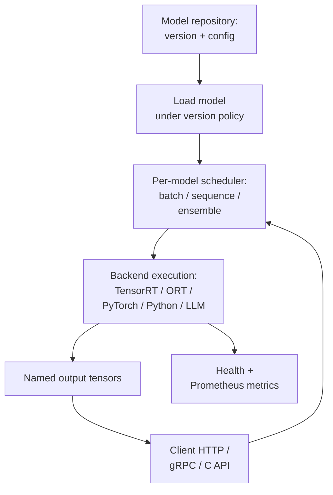

**NVIDIA Triton Inference Server** is an open-source inference serving system that loads versioned models from a **model repository**, accepts requests over HTTP/REST, gRPC, or an in-process C API, runs per-model **schedulers** (batching, queueing, sequencing), and executes work through **backends** (TensorRT, ONNX Runtime, PyTorch, Python, OpenVINO, TensorRT-LLM, vLLM, custom C++, and others). Clients talk to stable model names and tensor contracts; they do not need to know which framework file or GPU kernel path runs underneath.

Triton is a multi-framework **serving layer** for fleets with many models, frameworks, shared GPUs, versioned artifacts, ensembles, health checks, and [Prometheus](glossary://prometheus) metrics under one process (or a fleet of identical processes). Specialized engines such as [vLLM](glossary://vllm), [TensorRT-LLM](glossary://tensorrt-llm), and [SGLang](glossary://sglang) optimize particular generation paths deeply.

## Intuition

Triton exposes three contracts stacked on top of each other:

| Layer | Contract |
|-------|----------|
| Client API | Model name, version policy, input/output tensor names, dtypes, shapes, HTTP/gRPC or C API |
| Scheduler | How requests wait, batch, sequence, or route through an ensemble before hitting compute |
| Backend | How a specific model file actually runs (TensorRT plan, ONNX graph, Python `model.py`, LLM engine, ...) |

The **model repository** is the filesystem (or cloud object store) layout Triton reads at startup and can poll or manage at runtime. Each model is a directory with a `config.pbtxt` (or auto-config), numeric **version** subdirectories, and backend-specific files (`model.onnx`, `model.plan`, `model.pt`, `model.py`, ...). Version policy decides which versions are live; clients can pin a version or take the server default.

Production failures usually sit at a contract boundary: wrong tensor name, wrong image normalization outside the graph, TensorRT engine built for a different compute capability, batch delay that blows [p95 latency](glossary://p95-latency), or an ensemble step that OOMs because the producer is faster than the consumer.

## How it works

Official architecture is a straight pipeline:

1. **Ingress.** Requests arrive on HTTP/REST or gRPC (the [KServe](https://github.com/kserve/kserve) V2 inference protocol) or via the in-process C/Java API when you embed Triton in another process.
2. **Per-model scheduler.** Each loaded model has its own scheduler configuration. Common modes:
   - **Default scheduler** dispatches requests without combining independent requests. Enable the **dynamic batcher** for [stateless](https://docs.nvidia.com/deeplearning/triton-inference-server/user-guide/docs/user_guide/architecture.html) models to combine requests into larger batches up to `max_batch_size`.
   - **Sequence batcher** for stateful models: keep a correlated sequence on the same instance with start/end/ready control signals.
   - **Ensemble scheduler** for pipelines: route tensors between composing models without extra client round-trips.
3. **Instances.** `instance_group` sets how many concurrent copies of a model run (GPU or CPU). Multiple instances enable concurrent execution of the same model when the backend and GPU allow it.
4. **Backend execution.** The batched (or sequenced) request is handed to the backend that owns that model type. The backend produces named outputs.
5. **Ops surface.** Liveness/readiness health endpoints, model management APIs (load/unload/version), and Prometheus metrics (default `http://localhost:8002/metrics`) make Triton fit Kubernetes-style deploy, canary, and capacity work.

LLM-oriented backends can plug into the same outer shell. Triton's sequence batcher also documents **iterative sequences** as a path toward continuous / in-flight batching: a backend yields after each step so the scheduler can mix new and still-running requests. That is related to [continuous batching](glossary://continuous-batching) in dedicated LLM engines, but the default mental model for classic CV/NLP Triton deployments remains **request-level dynamic batching**, not iteration-level decode scheduling.

## Diagram



## Example

A search stack serves three models from one Triton process. Clients never open separate ONNX Runtime and TensorRT processes.

```text
model_repository/
  embedder/
    config.pbtxt
    1/
      model.onnx          # ONNX Runtime backend
  reranker/
    config.pbtxt
    2/
      model.plan          # TensorRT backend (version 2 is live)
  vision_classifier/
    config.pbtxt
    1/
      model.plan
```

Minimal `embedder` config (shapes abbreviated):

```protobuf
name: "embedder"
backend: "onnxruntime"
max_batch_size: 32
input [
  { name: "input_ids"  data_type: TYPE_INT64 dims: [ 128 ] }
  { name: "attention_mask" data_type: TYPE_INT64 dims: [ 128 ] }
]
output [
  { name: "sentence_embedding" data_type: TYPE_FP32 dims: [ 768 ] }
]
instance_group [ { count: 2, kind: KIND_GPU } ]
dynamic_batching {
  max_queue_delay_microseconds: 200
}
```

With `dynamic_batching` and two GPU instances, short independent embedding requests can form batches up to 32 while two executions run concurrently when load spikes. The same server can expose a fourth **ensemble** model that chains tokenizer preprocess (Python backend) into `embedder` so clients send raw strings once and get vectors back without holding intermediate tensors in the app process.

Launch shape (local path; pin image tags in real deploys). Defaults are HTTP `8000`, gRPC `8001`, metrics `8002`. Auto-complete of missing config fields is on by default; pass `--disable-auto-complete-config` only when you want every model to ship a full `config.pbtxt` (the old `--strict-model-config` flag is deprecated).

```bash
tritonserver --model-repository=/models
```

## Dynamic batching

Dynamic batching is the throughput lever most Triton deployments care about first. The server holds eligible requests briefly and forms a larger batch before calling the backend. NVIDIA's recommended tuning loop:

1. Set a safe `max_batch_size` the model and memory can support.
2. Enable defaults with `dynamic_batching { }`.
3. Measure latency and throughput (Performance Analyzer / real traffic).
4. If latency is still inside the budget, raise max batch and/or set a non-zero `max_queue_delay_microseconds` to trade a little wait for higher GPU efficiency.
5. Prefer `preferred_batch_size` only when specific sizes are dramatically faster (classic case: TensorRT optimization profiles).

Rough latency budget for a request that waits in the dynamic batcher:

$$
T_{\mathrm{e2e}} \approx T_{\mathrm{queue}} + T_{\mathrm{batch\ delay}} + T_{\mathrm{compute}}(B) + T_{\mathrm{network}}
$$

where $B$ is the formed batch size and $T_{\mathrm{queue}}$ here excludes the separately counted batch-formation delay. Triton's reported queue duration may already include that delay; check metric semantics to avoid double-counting. Larger $B$ can lower $T_{\mathrm{compute}}(B)/B$, while the configured batch delay still affects p95/p99. `max_queue_delay_microseconds` limits batch-formation wait; requests queued behind busy instances can wait longer. Interactive ranking or chat-adjacent paths need tighter delays than offline embedding backfill. Tune against [p95](glossary://p95-latency) (and p99) alongside peak tokens or images per second.

Queue policy can also cap queue depth and time out or reject overflow, which is how you fail loud instead of growing unbounded latency under overload.

## Ensembles and what Triton owns

An **ensemble** declares a dataflow (`ensemble_scheduling.step`) that maps tensors between composing models: preprocess → infer → postprocess, or multi-branch pipelines (classification + segmentation from one image). The client sees one model name; Triton keeps intermediate tensors in-server and can still use each component's own dynamic batching.

Triton owns:

- Model load, version policy, and repository layout (local, GCS, S3, Azure)
- Request protocols, batching/sequencing, instance concurrency
- Backend selection and execution lifecycle
- Health endpoints, metrics, and model management APIs
- Optional pipelines via ensembles or Business Logic Scripting (BLS)

Triton does **not** own product correctness, training data, threshold choices, auth/tenancy in front of the cluster, or whether an INT8 engine still ranks documents the way the FP32 notebook did. Those stay with the application and eval gates.

## Debug path

Split **correctness** from **performance**.

**Correctness differs from offline / notebook:**

- Input and output **names**, ranks, dtypes, and dynamic axes
- Pre/postprocessing outside the model (tokenizer, image mean/std, BGR vs RGB, NCHW vs NHWC)
- Backend conversion (ONNX export opset, TensorRT precision and calibration, missing plugins)
- Wrong model **version** or stale artifact in the repository
- Ensemble `input_map` / `output_map` key/value swap (key = composing model tensor; value = ensemble-local name)

**Correctness matches, latency or capacity is wrong:**

- Queue time vs compute time vs network (do not tune batch delay if the GPU is already saturated)
- Batch size histogram and whether delay ever helps form large batches
- Instance count and GPU memory (OOM on load vs OOM under max batch)
- Warmup: first requests after load pay initialization and kernel selection cost
- Ensemble producer/consumer imbalance (`max_inflight_requests` exists to bound intermediate backlog)
- GPU health via [NVIDIA DCGM](glossary://nvidia-dcgm) and Triton metrics alongside process CPU

Always replay a golden input set through the live Triton model and compare tensors (or decision thresholds) to the training-framework reference before celebrating a throughput win.

## Trade-offs

| Choice | Gain | Cost |
|--------|------|------|
| One Triton multi-model process | Shared ops, one metrics/health plane, ensembles | Noisy-neighbor risk; need isolation or separate deployments for hostile models |
| Dynamic batch delay | Higher throughput, better GPU use | Adds wait; can break tight p95 if delay is large or traffic is sparse |
| More `instance_group` copies | Concurrent execution of one model | Multiplies weight memory; can reduce max batch per instance |
| TensorRT / TensorRT-LLM backend | Strong NVIDIA GPU performance | Engine rebuilds, shape/profile constraints, parity validation |
| Python backend | Fast path for preprocess and custom logic | Often slower and harder to batch than compiled backends |
| Triton + LLM backend vs bare vLLM/TGI | Unified multi-model serving and ops | Extra moving parts; pure LLM fleets may prefer the dedicated engine alone |

## Why it matters here

Triton is the standard place to learn the difference between **a model file** and **a production inference service**: repository layout, versioning, batching policy, backend choice, ensembles, health, and metrics. For AI/ML engineers it is also the bridge between classic multi-model GPU serving (vision, embeddings, ranking, tabular) and modern LLM backends that plug into the same control plane.

## Related terms

- [TensorRT](glossary://tensorrt)
- [ONNX Runtime](glossary://onnx-runtime)
- [Continuous batching](glossary://continuous-batching)
- [vLLM](glossary://vllm)
- [P95 latency](glossary://p95-latency)
