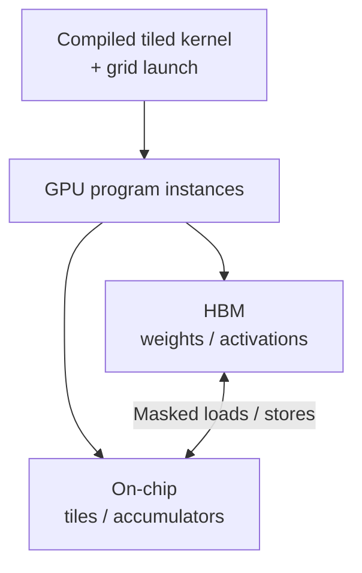

**Triton** (also called OpenAI Triton or triton-lang) is a Python-embedded language and compiler for writing custom GPU kernels as tiled block programs. You author a `@triton.jit` function that operates on **blocks** (small multi-dimensional arrays whose sizes are usually powers of two), launch many **program instances** over a grid with `tl.program_id`, and the compiler lowers that to high-quality device code (historically PTX via LLVM on NVIDIA; modern Triton also targets other GPU backends).

It sits between high-level framework ops and handwritten [CUDA](glossary://cuda) C++. You still choose how work is tiled across SMs and how pointers, masks, and fusion are structured. The compiler automates much of what makes CUDA painful *inside* a block: memory coalescing, shared-memory placement for heavy ops such as `tl.dot`, and scheduling across SIMD/tensor-core units. The foundations are the MAPL 2019 paper by Tillet, Kung, and Cox (tiled intermediate language for neural-network kernels). OpenAI released Triton 1.0 in 2021 as a Python-like programming model built on that line of work.

This entry covers the *Triton kernel language*. [Triton Inference Server](glossary://triton-inference-server) is NVIDIA's separate multi-framework model server; the products occupy different stack layers.

## Intuition

A modern GPU has three resources that kernels must balance: large off-chip [HBM](glossary://hbm)/DRAM, small fast on-chip SRAM (shared memory / L1 / registers), and ALUs / Tensor Cores. Naive framework graphs often materialize temporary tensors in HBM between small ops, so the bottleneck is traffic and launch overhead, not the math. A custom kernel fuses those steps, keeps tiles on-chip, and raises effective [arithmetic intensity](glossary://arithmetic-intensity).

CUDA asks you to think in **threads** (SIMT): `threadIdx`, warps of 32, `__syncthreads`, manual shared memory, and careful coalescing. Triton asks you to think in **tiles**: each program instance owns a block of indices, loads a block with a mask, runs NumPy-like block ops, and stores results. Parallelism *across* instances is still your job (the launch grid and tiling strategy). Parallelism *within* an instance is mostly the compiler's job.

| Concern | CUDA (typical) | Triton |
|---|---|---|
| Parallelism unit you write for | Thread / warp | Program instance over a **block** |
| Memory coalescing | Manual | Compiler |
| Shared memory for matmul tiles | Manual allocate / sync | Often automatic around `tl.dot` and similar |
| Scheduling within an SM | Manual | Compiler |
| Scheduling across SMs (tiling strategy) | Manual | Manual (grid + `program_id`) |
| Host integration | Launch APIs, streams | `@triton.jit` + grid launch from Python / [PyTorch](glossary://pytorch) |

OpenAI's 2021 write-up is explicit: Triton does **not** auto-partition work across SMs; developers still own algorithmic tiling. What it removes is the thread-level plumbing that makes a fused softmax or a small matmul fusion take hundreds of lines of CUDA.

## How it works

1. **Author a kernel** as a Python function decorated with `@triton.jit`. Arguments are usually raw pointers (a `torch.Tensor` is converted to a pointer to its first element), integer sizes, and `tl.constexpr` meta-parameters such as `BLOCK_SIZE`.
2. **Launch a grid** of program instances, analogous to a CUDA grid of blocks. A 1-D vector of length $N$ with block size $B$ needs $\lceil N / B \rceil$ instances: `grid = (triton.cdiv(n_elements, BLOCK_SIZE),)`.
3. **Each instance** reads `pid = tl.program_id(axis=0)`, builds offsets `pid * B + tl.arange(0, B)`, loads with a **mask** for out-of-bounds tails, computes, and stores with the same mask.
4. **Compile path (conceptual):** Python AST → Triton-IR (blocks as first-class values) → optimizations and automatic parallelization within the instance → LLVM-IR → GPU ISA (e.g. PTX → SASS on NVIDIA). TorchInductor in `torch.compile` often *emits* Triton for fused GPU kernels, so you may run Triton without writing it by hand.
5. **Heavy linear algebra** uses block matmul (`tl.dot`) with an FP32 accumulator pattern familiar from mixed-precision GEMM: load tiles of $A$ and $B$ in a $K$-loop, accumulate, optionally fuse an epilogue, then store.

### Tile indexing (vector case)

For length $N$ and compile-time block size $B$:

$$
\text{pid} \in \{0, 1, \ldots, \lceil N/B \rceil - 1\},\quad
\text{offsets} = \text{pid}\cdot B + \{0, 1, \ldots, B-1\}
$$

$$
\text{mask}_i = [\text{offsets}_i < N]
$$

Only masked elements participate in loads/stores. Wrong masks are the classic silent memory or correctness bug.

### Why fusion wins

A row-wise softmax written as separate PyTorch ops roughly does: reduce-max (write), subtract (write), exp (write), reduce-sum (write), divide (write). Each full pass over a row of length $N$ touches HBM. A fused Triton kernel keeps the row (or tile) in on-chip memory for max, exp, sum, and normalize, then writes **once**. OpenAI reported specialized Triton kernels up to about **2×** faster than equivalent Torch implementations for some research workloads, and FP16 matmul kernels competitive with cuBLAS in roughly two dozen lines of Python. These reported gains come from specialization, such as fixed shapes and fused epilogues.

## Diagram



## Example

### Minimal vector add (official tutorial shape)

```python
import torch
import triton
import triton.language as tl

@triton.jit
def add_kernel(x_ptr, y_ptr, out_ptr, n_elements, BLOCK_SIZE: tl.constexpr):
    pid = tl.program_id(axis=0)
    offsets = pid * BLOCK_SIZE + tl.arange(0, BLOCK_SIZE)
    mask = offsets < n_elements
    x = tl.load(x_ptr + offsets, mask=mask)
    y = tl.load(y_ptr + offsets, mask=mask)
    tl.store(out_ptr + offsets, x + y, mask=mask)

def add(x: torch.Tensor, y: torch.Tensor) -> torch.Tensor:
    # Flat pointer arithmetic requires contiguous, equally shaped GPU inputs.
    if (x.device != y.device or x.device.type != "cuda"
            or x.shape != y.shape or x.dtype != y.dtype
            or not x.is_contiguous() or not y.is_contiguous()):
        raise ValueError("expected matching contiguous GPU tensors")
    out = torch.empty_like(x)
    n = out.numel()
    if n == 0:
        return out
    grid = lambda meta: (triton.cdiv(n, meta["BLOCK_SIZE"]),)
    add_kernel[grid](x, y, out, n, BLOCK_SIZE=1024)
    return out
```

Validate first: `torch.max(torch.abs(add(x, y) - (x + y)))` should be $0$ for this op on nonempty, finite float32 inputs with matching devices and layouts. The helper rejects strided inputs because the kernel does not receive strides. It is a forward-only example; training needs a registered backward. Time with `triton.testing.do_bench` or CUDA events, not bare host timers around async launches.

### Fused row softmax (why people reach for Triton)

OpenAI's introductory fused softmax gives each program instance one row $m$ of $X \in \mathbb{R}^{M \times N}$. Conceptually:

$$
y_{m,:} = \mathrm{softmax}(x_{m,:})
= \frac{\exp\bigl(x_{m,:} - \max_j x_{m,j}\bigr)}
{\sum_j \exp\bigl(x_{m,j} - \max_j x_{m,j}\bigr)}
$$

In Triton, instance `m = tl.program_id(0)` loads columns with `tl.arange` and a `n < N` mask (pad max-input with $-\infty$), runs `tl.max` / `tl.exp` / `tl.sum` on the block, and stores once. Keeping the row in SRAM for the whole reduction avoids the multi-kernel temporary traffic of a naive framework graph. Production attention goes further: tile along sequence, use [online softmax](glossary://online-softmax) statistics, and never materialize the full $N \times N$ score matrix ([FlashAttention](glossary://flashattention)). Many of those IO-aware kernels are implemented or prototyped in Triton before (or alongside) highly tuned CUDA.

### Where it shows up in LLM stacks

- **Hand-written hot paths:** fused RMSNorm / LayerNorm, cross-entropy, RoPE, custom attention masks, MoE routing helpers, quantization epilogues.
- **Compiler-generated paths:** PyTorch 2.x `torch.compile` (TorchInductor) lowers many fused GPU regions to Triton automatically.
- **Serving research and products:** attention and norm kernels in open inference stacks are often Triton (sometimes next to CUDA/CUTLASS for the absolute hottest paths).

## Trade-offs

| Prefer Triton when | Prefer CUDA / vendor libs when |
|---|---|
| You need fusion or a layout the framework does not expose | You need peak performance on a mature GEMM/attention shape already covered by cuBLAS / cuDNN / FlashAttention |
| Engineers know Python better than CUDA C++ | You need full control of warps, pipelines, TMA, or architecture-specific tricks |
| You will autotune block sizes for a family of shapes | One fixed shape must hit the absolute ceiling and expert time is available |
| TorchInductor output is almost right and you will specialize it | Debugging requires tools and guarantees that only the CUDA ecosystem provides |

Triton still demands GPU literacy: occupancy, bank conflicts at a conceptual level, [roofline](glossary://roofline-model) thinking, and numerical stability. It removes thread bookkeeping; it does not remove algorithm design.

## Debug path

Production failures cluster around correctness first, then speed:

1. **Parity before speed.** Compare against a pure PyTorch reference on tiny shapes, odd sizes (not multiples of `BLOCK_SIZE`), empty/tail tiles, every dtype you ship (`fp32` / `fp16` / `bf16`), and both contiguous and strided layouts. Train-time kernels also need gradient checks via `torch.autograd.gradcheck` or a custom `autograd.Function` with a known-good backward.
2. **Masks and bounds.** Off-by-one in `offsets < n` or wrong strides silently corrupt neighbors or crash. Print `pid`, offsets, and masks on a 1-block launch when debugging.
3. **Numerics.** Reductions and softmax need max-subtraction or online stats; FP16 accumulators overflow; matmul should usually accumulate in FP32 then cast on store. Order of reductions can differ from the reference by ulps; decide absolute vs relative tolerances per op.
4. **Shape specialization.** A `BLOCK_M/N/K` config that wins on a single benchmark may thrash registers or underfill SMs on production batch × sequence. Autotune over real traffic shapes; keep a fallback for awkward sizes.
5. **Async timing and compile cost.** First launch pays JIT compile; measure steady state after warmup. Use CUDA events or `triton.testing.do_bench`. Host `time.perf_counter` without sync lies.
6. **Name collision.** Metrics or tickets saying "Triton OOM" may mean the **inference server**, not a kernel. Confirm which product owns the process.

## Why it matters here

LLM performance work often lives exactly in Triton's band: above "call `nn.Linear` and hope," below "write a 2,000-line CUDA attention kernel." Lessons on FlashAttention, HBM traffic, fused norms, and `torch.compile` all assume this middle layer. Understanding Triton means you can read why a fused kernel beats a framework graph, when Inductor-generated code is enough, and when a hand-written tile program is worth the parity test suite.

Primary references: [Triton documentation](https://triton-lang.org/main/index.html) and [Triton project](https://github.com/triton-lang/triton).

## Related terms

- [CUDA](glossary://cuda)
- [FlashAttention](glossary://flashattention)
- [HBM](glossary://hbm)
- [Arithmetic intensity](glossary://arithmetic-intensity)
- [PyTorch](glossary://pytorch)
