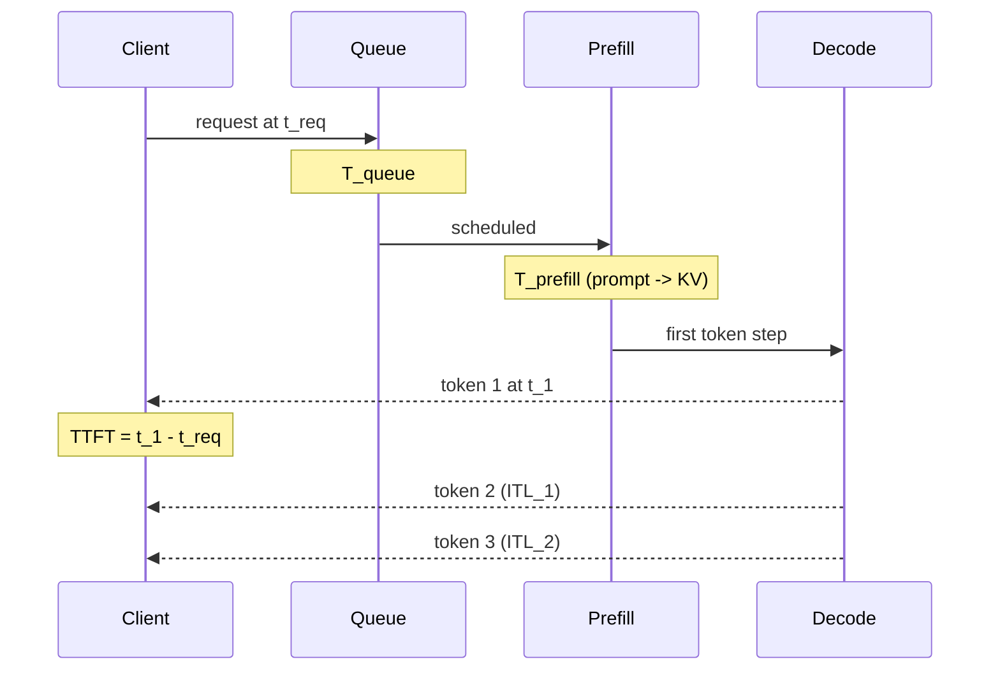

**Time to first token (TTFT)** is the wall-clock delay from when a request is submitted until the first **non-empty** output token is available on the measurement boundary you chose (client, gateway, or engine). If the request is sent at time $t_{\mathrm{req}}$ and the first real token arrives at $t_1$,

$$
\mathrm{TTFT} = t_1 - t_{\mathrm{req}}.
$$

TTFT measures the **silence before streaming starts**. [ITL](glossary://itl) / [TPOT](glossary://tpot) measure the pace of later tokens, while full-answer latency covers the complete response. Interactive chat, code complete, and voice agents feel "dead" when TTFT is high even if the rest of the stream is fast.

In production serving, TTFT almost always includes **queue wait**, **prompt prefill** (building the [KV cache](glossary://kv-cache) for the prompt), and **network / path overhead** up to the first token. Longer prompts raise TTFT because attention must process the full input before generation can begin.

## Example

A support-chat request leaves the app at $t = 0$:

| Event | Time | Slice |
|---|---:|---|
| Request hits API gateway | $12\,\mathrm{ms}$ | edge + auth |
| Inference queue admit | $95\,\mathrm{ms}$ | $T_{\mathrm{queue}} = 83\,\mathrm{ms}$ |
| Prefill of 2,400 prompt tokens finishes | $780\,\mathrm{ms}$ | $T_{\mathrm{prefill}} \approx 685\,\mathrm{ms}$ |
| First streamed token `"Sure"` arrives at client | $850\,\mathrm{ms}$ | first decode + stream flush |

$$
\mathrm{TTFT} = 850\,\mathrm{ms}.
$$

Tokens after that arrive every $\sim 35\,\mathrm{ms}$. [TPOT](glossary://tpot) is about $35\,\mathrm{ms}$ (~29 tokens/s of cadence). The user complained about "the model hanging," but decode was fine: **prefill + queue** owned almost all of the 850 ms silence.

Contrast a short, warm, prefix-cached completion: 180-token system prefix hit in cache, 40 new user tokens, empty queue. Prefill collapses to the uncached suffix and TTFT drops to $\sim 120\,\mathrm{ms}$. Same model and GPU; different prompt shape and cache state.

## Formula

For a streaming response with $n \ge 2$ output tokens, common serving definitions (Databricks, NVIDIA GenAI-Perf, Ray Serve LLM / vLLM-style benchmarks) decompose end-to-end latency as:

$$
\mathrm{E2E} = \mathrm{TTFT} + (n - 1) \cdot \overline{\mathrm{ITL}}
\approx \mathrm{TTFT} + (n - 1) \cdot \mathrm{TPOT}.
$$

The $-1$ matters: the first token is charged to TTFT / [prefill](glossary://prefill), not to the inter-token series. The equality assumes E2E ends at the last token and individual token arrival times are available. Trailing usage frames or stream teardown add time; multi-token chunks reveal chunk arrival times rather than every token's timing.

A useful **server-side** split of TTFT (when you instrument stages) is:

$$
\mathrm{TTFT} \approx T_{\mathrm{net,in}} + T_{\mathrm{queue}} + T_{\mathrm{prefill}} + T_{\mathrm{first\,decode}} + T_{\mathrm{stream,out}}.
$$

| Component | What it is |
|---|---|
| $T_{\mathrm{net,in}}$ | Inbound transport, connection setup, gateway, auth |
| $T_{\mathrm{queue}}$ | Wait before the scheduler starts this prompt |
| $T_{\mathrm{prefill}}$ | Parallel forward over prompt tokens; builds KV |
| $T_{\mathrm{first\,decode}}$ | Sample / emit token 1 after prefill |
| $T_{\mathrm{stream,out}}$ | Detokenize, proxy buffering, first SSE/WebSocket frame |

Benchmarks and products disagree on **where the clock starts** (client send vs server receive vs engine admit) and **where it stops** (engine emit vs bytes on the wire vs UI paint). Always state the boundary. Empty stream frames and terminal `[DONE]` markers must not count as the first token; NVIDIA GenAI-Perf and LLMPerf explicitly ignore content-less first chunks because TTFT is undefined without a real token.

## Diagram

Everything left of token 1 is TTFT. Every gap after that is ITL. Prefill work for *other* requests sharing the GPU can inflate both: their prefill steals steps and your queue grows.

## How it works

Autoregressive LLM inference has two phases:

1. **[Prefill](glossary://prefill).** The model runs over the full prompt, writing keys and values for every prompt position into the [KV cache](glossary://kv-cache). This pass is largely **compute-bound** and parallel across prompt tokens, but cost still grows with prompt length (attention over the sequence, plus weight loads). Until prefill finishes, there is no valid first output token.
2. **[Decode](glossary://decode-phase).** One new token per step, reusing the KV cache. After the first token, cadence is ITL/TPOT and is often **memory-bandwidth bound** at small batch.

So TTFT is "how long until the system has paid for this prompt and can stream." Under load, continuous batching may interleave your prefill with other requests' decode; your TTFT then includes **scheduling delay** alongside kernel time. [Prefix cache](glossary://prefix-cache) hits skip recomputing a shared prompt prefix, which cuts $T_{\mathrm{prefill}}$ when system prompts, tool schemas, or few-shot blocks repeat.

For a fixed model and hardware, use this as an order-of-magnitude estimate: prefill time grows with prompt tokens $L_{\mathrm{in}}$. At long context, prefill dominates TTFT; at short prompts under congestion, queue time dominates instead.

## What drives TTFT

| Driver | Effect |
|---|---|
| Prompt length / multimodal tokens | Longer prefill; primary TTFT lever for RAG and agents |
| Queue depth / concurrency | Wait before prefill starts; p95 TTFT blows up first |
| Prefix-cache hit vs miss | Hits shrink prefill to the uncached suffix |
| Batching / continuous batching | Higher GPU utilization and TPS; can delay individual prefills |
| Model size, precision, TP degree | Heavier forward or multi-GPU sync in prefill |
| Cold start / scale-from-zero | Image boot + weight load folded into the first request's TTFT if you measure from arrival |
| Safety, routing, retrieval in front | App-path work before the engine ever sees the prompt |
| Measurement point | Client TTFT includes more network and proxy buffering than engine-side TTFT |

Interactive products often target **p50 and p95 TTFT** alongside the mean. Averages hide the queued tail that users page on. Pair TTFT with goodput: requests per second that meet TTFT (and TPOT) SLOs. The fraction meeting those SLOs is attainment; raw tokens/s alone captures neither.

## Worked numbers

Short chat prompt, warm replica, empty queue:

- $T_{\mathrm{queue}} = 5\,\mathrm{ms}$, $T_{\mathrm{prefill}} = 90\,\mathrm{ms}$, path overhead $25\,\mathrm{ms}$
- $\mathrm{TTFT} \approx 120\,\mathrm{ms}$

Same model, 12k-token RAG pack, moderate load:

- $T_{\mathrm{queue}} = 200\,\mathrm{ms}$, $T_{\mathrm{prefill}} = 1.8\,\mathrm{s}$, path $50\,\mathrm{ms}$
- $\mathrm{TTFT} \approx 2.05\,\mathrm{s}$

If the product then streams $n = 150$ tokens at $\mathrm{TPOT} = 40\,\mathrm{ms}$:

$$
\mathrm{E2E} \approx 2.05 + 149 \times 0.040 \approx 8.0\,\mathrm{s}.
$$

Cutting the prompt in half (or caching a 6k shared prefix) might drop TTFT by roughly a second while leaving TPOT almost unchanged. That is the usual production win: **shrink or cache prefill**; extra decode throughput leaves TTFT mostly unchanged.

## Debug path

When users say "nothing is happening," treat it as a TTFT incident until proven otherwise:

1. **Confirm the metric.** Client-measured TTFT vs engine `time_to_first_token` (for example vLLM's `vllm:time_to_first_token_seconds`). If only the client is bad, chase gateways, SSE buffering, and empty first chunks.
2. **Split the silence.** Queue time vs prefill time vs first-token emit. vLLM-style stacks expose queue, prefill, and TTFT histograms separately; use them.
3. **Bucket by prompt length and cache state.** Plot TTFT vs $L_{\mathrm{in}}$ and prefix-cache hit rate. Linear growth with prompt length points at prefill; flat high TTFT points at queue or cold path.
4. **Check load shape.** Rising `num_requests_waiting`, KV usage near capacity, or preemption during prefill inflates TTFT without necessarily wrecking mean TPOT.
5. **Inspect the app path.** Retrieval, tool results stuffed into context, oversized system prompts, and sequential safety calls often dominate before the GPU runs.
6. **Compare routes.** A "fast" small model with a cold scale-to-zero path can lose to a warm larger model on TTFT. Measure cold vs warm separately.

If **TTFT is fine and the stream stutters**, investigate ITL/TPOT, decode scheduling, transport, and buffering. Prefill for competing requests can still delay an already-streaming request on a shared GPU.

## Trade-offs

| Goal | TTFT impact |
|---|---|
| Maximize aggregate tokens/s | Larger batches help TPS; individual TTFT often worsens |
| Strict interactive SLO | Cap concurrency, prioritize short prompts, chunk or disaggregate prefill |
| Long-context RAG | Prefill dominates; need caching, compression, or smaller packs |
| Offline batch jobs | High TTFT is usually acceptable; optimize throughput |

There is no free lunch: continuous batching and high utilization improve fleet efficiency and can still miss a chat p95 TTFT SLO. Set the [latency budget](glossary://latency-budget) for first token explicitly, then size queue depth, prompt limits, and cache policy against it.

## Why it matters here

Diagnose serving latency by separating TTFT, ITL, TPOT, and tokens/s. High TTFT points to queueing, prompt length, prefill, prefix-cache misses, cold starts, or front-end packing. High TPOT/ITL points to decode, batching, and KV pressure. Keeping those axes separate helps target the right layer: shorten or cache the prompt, admit fewer concurrent prefills, warm replicas, or move long jobs off the interactive path.

## Related terms

- [TPOT](glossary://tpot)
- [Prefill](glossary://prefill)
- [ITL](glossary://itl)
- [Prefix cache](glossary://prefix-cache)
- [Latency budget](glossary://latency-budget)
