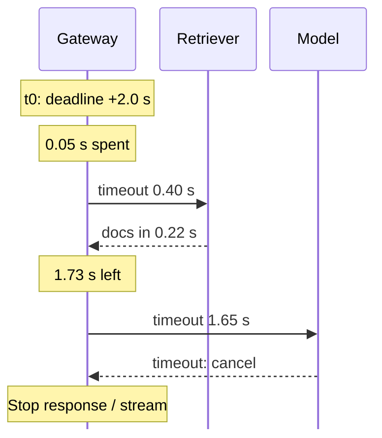

A **deadline** is an absolute time after which work must stop (cancel, fail, or shed). A **TTL** (time-to-live) is a duration after which data is no longer treated as fresh. They are often written with the same clock helpers, but they protect different invariants: deadlines bound *compute and wait*; TTLs bound *staleness of stored values*.

gRPC and Go's `context` package treat a **timeout** as a duration and convert it to a deadline at call start:

$$
t_{\mathrm{deadline}} = t_{\mathrm{start}} + T.
$$

A cache or Redis key with TTL $\tau$ written at $t_w$ expires at:

$$
t_{\mathrm{expires}} = t_w + \tau.
$$

HTTP caches (RFC 9111) phrase the same idea as freshness: a response is fresh when its age has not yet exceeded its freshness lifetime, i.e. `freshness_lifetime > current_age`.

## Intuition

| Concept | Question | Typical object | When it fires |
|---|---|---|---|
| **Deadline** | When must this *operation* stop? | RPC, tool call, stream, agent step | Cancel / `DEADLINE_EXCEEDED` / fail fast |
| **Timeout** | How long from *now* may it run? | Client config, `asyncio.wait_for` | Converted to a deadline at start |
| **TTL** | How long is this *value* still good? | Cache entry, rate-limit bucket, prompt-cache key | Evict, recompute, or revalidate |

A deadline bounds how long a hung provider can pin workers and consume tokens after no caller waits. A TTL prevents a retrieval or semantic cache from serving yesterday's policy as current.

Use a [monotonic clock](glossary://time-monotonic) for elapsed checks *inside one process*. Wall-clock jumps (NTP or manual steps) make timeout and local TTL math hard to reproduce; daylight-saving changes affect local civil-time displays, not Unix time itself. Durable expiry across hosts (Redis, HTTP `Expires`, signed tokens) needs wall time, stored as an absolute timestamp, with the knowledge that clock skew can expire keys early or late.

## Formula

**Local deadline remaining** after start $t_0$ with budget $T$:

$$
r(t) = T - (t - t_0),\qquad
\mathrm{expired}(t) \iff r(t) \le 0.
$$

**Propagated remaining** to a downstream hop (gRPC style): send *remaining* time so clock skew between machines cannot create extra budget. When hop $i$ is about to call hop $i+1$ with remaining $r(t)$:

$$
T_{i+1} = \max\bigl(0,\; r(t) - \varepsilon_{\mathrm{margin}}\bigr),
$$

where $\varepsilon_{\mathrm{margin}}$ is a small reserve for serialization, network RTT, and cleanup.

**TTL remaining** for a value written at $t_w$:

$$
\tau_{\mathrm{left}}(t) = \tau - (t - t_w),\qquad
\mathrm{stale}(t) \iff \tau_{\mathrm{left}}(t) \le 0.
$$

HTTP freshness (RFC 9111 §4.2), same inequality:

$$
\mathrm{response\_is\_fresh} \iff \mathrm{freshness\_lifetime} > \mathrm{current\_age}.
$$

Redis stores expiry as an absolute Unix timestamp (ms since 2.6+) even when you set relative `EXPIRE key seconds`. Time still advances while the process is down; loading an RDB onto a host with a wrong clock can expire (or resurrect) keys immediately.

## Diagram



TTL path is orthogonal: a cache entry written at $t_w$ with $\tau=300\,\mathrm{s}$ is reusable until $t_w+300$, independent of any single request's deadline.

## How it works

1. **Pick the stop condition.** Interactive chat: hard E2E or [TTFT](glossary://ttft) deadline from the [latency budget](glossary://latency-budget). Batch embed job: long deadline, or none, plus job-level max runtime. Cache: TTL from freshness SLO (policy docs $5\,\mathrm{min}$, product catalog $1\,\mathrm{h}$, embeddings until model/corpus version changes).
2. **Convert timeout → deadline once.** At the edge: $t_{\mathrm{deadline}} = t_{\mathrm{start}} + T$. Pass *one* deadline (or remaining) down the stack and shrink remaining budget at each hop. Stacking independent $5\,\mathrm{s}$ timeouts can overspend a $2\,\mathrm{s}$ product budget.
3. **Propagate cancellation.** When the deadline fires, stop waiting *and* signal workers (context cancel, AbortController, stream close). gRPC servers should check cancellation during long work; otherwise the client is gone while the server still spends GPU.
4. **Nest inside remaining budget.** Downstream timeout $\le$ remaining at call time, minus margin. [Retry backoff](glossary://retry-backoff) must count against the same deadline: three retries with full per-attempt timeouts can triple spend.
5. **Store TTL as absolute expiry when possible.** `expires_at = now + τ` (or Redis `EXPIRE` / `PEXPIRE`) so reads are $O(1)$ comparisons. Lazy delete on read is fine; active reaping (Redis passive + active expiry) still needs the absolute timestamp.
6. **Test with an [injected clock](glossary://injected-now).** Boundary equality ($t = t_{\mathrm{deadline}}$, $t = t_{\mathrm{expires}}$) is where inclusive vs exclusive bugs hide. Sleeping real seconds in unit tests is slow and flaky.

### What fails in production

| Failure | Symptom | Fix |
|---|---|---|
| No client deadline | Workers pinned; billable zombie generations | Always set a realistic edge deadline |
| Deadline not propagated | Upstream already failed; downstream still runs | Pass remaining budget; cancel on parent done |
| Timeout > parent remaining | "Success" after client left | Cap child timeout to remaining − margin |
| Retries ignore deadline | p99 blows past SLO; retry storms | Shared budget; stop when $r(t)\le 0$ |
| Wall clock for local TTL | NTP jump: mass expire or never expire | Monotonic for in-process age |
| Infinite / huge TTL | Stale policy or PII in cache forever | Bound TTL; version keys on corpus/policy |
| Zero TTL / past EXPIRE | Immediate miss or Redis delete | Treat $\tau\le 0$ as "do not store" |

## Example

Support chat with a **$2.0\,\mathrm{s}$** client deadline and a **retrieval embedding cache TTL of $300\,\mathrm{s}$**.

```python title="deadline-and-ttl.py"
from dataclasses import dataclass
from typing import Callable

Now = Callable[[], float]


@dataclass
class CacheEntry:
    value: str
    expires_at: float


class TTLCache:
    def __init__(self, now: Now) -> None:
        self.now = now
        self.items: dict[str, CacheEntry] = {}

    def set(self, key: str, value: str, ttl: float) -> None:
        if ttl <= 0:
            self.items.pop(key, None)  # replacement immediately expires
            return
        self.items[key] = CacheEntry(value, self.now() + ttl)

    def get(self, key: str) -> str | None:
        entry = self.items.get(key)
        if entry is None or entry.expires_at <= self.now():
            self.items.pop(key, None)
            return None
        return entry.value


def remaining(deadline: float, now: Now) -> float:
    return deadline - now()


def call_with_deadline(work, deadline: float, now: Now, margin: float = 0.05):
    """Refuse work that cannot start with enough budget left."""
    left = remaining(deadline, now)
    if left <= margin:
        raise TimeoutError("deadline exceeded before call")
    # In real code: pass timeout=left-margin to the client and cancel on fire.
    return work(timeout=left - margin)
```

Timeline with an injected clock:

| $t$ | Event | Deadline left | Cache |
|---:|---|---:|---|
| $0.00$ | Request starts, $T=2.0$ | $2.00\,\mathrm{s}$ | miss on embed key |
| $0.05$ | Auth + route | $1.95\,\mathrm{s}$ | (unchanged) |
| $0.05$ | Embed query, store with $\tau=300$ | $1.95\,\mathrm{s}$ | write `expires_at=300.05` |
| $0.30$ | Retrieve + pack | $1.70\,\mathrm{s}$ | (unchanged) |
| $0.30$ | Model generate with timeout $1.60$ | $1.70\,\mathrm{s}$ | (unchanged) |
| $2.00$ | Client deadline | $0$ | cancel stream if still open |
| $300.05$ | Same embed key | n/a | expire; next request recomputes |

A later identical query at $t=120$ still hits the embed cache (fresh until $300.05$) but gets its **own** $2.0\,\mathrm{s}$ deadline. TTL and deadline never share one number.

## Worked numbers

Product budget $B = 900\,\mathrm{ms}$ TTFT. Gateway spent $40\,\mathrm{ms}$, rewrite $50\,\mathrm{ms}$, so remaining before retrieve is $810\,\mathrm{ms}$. Retrieve budget in the [latency budget](glossary://latency-budget) table is $180\,\mathrm{ms}$. Set retrieve timeout to $\min(180, 810 - 30) = 180\,\mathrm{ms}$ with $30\,\mathrm{ms}$ margin. A flat $5\,\mathrm{s}$ client default would exceed the product budget.

Retry: two attempts with $180\,\mathrm{ms}$ each would need $360\,\mathrm{ms}$ worst case. Cap at one retry only if remaining after the first failure still exceeds $180+\mathrm{margin}$; otherwise fail or degrade (shorter $k$, skip rerank).

Cache sizing: $N$ keys, average value size $S$, TTL $\tau$, write rate $\lambda$. Steady-state occupancy is roughly $\min(\mathrm{capacity},\; \lambda \cdot \tau)$ live entries if every write is unique. Longer $\tau$ raises hit rate and memory; shorter $\tau$ raises origin load. Measure hit rate and stale-answer rate, not TTL alone.

## Trade-offs

| Choice | Gain | Cost |
|---|---|---|
| Tight deadline | Protects capacity and p99 | More cancels; partial answers |
| Loose / missing deadline | Fewer false timeouts | Zombie work, cascade overload |
| Short cache TTL | Fresher answers | Higher embed/retrieve cost |
| Long cache TTL | Cheap repeats | Stale policy, wrong product facts |
| Absolute deadline on wire | Clear "stop by $t$" | Needs skew-safe encoding (prefer remaining) |
| Duration-only per hop | Simple config | Easy to overspend parent budget |

## Why it matters here

LLM systems combine **long, expensive generations** with **multi-hop tools and caches**. Deadlines decide whether a stuck tool, vector search, or decode loop is allowed to keep spending GPU and money after the user left. TTLs decide whether a [semantic cache](glossary://semantic-cache), retrieval doc snapshot, or rate-limit window still reflects reality. Curriculum work on latency budgets, retries, load shedding, and serving all assumes you can name the stop time for work and the freshness window for data, test both with a fake clock, and propagate remaining budget so the whole chain stops together.

## Related terms

- [time.monotonic](glossary://time-monotonic)
- [injected now function](glossary://injected-now)
- [Latency budget](glossary://latency-budget)
- [Retry backoff](glossary://retry-backoff)
- [Semantic cache](glossary://semantic-cache)
