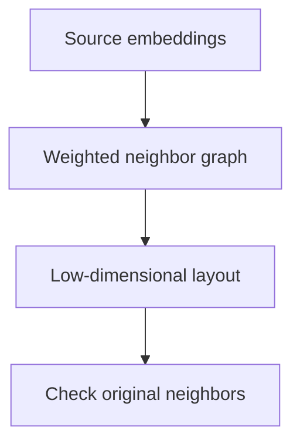

**Uniform Manifold Approximation and Projection (UMAP)** is a nonlinear dimensionality-reduction method that builds a weighted graph of nearby observations and finds a lower-dimensional arrangement that preserves important graph relationships. Engineers use its two-dimensional output to inspect embedding collections. Production similarity queries use the original vectors.

## What its graph actually preserves

UMAP first identifies neighboring observations in the original feature space. It assigns graph-edge strengths that account for local density, combines directed neighbor memberships, and optimizes a lower-dimensional layout whose nearby points respect those weighted relationships.

`n_neighbors` changes how broadly the algorithm defines a neighborhood. `min_dist` changes how tightly the resulting points can pack together. Different parameter choices can expose different structures without making any single picture a faithful map of every original distance. Plot orientation, empty space between groups, and apparent cluster area aren't reliable semantic units.

Some implementations can approximately transform new observations into an existing layout. That convenience doesn't turn the map into a stable, exact coordinate system comparable to a saved linear projection.

## Example

A document-search team plots policy embeddings and colors points by policy version. Recently ingested access-control clauses appear inside an unrelated deployment-policy cluster. The team examines those records in the original vectors, discovers that a parser stripped section headings, fixes ingestion, and verifies improvement using labeled queries.

Treat the UMAP map as an investigation lead. Verify suspicious records in the original vectors and test retrieval changes with labeled queries before choosing a serving index.

## Why it matters here

Applied embedding lessons distinguish diagnostic projections from serving representations. UMAP can reveal duplicate ingestion, suspicious neighborhoods, and changing document distributions, but grounded retrieval benchmarks and tenant-safe access checks decide whether a search system is ready to ship.

## Related terms

- [Embedding](glossary://embedding)
- [PCA](glossary://pca)
- [Recall at K](glossary://recall-at-k)
- [Vector](glossary://vector)
