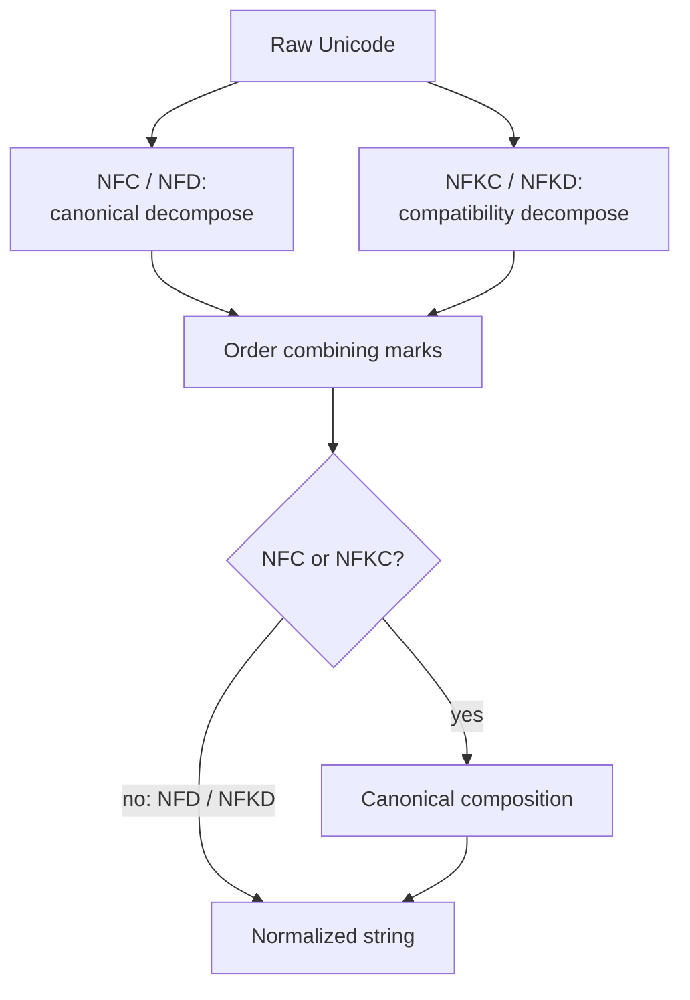

**Unicode normalization** maps a string to one of four standard forms so that sequences the Unicode Standard treats as equivalent share a single code-point sequence. The authoritative definition is Unicode Standard Annex #15 (UAX #15): normalize once, then compare or hash with ordinary binary equality. Applying the same chosen form before equality checks, tokenization, caching, or indexing keeps equivalent code points aligned across those operations.

Unicode defines two equivalence relations:

| Equivalence | Meaning | Typical examples |
|---|---|---|
| **Canonical** | Same abstract character; same visual appearance and behavior when rendered correctly | Precomposed `é` (U+00E9) vs `e` + combining acute (U+0065 U+0301); Hangul syllable vs jamo sequence; OHM SIGN (U+2126) vs GREEK CAPITAL LETTER OMEGA (U+03A9) |
| **Compatibility** | Same core character identity, but possibly different appearance or width | Ligature `fi` (U+FB01) vs `f`+`i`; fullwidth `Ａ` (U+FF21) vs ASCII `A`; superscript `²` vs `2`; Roman numeral `Ⅳ` vs `IV` |

Canonical forms preserve compatibility composites. Compatibility forms fold them away. That distinction is the whole engineering trade-off for RAG, search, identifiers, and security.

## How it works

UAX #15 defines four Normalization Forms by crossing *which decomposition* with *whether to recompose*:

| Form | Algorithm | Use when |
|---|---|---|
| **NFD** | Canonical decomposition | You want fully decomposed combining sequences (internal analysis, some linguistic pipelines) |
| **NFC** | Canonical decomposition, then canonical composition | Default for stored text, web content (W3C recommends NFC), and most equality checks |
| **NFKD** | Compatibility decomposition | Aggressive matching keys where visual style should not matter |
| **NFKC** | Compatibility decomposition, then canonical composition | Search / dedupe / identifier folding when lossy merge is acceptable |

Process for a chosen form:

1. **Fully decompose** every character using the Unicode Character Database decomposition mappings (canonical only for NFC/NFD; canonical plus compatibility for NFKC/NFKD). Hangul syllables have special full-decomposition rules.
2. **Canonically order** combining marks by Canonical_Combining_Class so mark order is unique inside each combining sequence.
3. For NFC/NFKC only: **canonically compose** via the Canonical Composition Algorithm: replace eligible starter + following character pairs with their primary composite when the follow-on is not blocked by an intervening character. Composition exclusions never recompose (singletons such as OHM SIGN are already gone after step 1).

All four forms are **idempotent**: applying the same form twice does not change the string further. Writing $\mathrm{toNFx}$ for the map into form $X$:

$$
\mathrm{toNFx}(\mathrm{toNFx}(s)) = \mathrm{toNFx}(s)
$$

Uniqueness is the design goal. If $x$ and $y$ are canonically equivalent, then $\mathrm{toNFC}(x)=\mathrm{toNFC}(y)$ and $\mathrm{toNFD}(x)=\mathrm{toNFD}(y)$. If they are only compatibility-equivalent, only NFKC/NFKD are guaranteed to agree.

ASCII (U+0000..U+007F) is unchanged under every form. Text in U+0000..U+00FF (Latin-1) is already NFC. Forms are **not** closed under concatenation: joining two normalized strings can require re-normalizing around the join boundary (marks may reorder or compose across the cut).

## Example

Two visual copies of *café*'s last letter:

```text
precomposed:  U+00E9           ("é")
decomposed:   U+0065 U+0301    ("e" + combining acute)
```

In Python:

```python
import unicodedata

a = "\u00e9"      # é
b = "e\u0301"     # e + combining acute
assert a != b
assert unicodedata.normalize("NFC", a) == unicodedata.normalize("NFC", b) == "\u00e9"
assert unicodedata.normalize("NFD", a) == unicodedata.normalize("NFD", b) == "e\u0301"
```

Code-point length and UTF-8 size differ until you normalize: precomposed is 1 code point / 2 UTF-8 bytes; decomposed is 2 code points / 3 UTF-8 bytes. A tokenizer that sees different sequences can emit different IDs and different token counts for text that a user treats as the same string.

Compatibility folding (NFKC), which NFC refuses:

| Input | NFC result | NFKC result |
|---|---|---|
| `fi` (U+FB01) | still `fi` | `fi` |
| `Ａ` (U+FF21) | still `Ａ` | `A` |
| `²` (U+00B2) | still `²` | `2` |
| `Ⅳ` (U+2163) | still `Ⅳ` | `IV` |

Singleton canonical maps hit *all* forms. OHM SIGN (U+2126) becomes GREEK CAPITAL LETTER OMEGA (U+03A9) under NFC, NFD, NFKC, and NFKD. That character never survives in a normalized string.

## Diagram



## Intuition

Normalization chooses a canonical code-point representation for text identity. Pixel-identical glyphs can still be different sequences. NFC is the usual storage and interchange form: composed where Unicode has a composite, while preserving ligatures and fullwidth forms. NFKC is a coarser mapping that collapses many compatibility variants into plain ASCII-like sequences. That mapping is useful for search keys and unsafe as the only copy of a username or legal string.

In LLM systems the same rule shows up as a **train / eval / serve contract**. The [tokenizer artifact](glossary://tokenizer-artifact) may apply NFC or NFKC inside its normalizer (Hugging Face `tokenizers` exposes `NFC`, `NFD`, `NFKC`, `NFKD`; SentencePiece packages its own normalization). If ingestion normalizes to NFKC, the model was trained with NFC-only inputs, and the API hashes raw UTF-8, you get three identities for one user-visible string.

## Debug path

When two strings look equal but disagree in equality, retrieval, or token counts:

1. Print code points: `" ".join(f"U+{ord(c):04X}" for c in s)`.
2. Compare under each form: `unicodedata.normalize(form, s)` for `NFC`, `NFD`, `NFKC`, `NFKD`.
3. Check `unicodedata.is_normalized(form, s)` if available.
4. Tokenize both the raw and the normalized string with the production artifact; log IDs and length.
5. Hash both raw bytes and normalized UTF-8 if the digest is a cache or dedupe key; store which recipe was used ([checksum](glossary://checksum) metadata).
6. Keep the original submitted text for audits even when a normalized form drives matching.

Typical production symptoms: semantic cache miss on a "duplicate" query, near-duplicate documents that never collapse, BM25 hit on one accent form only, eval exact-match failures on gold that used a different form, and auth or filter bugs when fullwidth or ligature variants bypass an allowlist that only stores ASCII.

## Trade-offs

| Choice | Keeps | Loses / risks |
|---|---|---|
| **No normalization** | Original bytes and typography | Silent inequality; split indexes; train/serve skew |
| **NFC** | Canonical identity; most visual structure; W3C-friendly interchange | Ligatures, fullwidth, superscripts stay distinct from plain ASCII |
| **NFD** | Stable decomposed base+marks (easy diacritic stripping after) | Longer sequences; worse as default interchange |
| **NFKC / NFKD** | Strong matching and dedupe across compatibility variants | Erases distinctions needed for math notation, some IDs, spoof detection, and round-trip to legacy encodings |

UAX #15 warns that NFKC/NFKD must not be applied blindly to arbitrary text: they prevent many legacy round trips and can remove semantics that markup would need to restore. Treat compatibility forms like case folding: useful for keys, not always for the canonical stored document.

Security note: NFKC can map fullwidth `ａｄｍｉｎ` onto `admin`. That helps search; it also means a security boundary that only lowercases without normalizing, or that normalizes only on one side of a compare, can miss or wrongly accept lookalikes. Normalization does not merge all visual confusables: Latin `a` and Cyrillic `а` remain distinct even under NFKC. Prefer: store raw + chosen form, compare under an explicit policy, and review identifier classes (UAX #31) and [Unicode security mechanisms](https://www.unicode.org/reports/tr39/) separately from free-text search.

## Why it matters here

Tokenizer counts, [byte fallback](glossary://byte-fallback) paths, embedding inputs, cache keys, filters, checksums, and RAG chunk identities all sit on top of a code-point sequence. If clients, parsers, and serving disagree on NFC vs NFKC, the failure looks like a model bug: retrieval miss, duplicate chunk, auth glitch, or tokenizer surprise. Pin one form in the [tokenizer artifact](glossary://tokenizer-artifact) and ingestion [parsing](glossary://parsing) path, document it next to the content hash recipe, and run eval fixtures through the same pipeline as production.

## Related terms

- [Tokenization](glossary://tokenization)
- [Tokenizer artifact](glossary://tokenizer-artifact)
- [Byte fallback](glossary://byte-fallback)
- [Parsing](glossary://parsing)
- [Checksum](glossary://checksum)
