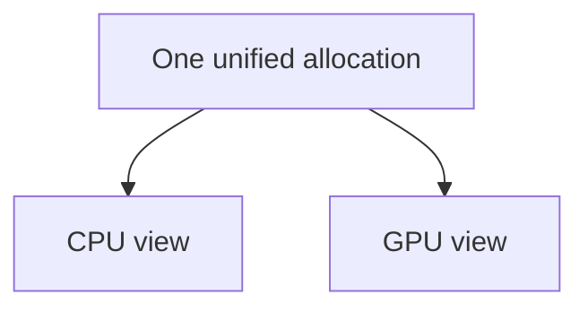

Unified memory gives multiple processors a shared programming view of an allocation, but its implementation depends on the hardware and runtime. CUDA managed memory can expose one addressable allocation while the system migrates or maps pages between CPU and GPU locations. Apple silicon uses a unified physical memory architecture shared by CPU and GPU. These designs reduce some manual-copy complexity. Capacity, access latency, and performance still depend on the hardware and workload.

## Shared addressability versus physical residency

On CUDA systems, a managed allocation may incur page faults and migration when a processor first touches data currently resident elsewhere. Explicit prefetching can move likely-needed pages nearer to the next processor, and access hints can influence placement. On Apple silicon, CPU and GPU can share physical memory without a discrete PCIe-style copy, but bandwidth, synchronization, allocator limits, and contention with the rest of the system remain real.

CUDA Unified Memory, unified virtual addressing, explicit pinned-memory transfers, and Apple silicon's physically shared memory expose different mechanisms. Their application-facing convenience may look similar, while migration, access latency, coherence, and capacity behavior differ significantly.

## Example

A workstation with 32 GB of shared system memory cannot dedicate all 32 GB to a model. The operating system, browser, Python process, allocator reservations, activations, and temporary tensors all use the same capacity. A 20 GB checkpoint might load but fail during a forward pass once intermediate allocations appear. On a discrete CUDA system, a managed allocation larger than local GPU memory may instead thrash as pages repeatedly migrate between processors.

## Why it matters here

Foundation lessons compare Apple MPS with CUDA, while advanced projects reason about HBM, offload, and cache movement. Unified-memory literacy prevents misleading conclusions such as "shared memory means no memory budget" or "one pointer means no transfer cost." It also helps readers separate physical hardware architecture from a runtime-managed allocation policy.

## Related terms

- [MPS backend](glossary://mps-backend)
- [HBM](glossary://hbm)
- [Host-to-device transfer](glossary://host-to-device-transfer)
- [Virtual memory](glossary://virtual-memory)
